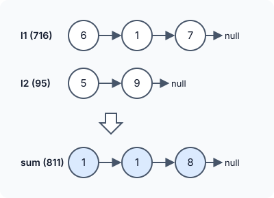

# Add Two Numbers

::problem{slug=add-two-numbers}

## Problem Statement

Two non-negative integers are stored in two non-empty linked lists, one decimal digit per node, with the digits in **reverse order** — the head holds the ones digit. Add the two numbers and return their sum as a linked list in the same reversed format.

Apart from the number `0` itself, neither number has leading zeros.



### Examples

| Input | Output | Why |
|---|---|---|
| `l1 = [6, 1, 7], l2 = [5, 9]` | `[1, 1, 8]` | 716 + 95 = 811 |
| `l1 = [0], l2 = [0]` | `[0]` | 0 + 0 = 0 |
| `l1 = [9, 9, 9], l2 = [1]` | `[0, 0, 0, 1]` | 999 + 1 = 1000 |

### Constraints

- Each list has between `1` and `100` nodes.
- `0 <= Node.val <= 9`
- Neither number has leading zeros (except `0` itself).

:::callout
Storing the digits in reverse order is exactly what makes this easy: the heads hold the ones digits, so walking both lists from the head is the same as adding on paper from right to left. With up to 100 digits, converting to a built-in integer type would overflow.
:::

## Approach: Digit-by-Digit Addition with Carry

Walk both lists together while either still has nodes:

1. `sum = (digit from l1 or 0) + (digit from l2 or 0) + carry`.
2. The new digit is `sum % 10`; the new carry is `sum / 10` (either `0` or `1`).
3. Append a node with the new digit to the result, using `sumTail` to append in `O(1)`.
4. Advance whichever lists still have nodes.

If a carry is left after both lists end, it becomes one more node (`999 + 1` needs a fourth digit).

:::code-tabs
```cpp
class Solution {
public:
    ListNode* addTwoNumbers(ListNode* l1, ListNode* l2) {
        if (!l1 && !l2) return NULL;
        else if (!l1 || !l2) return l1 ? l1 : l2;
        ListNode* sumll, * sumTail = nullptr;

        int carry = 0;
        while (l1 || l2) {
            int sum = (l1 ? l1->val : 0) + (l2 ? l2->val : 0) + carry;
            carry = sum / 10;
            sum = sum % 10;
            ListNode* nNode = new ListNode(sum);
            if (sumTail) {
                sumTail->next = nNode;
                sumTail = sumTail->next;
            } else {
                sumTail = sumll = nNode;
            }
            if (l1) l1 = l1->next;
            if (l2) l2 = l2->next;
        }
        if (carry) {
            sumTail->next = new ListNode(carry);
        }
        return sumll;
    }
};
```
```java
class Solution {
    public ListNode addTwoNumbers(ListNode l1, ListNode l2) {
        if (l1 == null && l2 == null) return null;
        else if (l1 == null || l2 == null) return l1 != null ? l1 : l2;
        ListNode sumll = null, sumTail = null;

        int carry = 0;
        while (l1 != null || l2 != null) {
            int sum = (l1 != null ? l1.val : 0) + (l2 != null ? l2.val : 0) + carry;
            carry = sum / 10;
            sum = sum % 10;
            ListNode nNode = new ListNode(sum);
            if (sumTail != null) {
                sumTail.next = nNode;
                sumTail = sumTail.next;
            } else {
                sumTail = sumll = nNode;
            }
            if (l1 != null) l1 = l1.next;
            if (l2 != null) l2 = l2.next;
        }
        if (carry != 0) {
            sumTail.next = new ListNode(carry);
        }
        return sumll;
    }
}
```
```python
class Solution:
    def addTwoNumbers(self, l1: Optional[ListNode], l2: Optional[ListNode]) -> Optional[ListNode]:
        if not l1 and not l2:
            return None
        elif not l1 or not l2:
            return l1 if l1 else l2
        sumll = sum_tail = None

        carry = 0
        while l1 or l2:
            total = (l1.val if l1 else 0) + (l2.val if l2 else 0) + carry
            carry = total // 10
            total = total % 10
            n_node = ListNode(total)
            if sum_tail:
                sum_tail.next = n_node
                sum_tail = sum_tail.next
            else:
                sum_tail = sumll = n_node
            if l1:
                l1 = l1.next
            if l2:
                l2 = l2.next
        if carry:
            sum_tail.next = ListNode(carry)
        return sumll
```
:::

**Complexity**

- **Time:** `O(max(m, n))` for lists of `m` and `n` digits.
- **Space:** `O(max(m, n))` for the new result list (at most one digit longer than the longer input).

### Dry Run

`l1 = [6, 1, 7]` (716), `l2 = [5, 9]` (95)

| Digit of l1 | Digit of l2 | Carry in | sum | New digit | Carry out | Result so far |
|---|---|---|---|---|---|---|
| 6 | 5 | 0 | 11 | 1 | 1 | `1` |
| 1 | 9 | 1 | 11 | 1 | 1 | `1 1` |
| 7 | – (0) | 1 | 8 | 8 | 0 | `1 1 8` |

No carry is left, so the answer is `[1, 1, 8]` — 811.

## Try It Yourself

```python runnable
class ListNode:
    def __init__(self, val=0, next=None):
        self.val = val
        self.next = next

def build(values):
    head = None
    for v in reversed(values):
        head = ListNode(v, head)
    return head

def to_list(node):
    out = []
    while node:
        out.append(node.val)
        node = node.next
    return out

class Solution:
    def addTwoNumbers(self, l1, l2):
        if not l1 and not l2:
            return None
        elif not l1 or not l2:
            return l1 if l1 else l2
        sumll = sum_tail = None

        carry = 0
        while l1 or l2:
            total = (l1.val if l1 else 0) + (l2.val if l2 else 0) + carry
            carry = total // 10
            total = total % 10
            n_node = ListNode(total)
            if sum_tail:
                sum_tail.next = n_node
                sum_tail = sum_tail.next
            else:
                sum_tail = sumll = n_node
            if l1:
                l1 = l1.next
            if l2:
                l2 = l2.next
        if carry:
            sum_tail.next = ListNode(carry)
        return sumll


sol = Solution()
print(to_list(sol.addTwoNumbers(build([6, 1, 7]), build([5, 9]))))  # [1, 1, 8]
print(to_list(sol.addTwoNumbers(build([0]), build([0]))))  # [0]
print(to_list(sol.addTwoNumbers(build([9, 9, 9]), build([1]))))  # [0, 0, 0, 1]
```

## Edge Cases

- **Different lengths:** the missing digits of the shorter list count as `0`.
- **Final carry:** `999 + 1` produces a result one node longer than either input.
- **Zeros:** `0 + 0` is the single node `[0]`.

## Practice Questions

:::details[What is the largest possible sum at one position?]
`9 + 9 + 1 = 19`, so the carry is never more than `1`.
:::

:::details[How would you add the numbers if the digits were stored most-significant first?]
Either reverse both lists, add as above and reverse the result, or push the digits of each list onto a stack and pop them to add from the least significant digit, building the result from the front.
:::
