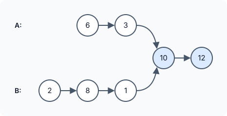

# Intersection of Two Linked Lists

::problem{slug=intersection-of-two-linked-lists}

## Problem Statement

You are given the heads of two singly linked lists, `headA` and `headB`. At some node they may **merge** — from that node on, both lists share the exact same nodes. Return that first shared node, or `null` if the lists never meet.

"Shared" means the **same node object** in memory, not just an equal value. The lists contain no cycles, and they must keep their original structure after your function returns.



### Examples

| List A | List B | Shared part | Output |
|---|---|---|---|
| `6 → 3 → (10 → 12)` | `2 → 8 → 1 → (10 → 12)` | `10 → 12` | the node `10` |
| `7 → (4)` | `(4)` | `4` | the node `4` |
| `5 → 9` | `1 → 3` | none | `null` |

In the second example, `headB` *is* the shared node.

### Constraints

- List A has `m` nodes and list B has `n` nodes, `1 <= m, n <= 3 · 10^4`.
- `1 <= Node.val <= 10^5`
- There are no cycles anywhere in the structure.

**Follow-up:** can you solve it in `O(m + n)` time with only `O(1)` extra memory?

:::callout
After the merge point the two lists are identical, so they have the **same tail length**. The only difference between them is the part *before* the merge. If you can line up both pointers at the same distance from the end, they will reach the merge node at the same time.
:::

## Approach 1: Hash Set of List A's Nodes

Store every node of list A in a set, then walk list B. The first node of B that is already in the set is the merge point.

:::code-tabs
```cpp
class Solution {
public:
    ListNode* getIntersectionNode(ListNode* headA, ListNode* headB) {
        unordered_map<ListNode*, bool> visited;

        while (headA) {
            visited[headA] = true;
            headA = headA->next;
        }

        while (headB) {
            if (visited[headB]) return headB;
            headB = headB->next;
        }
        return nullptr;
    }
};
```
```java
class Solution {
    public ListNode getIntersectionNode(ListNode headA, ListNode headB) {
        Set<ListNode> visited = new HashSet<>();

        while (headA != null) {
            visited.add(headA);
            headA = headA.next;
        }

        while (headB != null) {
            if (visited.contains(headB)) return headB;
            headB = headB.next;
        }
        return null;
    }
}
```
```python
class Solution:
    def getIntersectionNode(self, headA: ListNode, headB: ListNode) -> Optional[ListNode]:
        visited = set()

        while headA:
            visited.add(headA)
            headA = headA.next

        while headB:
            if headB in visited:
                return headB
            headB = headB.next
        return None
```
:::

**Complexity**

- **Time:** `O(m + n)`.
- **Space:** `O(m)` for the set.

:::callout
In C++, `visited[headB]` inserts `headB` with value `false` when it is missing. The answer is still correct, but `visited.count(headB)` (or an `unordered_set`) avoids growing the map while walking list B.
:::

## Approach 2: Skip the Length Difference

1. Count both lengths, `l1` and `l2`.
2. Advance the head of the **longer** list by `|l1 - l2|` nodes. Now both pointers are the same distance from the end.
3. Move both one step at a time until they are equal. They either meet at the merge node, or both reach `null` together (no intersection).

:::code-tabs
```cpp
class Solution {
public:
    ListNode* getIntersectionNode(ListNode* headA, ListNode* headB) {
        int l1 = lenLL(headA);
        int l2 = lenLL(headB);
        int diff = abs(l1 - l2);
        while (diff--) l1 > l2 ? headA = headA->next : headB = headB->next;
        while (headA != headB) {
            headA = headA->next;
            headB = headB->next;
        }
        return headA;
    }
private:
    int lenLL(ListNode* node) {
        int len = 0;
        while (node) {
            len++;
            node = node->next;
        }
        return len;
    }
};
```
```java
class Solution {
    public ListNode getIntersectionNode(ListNode headA, ListNode headB) {
        int l1 = lenLL(headA);
        int l2 = lenLL(headB);
        int diff = Math.abs(l1 - l2);
        while (diff-- > 0) {
            if (l1 > l2) headA = headA.next;
            else headB = headB.next;
        }
        while (headA != headB) {
            headA = headA.next;
            headB = headB.next;
        }
        return headA;
    }

    private int lenLL(ListNode node) {
        int len = 0;
        while (node != null) {
            len++;
            node = node.next;
        }
        return len;
    }
}
```
```python
class Solution:
    def getIntersectionNode(self, headA: ListNode, headB: ListNode) -> Optional[ListNode]:
        l1 = self.lenLL(headA)
        l2 = self.lenLL(headB)
        diff = abs(l1 - l2)
        for _ in range(diff):
            if l1 > l2:
                headA = headA.next
            else:
                headB = headB.next
        while headA is not headB:
            headA = headA.next
            headB = headB.next
        return headA

    def lenLL(self, node: Optional[ListNode]) -> int:
        length = 0
        while node:
            length += 1
            node = node.next
        return length
```
:::

**Complexity**

- **Time:** `O(m + n)`.
- **Space:** `O(1)`.

## Approach 3: Switch Lists at the End

Run two pointers, `aA` from `headA` and `bB` from `headB`. When a pointer falls off the end of its list, restart it at the head of the **other** list.

Each pointer then walks `(A-only part) + (shared part) + (B-only part)` or `(B-only part) + (shared part) + (A-only part)` — the same total — before reaching the shared part a second time. So:

- If the lists merge, both pointers arrive at the merge node **at the same step**.
- If they do not, both reach `null` at the same step (after `m + n` moves), and the loop ends with `null`.

:::code-tabs
```cpp
class Solution {
public:
    ListNode* getIntersectionNode(ListNode* headA, ListNode* headB) {
        ListNode* aA = headA, * bB = headB;

        while (aA != bB) {
            aA = aA ? aA->next : headB;
            bB = bB ? bB->next : headA;
        }
        return aA;
    }
};
```
```java
class Solution {
    public ListNode getIntersectionNode(ListNode headA, ListNode headB) {
        ListNode aA = headA, bB = headB;

        while (aA != bB) {
            aA = aA != null ? aA.next : headB;
            bB = bB != null ? bB.next : headA;
        }
        return aA;
    }
}
```
```python
class Solution:
    def getIntersectionNode(self, headA: ListNode, headB: ListNode) -> Optional[ListNode]:
        aA, bB = headA, headB

        while aA is not bB:
            aA = aA.next if aA else headB
            bB = bB.next if bB else headA
        return aA
```
:::

**Complexity**

- **Time:** `O(m + n)` — each pointer makes at most `m + n` moves.
- **Space:** `O(1)`.

### Dry Run (Approach 3)

A = `6 → 3 → 10 → 12`, B = `2 → 8 → 1 → 10 → 12`

| Step | aA | bB |
|---|---|---|
| 0 | 6 | 2 |
| 1 | 3 | 8 |
| 2 | 10 | 1 |
| 3 | 12 | 10 |
| 4 | `null` | 12 |
| 5 | 2 (switched to B) | `null` |
| 6 | 8 | 6 (switched to A) |
| 7 | 1 | 3 |
| 8 | **10** | **10** |

Both pointers reach node `10` at step 8: `2 + 2 + 3 + 1 = 8` moves each.

## Try It Yourself

```python runnable
class ListNode:
    def __init__(self, val=0, next=None):
        self.val = val
        self.next = next

def build(values, tail=None):
    head = tail
    for v in reversed(values):
        head = ListNode(v, head)
    return head

class Solution:
    def getIntersectionNode(self, headA, headB):
        aA, bB = headA, headB

        while aA is not bB:
            aA = aA.next if aA else headB
            bB = bB.next if bB else headA
        return aA


sol = Solution()
shared = build([10, 12])
node = sol.getIntersectionNode(build([6, 3], shared), build([2, 8, 1], shared))
print(node.val)  # 10
shared = build([4])
print(sol.getIntersectionNode(build([7], shared), shared).val)  # 4
print(sol.getIntersectionNode(build([5, 9]), build([1, 3])))  # None
```

## Comparison

| Approach | Time | Extra space |
|---|---|---|
| Hash set | `O(m + n)` | `O(m)` |
| Skip the length difference | `O(m + n)` | `O(1)` |
| Switch lists at the end | `O(m + n)` | `O(1)` |

## Edge Cases

- **No intersection:** every approach returns `null`, including when the lists have different lengths.
- **One head is the merge node:** the answer is that head.
- **Equal values but different nodes:** not an intersection — only node identity counts.

## Practice Questions

:::details[Why can't approach 3 loop forever when the lists do not intersect?]
After switching once, each pointer has walked `m + n` nodes when it reaches the end of the second list. Both arrive at `null` at that same step, so `aA == bB` (both `null`) and the loop stops.
:::

:::details[What would happen if the input contained a cycle?]
Approaches 2 and 3 would never reach `null` — counting the length or walking to the end would loop forever. That is why the problem guarantees there are no cycles.
:::
