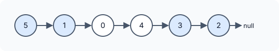

title : Linked List Components

summary : Count the connected groups formed by a set of values inside a linked list. Use a hash set and count where each run of matching nodes ends, a one-pass O(n) solution with code in C++, Java and Python.

# Linked List Components

::problem{slug=linked-list-components}

## Problem Statement

You are given the `head` of a linked list whose values are all **distinct**, and an array `nums` containing some of those values (also distinct).

Two values from `nums` are *connected* if they sit in **adjacent nodes** of the list. A **component** is a maximal group of values from `nums` linked together this way — in other words, a maximal run of consecutive nodes whose values all belong to `nums`. Return the number of components.



### Examples

| Input | Output | Why |
|---|---|---|
| `head = [5, 1, 0, 4, 3, 2], nums = [2, 5, 1, 3]` | `2` | runs `5 → 1` and `3 → 2` |
| `head = [0, 1, 2, 3], nums = [0, 2]` | `2` | `0` and `2` are not adjacent |
| `head = [3, 0, 1, 2], nums = [1, 0, 3, 2]` | `1` | the whole list is one run |

The order of `nums` does not matter; only the order of the linked list does.

### Constraints

- The list has `n` nodes, `1 <= n <= 10^4`.
- `0 <= Node.val < n`, and all node values are unique.
- `1 <= nums.length <= n`
- `0 <= nums[i] < n`, and all values of `nums` are unique.

:::callout
Mark each node as "in `nums`" or "not in `nums`". The answer is the number of **runs of marked nodes**. A run ends exactly when a marked node is followed by an unmarked node or by the end of the list.
:::

## Approach: Hash Set + Count Where Runs End

1. Put all of `nums` into a hash set, so "is this value in `nums`?" takes `O(1)`.
2. Walk the list keeping a flag `lastNumPartOfComponent` — whether the previous node was marked.
3. When the current node is **not** in the set and the previous one was, a run has just ended: count it.
4. After the loop, if the last node was marked, the final run ends at the end of the list: count it too.

:::code-tabs
```cpp
class Solution {
public:
    int numComponents(ListNode* head, vector<int>& nums) {
        unordered_set<int> st(nums.begin(), nums.end());

        int components = 0;
        bool lastNumPartOfComponent = false;

        while (head) {
            const int inSet = st.count(head->val);
            if (inSet) {
                lastNumPartOfComponent = true;
            } else {
                if (lastNumPartOfComponent) components++;
                lastNumPartOfComponent = false;
            }
            head = head->next;
        }
        if (lastNumPartOfComponent) components++;
        return components;
    }
};
```
```java
class Solution {
    public int numComponents(ListNode head, int[] nums) {
        Set<Integer> st = new HashSet<>();
        for (int x : nums) st.add(x);

        int components = 0;
        boolean lastNumPartOfComponent = false;

        while (head != null) {
            boolean inSet = st.contains(head.val);
            if (inSet) {
                lastNumPartOfComponent = true;
            } else {
                if (lastNumPartOfComponent) components++;
                lastNumPartOfComponent = false;
            }
            head = head.next;
        }
        if (lastNumPartOfComponent) components++;
        return components;
    }
}
```
```python
class Solution:
    def numComponents(self, head: Optional[ListNode], nums: List[int]) -> int:
        st = set(nums)

        components = 0
        last_num_part_of_component = False

        while head:
            in_set = head.val in st
            if in_set:
                last_num_part_of_component = True
            else:
                if last_num_part_of_component:
                    components += 1
                last_num_part_of_component = False
            head = head.next
        if last_num_part_of_component:
            components += 1
        return components
```
:::

**Complexity**

- **Time:** `O(n + k)` for `n` nodes and `k = nums.length` (building the set plus one pass).
- **Space:** `O(k)` for the set.

### Dry Run

`head = [5, 1, 0, 4, 3, 2]`, `nums = [2, 5, 1, 3]`

| Node | In set? | Previous marked? | Action | components |
|---|---|---|---|---|
| 5 | yes | no | start run | 0 |
| 1 | yes | yes | continue run | 0 |
| 0 | no | yes | run ended | 1 |
| 4 | no | no | – | 1 |
| 3 | yes | no | start run | 1 |
| 2 | yes | yes | continue run | 1 |
| end | – | yes | final run ended | 2 |

## Try It Yourself

```python runnable
class ListNode:
    def __init__(self, val=0, next=None):
        self.val = val
        self.next = next

def build(values):
    head = None
    for v in reversed(values):
        head = ListNode(v, head)
    return head

class Solution:
    def numComponents(self, head, nums):
        st = set(nums)

        components = 0
        last_num_part_of_component = False

        while head:
            in_set = head.val in st
            if in_set:
                last_num_part_of_component = True
            else:
                if last_num_part_of_component:
                    components += 1
                last_num_part_of_component = False
            head = head.next
        if last_num_part_of_component:
            components += 1
        return components


sol = Solution()
print(sol.numComponents(build([5, 1, 0, 4, 3, 2]), [2, 5, 1, 3]))  # 2
print(sol.numComponents(build([0, 1, 2, 3]), [0, 2]))  # 2
print(sol.numComponents(build([3, 0, 1, 2]), [1, 0, 3, 2]))  # 1
```

## Edge Cases

- **Run reaching the tail:** counted by the check after the loop.
- **Every value in `nums`:** the whole list is a single component.
- **Single-node list:** one component (since `nums` is non-empty and its values come from the list).

## Practice Questions

:::details[Why is a hash set better than searching nums for every node?]
Searching the array costs `O(k)` per node, giving `O(n · k)` overall — up to 10^8 operations here. The set makes each lookup `O(1)` on average, so the total is `O(n + k)`.
:::

:::details[Can you count run starts instead of run ends?]
Yes. Count a node when it is in the set and the previous node is not (or it is the head). Every run has exactly one start, so this gives the same answer without the extra check after the loop.
:::
