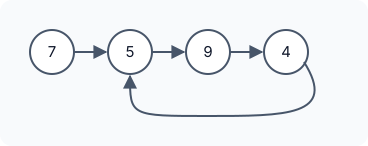

# Linked List Cycle

::problem{slug=linked-list-cycle}

## Problem Statement

Given the `head` of a linked list, determine whether the list contains a **cycle**: some node that you reach again if you keep following `next` pointers. Return `true` if there is a cycle, otherwise `false`.

In the examples, `pos` is the 0-based index of the node that the last node points back to (`-1` means the last node points to `null`). `pos` is only used to describe the input; your function receives just `head`.



### Examples

| Input | Output | Why |
|---|---|---|
| `head = [7, 5, 9, 4], pos = 1` | `true` | `4` links back to `5` |
| `head = [2, 6], pos = 0` | `true` | `6` links back to `2` |
| `head = [8], pos = -1` | `false` | the list ends |

### Constraints

- The list has between `0` and `10^4` nodes.
- `-10^5 <= Node.val <= 10^5`
- `pos` is `-1` or a valid index in the list.

**Follow-up:** can you solve it using `O(1)` extra memory?

:::callout
Values can repeat, so you cannot detect a cycle by looking at values. What repeats in a cycle is the **node itself** (its address/reference). Every approach below checks for "have I been at this exact node before?"
:::

## Approach 1: Hash Set of Visited Nodes

Walk the list and store every node pointer in a set. If you reach a node that is already in the set, you have gone around a cycle. If you reach `null`, the list ends and there is no cycle.

:::code-tabs
```cpp
class Solution {
public:
    bool hasCycle(ListNode* head) {
        unordered_set<ListNode*> st;
        while (head) {
            if (st.count(head)) return true;
            st.insert(head);
            head = head->next;
        }
        return false;
    }
};
```
```java
class Solution {
    public boolean hasCycle(ListNode head) {
        Set<ListNode> st = new HashSet<>();
        while (head != null) {
            if (st.contains(head)) return true;
            st.add(head);
            head = head.next;
        }
        return false;
    }
}
```
```python
class Solution:
    def hasCycle(self, head: Optional[ListNode]) -> bool:
        st = set()
        while head:
            if head in st:
                return True
            st.add(head)
            head = head.next
        return False
```
:::

**Complexity**

- **Time:** `O(n)`.
- **Space:** `O(n)` for the set.

## Approach 2: Floyd's Slow and Fast Pointers

Move `slow` one step and `fast` two steps at a time.

- **No cycle:** `fast` reaches the end (`null`) and the loop stops.
- **Cycle:** both pointers eventually enter the cycle. Inside it, `fast` gains exactly **one** node on `slow` per step, so the gap between them shrinks by one each time and must reach zero — they meet on the same node.

:::code-tabs
```cpp
class Solution {
public:
    bool hasCycle(ListNode* head) {
        ListNode* slow = head, * fast = head;

        while (slow && fast && fast->next) {
            slow = slow->next;
            fast = fast->next->next;
            if (slow == fast) return true;
        }
        return false;
    }
};
```
```java
class Solution {
    public boolean hasCycle(ListNode head) {
        ListNode slow = head, fast = head;

        while (slow != null && fast != null && fast.next != null) {
            slow = slow.next;
            fast = fast.next.next;
            if (slow == fast) return true;
        }
        return false;
    }
}
```
```python
class Solution:
    def hasCycle(self, head: Optional[ListNode]) -> bool:
        slow = fast = head

        while slow and fast and fast.next:
            slow = slow.next
            fast = fast.next.next
            if slow is fast:
                return True
        return False
```
:::

**Complexity**

- **Time:** `O(n)` — `slow` enters the cycle within `n` steps, and they meet before `slow` completes one lap.
- **Space:** `O(1)`.

:::callout
The pointers are compared **after** moving. Comparing before the first move would report a cycle immediately, because both start on `head`.
:::

## Approach 3: Redirect Visited Nodes to a Marker

Create one extra marker node `tmp`. Walk the list, and for every node you leave, point its `next` at `tmp`. If you ever arrive at a node whose `next` is already `tmp`, you have been there before — a cycle. If a node's `next` is `null`, the list ends.

:::code-tabs
```cpp
class Solution {
public:
    bool hasCycle(ListNode* head) {
        ListNode* tmp = new ListNode(-1);
        ListNode* curr = head;
        while (curr) {
            if (!curr->next) return false;
            if (curr->next == tmp) return true;
            ListNode* nxt = curr->next;
            curr->next = tmp;

            curr = nxt;
        }
        return false;
    }
};
```
```java
class Solution {
    public boolean hasCycle(ListNode head) {
        ListNode tmp = new ListNode(-1);
        ListNode curr = head;
        while (curr != null) {
            if (curr.next == null) return false;
            if (curr.next == tmp) return true;
            ListNode nxt = curr.next;
            curr.next = tmp;

            curr = nxt;
        }
        return false;
    }
}
```
```python
class Solution:
    def hasCycle(self, head: Optional[ListNode]) -> bool:
        tmp = ListNode(-1)
        curr = head
        while curr:
            if not curr.next:
                return False
            if curr.next is tmp:
                return True
            nxt = curr.next
            curr.next = tmp

            curr = nxt
        return False
```
:::

**Complexity**

- **Time:** `O(n)`.
- **Space:** `O(1)` — a single extra node.

:::callout
This approach **destroys the list**: after it runs, every visited node points to the marker. Use it only when the list is not needed afterwards. (The C++ version also never frees `tmp`.)
:::

## Try It Yourself

```python runnable
class ListNode:
    def __init__(self, val=0, next=None):
        self.val = val
        self.next = next

def build(values, pos):
    nodes = [ListNode(v) for v in values]
    for a, b in zip(nodes, nodes[1:]):
        a.next = b
    if pos >= 0:
        nodes[-1].next = nodes[pos]
    return nodes[0] if nodes else None

class Solution:
    def hasCycle(self, head):
        slow = fast = head

        while slow and fast and fast.next:
            slow = slow.next
            fast = fast.next.next
            if slow is fast:
                return True
        return False


sol = Solution()
print(sol.hasCycle(build([7, 5, 9, 4], 1)))  # True
print(sol.hasCycle(build([2, 6], 0)))  # True
print(sol.hasCycle(build([8], -1)))  # False
```

## Comparison

| Approach | Time | Extra space | Keeps the list intact? |
|---|---|---|---|
| Hash set | `O(n)` | `O(n)` | yes |
| Slow and fast pointers | `O(n)` | `O(1)` | yes |
| Redirect to a marker | `O(n)` | `O(1)` | no |

## Edge Cases

- **Empty list:** no cycle.
- **Single node pointing to itself:** a cycle (`pos = 0`).
- **Cycle back to the head:** the whole list is the cycle.

## Practice Questions

:::details[Why can fast never jump over slow inside the cycle?]
Inside the cycle, each step increases `fast`'s lead by exactly one node. If `slow` is `k` nodes ahead of `fast`, after one step it is `k - 1` nodes ahead. The distance decreases one at a time, so it hits `0` exactly — `fast` cannot skip past.
:::

:::details[How would you find the node where the cycle starts?]
After `slow` and `fast` meet, move one pointer back to `head` and advance both one step at a time. The node where they meet again is the start of the cycle. This works because the distance from the head to the cycle start equals the distance from the meeting point to the cycle start (going forward around the cycle).
:::
