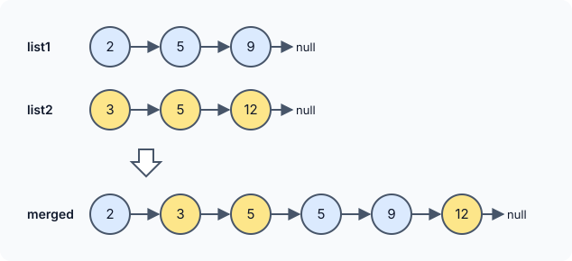

title : Merge Two Sorted Lists

summary : Merge two sorted linked lists into one sorted list by splicing nodes, not copying them. Covers an iterative approach with a dummy head and a recursive approach, with diagrams and edge cases.

# Merge Two Sorted Lists

::problem{slug=merge-two-sorted-lists}

## Problem Statement

You are given the heads of two linked lists, `list1` and `list2`, each already sorted in non-decreasing order. Combine them into a single sorted list by **re-linking the existing nodes** (no new nodes are needed) and return the head of the combined list.



### Examples

| Input | Output |
|---|---|
| `list1 = [2, 5, 9], list2 = [3, 5, 12]` | `[2, 3, 5, 5, 9, 12]` |
| `list1 = [], list2 = []` | `[]` |
| `list1 = [], list2 = [-4]` | `[-4]` |

### Constraints

- Each list has between `0` and `50` nodes.
- `-100 <= Node.val <= 100`
- Both lists are sorted in non-decreasing order.

:::callout
The smallest remaining value is always at the front of one of the two lists. Repeatedly take the smaller front node and append it to the result — the same "merge" step used in merge sort.
:::

## Approach 1: Iterative Splicing

Keep two pointers for the result: `merged` (its head) and `mergedTail` (its last node).

1. If either list is empty, the answer is simply the other one.
2. While both lists have nodes, pick the one whose front value is smaller, append it after `mergedTail`, and advance that list.
3. When one list runs out, the other one is already sorted and larger than everything taken so far, so attach it in one step.

:::code-tabs
```cpp
class Solution {
public:
    ListNode* mergeTwoLists(ListNode* list1, ListNode* list2) {
        if (!list1 || !list2) return list1 ? list1 : list2;

        ListNode* merged = nullptr, * mergedTail = nullptr;
        while (list1 && list2) {
            bool isL1Sm = list1->val < list2->val;
            ListNode* temp = isL1Sm ? list1 : list2;
            if (!merged) {
                merged = mergedTail = temp;
            } else {
                mergedTail->next = temp;
                mergedTail = temp;
            }
            if (isL1Sm) list1 = list1->next;
            else list2 = list2->next;
        }

        if (list1) mergedTail->next = list1;
        else mergedTail->next = list2;
        return merged;
    }
};
```
```java
class Solution {
    public ListNode mergeTwoLists(ListNode list1, ListNode list2) {
        if (list1 == null || list2 == null) return list1 != null ? list1 : list2;

        ListNode merged = null, mergedTail = null;
        while (list1 != null && list2 != null) {
            boolean isL1Sm = list1.val < list2.val;
            ListNode temp = isL1Sm ? list1 : list2;
            if (merged == null) {
                merged = mergedTail = temp;
            } else {
                mergedTail.next = temp;
                mergedTail = temp;
            }
            if (isL1Sm) list1 = list1.next;
            else list2 = list2.next;
        }

        if (list1 != null) mergedTail.next = list1;
        else mergedTail.next = list2;
        return merged;
    }
}
```
```python
class Solution:
    def mergeTwoLists(self, list1: Optional[ListNode], list2: Optional[ListNode]) -> Optional[ListNode]:
        if not list1 or not list2:
            return list1 if list1 else list2

        merged = merged_tail = None
        while list1 and list2:
            is_l1_sm = list1.val < list2.val
            temp = list1 if is_l1_sm else list2
            if not merged:
                merged = merged_tail = temp
            else:
                merged_tail.next = temp
                merged_tail = temp
            if is_l1_sm:
                list1 = list1.next
            else:
                list2 = list2.next

        if list1:
            merged_tail.next = list1
        else:
            merged_tail.next = list2
        return merged
```
:::

**Complexity**

- **Time:** `O(m + n)` — each node is appended exactly once.
- **Space:** `O(1)` — only pointers are rearranged.

### Dry Run

`list1 = [2, 5, 9]`, `list2 = [3, 5, 12]`

| Compare | Smaller (taken) | Merged so far |
|---|---|---|
| 2 vs 3 | 2 (list1) | `2` |
| 5 vs 3 | 3 (list2) | `2 3` |
| 5 vs 5 | 5 (list2, since `5 < 5` is false) | `2 3 5` |
| 5 vs 12 | 5 (list1) | `2 3 5 5` |
| 9 vs 12 | 9 (list1) | `2 3 5 5 9` |
| list1 empty | attach `12` | `2 3 5 5 9 12` |

## Approach 2: Recursive

The merged list starts with the smaller of the two front nodes; after it comes the merge of everything that remains. That is a direct recursive definition:

- If either list is empty, return the other.
- Otherwise take the smaller front node as `head`, and set `head->next` to the merge of the rest.

:::code-tabs
```cpp
class Solution {
public:
    ListNode* mergeTwoLists(ListNode* head1, ListNode* head2) {
        if (!head1 || !head2)
            return head1 ? head1 : head2;
        ListNode* head = NULL;
        if (head1->val <= head2->val) {
            head = head1;
            head->next = mergeTwoLists(head1->next, head2);
        } else {
            head = head2;
            head->next = mergeTwoLists(head2->next, head1);
        }
        return head;
    }
};
```
```java
class Solution {
    public ListNode mergeTwoLists(ListNode head1, ListNode head2) {
        if (head1 == null || head2 == null)
            return head1 != null ? head1 : head2;
        ListNode head = null;
        if (head1.val <= head2.val) {
            head = head1;
            head.next = mergeTwoLists(head1.next, head2);
        } else {
            head = head2;
            head.next = mergeTwoLists(head2.next, head1);
        }
        return head;
    }
}
```
```python
class Solution:
    def mergeTwoLists(self, head1: Optional[ListNode], head2: Optional[ListNode]) -> Optional[ListNode]:
        if not head1 or not head2:
            return head1 if head1 else head2
        head = None
        if head1.val <= head2.val:
            head = head1
            head.next = self.mergeTwoLists(head1.next, head2)
        else:
            head = head2
            head.next = self.mergeTwoLists(head2.next, head1)
        return head
```
:::

**Complexity**

- **Time:** `O(m + n)`.
- **Space:** `O(m + n)` for the recursion stack (one call per node).

:::callout
Swapping the argument order in the `else` branch (`mergeTwoLists(head2->next, head1)`) is fine: merging is symmetric, so it does not matter which list is passed first.
:::

## Try It Yourself

```python runnable
class ListNode:
    def __init__(self, val=0, next=None):
        self.val = val
        self.next = next

def build(values):
    head = None
    for v in reversed(values):
        head = ListNode(v, head)
    return head

def to_list(node):
    out = []
    while node:
        out.append(node.val)
        node = node.next
    return out

class Solution:
    def mergeTwoLists(self, list1, list2):
        if not list1 or not list2:
            return list1 if list1 else list2

        merged = merged_tail = None
        while list1 and list2:
            is_l1_sm = list1.val < list2.val
            temp = list1 if is_l1_sm else list2
            if not merged:
                merged = merged_tail = temp
            else:
                merged_tail.next = temp
                merged_tail = temp
            if is_l1_sm:
                list1 = list1.next
            else:
                list2 = list2.next

        if list1:
            merged_tail.next = list1
        else:
            merged_tail.next = list2
        return merged


sol = Solution()
print(to_list(sol.mergeTwoLists(build([2, 5, 9]), build([3, 5, 12]))))  # [2, 3, 5, 5, 9, 12]
print(to_list(sol.mergeTwoLists(build([]), build([]))))  # []
print(to_list(sol.mergeTwoLists(build([]), build([-4]))))  # [-4]
```

## Comparison

| Approach | Time | Extra space |
|---|---|---|
| Iterative splicing | `O(m + n)` | `O(1)` |
| Recursive | `O(m + n)` | `O(m + n)` stack |

## Edge Cases

- **One or both lists empty:** return the other list (or `null`).
- **Equal values:** either node can go first; the result is still sorted.
- **One list much longer:** its remaining tail is attached in a single step, not node by node.

## Practice Questions

:::details[How does a dummy head node simplify the iterative version?]
Start with a dummy node and set `mergedTail = &dummy`. Then every append is just `mergedTail->next = temp; mergedTail = temp;` with no special case for the first node, and the answer is `dummy.next`.
:::

:::details[How would you merge k sorted lists efficiently?]
Merging them one by one costs `O(k · N)` for `N` total nodes. Using a min-heap holding the current front of each list gives `O(N log k)`, and so does merging them in pairs, like the levels of merge sort.
:::
