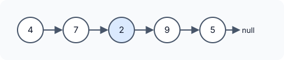
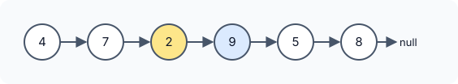

title : Middle of the Linked List

summary : Find the middle node of a linked list. Count the nodes and walk halfway, or use the slow and fast pointer (tortoise and hare) technique to find it in a single pass.

# Middle of the Linked List

::problem{slug=middle-of-the-linked-list}

## Problem Statement

Given the `head` of a non-empty singly linked list, return its **middle node**. When the list has an even number of nodes there are two middle nodes; return the **second** one.

Returning the node means the answer is the middle node together with everything after it.





### Examples

| Input | Output | Why |
|---|---|---|
| `head = [4, 7, 2, 9, 5]` | `[2, 9, 5]` | 5 nodes, the 3rd one is the middle |
| `head = [4, 7, 2, 9, 5, 8]` | `[9, 5, 8]` | 6 nodes, middles are `2` and `9`; return the second |
| `head = [11]` | `[11]` | a single node is its own middle |

### Constraints

- The list has between `1` and `100` nodes.
- `1 <= Node.val <= 100`

:::callout
For a list of `len` nodes, the required middle is always the node at index `len / 2` (0-based, integer division). For 5 nodes that is index 2, for 6 nodes index 3 — the second middle.
:::

## Approach 1: Count, Then Walk

Two passes:

1. Count the nodes to get `len`.
2. Start again from the head and move `len / 2` steps.

:::code-tabs
```cpp
class Solution {
public:
    ListNode* middleNode(ListNode* head) {
        int len = lenLL(head);
        for (int i = 0; i < len / 2; i++) {
            head = head->next;
        }
        return head;
    }
private:
    int lenLL(ListNode* node) {
        int len = 0;
        while (node) {
            node = node->next;
            len++;
        }
        return len;
    }
};
```
```java
class Solution {
    public ListNode middleNode(ListNode head) {
        int len = lenLL(head);
        for (int i = 0; i < len / 2; i++) {
            head = head.next;
        }
        return head;
    }

    private int lenLL(ListNode node) {
        int len = 0;
        while (node != null) {
            node = node.next;
            len++;
        }
        return len;
    }
}
```
```python
class Solution:
    def middleNode(self, head: Optional[ListNode]) -> Optional[ListNode]:
        length = self.lenLL(head)
        for _ in range(length // 2):
            head = head.next
        return head

    def lenLL(self, node: Optional[ListNode]) -> int:
        length = 0
        while node:
            node = node.next
            length += 1
        return length
```
:::

**Complexity**

- **Time:** `O(n)` — about `1.5 · n` steps (a full pass plus half a pass).
- **Space:** `O(1)`.

## Approach 2: Slow and Fast Pointers (Tortoise and Hare)

Move two pointers from the head at the same time: `turtle` moves **one** step, `rabbit` moves **two** steps. When `rabbit` cannot take another double step, it has covered the whole list and `turtle` has covered exactly half of it.

The loop continues while `rabbit` and `rabbit->next` both exist:

- **Odd length:** `rabbit` stops *on* the last node and `turtle` is on the exact middle.
- **Even length:** `rabbit` steps *past* the last node (to `nullptr`) and `turtle` lands on the **second** middle — exactly what the problem asks for.

:::code-tabs
```cpp
class Solution {
public:
    ListNode* middleNode(ListNode* head) {
        if (!head) return nullptr;
        ListNode* turtle = head;
        ListNode* rabbit = head;

        while (turtle && rabbit && rabbit->next) {
            turtle = turtle->next;
            rabbit = rabbit->next->next;
        }
        return turtle;
    }
};
```
```java
class Solution {
    public ListNode middleNode(ListNode head) {
        if (head == null) return null;
        ListNode turtle = head;
        ListNode rabbit = head;

        while (turtle != null && rabbit != null && rabbit.next != null) {
            turtle = turtle.next;
            rabbit = rabbit.next.next;
        }
        return turtle;
    }
}
```
```python
class Solution:
    def middleNode(self, head: Optional[ListNode]) -> Optional[ListNode]:
        if not head:
            return None
        turtle = head
        rabbit = head

        while turtle and rabbit and rabbit.next:
            turtle = turtle.next
            rabbit = rabbit.next.next
        return turtle
```
:::

**Complexity**

- **Time:** `O(n)` — a single pass (`rabbit` makes about `n / 2` double steps).
- **Space:** `O(1)`.

### Dry Run

`head = [4, 7, 2, 9, 5, 8]`

| Step | turtle | rabbit | Continue? |
|---|---|---|---|
| start | 4 | 4 | `rabbit.next` exists |
| 1 | 7 | 2 | yes |
| 2 | 2 | 5 | yes |
| 3 | 9 | `null` | no — stop |

`turtle` is on `9`, the second middle.

## Try It Yourself

```python runnable
class ListNode:
    def __init__(self, val=0, next=None):
        self.val = val
        self.next = next

def build(values):
    head = None
    for v in reversed(values):
        head = ListNode(v, head)
    return head

def to_list(node):
    out = []
    while node:
        out.append(node.val)
        node = node.next
    return out

class Solution:
    def middleNode(self, head):
        if not head:
            return None
        turtle = head
        rabbit = head

        while turtle and rabbit and rabbit.next:
            turtle = turtle.next
            rabbit = rabbit.next.next
        return turtle


sol = Solution()
print(to_list(sol.middleNode(build([4, 7, 2, 9, 5]))))  # [2, 9, 5]
print(to_list(sol.middleNode(build([4, 7, 2, 9, 5, 8]))))  # [9, 5, 8]
print(to_list(sol.middleNode(build([11]))))  # [11]
```

## Comparison

| Approach | Time | Space | Passes |
|---|---|---|---|
| Count, then walk | `O(n)` | `O(1)` | 1.5 |
| Slow and fast pointers | `O(n)` | `O(1)` | 1 |

## Edge Cases

- **Single node:** the loop never runs; the head itself is returned.
- **Two nodes:** the second node is returned (second middle).
- **Even vs odd length:** the `rabbit && rabbit->next` condition is what makes the even case land on the *second* middle.

## Practice Questions

:::details[How would you return the FIRST middle node for even-length lists instead?]
Stop one step earlier: loop while `rabbit->next && rabbit->next->next`. For `[4, 7, 2, 9, 5, 8]` this stops with `turtle` on `2`. In the counting approach, walk `(len - 1) / 2` steps instead.
:::

:::details[Why is the turtle condition in the while loop never what stops it?]
`turtle` is always behind `rabbit`, so if `rabbit` is not `null`, `turtle` is not `null` either. The check on `turtle` is harmless but redundant.
:::
