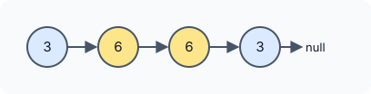

# Palindrome Linked List

::problem{slug=palindrome-linked-list}

## Problem Statement

Given the `head` of a singly linked list, return `true` if the sequence of values reads the same from front to back as from back to front (a **palindrome**), and `false` otherwise.



### Examples

| Input | Output |
|---|---|
| `head = [3, 6, 6, 3]` | `true` |
| `head = [5, 2, 5]` | `true` |
| `head = [4, 9]` | `false` |

### Constraints

- The list has between `1` and `10^5` nodes.
- `0 <= Node.val <= 9`

**Follow-up:** can you do it in `O(n)` time and `O(1)` extra space?

:::callout
A singly linked list can only be walked forwards, but a palindrome check needs to compare the first value with the last, the second with the second-last, and so on. Every approach below is a different way to get the second half **in reverse order**.
:::

## Approach 1: Copy Into an Array

Store the nodes in an array, then compare positions `i` and `len - 1 - i` from both ends, exactly like checking a palindrome string.

:::code-tabs
```cpp
class Solution {
public:
    bool isPalindrome(ListNode* head) {
        vector<ListNode*> res;
        while (head) {
            res.push_back(head);
            head = head->next;
        }
        for (int i = 0, len = res.size(); i < len / 2; i++) {
            if (res[i]->val != res[len - 1 - i]->val)
                return false;
        }
        return true;
    }
};
```
```java
class Solution {
    public boolean isPalindrome(ListNode head) {
        List<ListNode> res = new ArrayList<>();
        while (head != null) {
            res.add(head);
            head = head.next;
        }
        for (int i = 0, len = res.size(); i < len / 2; i++) {
            if (res.get(i).val != res.get(len - 1 - i).val)
                return false;
        }
        return true;
    }
}
```
```python
class Solution:
    def isPalindrome(self, head: Optional[ListNode]) -> bool:
        res = []
        while head:
            res.append(head)
            head = head.next
        length = len(res)
        for i in range(length // 2):
            if res[i].val != res[length - 1 - i].val:
                return False
        return True
```
:::

**Complexity**

- **Time:** `O(n)`.
- **Space:** `O(n)` for the array.

## Approach 2: Find the Middle, Stack the Second Half

1. Use slow/fast pointers (`turtle` one step, `rabbit` two steps) to stop `turtle` at the **end of the first half**. The loop runs while `rabbit->next && rabbit->next->next`, so for even lengths `turtle` stops on the first middle node.
2. Push every value **after** `turtle` onto a stack. Popping the stack gives the second half in reverse.
3. Compare the list from the head with the popped values.

For odd lengths the middle node stays in the first half; the comparison simply stops when the stack is empty, so the middle value is never compared (it does not need to be).

:::code-tabs
```cpp
class Solution {
public:
    bool isPalindrome(ListNode* head) {
        ListNode* turtle = head, * rabbit = head;

        while (rabbit->next && rabbit->next->next) {
            turtle = turtle->next;
            rabbit = rabbit->next->next;
        }

        rabbit = turtle->next;
        turtle = head;

        stack<int> stck;
        while (rabbit) {
            stck.push(rabbit->val);
            rabbit = rabbit->next;
        }

        // compare turtle and reversed rabbit path
        while (turtle && !stck.empty()) {
            if (turtle->val != stck.top()) return false;
            turtle = turtle->next;
            stck.pop();
        }
        return true;
    }
};
```
```java
class Solution {
    public boolean isPalindrome(ListNode head) {
        ListNode turtle = head, rabbit = head;

        while (rabbit.next != null && rabbit.next.next != null) {
            turtle = turtle.next;
            rabbit = rabbit.next.next;
        }

        rabbit = turtle.next;
        turtle = head;

        Deque<Integer> stck = new ArrayDeque<>();
        while (rabbit != null) {
            stck.push(rabbit.val);
            rabbit = rabbit.next;
        }

        // compare turtle and reversed rabbit path
        while (turtle != null && !stck.isEmpty()) {
            if (turtle.val != stck.peek()) return false;
            turtle = turtle.next;
            stck.pop();
        }
        return true;
    }
}
```
```python
class Solution:
    def isPalindrome(self, head: Optional[ListNode]) -> bool:
        turtle = rabbit = head

        while rabbit.next and rabbit.next.next:
            turtle = turtle.next
            rabbit = rabbit.next.next

        rabbit = turtle.next
        turtle = head

        stck = []
        while rabbit:
            stck.append(rabbit.val)
            rabbit = rabbit.next

        # compare turtle and reversed rabbit path
        while turtle and stck:
            if turtle.val != stck[-1]:
                return False
            turtle = turtle.next
            stck.pop()
        return True
```
:::

**Complexity**

- **Time:** `O(n)`.
- **Space:** `O(n / 2)` for the stack — still `O(n)`, but half of approach 1.

## Approach 3: Reverse the Second Half in Place

Replace the stack with an in-place reversal to reach `O(1)` extra space:

1. Find the end of the first half exactly as in approach 2.
2. Reverse the list that starts right after it (the second half).
3. Walk the first half and the reversed second half together, comparing values, until the shorter one ends.

:::code-tabs
```cpp
class Solution {
public:
    bool isPalindrome(ListNode* head) { // O(3N/2)
        ListNode* turtle = head, * rabbit = head;

        while (rabbit->next && rabbit->next->next) { // O(N/2)
            turtle = turtle->next;
            rabbit = rabbit->next->next;
        }

        rabbit = turtle->next;
        turtle = head;

        // reverse rabbit
        ListNode* rv = nullptr;
        while (rabbit) { // O(N/2)
            ListNode* temp = rabbit;
            rabbit = rabbit->next;
            temp->next = rv;
            rv = temp;
        }

        // compare turtle and reversed rabbit path
        while (turtle && rv) { // O(N/2)
            if (turtle->val != rv->val) return false;
            turtle = turtle->next;
            rv = rv->next;
        }
        return true;
    }
};
```
```java
class Solution {
    public boolean isPalindrome(ListNode head) { // O(3N/2)
        ListNode turtle = head, rabbit = head;

        while (rabbit.next != null && rabbit.next.next != null) { // O(N/2)
            turtle = turtle.next;
            rabbit = rabbit.next.next;
        }

        rabbit = turtle.next;
        turtle = head;

        // reverse rabbit
        ListNode rv = null;
        while (rabbit != null) { // O(N/2)
            ListNode temp = rabbit;
            rabbit = rabbit.next;
            temp.next = rv;
            rv = temp;
        }

        // compare turtle and reversed rabbit path
        while (turtle != null && rv != null) { // O(N/2)
            if (turtle.val != rv.val) return false;
            turtle = turtle.next;
            rv = rv.next;
        }
        return true;
    }
}
```
```python
class Solution:
    def isPalindrome(self, head: Optional[ListNode]) -> bool:  # O(3N/2)
        turtle = rabbit = head

        while rabbit.next and rabbit.next.next:  # O(N/2)
            turtle = turtle.next
            rabbit = rabbit.next.next

        rabbit = turtle.next
        turtle = head

        # reverse rabbit
        rv = None
        while rabbit:  # O(N/2)
            temp = rabbit
            rabbit = rabbit.next
            temp.next = rv
            rv = temp

        # compare turtle and reversed rabbit path
        while turtle and rv:  # O(N/2)
            if turtle.val != rv.val:
                return False
            turtle = turtle.next
            rv = rv.next
        return True
```
:::

**Complexity**

- **Time:** `O(n)` — about `3n / 2` steps: half a pass to find the middle, half to reverse, half to compare.
- **Space:** `O(1)`.

:::callout
This approach **changes the input list**: after it runs, the second half is reversed and the first half's last node still points to what is now the *tail* of the reversed part. If the caller needs the list afterwards, reverse the second half back before returning.
:::

### Dry Run (Approach 3)

`head = [5, 2, 5]`

| Step | Result |
|---|---|
| find middle | `turtle` stops on `2` |
| second half | `5` (just one node), reversed: `5` |
| compare | `5` vs `5` ✔, then `rv` is `null` — stop |

The middle `2` is never compared, and the answer is `true`.

## Try It Yourself

```python runnable
class ListNode:
    def __init__(self, val=0, next=None):
        self.val = val
        self.next = next

def build(values):
    head = None
    for v in reversed(values):
        head = ListNode(v, head)
    return head

class Solution:
    def isPalindrome(self, head):  # O(3N/2)
        turtle = rabbit = head

        while rabbit.next and rabbit.next.next:  # O(N/2)
            turtle = turtle.next
            rabbit = rabbit.next.next

        rabbit = turtle.next
        turtle = head

        # reverse rabbit
        rv = None
        while rabbit:  # O(N/2)
            temp = rabbit
            rabbit = rabbit.next
            temp.next = rv
            rv = temp

        # compare turtle and reversed rabbit path
        while turtle and rv:  # O(N/2)
            if turtle.val != rv.val:
                return False
            turtle = turtle.next
            rv = rv.next
        return True


sol = Solution()
print(sol.isPalindrome(build([3, 6, 6, 3])))  # True
print(sol.isPalindrome(build([5, 2, 5])))  # True
print(sol.isPalindrome(build([4, 9])))  # False
```

## Comparison

| Approach | Time | Extra space | Modifies list? |
|---|---|---|---|
| Copy into an array | `O(n)` | `O(n)` | no |
| Stack the second half | `O(n)` | `O(n)` | no |
| Reverse the second half | `O(n)` | `O(1)` | yes |

## Edge Cases

- **Single node:** always a palindrome; the second half is empty.
- **Two nodes:** compared directly (`[4, 9]` is `false`, `[7, 7]` is `true`).
- **Odd length:** the middle node is never compared, which is correct.

## Practice Questions

:::details[Why not build a string of the values and check that instead?]
It only works when every value is a single character. With multi-digit values, `[1, 21]` becomes `"121"`, which is a palindrome even though the list is not. Comparing values node by node avoids this.
:::

:::details[In approach 3, why does the comparison loop stop correctly even though the first half was never cut off?]
The first half still links into the old middle, but the reversed second half ends in `null` and is never longer than the first half. The loop stops as soon as `rv` becomes `null`, so it never walks past the halfway point.
:::
