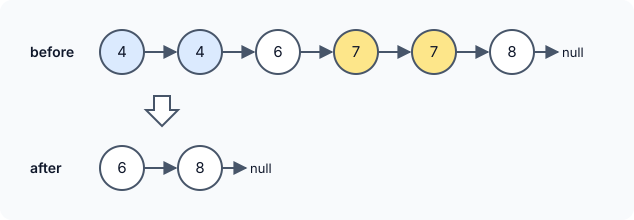

title : Remove Duplicates from Sorted List II

summary : Remove every value that appears more than once in a sorted linked list, keeping only distinct values. Build the result while scanning, with a dummy head to handle duplicates at the start.

# Remove Duplicates from Sorted List II

::problem{slug=remove-duplicates-from-sorted-list-ii}

## Problem Statement

You are given the `head` of a linked list sorted in ascending order. Remove **every node whose value occurs more than once** — not just the extra copies, but all of them — so that only values that appeared exactly once remain. Return the head of the resulting sorted list.



### Examples

| Input | Output | Why |
|---|---|---|
| `head = [4, 4, 6, 7, 7, 8]` | `[6, 8]` | `4` and `7` repeat, so all their nodes go |
| `head = [3, 3, 3, 5, 9]` | `[5, 9]` | the head itself is removed |
| `head = [2, 2]` | `[]` | nothing survives |

### Constraints

- The list has between `0` and `300` nodes.
- `-100 <= Node.val <= 100`
- The list is sorted in ascending order.

:::callout
This differs from the simpler version of the problem in one way: when a value repeats, the **first** copy must also go. So you must know whether a run had copies *before* deciding to keep its first node — and the head of the list itself may disappear.
:::

## Approach: Build the Result While Scanning

Walk the list with `head`, while building the answer with two pointers: `nHead` (the first kept node) and `nTail` (the last kept node).

For each node:

1. **Remove the copies after it.** While the next node has the same value, unlink and delete it, and remember that this value repeated (`shouldDeleteHead = true`).
2. **If the value repeated**, the current node must go as well. Move `head` to the next node, link the last kept node (`nTail`) to it so the kept part stays connected, delete the current node, and continue.
3. **Otherwise the value is unique**: keep it. If nothing was kept yet, it becomes `nHead`; in any case it becomes the new `nTail`.

:::code-tabs
```cpp
class Solution {
public:
    ListNode* deleteDuplicates(ListNode* head) {
        ListNode* nHead = nullptr, * nTail = nullptr;
        while (head) {
            bool shouldDeleteHead = false;
            while (head->next && head->next->val == head->val) {
                shouldDeleteHead = true;
                ListNode* del = head->next;
                head->next = del->next;
                delete del;
            }
            if (shouldDeleteHead) {
                ListNode* del = head;
                head = head->next;
                if (nTail) nTail->next = head;
                delete del;
                continue;
            }
            if (!nHead) nHead = head;
            nTail = head;
            head = head->next;
        }
        return nHead;
    }
};
```
```java
class Solution {
    public ListNode deleteDuplicates(ListNode head) {
        ListNode nHead = null, nTail = null;
        while (head != null) {
            boolean shouldDeleteHead = false;
            while (head.next != null && head.next.val == head.val) {
                shouldDeleteHead = true;
                ListNode del = head.next;
                head.next = del.next;
            }
            if (shouldDeleteHead) {
                head = head.next;
                if (nTail != null) nTail.next = head;
                continue;
            }
            if (nHead == null) nHead = head;
            nTail = head;
            head = head.next;
        }
        return nHead;
    }
}
```
```python
class Solution:
    def deleteDuplicates(self, head: Optional[ListNode]) -> Optional[ListNode]:
        n_head = n_tail = None
        while head:
            should_delete_head = False
            while head.next and head.next.val == head.val:
                should_delete_head = True
                delete = head.next
                head.next = delete.next
            if should_delete_head:
                head = head.next
                if n_tail:
                    n_tail.next = head
                continue
            if not n_head:
                n_head = head
            n_tail = head
            head = head.next
        return n_head
```
:::

**Complexity**

- **Time:** `O(n)` — every node is visited once and removed at most once.
- **Space:** `O(1)`.

:::callout
`nTail->next = head` may temporarily point at a node that will itself be removed later (for example the first `7` after removing the `4`s in a list like `[1, 4, 4, 7, 7]`). That is fine: when that node is removed, the same line runs again and moves the link forward. At the end, `nTail->next` always points at the next kept node or `null`.
:::

### Dry Run

`head = [4, 4, 6, 7, 7, 8]`

| head | Copies removed? | Action | nHead | nTail | Kept list |
|---|---|---|---|---|---|
| 4 | yes (one `4`) | delete this `4` too | – | – | – |
| 6 | no | keep | 6 | 6 | `6` |
| 7 | yes (one `7`) | delete this `7`, `nTail->next = 8` | 6 | 6 | `6` |
| 8 | no | keep | 6 | 8 | `6 8` |

## Try It Yourself

```python runnable
class ListNode:
    def __init__(self, val=0, next=None):
        self.val = val
        self.next = next

def build(values):
    head = None
    for v in reversed(values):
        head = ListNode(v, head)
    return head

def to_list(node):
    out = []
    while node:
        out.append(node.val)
        node = node.next
    return out

class Solution:
    def deleteDuplicates(self, head):
        n_head = n_tail = None
        while head:
            should_delete_head = False
            while head.next and head.next.val == head.val:
                should_delete_head = True
                delete = head.next
                head.next = delete.next
            if should_delete_head:
                head = head.next
                if n_tail:
                    n_tail.next = head
                continue
            if not n_head:
                n_head = head
            n_tail = head
            head = head.next
        return n_head


sol = Solution()
print(to_list(sol.deleteDuplicates(build([4, 4, 6, 7, 7, 8]))))  # [6, 8]
print(to_list(sol.deleteDuplicates(build([3, 3, 3, 5, 9]))))  # [5, 9]
print(to_list(sol.deleteDuplicates(build([2, 2]))))  # []
```

## Edge Cases

- **The head repeats:** `nHead` is only set when the first *unique* node is found, so a removed head is handled naturally.
- **Everything repeats:** `nHead` stays `null`.
- **Repeated value at the end:** `nTail->next` is set to `null` when the last run is removed, so no deleted node stays linked.

## Practice Questions

:::details[How would a dummy node simplify this?]
Put a dummy node before the head and keep `prev` on the last kept node (starting at the dummy). When a run of equal values is found, set `prev->next` to the node after the run; otherwise move `prev` forward. The answer is `dummy.next`, and there is no special case for the head.
:::

:::details[What would the output be for [1, 1, 2, 2, 3, 3]?]
An empty list. Every value appears twice, so every node is removed.
:::
