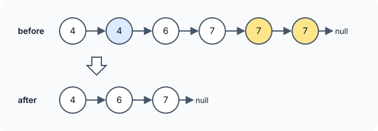

# Remove Duplicates from Sorted List

::problem{slug=remove-duplicates-from-sorted-list}

## Problem Statement

You are given the `head` of a linked list sorted in ascending order. Delete the extra copies so that **every value appears exactly once**, and return the head of the resulting (still sorted) list.



### Examples

| Input | Output |
|---|---|
| `head = [4, 4, 6, 7, 7, 7]` | `[4, 6, 7]` |
| `head = [2, 2, 2]` | `[2]` |
| `head = [1, 5, 9]` | `[1, 5, 9]` |

### Constraints

- The list has between `0` and `300` nodes.
- `-100 <= Node.val <= 100`
- The list is sorted in ascending order.

:::callout
Because the list is sorted, all copies of a value sit **next to each other**. A node is a duplicate exactly when it has the same value as the node just before it, so one pass comparing neighbours is enough.
:::

## Approach 1: Skip All Copies at Once

Visit each distinct node in turn. While the node right after it holds the same value, unlink that next node. Once the neighbour differs, move on.

:::code-tabs
```cpp
class Solution {
public:
    ListNode* deleteDuplicates(ListNode* head) {
        ListNode* nHead = head;
        while (head) {
            while (head->next && head->next->val == head->val) {
                ListNode* del = head->next;
                head->next = del->next;
                delete del;
            }
            head = head->next;
        }
        return nHead;
    }
};
```
```java
class Solution {
    public ListNode deleteDuplicates(ListNode head) {
        ListNode nHead = head;
        while (head != null) {
            while (head.next != null && head.next.val == head.val) {
                ListNode del = head.next;
                head.next = del.next; // del is garbage-collected
            }
            head = head.next;
        }
        return nHead;
    }
}
```
```python
class Solution:
    def deleteDuplicates(self, head: Optional[ListNode]) -> Optional[ListNode]:
        n_head = head
        while head:
            while head.next and head.next.val == head.val:
                delete = head.next
                head.next = delete.next  # the removed node is garbage-collected
            head = head.next
        return n_head
```
:::

**Complexity**

- **Time:** `O(n)` — each node is either kept and passed once, or removed once.
- **Space:** `O(1)`.

## Approach 2: Two Pointers

Keep `first` on the last node that is being kept and `second` on the node being examined:

- If `second` has the same value as `first`, unlink and delete `second`, then look at the new `first->next`.
- Otherwise `second` is a new value, so both pointers move forward.

:::code-tabs
```cpp
class Solution {
public:
    ListNode* deleteDuplicates(ListNode* head) {
        if (!head)
            return NULL;
        ListNode* first = head;
        ListNode* second = head->next;
        while (second) {
            if (first->val == second->val) {
                first->next = second->next;
                delete second;
                second = first->next;
            } else {
                first = second;
                second = second->next;
            }
        }
        return head;
    }
};
```
```java
class Solution {
    public ListNode deleteDuplicates(ListNode head) {
        if (head == null)
            return null;
        ListNode first = head;
        ListNode second = head.next;
        while (second != null) {
            if (first.val == second.val) {
                first.next = second.next;
                second = first.next;
            } else {
                first = second;
                second = second.next;
            }
        }
        return head;
    }
}
```
```python
class Solution:
    def deleteDuplicates(self, head: Optional[ListNode]) -> Optional[ListNode]:
        if not head:
            return None
        first = head
        second = head.next
        while second:
            if first.val == second.val:
                first.next = second.next
                second = first.next
            else:
                first = second
                second = second.next
        return head
```
:::

**Complexity**

- **Time:** `O(n)`.
- **Space:** `O(1)`.

:::callout
The C++ versions call `delete` on every removed node so that no memory leaks. Java and Python free unreachable nodes automatically, so unlinking is enough there.
:::

### Dry Run (Approach 2)

`head = [4, 4, 6, 7, 7, 7]`

| first | second | Equal? | Action | List now |
|---|---|---|---|---|
| 4 | 4 | yes | unlink second 4 | `4 6 7 7 7` |
| 4 | 6 | no | advance | `4 6 7 7 7` |
| 6 | 7 | no | advance | `4 6 7 7 7` |
| 7 | 7 | yes | unlink | `4 6 7 7` |
| 7 | 7 | yes | unlink | `4 6 7` |
| 7 | `null` | – | stop | `4 6 7` |

## Try It Yourself

```python runnable
class ListNode:
    def __init__(self, val=0, next=None):
        self.val = val
        self.next = next

def build(values):
    head = None
    for v in reversed(values):
        head = ListNode(v, head)
    return head

def to_list(node):
    out = []
    while node:
        out.append(node.val)
        node = node.next
    return out

class Solution:
    def deleteDuplicates(self, head):
        if not head:
            return None
        first = head
        second = head.next
        while second:
            if first.val == second.val:
                first.next = second.next
                second = first.next
            else:
                first = second
                second = second.next
        return head


sol = Solution()
print(to_list(sol.deleteDuplicates(build([4, 4, 6, 7, 7, 7]))))  # [4, 6, 7]
print(to_list(sol.deleteDuplicates(build([2, 2, 2]))))  # [2]
print(to_list(sol.deleteDuplicates(build([1, 5, 9]))))  # [1, 5, 9]
```

## Comparison

| Approach | Time | Space |
|---|---|---|
| Skip all copies at once | `O(n)` | `O(1)` |
| Two pointers | `O(n)` | `O(1)` |

Both do the same work; they only differ in how the loop is organised.

## Edge Cases

- **Empty list:** return `null`.
- **All values equal:** only the first node remains.
- **No duplicates:** the list is unchanged.

## Practice Questions

:::details[Why does this not work on an unsorted list?]
Copies of a value are only guaranteed to be adjacent in a sorted list. In `[3, 1, 3]` the two `3`s are not neighbours, so comparing neighbours never finds them. An unsorted list needs a hash set of values already seen.
:::

:::details[In approach 1, why is it safe to move head forward after the inner loop?]
When the inner loop ends, `head->next` is either `null` or a node with a different (larger) value. That next node is the first copy of a new value, so it must be kept — moving to it is exactly right.
:::
