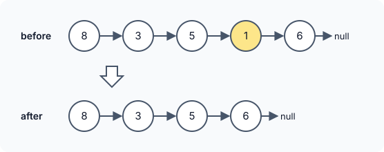

title : Remove Nth Node From End of List

summary : Remove the nth node from the end of a linked list. Count the length first, or use two pointers with a gap of n to do it in a single pass, with a dummy node for removing the head.

# Remove Nth Node From End of List

::problem{slug=remove-nth-node-from-end-of-list}

## Problem Statement

Given the `head` of a linked list and an integer `n`, delete the node that is `n`-th **counting from the end** (the last node is 1st from the end) and return the head of the modified list.



### Examples

| Input | Output | Why |
|---|---|---|
| `head = [8, 3, 5, 1, 6], n = 2` | `[8, 3, 5, 6]` | `1` is 2nd from the end |
| `head = [7], n = 1` | `[]` | the only node is removed |
| `head = [7, 9], n = 2` | `[9]` | the head is removed |

### Constraints

- The list has `sz` nodes, `1 <= sz <= 30`.
- `0 <= Node.val <= 100`
- `1 <= n <= sz`

**Follow-up:** can you do it in a single pass?

:::callout
To unlink a node you need the node **before** it. In a list of length `len`, the `n`-th node from the end is at 0-based index `len - n`, so the node before it is at index `len - n - 1`. The only special case is `n == len`: the head itself is removed and there is no node before it.
:::

## Approach 1: Count the Length First

1. Count the nodes (`len`).
2. If `n == len`, the head is the node to remove: return `head->next`.
3. Otherwise walk `len - 1 - n` steps from the head to reach the node just **before** the target, and bypass the target.

:::code-tabs
```cpp
class Solution {
public:
    ListNode* removeNthFromEnd(ListNode* head, int n) {
        int len = lengthLL(head);

        ListNode* clone = head;
        if (n == len) {
            head = head->next;
            delete clone;
            return head;
        }
        int mv = len - 1 - n;

        while (mv) {
            mv--;
            clone = clone->next;
        }
        ListNode* del = clone->next;
        clone->next = del->next;
        delete del;
        return head;
    }
private:
    int lengthLL(ListNode* head) {
        int len = 0;
        while (head) {
            len++;
            head = head->next;
        }
        return len;
    }
};
```
```java
class Solution {
    public ListNode removeNthFromEnd(ListNode head, int n) {
        int len = lengthLL(head);

        ListNode clone = head;
        if (n == len) {
            return head.next;
        }
        int mv = len - 1 - n;

        while (mv != 0) {
            mv--;
            clone = clone.next;
        }
        ListNode del = clone.next;
        clone.next = del.next;
        return head;
    }

    private int lengthLL(ListNode head) {
        int len = 0;
        while (head != null) {
            len++;
            head = head.next;
        }
        return len;
    }
}
```
```python
class Solution:
    def removeNthFromEnd(self, head: Optional[ListNode], n: int) -> Optional[ListNode]:
        length = self.lengthLL(head)

        clone = head
        if n == length:
            return head.next
        mv = length - 1 - n

        while mv:
            mv -= 1
            clone = clone.next
        delete = clone.next
        clone.next = delete.next
        return head

    def lengthLL(self, head: Optional[ListNode]) -> int:
        length = 0
        while head:
            length += 1
            head = head.next
        return length
```
:::

**Complexity**

- **Time:** `O(sz)` — two passes over the list.
- **Space:** `O(1)`.

## Approach 2: Two Pointers With a Gap (One Pass)

Place two pointers `x` and `y` at the head, then move `y` forward `n` steps. Now `y` is exactly `n` nodes ahead of `x`.

- If `y` is already `nullptr`, the list has exactly `n` nodes, so the head is the target: return `head->next`.
- Otherwise move both pointers together until `y` is on the **last** node. Since the gap is still `n`, `x` is now on the node just before the `n`-th from the end. Bypass `x->next`.

:::code-tabs
```cpp
class Solution {
public:
    ListNode* removeNthFromEnd(ListNode* head, int n) {
        // keep a gap of n nodes between the two pointers
        ListNode* x = head;
        ListNode* y = head;
        for (int i = 1; i <= n; i++) {
            y = y->next;
        }

        if (!y) { // first node
            head = head->next;
            delete x;
            return head;
        }

        while (y->next) {
            x = x->next;
            y = y->next;
        }

        ListNode* del = x->next;
        x->next = del->next;
        delete del;
        return head;
    }
};
```
```java
class Solution {
    public ListNode removeNthFromEnd(ListNode head, int n) {
        // keep a gap of n nodes between the two pointers
        ListNode x = head;
        ListNode y = head;
        for (int i = 1; i <= n; i++) {
            y = y.next;
        }

        if (y == null) { // first node
            return head.next;
        }

        while (y.next != null) {
            x = x.next;
            y = y.next;
        }

        ListNode del = x.next;
        x.next = del.next;
        return head;
    }
}
```
```python
class Solution:
    def removeNthFromEnd(self, head: Optional[ListNode], n: int) -> Optional[ListNode]:
        # keep a gap of n nodes between the two pointers
        x = head
        y = head
        for _ in range(n):
            y = y.next

        if not y:  # first node
            return head.next

        while y.next:
            x = x.next
            y = y.next

        delete = x.next
        x.next = delete.next
        return head
```
:::

**Complexity**

- **Time:** `O(sz)` — a single pass.
- **Space:** `O(1)`.

### Dry Run (Approach 2)

`head = [8, 3, 5, 1, 6]`, `n = 2`

| Step | x | y |
|---|---|---|
| after moving y by 2 | 8 | 5 |
| move both | 3 | 1 |
| move both | 5 | 6 (last node, stop) |

`x` is on `5`, so `x->next` (the `1`) is removed: `[8, 3, 5, 6]`.

## Try It Yourself

```python runnable
class ListNode:
    def __init__(self, val=0, next=None):
        self.val = val
        self.next = next

def build(values):
    head = None
    for v in reversed(values):
        head = ListNode(v, head)
    return head

def to_list(node):
    out = []
    while node:
        out.append(node.val)
        node = node.next
    return out

class Solution:
    def removeNthFromEnd(self, head, n):
        # keep a gap of n nodes between the two pointers
        x = head
        y = head
        for _ in range(n):
            y = y.next

        if not y:  # first node
            return head.next

        while y.next:
            x = x.next
            y = y.next

        delete = x.next
        x.next = delete.next
        return head


sol = Solution()
print(to_list(sol.removeNthFromEnd(build([8, 3, 5, 1, 6]), 2)))  # [8, 3, 5, 6]
print(to_list(sol.removeNthFromEnd(build([7]), 1)))  # []
print(to_list(sol.removeNthFromEnd(build([7, 9]), 2)))  # [9]
```

## Comparison

| Approach | Time | Space | Passes |
|---|---|---|---|
| Count length first | `O(sz)` | `O(1)` | 2 |
| Two pointers with a gap | `O(sz)` | `O(1)` | 1 |

## Edge Cases

- **`n == sz`:** the head is removed; both approaches handle it before looking for a previous node.
- **`n == 1`:** the last node is removed.
- **Single-node list:** the result is empty.

## Practice Questions

:::details[Why does approach 2 stop when y is on the last node rather than at null?]
Stopping at the last node leaves `x` one node *before* the target, which is what is needed to unlink it. If `y` went on to `null`, `x` would land *on* the target, and a singly linked list cannot go back to fix the previous link.
:::

:::details[How would a dummy node remove the n == sz special case?]
Start both pointers at a dummy node placed before the head and move `y` forward `n` steps. When `y` reaches the last node, `x` is before the target even if the target is the real head; the answer is `dummy.next`.
:::
