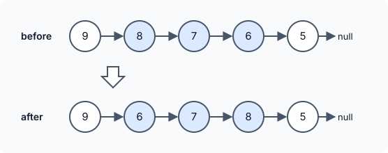

title : Reverse Linked List II

summary : Reverse only the part of a linked list between two positions. Find the node before the range, reverse the range in place, and reconnect both ends, all in one pass.

# Reverse Linked List II

::problem{slug=reverse-linked-list-ii}

## Problem Statement

You are given the `head` of a singly linked list and two positions `left <= right` (1-based). Reverse only the part of the list from position `left` to position `right`, leave everything else in place, and return the head of the list.



### Examples

| Input | Output |
|---|---|
| `head = [9, 8, 7, 6, 5], left = 2, right = 4` | `[9, 6, 7, 8, 5]` |
| `head = [4, 2], left = 1, right = 2` | `[2, 4]` |
| `head = [3], left = 1, right = 1` | `[3]` |

### Constraints

- The list has `n` nodes, `1 <= n <= 500`.
- `-500 <= Node.val <= 500`
- `1 <= left <= right <= n`

**Follow-up:** can you do it in one pass?

:::callout
Reversing a sublist touches only **two outside links**: the node just before position `left` must point to the new front of the sublist, and the old front of the sublist (which becomes its last node) must point to whatever came after position `right`.
:::

## Approach: Find the Node Before, Reverse, Reconnect

The solution uses these pointers:

- `revStart` — the node **before** position `left`, or `nullptr` when `left == 1` (nothing comes before).
- `fn` — the first node of the part to reverse. After the reversal it becomes the **last** node of that part.
- `rv` — the reversed part being built (same three-pointer loop as reversing a whole list).
- `rest` — the first node **after** the reversed part, once the loop finishes.

Steps:

1. Walk `revStart` forward `left - 2` times so it stops at position `left - 1`.
2. Start at `fn = revStart->next` (or `head` if `left == 1`) and reverse exactly `total = right - left + 1` nodes.
3. Reconnect: `fn->next = rest`, and `revStart->next = rv` (if there is a node before). If `left == 1`, the new head is `rv`.

:::code-tabs
```cpp
class Solution {
public:
    ListNode* reverseBetween(ListNode* head, int left, int right) {
        ListNode* revStart = (left == 1 ? nullptr : head); // node before reversed part

        int total = right - left + 1;
        while (revStart && left - 2 > 0) {
            revStart = revStart->next;
            left--;
        }

        ListNode* rest = revStart ? revStart->next : head;

        ListNode* fn = rest; // first node of the part to reverse

        ListNode* rv = nullptr;
        while (rest && total--) {
            ListNode* temp = rest;
            rest = rest->next;
            temp->next = rv;
            rv = temp;
        }

        fn->next = rest;
        if (revStart) revStart->next = rv;

        return revStart ? head : rv;
    }
};
```
```java
class Solution {
    public ListNode reverseBetween(ListNode head, int left, int right) {
        ListNode revStart = (left == 1 ? null : head); // node before reversed part

        int total = right - left + 1;
        while (revStart != null && left - 2 > 0) {
            revStart = revStart.next;
            left--;
        }

        ListNode rest = revStart != null ? revStart.next : head;

        ListNode fn = rest; // first node of the part to reverse

        ListNode rv = null;
        while (rest != null && total-- > 0) {
            ListNode temp = rest;
            rest = rest.next;
            temp.next = rv;
            rv = temp;
        }

        fn.next = rest;
        if (revStart != null) revStart.next = rv;

        return revStart != null ? head : rv;
    }
}
```
```python
class Solution:
    def reverseBetween(self, head: Optional[ListNode], left: int, right: int) -> Optional[ListNode]:
        rev_start = None if left == 1 else head  # node before reversed part

        total = right - left + 1
        while rev_start and left - 2 > 0:
            rev_start = rev_start.next
            left -= 1

        rest = rev_start.next if rev_start else head

        fn = rest  # first node of the part to reverse

        rv = None
        while rest and total > 0:
            total -= 1
            temp = rest
            rest = rest.next
            temp.next = rv
            rv = temp

        fn.next = rest
        if rev_start:
            rev_start.next = rv

        return head if rev_start else rv
```
:::

**Complexity**

- **Time:** `O(right)` — the list is walked only up to position `right`, in a single pass.
- **Space:** `O(1)`.

### Dry Run

`head = [9, 8, 7, 6, 5]`, `left = 2`, `right = 4`

| Step | State |
|---|---|
| find node before | `left - 2 = 0` moves, so `revStart = 9` |
| start of part | `fn = 8`, `total = 3` |
| reverse 3 nodes | `rv = 6 → 7 → 8`, `rest = 5` |
| reconnect | `8.next = 5`, `9.next = 6` |

Result: `9 → 6 → 7 → 8 → 5`.

## Try It Yourself

```python runnable
class ListNode:
    def __init__(self, val=0, next=None):
        self.val = val
        self.next = next

def build(values):
    head = None
    for v in reversed(values):
        head = ListNode(v, head)
    return head

def to_list(node):
    out = []
    while node:
        out.append(node.val)
        node = node.next
    return out

class Solution:
    def reverseBetween(self, head, left, right):
        rev_start = None if left == 1 else head  # node before reversed part

        total = right - left + 1
        while rev_start and left - 2 > 0:
            rev_start = rev_start.next
            left -= 1

        rest = rev_start.next if rev_start else head

        fn = rest  # first node of the part to reverse

        rv = None
        while rest and total > 0:
            total -= 1
            temp = rest
            rest = rest.next
            temp.next = rv
            rv = temp

        fn.next = rest
        if rev_start:
            rev_start.next = rv

        return head if rev_start else rv


sol = Solution()
print(to_list(sol.reverseBetween(build([9, 8, 7, 6, 5]), 2, 4)))  # [9, 6, 7, 8, 5]
print(to_list(sol.reverseBetween(build([4, 2]), 1, 2)))  # [2, 4]
print(to_list(sol.reverseBetween(build([3]), 1, 1)))  # [3]
```

## Edge Cases

- **`left == 1`:** there is no node before the part, so the reversed part's front (`rv`) becomes the new head.
- **`right == n`:** `rest` is `null` after the loop, so the old front of the part becomes the tail.
- **`left == right`:** one node is "reversed" — the list is unchanged.

## Practice Questions

:::details[Why must fn be saved before the reversal loop?]
During the loop, `rest` moves past the part and `rv` ends on its *last* original node. The old first node (which becomes the tail of the reversed part) is no longer reachable from either pointer, but its `next` must be set to `rest`. Saving it as `fn` is the only way to reach it.
:::

:::details[How would a dummy node remove the left == 1 special case?]
Put a dummy node before the head and start `revStart` there, moving it `left - 1` steps. There is then always a node before the part, and the answer is `dummy.next`.
:::
