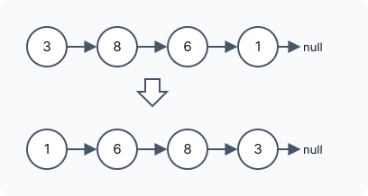

title : Reverse Linked List

summary : Reverse a singly linked list. Learn the classic iterative three-pointer method and two recursive versions, with step-by-step diagrams of how the links change.

# Reverse Linked List

::problem{slug=reverse-linked-list}

## Problem Statement

You are given the `head` of a singly linked list. Reverse the direction of every link so that the last node becomes the first, and return the head of the reversed list.



### Examples

| Input | Output |
|---|---|
| `head = [3, 8, 6, 1]` | `[1, 6, 8, 3]` |
| `head = [10, 20]` | `[20, 10]` |
| `head = []` | `[]` |

### Constraints

- The list has between `0` and `5000` nodes.
- `-5000 <= Node.val <= 5000`

**Follow-up:** a linked list can be reversed both iteratively and recursively. Can you write both?

:::callout
You never need to move values around. Reversing a list only means making every node's `next` point to the node that was **before** it.
:::

## Approach 1: Iterative (Three Pointers)

Walk through the list once, keeping:

- `rv` — the head of the part that is already reversed (starts as `nullptr`),
- `head` — the next node still to be processed,
- `temp` — the node being moved right now.

At each step, detach the front node from the remaining list and push it onto the front of the reversed part:

1. `temp = head`, then `head = head->next` (remember the rest before breaking the link).
2. `temp->next = rv` (point the node backwards).
3. `rv = temp` (it is now the head of the reversed part).

When `head` becomes `nullptr`, `rv` is the new head.

:::code-tabs
```cpp
class Solution {
public:
    ListNode* reverseList(ListNode* head) {
        ListNode* rv = nullptr;
        while (head) {
            ListNode* temp = head;
            head = head->next;
            temp->next = rv;
            rv = temp;
        }
        return rv;
    }
};
```
```java
class Solution {
    public ListNode reverseList(ListNode head) {
        ListNode rv = null;
        while (head != null) {
            ListNode temp = head;
            head = head.next;
            temp.next = rv;
            rv = temp;
        }
        return rv;
    }
}
```
```python
class Solution:
    def reverseList(self, head: Optional[ListNode]) -> Optional[ListNode]:
        rv = None
        while head:
            temp = head
            head = head.next
            temp.next = rv
            rv = temp
        return rv
```
:::

**Complexity**

- **Time:** `O(n)` — every node is visited once.
- **Space:** `O(1)`.

### Dry Run

`head = [3, 8, 6, 1]`

| Step | temp | rv (reversed part) | head (remaining) |
|---|---|---|---|
| start | – | `null` | `3 → 8 → 6 → 1` |
| 1 | 3 | `3` | `8 → 6 → 1` |
| 2 | 8 | `8 → 3` | `6 → 1` |
| 3 | 6 | `6 → 8 → 3` | `1` |
| 4 | 1 | `1 → 6 → 8 → 3` | `null` |

## Approach 2: Recursive, Carrying the Reversed Part

The loop above can be written as recursion. Pass the reversed part (`prev`) along with the current node (`curr`):

- If `curr` is `nullptr`, everything is reversed — return `prev`.
- Otherwise point `curr` backwards to `prev` and recurse on the rest, with `curr` as the new `prev`.

:::code-tabs
```cpp
class Solution {
public:
    ListNode* reverseList(ListNode* curr, ListNode* prev = nullptr) {
        if (!curr) return prev;

        ListNode* nxt = curr->next;
        curr->next = prev;

        return reverseList(nxt, curr);
    }
};
```
```java
class Solution {
    public ListNode reverseList(ListNode head) {
        return reverseList(head, null);
    }

    private ListNode reverseList(ListNode curr, ListNode prev) {
        if (curr == null) return prev;

        ListNode nxt = curr.next;
        curr.next = prev;

        return reverseList(nxt, curr);
    }
}
```
```python
class Solution:
    def reverseList(self, curr: Optional[ListNode], prev: Optional[ListNode] = None) -> Optional[ListNode]:
        if not curr:
            return prev

        nxt = curr.next
        curr.next = prev

        return self.reverseList(nxt, curr)
```
:::

**Complexity**

- **Time:** `O(n)`.
- **Space:** `O(n)` for the recursion stack (one call per node).

## Approach 3: Recursive, Reverse the Rest Then Attach

A different way to think recursively: assume the call `reverseList(head->next)` already reversed everything **after** `head` and returned its new head (the original last node). What is left is to fix the link between `head` and its old successor:

- `head->next` is now the **tail** of the reversed rest, so `head->next->next = head` attaches `head` after it.
- `head->next = nullptr` makes `head` the new tail.

The base case is an empty list or a single node, which is already reversed.

:::code-tabs
```cpp
class Solution {
public:
    ListNode* reverseList(ListNode* head) {
        if (!head || !head->next) return head;
        ListNode* hd = reverseList(head->next); // always the last node of the original list

        // reverse arrow
        head->next->next = head;
        head->next = nullptr;

        return hd;
    }
};
```
```java
class Solution {
    public ListNode reverseList(ListNode head) {
        if (head == null || head.next == null) return head;
        ListNode hd = reverseList(head.next); // always the last node of the original list

        // reverse arrow
        head.next.next = head;
        head.next = null;

        return hd;
    }
}
```
```python
class Solution:
    def reverseList(self, head: Optional[ListNode]) -> Optional[ListNode]:
        if not head or not head.next:
            return head
        hd = self.reverseList(head.next)  # always the last node of the original list

        # reverse arrow
        head.next.next = head
        head.next = None

        return hd
```
:::

**Complexity**

- **Time:** `O(n)`.
- **Space:** `O(n)` for the recursion stack.

:::callout
Both recursive versions use one stack frame per node. With 5000 nodes this is fine, but for very long lists (hundreds of thousands of nodes) the recursion can overflow the call stack. Python's default recursion limit is 1000, so the Python versions need `sys.setrecursionlimit` for lists longer than that.
:::

## Try It Yourself

```python runnable
class ListNode:
    def __init__(self, val=0, next=None):
        self.val = val
        self.next = next

def build(values):
    head = None
    for v in reversed(values):
        head = ListNode(v, head)
    return head

def to_list(node):
    out = []
    while node:
        out.append(node.val)
        node = node.next
    return out

class Solution:
    def reverseList(self, head):
        rv = None
        while head:
            temp = head
            head = head.next
            temp.next = rv
            rv = temp
        return rv


sol = Solution()
print(to_list(sol.reverseList(build([3, 8, 6, 1]))))  # [1, 6, 8, 3]
print(to_list(sol.reverseList(build([10, 20]))))  # [20, 10]
print(to_list(sol.reverseList(build([]))))  # []
```

## Comparison

| Approach | Time | Extra space |
|---|---|---|
| Iterative | `O(n)` | `O(1)` |
| Recursive with accumulator | `O(n)` | `O(n)` stack |
| Recursive, reverse rest then attach | `O(n)` | `O(n)` stack |

## Edge Cases

- **Empty list:** return `null`.
- **Single node:** it is already reversed.
- **Saving `next` first:** in every version, the next node must be saved before `next` is overwritten, otherwise the rest of the list is lost.

## Practice Questions

:::details[In approach 3, why is head->next the tail of the reversed rest?]
Before the recursive call, `head->next` is the first node of the rest. Reversing the rest makes its first node the last one, and the recursive call does not change `head->next`, so it still points to that node — now the tail.
:::

:::details[What goes wrong if approach 3 forgets head->next = nullptr?]
The original head would still point to its old successor, which now points back to it. The result would contain a two-node cycle at the end instead of ending in `null`.
:::
