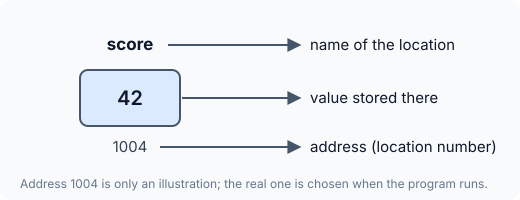
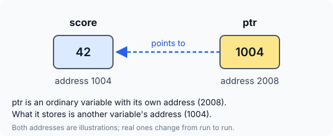

# The & and * Operators in C


Pointers have a reputation for being the hardest part of C. Most of that difficulty comes from the vocabulary — "this variable *points to* that one" sounds mysterious — rather than from the idea itself. Underneath, a pointer is built from two very small operators: `&` and `*`. This article explains both, starting from what actually happens in memory when you declare an ordinary variable.

## What a Declaration Really Does

Take this line:

```c
int score = 42;
```

When the compiler sees it, three things happen:

1. **Memory is reserved** — enough bytes to hold one `int`.
2. **A name is attached** — that block of memory can now be referred to as `score`.
3. **A value is stored** — the number `42` is written into those bytes.

Every block of memory has a **location number**, called its **address**. Picture it like this:



The address `1004` in the picture is made up. Your program does not choose it — the system picks a free location when the program runs, and it may pick a different one next time. What matters is the key fact:

:::callout
**An address is just a number.** Every variable lives at some numbered location in memory, and C lets you get hold of that number.
:::

## The Address-of Operator: `&`

Putting `&` in front of a variable gives you its **address** instead of its value. `score` means "the value stored in score"; `&score` means "where score is stored".

```c runnable
#include <stdio.h>

int main(void)
{
    int score = 42;

    printf("Value of score   = %d\n", score);
    printf("Address of score = %p\n", (void *)&score);

    return 0;
}
```

A sample run prints:

```
Value of score   = 42
Address of score = 0x7ffe92d419b4
```

The value is always `42`, but the address you see will be different — run the program twice and it will most likely change. That is expected: modern operating systems deliberately place a program's memory at a different spot on every run.

:::callout
**Print addresses with `%p`, not `%u` or `%d`.** Older books often print addresses with `%u`. On today's 64-bit systems an address is 8 bytes while `unsigned int` is usually 4, so `%u` is undefined behaviour and can print a wrong number (compilers warn: *format '%u' expects argument of type 'unsigned int', but argument has type 'int \*'*). `%p` is the format made for addresses; it expects a `void *`, which is why the address is cast with `(void *)`.
:::

## The Value-at-Address Operator: `*`

The second operator works in the opposite direction. Putting `*` in front of an **address** gives you **the value stored at that address**. It is called the *value at address* operator, and also the **indirection** or **dereference** operator, because it reaches the value indirectly, through its location.

Since `&score` is an address, `*(&score)` means "the value stored at the address of score" — which is simply `score`:

```c runnable
#include <stdio.h>

int main(void)
{
    int score = 42;
    int direct = score;          /* read the variable by its name   */
    int indirect = *(&score);    /* read it through its address     */

    printf("Read by name:    %d\n", direct);
    printf("Read by address: %d\n", indirect);
    printf("Same value?      %s\n", direct == indirect ? "yes" : "no");

    return 0;
}
```

Output:

```
Read by name:    42
Read by address: 42
Same value?      yes
```

Both reads always give the same value. `&` and `*` undo each other: `&` goes from a variable to its address, and `*` goes from an address back to the value.

| Expression | Meaning | In the example |
|---|---|---|
| `score` | the value stored in `score` | `42` |
| `&score` | the address of `score` | `1004` (illustrative) |
| `*(&score)` | the value at the address of `score` | `42` |

## Storing an Address in a Variable

`&score` produces a number, and numbers can be stored in variables. So the address can be saved for later:

```c
ptr = &score;
```

Now `ptr` holds the address of `score`. But `ptr` is not an ordinary integer variable: what it holds is **the location of another variable**. A variable like this is called a **pointer**.

`ptr` is still a variable in every other way, so the compiler has to give it memory of its own, at its own address:



Two separate boxes, two separate addresses. The only special thing about `ptr` is *what* it stores: the number `1004`, which happens to be where `score` lives. That is all "ptr points to score" means.

Before C lets you store an address in `ptr`, it has to be declared as a pointer. For an address of an `int` the declaration is `int *ptr;` — read it as "the value at the address in `ptr` is an `int`". The program below puts the pieces together:

```c runnable
#include <stdio.h>

int main(void)
{
    int score = 42;
    int *ptr;          /* ptr can hold the address of an int */

    ptr = &score;      /* store score's address in ptr */

    printf("Address of score = %p\n", (void *)&score);
    printf("Value of ptr     = %p\n", (void *)ptr);
    printf("Address of ptr   = %p\n", (void *)&ptr);

    return 0;
}
```

Sample output:

```
Address of score = 0x7ffceec5b2fc
Value of ptr     = 0x7ffceec5b2fc
Address of ptr   = 0x7ffceec5b300
```

The first two lines always match: the value stored in `ptr` *is* the address of `score`. The third line is different, because `ptr` lives at a location of its own.

## Key Takeaways

- Declaring a variable reserves memory, names it, and stores a value in it.
- Every variable has an **address**, which is just a number chosen when the program runs.
- `&x` gives the **address** of `x`.
- `*address` gives the **value stored at** that address, so `*(&x)` is the same as `x`.
- A variable that stores an address is a **pointer**. It has its own memory and its own address, like any other variable.
- Print addresses with `%p` and a `(void *)` cast.

## Practice Questions

:::details[If score is stored at address 1004, what is the value of &score? What is *(&score)?]
`&score` is `1004`, the address. `*(&score)` is the value stored at address `1004`, which is `42` — the same as `score`.
:::

:::details[Why can't you rely on a variable's address being the same every time the program runs?]
The address is chosen by the system when the program is loaded. Modern operating systems also randomise memory layout on purpose (a security feature called address space layout randomisation), so the same variable usually gets a different address on each run.
:::

:::details[ptr stores the address of score. Is &ptr the same as &score?]
No. `&score` is where `score` lives, and that number is what `ptr` stores. `&ptr` is where `ptr` itself lives — a different location, because `ptr` is a separate variable with its own memory.
:::

:::details[What is wrong with printf("%u", &score); on a 64-bit machine?]
`%u` tells `printf` to read an `unsigned int` (usually 4 bytes), but `&score` is a pointer (usually 8 bytes). The mismatch is undefined behaviour and can print a truncated or wrong number. Use `printf("%p", (void *)&score);`.
:::
