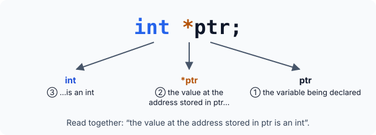
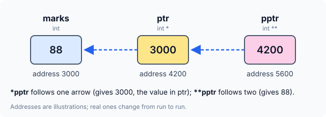

# Pointer Variables and Pointers to Pointers


The previous article showed that `&x` gives the address of `x`, and that `*` gives the value stored at an address. It ended by storing an address in a second variable. This article looks closely at that variable: how it is declared, what its declaration really says, how one pointer can hold the address of another, and the vocabulary programmers use when they talk about pointers.

## Declaring a Pointer

A variable that will hold the address of an `int` is declared like this:

```c
int *ptr;
```

This tells the compiler that `ptr` will be used to store the **address of an integer** — in other words, `ptr` *points to* an `int`.

Why is there a `*` in the declaration? Read it using the meaning of `*` you already know: **value at address**. Then `int *ptr` says: *the value at the address stored in `ptr` is an `int`.*



So the declaration does not describe `ptr` directly. It describes what you get when you apply `*` to `ptr` — and that is an `int`.

## Everything So Far in One Program

The program below combines `&`, `*` and a pointer variable. Before running it, try to predict each line using the memory map from the previous article: `marks` holds `88`, and `ptr` holds the address of `marks`.

```c runnable
#include <stdio.h>

int main(void)
{
    int marks = 88;
    int *ptr;

    ptr = &marks;

    puts("-- addresses --");
    printf("&marks    : %p\n", (void *)&marks);
    printf("ptr       : %p\n", (void *)ptr);
    printf("&ptr      : %p\n", (void *)&ptr);

    puts("-- values --");
    printf("marks     : %d\n", marks);
    printf("*(&marks) : %d\n", *(&marks));
    printf("*ptr      : %d\n", *ptr);

    return 0;
}
```

A sample run:

```
-- addresses --
&marks    : 0x7ffe1509839c
ptr       : 0x7ffe1509839c
&ptr      : 0x7ffe150983a0
-- values --
marks     : 88
*(&marks) : 88
*ptr      : 88
```

What to notice:

- **`&marks` and `ptr` are equal** — `ptr` stores the address of `marks`.
- **`&ptr` is different** — `ptr` is a separate variable at its own location.
- **`marks`, `*(&marks)` and `*ptr` are all `88`** — three ways of reaching the same value: by name, through its address, and through a pointer that holds its address.

:::callout
Everything that follows about pointers is built from these four expressions: `&marks`, `&ptr`, `*ptr` and `*(&marks)`. If any line of the output surprised you, trace it on the memory map before moving on.
:::

## Pointers of Other Types

The same pattern works for any type. Here are three pointer declarations:

```c
int    *count_ptr;
char   *letter_ptr;
double *price_ptr;
```

All three are pointer variables: each one can hold an address. An address is a location number in memory, so every pointer holds that kind of value, whatever type it is declared with.

The type in the declaration describes **what is stored at that address**, not what the pointer itself holds:

| Declaration | What the pointer holds | What `*pointer` gives |
|---|---|---|
| `int *count_ptr;` | the address of an `int` | an `int` |
| `char *letter_ptr;` | the address of a `char` | a `char` |
| `double *price_ptr;` | the address of a `double` | a `double` |

:::callout
`double *price_ptr;` does **not** mean that `price_ptr` holds a floating-point number. It holds an **address**, and the floating-point value lives at that address. Mixing these two up is one of the most common pointer mistakes.
:::

:::callout
Thinking of an address as a whole number is a good mental model, and it is how memory maps are drawn. In the C language itself, though, a pointer is not an integer type: you cannot freely mix pointers and integers, and you print a pointer with `%p`, not with an integer format.
:::

## A Pointer to a Pointer

A pointer is a variable, so it has an address too. That address can be stored in yet another variable — a **pointer to a pointer**:

```c
int marks = 88;
int *ptr = &marks;     /* pointer to an int              */
int **pptr = &ptr;     /* pointer to a pointer to an int */
```

Read `int **pptr` with the same rule as before: `**pptr` — the value at the address stored at the address in `pptr` — is an `int`.



Each `*` follows one arrow in the picture:

| Expression | Follows | Result (using the picture) |
|---|---|---|
| `pptr` | – | `4200`, the address of `ptr` |
| `*pptr` | one arrow | `3000`, the value stored in `ptr` |
| `**pptr` | two arrows | `88`, the value of `marks` |

```c runnable
#include <stdio.h>

int main(void)
{
    int marks = 88;
    int *ptr = &marks;     /* pointer to an int                 */
    int **pptr = &ptr;     /* pointer to a pointer to an int    */

    puts("-- where each variable lives --");
    printf("&marks : %p\n", (void *)&marks);
    printf("&ptr   : %p\n", (void *)&ptr);
    printf("&pptr  : %p\n", (void *)&pptr);

    puts("-- what each variable stores --");
    printf("ptr    : %p  (address of marks)\n", (void *)ptr);
    printf("pptr   : %p  (address of ptr)\n", (void *)pptr);
    printf("*pptr  : %p  (value stored in ptr)\n", (void *)*pptr);

    puts("-- reaching marks --");
    printf("marks  : %d\n", marks);
    printf("*ptr   : %d\n", *ptr);
    printf("**pptr : %d\n", **pptr);

    return 0;
}
```

A sample run:

```
-- where each variable lives --
&marks : 0x7ffdf0fc9264
&ptr   : 0x7ffdf0fc9268
&pptr  : 0x7ffdf0fc9270
-- what each variable stores --
ptr    : 0x7ffdf0fc9264  (address of marks)
pptr   : 0x7ffdf0fc9268  (address of ptr)
*pptr  : 0x7ffdf0fc9264  (value stored in ptr)
-- reaching marks --
marks  : 88
*ptr   : 88
**pptr : 88
```

Match each line to the memory map: `pptr` equals `&ptr`, `*pptr` equals `ptr` (which equals `&marks`), and `**pptr` reaches `88`.

### How Far Can This Go?

To compare the three declarations:

```c
int    marks;   /* an ordinary int                */
int   *ptr;     /* a pointer to an int            */
int  **pptr;    /* a pointer to a pointer to an int */
```

Nothing stops you from adding more levels — `int ***` is a pointer to a pointer to a pointer, and so on. In practice, programs rarely need more than two levels; beyond that the code becomes hard for people to follow.

## The Jargon of Pointers

Consider this fragment:

```c
int temperature = 21;
int *tp;
tp = &temperature;
```

Which of these statements are true?

1. `tp` holds the address of an `int`.
2. The value at the address held in `tp` is an `int`.
3. `tp` is an `int` pointer.
4. `tp` points to an `int`.
5. `tp` is a pointer that points in the direction of an `int`.

**All of them.** They are five ways of saying one fact: `tp` holds the address of an `int`, so it is called an **`int` pointer**. This is the vocabulary that makes pointers sound harder than they are — each phrase is just shorthand for "holds the address of".

The same naming rule applies to any type. A pointer is named after the kind of thing whose address it holds:

| A pointer holding the address of… | is called… |
|---|---|
| an `int` | an `int` pointer |
| a `float` | a `float` pointer |
| an array | an array pointer |
| a structure | a structure pointer |
| a function | a function pointer |

## Key Takeaways

- `int *ptr;` reads as "the value at the address stored in `ptr` is an `int`".
- A pointer always holds an **address**; its declared type describes what lives at that address.
- A pointer has its own address, so `&ptr` is different from `ptr`.
- A pointer to a pointer (`int **pptr`) holds the address of another pointer; each `*` follows one level.
- "Points to an `int`", "`int` pointer" and "holds the address of an `int`" all mean the same thing.

## Practice Questions

:::details[Given int *ptr = &marks;, which two expressions in the first program always print the same address?]
`&marks` and `ptr`. `ptr` was assigned `&marks`, so its value is the address of `marks`. `&ptr` is the address of `ptr` itself and is different.
:::

:::details[What does char *letter_ptr; say about letter_ptr? Does it hold a character?]
No. `letter_ptr` holds an **address**. The declaration says that the value stored *at* that address is a `char`, so `*letter_ptr` is a `char`.
:::

:::details[In the pointer-to-pointer picture, what are pptr, *pptr and **pptr?]
`pptr` is `4200` (the address of `ptr`), `*pptr` is `3000` (the value stored in `ptr`, which is the address of `marks`), and `**pptr` is `88` (the value of `marks`).
:::

:::details[If you declared int ***p3 = &pptr;, how many * would you need to reach marks?]
Three: `***p3`. `*p3` is `pptr`, `**p3` is `ptr`, and `***p3` is `marks`.
:::

:::details[A pointer q holds the address of a structure. What would you call q?]
A structure pointer. A pointer is named after the type of the thing whose address it holds.
:::
