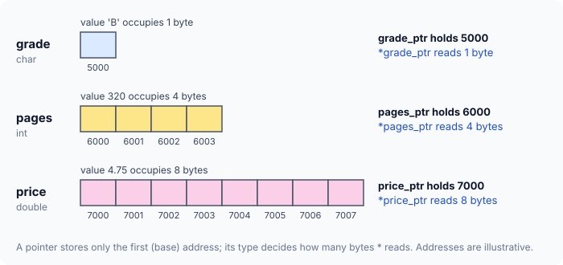
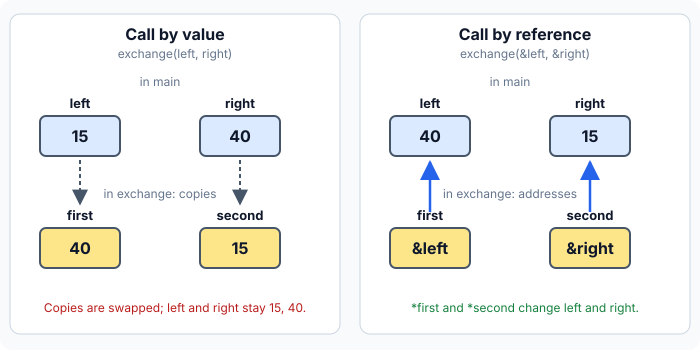

# Pointer Types, Passing Addresses to Functions, and Returning Pointers

The earlier articles used `int` pointers only. This one answers three practical questions:

1. Why does a pointer need a type at all, if every pointer just holds an address?
2. How can a function change variables that belong to its caller?
3. Can a function hand back a pointer, and what can go wrong when it does?

## Pointers to Different Types

Here are three variables of different types, each with a pointer that holds its address:

```c runnable
#include <stdio.h>

int main(void)
{
    char   grade = 'B';
    int    pages = 320;
    double price = 4.75;

    char   *grade_ptr = &grade;
    int    *pages_ptr = &pages;
    double *price_ptr = &price;

    printf("grade_ptr holds %p, *grade_ptr = %c\n", (void *)grade_ptr, *grade_ptr);
    printf("pages_ptr holds %p, *pages_ptr = %d\n", (void *)pages_ptr, *pages_ptr);
    printf("price_ptr holds %p, *price_ptr = %.2f\n", (void *)price_ptr, *price_ptr);

    printf("bytes read: char %zu, int %zu, double %zu\n",
           sizeof *grade_ptr, sizeof *pages_ptr, sizeof *price_ptr);

    return 0;
}
```

A sample run on a typical 64-bit machine:

```
grade_ptr holds 0x7ffe1dfa1e73, *grade_ptr = B
pages_ptr holds 0x7ffe1dfa1e74, *pages_ptr = 320
price_ptr holds 0x7ffe1dfa1e78, *price_ptr = 4.75
bytes read: char 1, int 4, double 8
```

Each value went in through a pointer of the matching type and came back out correctly. The last line shows the important detail: the three variables occupy **different numbers of bytes**.

### A Pointer Stores Only the First Byte's Address

A `char` occupies 1 byte, an `int` usually 4 and a `double` 8. Yet each pointer holds just **one** address — the address of the variable's **first byte**, often called its **base address**.



So how does `*pages_ptr` know to read all 4 bytes of `pages`, and not just the first one? **From the pointer's type.** Because `pages_ptr` is declared as an `int` pointer, `*pages_ptr` reads one `int`'s worth of bytes starting at the base address. Likewise `*price_ptr` reads 8 bytes because it is a `double` pointer, and `*grade_ptr` reads 1 byte.

:::callout
This is the real reason pointers have types. The address tells `*` **where to start**; the type tells it **how many bytes to read** and **how to interpret them**.
:::

:::callout
Byte counts depend on the system. Older 16-bit compilers used 2-byte `int`s; on today's common 64-bit systems an `int` is 4 bytes. Use `sizeof` rather than assuming a size.
:::

### Reading Through the Wrong Pointer Type

What happens if the address of an `int` is stored in a pointer to a 1-byte type? The address is still correct — but `*` now reads only one byte:

```c runnable
#include <stdio.h>

int main(void)
{
    int pages = 320;                                  /* 320 = 0x00000140 */

    int           *as_int  = &pages;                  /* right type        */
    unsigned char *as_byte = (unsigned char *)&pages; /* wrong type: 1 byte */

    printf("Same address?    %s\n", (void *)as_int == (void *)as_byte ? "yes" : "no");
    printf("Read as an int:  %d\n", *as_int);
    printf("Read as a byte:  %d\n", *as_byte);

    return 0;
}
```

Output on a typical PC:

```
Same address?    yes
Read as an int:  320
Read as a byte:  64
```

Both pointers hold the same address, but `*as_byte` reads just the first byte of `pages`. `320` is `0x140` in hexadecimal; most PCs store the least significant byte first, so that first byte is `0x40`, which is `64`.

The `(unsigned char *)` in front of `&pages` is a **cast**: it tells the compiler to treat the `int` address as a byte address. Without it, the compiler warns that the pointer types do not match — that warning is exactly the mistake this example demonstrates.

:::callout
**Match the pointer type to the data.** To read an `int` through its address, keep the address in an `int` pointer; to read a `double`, use a `double` pointer. A mismatched pointer reads the wrong number of bytes and produces a wrong value.
:::

The result `64` is for little-endian machines (which store the low byte first), such as x86 and most ARM systems. A big-endian machine stores the high byte first and would print `0`.

## Passing Addresses to Functions

A function can receive its arguments in one of two ways:

1. **The values** of the arguments — *call by value*.
2. **The addresses** of the arguments — *call by reference*.

### Call by Value

With call by value, the value of each **actual argument** (the one written in the call) is **copied** into the matching **formal argument** (the parameter inside the function). The function works on its own copies, so whatever it does to them has no effect on the caller's variables.

```c runnable
#include <stdio.h>

void exchange(int first, int second)
{
    int temp = first;
    first = second;
    second = temp;
    printf("inside exchange: first = %d, second = %d\n", first, second);
}

int main(void)
{
    int left = 15, right = 40;

    exchange(left, right);
    printf("back in main:    left = %d, right = %d\n", left, right);

    return 0;
}
```

Output:

```
inside exchange: first = 40, second = 15
back in main:    left = 15, right = 40
```

`exchange` did swap its two values — but only its copies. `left` and `right` in `main` are untouched.

### Call by Reference

With call by reference, the **addresses** of the actual arguments are copied into the formal arguments, which are therefore pointers. Through those addresses, the function can reach — and change — the caller's variables directly.

```c runnable
#include <stdio.h>

void exchange(int *first, int *second)
{
    int temp = *first;
    *first = *second;
    *second = temp;
}

int main(void)
{
    int left = 15, right = 40;

    exchange(&left, &right);
    printf("back in main: left = %d, right = %d\n", left, right);

    return 0;
}
```

Output:

```
back in main: left = 40, right = 15
```

This time `first` holds the address of `left` and `second` the address of `right`, so `*first` and `*second` **are** `left` and `right`. Swapping them swaps the caller's variables.



:::callout
Strictly speaking, C always passes arguments by value — in the second program, it is the *addresses* that get copied. "Call by reference" is the usual name for this technique of passing addresses so that a function can modify the caller's variables.
:::

### Returning More Than One Result

A `return` statement hands back only **one** value. Passing addresses gets around that: the function writes each result to an address supplied by the caller.

The function below splits a number of seconds into minutes and seconds. The input is passed by value; the two results come back through pointers:

```c runnable
#include <stdio.h>

/* total_seconds comes in by value; the two results go out through pointers */
void split_time(int total_seconds, int *minutes, int *seconds)
{
    *minutes = total_seconds / 60;
    *seconds = total_seconds % 60;
}

int main(void)
{
    int mins, secs;

    split_time(437, &mins, &secs);
    printf("437 seconds = %d min %d s\n", mins, secs);

    return 0;
}
```

Output:

```
437 seconds = 7 min 17 s
```

This is a **mixed call**: one argument by value, two by address. Because `split_time` stores its answers at the addresses of `mins` and `secs`, the values are already in `main`'s variables when the function returns.

## Functions Returning Pointers

A function can return an `int`, a `double` — or a **pointer**. The return type says so, both in the declaration (the *prototype*) and in the definition:

```c runnable
#include <stdio.h>

int *get_limit(void);           /* returns the address of an int */

int main(void)
{
    int *limit_ptr = get_limit();

    printf("limit_ptr holds %p\n", (void *)limit_ptr);
    printf("*limit_ptr = %d\n", *limit_ptr);

    return 0;
}

int *get_limit(void)
{
    static int limit = 50;      /* static: lives for the whole program */
    return &limit;
}
```

Sample output:

```
limit_ptr holds 0x557f9a240010
*limit_ptr = 50
```

The prototype `int *get_limit(void);` tells the compiler that `get_limit` takes no arguments and returns an `int` pointer. `main` stores the returned address in `limit_ptr` and reads `50` through it.

### Why `static` Matters Here

Remove `static`, and the function returns the address of an ordinary local variable:

```c
int *get_limit(void)
{
    int limit = 50;      /* ordinary local variable */
    return &limit;       /* WRONG: limit stops existing when the function returns */
}
```

An ordinary local variable exists only while its function is running. When `get_limit` returns, `limit` is gone, so the returned address points at memory that no longer belongs to it — a **dangling pointer**. Reading `*limit_ptr` after that is undefined behaviour.

Declaring the variable `static` keeps it alive for the whole run of the program, so its address stays valid after the function returns.

:::callout
**Never return the address of an ordinary local variable.** Modern compilers warn about it (*function returns address of local variable*), and with GCC the program may even receive a null pointer and crash on `*limit_ptr`. Older books describe the result as just "a wrong value"; today you should expect a crash or worse.
:::

## Key Takeaways

- A pointer stores only the **base address** (first byte) of a variable; its **type** decides how many bytes `*` reads.
- Reading data through a pointer of the wrong type reads the wrong bytes. Match the pointer type to the data.
- **Call by value** copies values: the function cannot change the caller's variables.
- **Call by reference** passes addresses: through them, the function can change the caller's variables.
- Passing addresses lets a function deliver **more than one result**.
- A function can return a pointer, but never the address of an ordinary local variable — use `static` (or memory that outlives the call).

## Practice Questions

:::details[A double occupies 8 bytes starting at address 7000. What does a double pointer to it hold, and how many bytes does * read?]
It holds `7000`, the base address only. Because it is a `double` pointer, `*` reads 8 bytes, from `7000` to `7007`.
:::

:::details[Why did *as_byte print 64 instead of 320?]
`as_byte` points to a 1-byte type, so `*as_byte` reads only the first byte of `pages`. On a little-endian machine that is the low byte of `0x140`, which is `0x40` = `64`.
:::

:::details[After exchange(left, right) with the call-by-value version, why are left and right unchanged?]
`first` and `second` received **copies** of `left` and `right`. Swapping the copies does not touch the originals in `main`.
:::

:::details[How would you write a function that gives back both the sum and the product of two ints?]
Pass the two numbers by value and two result addresses: `void sum_product(int a, int b, int *sum, int *product) { *sum = a + b; *product = a * b; }`, called as `sum_product(3, 4, &s, &p);`.
:::

:::details[What is wrong with returning &limit when limit is an ordinary local variable?]
`limit` is destroyed when the function returns, so the caller receives a dangling pointer. Using it is undefined behaviour. Making `limit` `static` keeps it alive for the whole program.
:::
