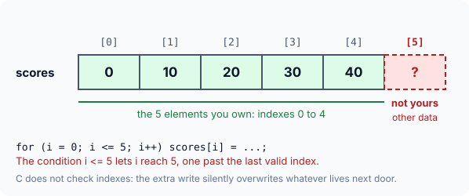
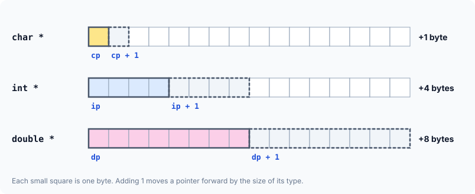
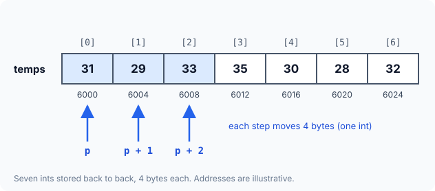

title : Arrays and Pointer Arithmetic

summary : How arrays are laid out in memory, why an array name gives its base address, and how pointer arithmetic moves by whole elements. Learn why a[i] means *(a + i) and which pointer operations are allowed.

# Arrays and Pointer Arithmetic

Arrays and pointers are so tightly linked in C that you cannot really understand one without the other. Every time you walk through an array, pointers are involved behind the scenes. This article starts the connection: what an array is and how it sits in memory, how to hand array elements to functions, and the **pointer arithmetic** that lets a pointer move from one element to the next.

## Why Arrays Exist

Suppose a program needs to keep the noon temperature for every day of a week. With ordinary variables you would need seven of them — `t0`, `t1`, …, `t6` — and seven separate lines of code to print them. For a whole year it would be 365 variables. That does not scale, and some tasks (such as "find the hottest day") become almost impossible to write.

An **array** solves this. It is a **single variable that holds many values of the same type**, stored one after another in memory. Each value is an **element**, and you pick an element by its position, called its **index** or **subscript**.

```c
int temps[7] = {31, 29, 33, 35, 30, 28, 32};
```

Here `temps` is one name for all seven readings. `temps[0]` is the first one (`31`), `temps[3]` is the fourth (`35`), and `temps[6]` is the last (`32`).

:::callout
C counts positions from **0**. The first element of every array is index `0`, so the last element of an array of `n` elements is index `n - 1`. `temps[7]` does **not** exist.
:::

Because all the readings share one name, a loop can process them with a single statement:

```c runnable
#include <stdio.h>

int main(void)
{
    int temps[7] = {31, 29, 33, 35, 30, 28, 32};   /* one week of readings */
    int count = sizeof temps / sizeof temps[0];     /* number of elements   */

    printf("temps holds %d elements\n", count);
    for (int day = 0; day < count; day++)
        printf("temps[%d] = %d\n", day, temps[day]);

    return 0;
}
```

```
temps holds 7 elements
temps[0] = 31
temps[1] = 29
temps[2] = 33
temps[3] = 35
temps[4] = 30
temps[5] = 28
temps[6] = 32
```

`sizeof temps` is the size of the whole array in bytes (7 × 4 = 28 here) and `sizeof temps[0]` is the size of one element (4), so dividing them gives the number of elements. This keeps the loop correct even if you later change the array's size.

## Declaring and Initialising Arrays

A declaration states the element type, the name and the number of elements (the **dimension**):

```c
int    marks[30];      /* 30 ints     */
double prices[60];     /* 60 doubles  */
char   name[25];       /* 25 chars    */
```

All elements of one array have the **same type** — an array cannot hold 10 numbers of which 5 are `int` and 5 are `double`. An array of `char` is how C stores text; such arrays are usually called **strings** and get their own article later.

Arrays can be given values where they are declared:

```c runnable
#include <stdio.h>

int totals[4];                          /* outside any function: all zeros */

int main(void)
{
    int full[5]    = {7, 1, 4, 9, 2};    /* every element given           */
    int partial[5] = {7, 1};             /* rest become 0                 */
    int sized[]    = {7, 1, 4};          /* size taken from the list: 3   */

    printf("full:    %d %d %d %d %d\n", full[0], full[1], full[2], full[3], full[4]);
    printf("partial: %d %d %d %d %d\n", partial[0], partial[1], partial[2], partial[3], partial[4]);
    printf("sized has %zu elements\n", sizeof sized / sizeof sized[0]);
    printf("totals:  %d %d %d %d\n", totals[0], totals[1], totals[2], totals[3]);

    return 0;
}
```

```
full:    7 1 4 9 2
partial: 7 1 0 0 0
sized has 3 elements
totals:  0 0 0 0
```

### Key Facts About Arrays

| Fact | Example |
|---|---|
| An array is a collection of elements of **one type**. | `int temps[7];` holds only `int`s |
| Type and size must be declared before use. | `double prices[60];` |
| Indexes run from `0` to `size - 1`. | `temps[0]` … `temps[6]` |
| Elements are stored in **consecutive (contiguous)** memory locations. | see the next section |
| An array can be initialised where it is declared. | `int full[5] = {7, 1, 4, 9, 2};` |
| With an initialiser, the size may be left out. | `int sized[] = {7, 1, 4};` has 3 elements |
| If you give fewer values than the size, the rest are `0`. | `int partial[5] = {7, 1};` |
| An uninitialised array inside a function holds **garbage** (unpredictable values); one declared outside all functions, or `static`, starts as all zeros. | `int scratch[5];` inside `main` — unknown values |

### C Does Not Check Array Bounds

There is one more fact, and it causes more bugs than all the others combined: **C never checks that an index is inside the array.** Writing to `scores[5]` in a 5-element array is not reported as an error — the value is simply written into whatever memory comes next, which may belong to another variable or to the program itself.



The classic version of this bug is a loop that uses `<=` instead of `<`:

```c
#include <stdio.h>

int main(void)
{
    int scores[5];

    for (int i = 0; i <= 5; i++)    /* BUG: <= runs one step too far */
        scores[i] = i * 10;

    printf("%d\n", scores[0]);
    return 0;
}
```

The result is **undefined behaviour**: the program might seem to work, print nonsense, or crash — and it may behave differently on another machine or after an unrelated change.

:::callout
**Staying inside the array is the programmer's job, not the compiler's.** Loop with `i < size`, not `i <= size`. Two tools help catch mistakes: GCC with optimisation (`-O2 -Wall`) can warn *iteration 5 invokes undefined behavior* for simple loops like this one, and compiling with `-fsanitize=address -g` makes the program stop with a **stack-buffer-overflow** report at the exact bad write.
:::

## Passing Array Elements to a Function

An array element is just a variable, so it can be passed to a function in the two ways you already know:

1. **By value** — pass `temps[day]`, and the function gets a copy of that element.
2. **By address** — pass `&temps[day]`, and the function gets a pointer to that element.

### By Value

```c runnable
#include <stdio.h>

void print_reading(int value)        /* receives a copy of one element */
{
    printf("%d ", value);
}

int main(void)
{
    int temps[7] = {31, 29, 33, 35, 30, 28, 32};

    for (int day = 0; day < 7; day++)
        print_reading(temps[day]);
    printf("\n");

    return 0;
}
```

```
31 29 33 35 30 28 32 
```

Each call passes one element. The function receives it in an ordinary `int` parameter, exactly as it would receive any other `int`.

### By Address

```c runnable
#include <stdio.h>

void print_at(const int *where)      /* receives the address of one element */
{
    printf("%d ", *where);
}

void add_one(int *where)             /* can change the element it points to */
{
    *where = *where + 1;
}

int main(void)
{
    int temps[7] = {31, 29, 33, 35, 30, 28, 32};

    for (int day = 0; day < 7; day++)
        print_at(&temps[day]);
    printf("\n");

    add_one(&temps[3]);              /* change one element through its address */
    printf("temps[3] is now %d\n", temps[3]);

    return 0;
}
```

```
31 29 33 35 30 28 32 
temps[3] is now 36
```

Now each call passes the **address** of an element, so the parameter must be a pointer, and the function reaches the element with `*`. Because it holds the address, a function such as `add_one` can also **change** the element in the caller's array.

:::callout
The `const` in `const int *where` promises that `print_at` will only read through the pointer, never write. The compiler enforces the promise, and readers of the code can see at a glance that the function does not modify the array. Use it whenever a function only needs to look.
:::

:::details[Try it: complete the function show()]
Below, `main` passes each element's address to `pass_along`, which hands it on to `show` by passing **the address of its own pointer**. Write `show` so that it prints the element.

```c
void pass_along(int *where)
{
    show(&where);
}
```

**Answer.** `&where` is the address of a pointer to an `int`, so `show` receives an `int **`. One `*` gives back the pointer, and a second `*` gives the element:

```c runnable
#include <stdio.h>

void show(int **pp)
{
    printf("%d ", **pp);             /* *pp is the pointer, **pp the element */
}

void pass_along(int *where)
{
    show(&where);                    /* pass the address of the pointer */
}

int main(void)
{
    int temps[7] = {31, 29, 33, 35, 30, 28, 32};

    for (int day = 0; day < 7; day++)
        pass_along(&temps[day]);
    printf("\n");

    return 0;
}
```

```
31 29 33 35 30 28 32 
```
:::

## Pointer Arithmetic

To see what pointers have to do with arrays, we first need the rules for doing arithmetic on pointers.

### Adding 1 Moves to the Next Element

When a pointer is incremented, it does not move forward by one byte. It moves forward by **the size of the type it points to**, so that it lands on the next value of that type.

```c runnable
#include <stdio.h>

int main(void)
{
    int    count = 3;
    double level = 1.5;
    char   grade = 'A';

    int    *ip = &count;
    double *dp = &level;
    char   *cp = &grade;

    printf("ip: %p -> %p\n", (void *)ip, (void *)(ip + 1));
    printf("dp: %p -> %p\n", (void *)dp, (void *)(dp + 1));
    printf("cp: %p -> %p\n", (void *)cp, (void *)(cp + 1));

    printf("steps in bytes: int %td, double %td, char %td\n",
           (char *)(ip + 1) - (char *)ip,
           (char *)(dp + 1) - (char *)dp,
           (char *)(cp + 1) - (char *)cp);

    return 0;
}
```

A sample run:

```
ip: 0x7ffc3ab638b4 -> 0x7ffc3ab638b8
dp: 0x7ffc3ab638b8 -> 0x7ffc3ab638c0
cp: 0x7ffc3ab638b3 -> 0x7ffc3ab638b4
steps in bytes: int 4, double 8, char 1
```

The addresses change from run to run, but the steps do not: `ip + 1` is 4 bytes on, `dp + 1` is 8 bytes on and `cp + 1` is 1 byte on.



The last line converts both pointers to `char *` before subtracting them, so the difference is counted in bytes. (Pointing `+ 1` past a single variable is allowed, as long as you never read or write through that address.)

### What You Can and Cannot Do

The same rule applies to adding or subtracting any whole number: `p + 3` is three elements further on, `p - 2` is two elements back.

| Operation | Allowed? | Meaning |
|---|---|---|
| `p + n`, `p - n`, `p++`, `p--` | yes | move `n` elements forward or back |
| `q - p` (both in the same array) | yes | number of **elements** between them |
| `p < q`, `p == q`, … (same array) | yes | which one comes first; are they equal |
| `p + q` | **no** | adding two addresses has no meaning |
| `p * 2`, `p / 2` | **no** | multiplying or dividing an address has no meaning |

:::callout
Pointer arithmetic is only defined **inside one array** (plus the position just past its last element). Moving a pointer before the first element or more than one past the end, or subtracting pointers into two different arrays, is undefined behaviour even if you never read through the result.
:::

## Arrays Live in Consecutive Memory

Two facts now come together:

1. Array elements are stored in **consecutive** memory locations.
2. Adding 1 to a pointer moves it to the **next location of its type**.

So if a pointer holds the address of `temps[0]`, adding 1 makes it point at `temps[1]`, adding 2 at `temps[2]`, and so on. The program below confirms the first fact by printing each element's address:

```c runnable
#include <stdio.h>

int main(void)
{
    int temps[7] = {31, 29, 33, 35, 30, 28, 32};

    for (int day = 0; day < 7; day++)
        printf("temps[%d] at %p\n", day, (void *)&temps[day]);

    printf("gap between neighbours: %td bytes\n",
           (char *)&temps[1] - (char *)&temps[0]);

    return 0;
}
```

A sample run:

```
temps[0] at 0x7ffccbbdb8a0
temps[1] at 0x7ffccbbdb8a4
temps[2] at 0x7ffccbbdb8a8
temps[3] at 0x7ffccbbdb8ac
temps[4] at 0x7ffccbbdb8b0
temps[5] at 0x7ffccbbdb8b4
temps[6] at 0x7ffccbbdb8b8
gap between neighbours: 4 bytes
```

Your addresses will differ, but each one is always exactly `sizeof(int)` bytes (4 here) after the previous one. With simple illustrative addresses, the array looks like this:



## Two Ways to Walk Through an Array

### With Subscripts

The familiar way: a loop counter picks each element by its index.

```c runnable
#include <stdio.h>

int main(void)
{
    int temps[7] = {31, 29, 33, 35, 30, 28, 32};

    for (int day = 0; day < 7; day++)
        printf("%d ", temps[day]);           /* subscript: the day-th element */
    printf("\n");

    return 0;
}
```

```
31 29 33 35 30 28 32 
```

### With a Pointer

Store the address of the first element in a pointer, read through it, then step it forward:

```c runnable
#include <stdio.h>

int main(void)
{
    int temps[7] = {31, 29, 33, 35, 30, 28, 32};
    int *p = &temps[0];                      /* start at the first element */

    for (int day = 0; day < 7; day++) {
        printf("%d ", *p);                   /* read the current element    */
        p++;                                 /* step to the next element    */
    }
    printf("\n");

    return 0;
}
```

```
31 29 33 35 30 28 32 
```

On the first pass `p` holds the address of `temps[0]`, so `*p` is `31`. After `p++` it holds the address of `temps[1]`, so `*p` is `29`, and so on to the end.

### Letting the Pointer Control the Loop

Pointer comparison and subtraction let the pointer itself decide when to stop — and tell you where you are. This version also finds the hottest day:

```c runnable
#include <stdio.h>

int main(void)
{
    int temps[7] = {31, 29, 33, 35, 30, 28, 32};
    int *first = &temps[0];
    int *end   = &temps[7];                  /* one past the last element: never read it */

    for (int *p = first; p < end; p++)       /* compare pointers to stop */
        printf("%d ", *p);
    printf("\n");

    int *hottest = first;
    for (int *p = first; p < end; p++)
        if (*p > *hottest)
            hottest = p;

    printf("hottest = %d, on day %td\n", *hottest, hottest - first);  /* pointer subtraction */

    return 0;
}
```

```
31 29 33 35 30 28 32 
hottest = 35, on day 3
```

`end` is the address **just past** the last element. Forming that address is allowed — it is the standard way to mark the end of an array — but it must never be read. The loop stops as soon as `p` reaches it. Subtracting `hottest - first` gives the number of elements between them, which is exactly the index of the hottest day.

### Which Should You Use?

Older books often claim that pointer access is always faster than subscripts. That was true for early compilers, but it is not a reason to choose today: an optimising compiler turns both loops into the same machine code. (With `gcc -O2`, a loop that sums an array with `a[i]` and one that sums it with `*p++` compile to an identical four-instruction inner loop — the compiler rewrites the subscript version into a pointer walk on its own.)

Choose whichever makes the code clearer:

- **Pointers** read naturally when you process elements **in a fixed order** — start to end, end to start, every second element.
- **Subscripts** are clearer when you jump around, or when the **index itself means something** (day 3, row 5, student 42).

## Key Takeaways

- An array holds many values of one type under one name; indexes run from `0` to `size - 1`.
- `sizeof arr / sizeof arr[0]` gives the number of elements of an array declared in the same scope.
- Elements are stored in consecutive memory, one after another.
- C does **not** check indexes; reading or writing outside an array is undefined behaviour. Loop with `<`, not `<=`.
- Elements can be passed to functions by value (`arr[i]`) or by address (`&arr[i]`); only the address lets the function change the element.
- `p + 1` moves a pointer forward by the size of its type. You can add or subtract integers, subtract two pointers into the same array, and compare them — but not add, multiply or divide pointers.
- Walking an array with a pointer and with subscripts are equally fast with a modern compiler; pick the clearer one.

## Practice Questions

:::details[An int array starts at address 6000. At which address does element [5] start, if an int is 4 bytes?]
`6000 + 5 × 4 = 6020`. Element `[i]` starts `i × sizeof(int)` bytes after the start of the array.
:::

:::details[What is wrong with: double prices[4]; for (int i = 1; i <= 4; i++) prices[i] = 0;]
Two problems. It skips `prices[0]`, the first element, and it writes `prices[4]`, which is one past the end — undefined behaviour. The correct loop is `for (int i = 0; i < 4; i++)`.
:::

:::details[int partial[6] = {5, 8}; — what are partial[1] and partial[4]?]
`partial[1]` is `8`. `partial[4]` is `0`: when an initialiser lists fewer values than the size, the remaining elements are set to zero.
:::

:::details[p points to temps[2]. Which elements do *(p + 3) and *(p - 2) refer to?]
`p + 3` points 3 elements further on, so `*(p + 3)` is `temps[5]`. `p - 2` points 2 elements back, so `*(p - 2)` is `temps[0]`. Both stay inside the array, so both are valid.
:::

:::details[A function must double every value it receives. Should it take int value or int *value? Why?]
`int *value`. A function that receives a copy (`int value`) can only change its copy; with the element's address it can change the element in the caller's array: `*value = *value * 2;`.
:::

:::details[q points to temps[6] and p to temps[1]. What is q - p, and what is (char *)q - (char *)p for an int array?]
`q - p` is `5` — the number of **elements** between them. Converted to `char *`, the difference is counted in **bytes**: `5 × 4 = 20`.
:::
