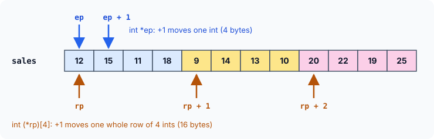

# Passing Arrays to Functions and Two-Dimensional Arrays

In the previous article we passed array elements to functions **one at a time** — either a copy of each element, or the address of each element. That works, but it is clumsy: a function that wants to total, sort or print an array should be able to receive the **whole array** in one go.

This article shows how that is done, and in the process uncovers the single most important fact about arrays in C: *an array's name is a pointer to its first element*. Once that clicks, `a[i]` stops being magic syntax and becomes simple pointer arithmetic. We then extend the idea to **two-dimensional arrays** — tables of rows and columns — and see that they, too, are nothing but pointers and arithmetic underneath.

## Passing an Entire Array to a Function

Think back to the pointer walk from the previous article: we put the address of element `0` in a pointer, read `*p`, then did `p++` to step to the next element. Nothing in that loop needed the array itself — only **where it starts** and **how many elements to visit**.

That is exactly what a function needs, too. So to hand a whole array to a function, we pass two things:

1. the address of its first element, and
2. the number of elements.

```c runnable
#include <stdio.h>

void print_all(const int *p, int n)      /* p: where the array starts, n: how many */
{
    for (int i = 0; i < n; i++) {
        printf("%d ", *p);
        p++;                              /* move to the next element */
    }
    printf("\n");
}

int main(void)
{
    int scores[6] = {72, 85, 64, 90, 58, 77};

    print_all(&scores[0], 6);             /* address of the first element ...   */
    print_all(scores, 6);                 /* ... is exactly what the name gives */

    return 0;
}
```

```
72 85 64 90 58 77 
72 85 64 90 58 77 
```

Look at the two calls in `main`. The first passes `&scores[0]`, the address of the first element — nothing new there. The second passes just `scores`, the **name** of the array, and produces exactly the same result. That is because:

:::callout
**When you use an array's name in an expression, C gives you the address of its first element.** `scores` and `&scores[0]` mean the same thing. This address is called the array's **base address**.
:::

Why is the count `6` needed? Because the function receives only an address. An address says where the data **starts**; it says nothing about where it **ends**. Without `n`, the loop in `print_all` would have no idea when to stop.

### The Function Gets a Pointer, Not a Copy

This has a consequence that surprises almost everyone the first time. Inside the function, the parameter is just a pointer — so `sizeof` reports the size of a pointer, not of the array:

```c runnable
#include <stdio.h>

void report(const int *p)
{
    printf("inside report: sizeof p      = %zu bytes (just a pointer)\n", sizeof p);
}

int main(void)
{
    int scores[6] = {72, 85, 64, 90, 58, 77};

    printf("inside main:   sizeof scores = %zu bytes (the whole array)\n", sizeof scores);
    report(scores);

    return 0;
}
```

```
inside main:   sizeof scores = 24 bytes (the whole array)
inside report: sizeof p      = 8 bytes (just a pointer)
```

In `main`, `scores` is the real array: 6 `int`s × 4 bytes = 24 bytes. In `report`, all that arrived is an 8-byte address. So the `sizeof arr / sizeof arr[0]` trick from the previous article only works where the array was declared — **never inside a function that received it**. That is one more reason the element count has to be passed separately.

Two more things follow from "the function gets a pointer":

- **No copy is made.** Passing a million-element array costs the same as passing one address — fast, no matter the size.
- **The function can change the caller's array**, because it works on the original elements through their addresses. If it should only read them, say so with `const`, as `print_all` does.

### An Array Name Is Not a Pointer Variable

The name behaves like an address, but it is not a variable that holds one. It is fixed to the array, so it cannot be moved:

```c
int scores[6] = {72, 85, 64, 90, 58, 77};
scores++;            /* error: lvalue required as increment operand */
```

To walk through an array, copy the address into a real pointer (`int *p = scores;`) and move that instead — which is exactly what happens when the array is passed to a function: the parameter `p` is a fresh pointer that starts at the base address.

## The Real Thing: What `a[i]` Really Means

Now for the fact that ties arrays and pointers together completely.

If `scores` is the address of element `0`, then by pointer arithmetic:

- `scores + 1` is the address of element `1`,
- `scores + 3` is the address of element `3`,
- and in general, `scores + i` is the address of element `i`.

Put a `*` in front of an address and you get the value stored there. So `*(scores + 3)` is the value of element `3` — the very same thing we have been writing as `scores[3]`.

![The array scores of six ints starting at address 8000; the name scores means address 8000, scores plus 3 means the address of element 3, and scores[3], *(scores+3), *(3+scores) and 3[scores] all name the value 90](images/array-name-and-subscripts.svg)

This is not a coincidence. It is **how C defines subscripts**: whenever you write `a[i]`, the compiler translates it into `*(a + i)`. The square brackets are just a convenient way of writing "move `i` elements from the start, then read".

And since `a + i` is the same as `i + a`, all four of these name the same element:

| Expression | How to read it |
|---|---|
| `scores[i]` | the familiar subscript notation |
| `*(scores + i)` | what the compiler turns `scores[i]` into |
| `*(i + scores)` | addition does not care about order |
| `i[scores]` | legal (it becomes `*(i + scores)`), but never write this in real code |

```c runnable
#include <stdio.h>

int main(void)
{
    int scores[6] = {72, 85, 64, 90, 58, 77};

    for (int i = 0; i < 6; i++)
        printf("scores[%d]: %d %d %d %d\n",
               i, scores[i], *(scores + i), *(i + scores), i[scores]);

    return 0;
}
```

```
scores[0]: 72 72 72 72
scores[1]: 85 85 85 85
scores[2]: 64 64 64 64
scores[3]: 90 90 90 90
scores[4]: 58 58 58 58
scores[5]: 77 77 77 77
```

:::callout
`i[scores]` appears here only to prove the point. It compiles and works, but it is a curiosity — anyone reading it will be confused. Use `scores[i]`.
:::

## More Than One Dimension

Many kinds of data are naturally **tables**: marks of students in several subjects, seats in rows of a theatre, pixels in an image. C handles them with **two-dimensional (2-D) arrays**, also called **matrices**.

Suppose three shops report their sales for each of the four quarters of a year. That is a table of 3 rows (shops) and 4 columns (quarters):

```c runnable
#include <stdio.h>

int main(void)
{
    int sales[3][4] = {
        {12, 15, 11, 18},     /* shop 0: quarters 0..3 */
        { 9, 14, 13, 10},     /* shop 1 */
        {20, 22, 19, 25}      /* shop 2 */
    };

    for (int shop = 0; shop < 3; shop++) {
        printf("shop %d:", shop);
        for (int q = 0; q < 4; q++)
            printf(" %3d", sales[shop][q]);
        printf("\n");
    }

    return 0;
}
```

```
shop 0:  12  15  11  18
shop 1:   9  14  13  10
shop 2:  20  22  19  25
```

In `sales[shop][q]` the **first** subscript selects the row and the **second** selects the column. As always, both are counted from `0`: rows `0` to `2`, columns `0` to `3`. The inner braces in the initialiser group the values row by row; they make the table easy to read, though C would also accept the 12 values in one flat list.

### How a 2-D Array Is Really Stored

Rows and columns exist only in our heads. Memory is a single long line of bytes, so a 2-D array is stored **row after row**: all of row 0, then all of row 1, then all of row 2. This is called **row-major order**.

```c runnable
#include <stdio.h>

int main(void)
{
    int sales[3][4] = {
        {12, 15, 11, 18},
        { 9, 14, 13, 10},
        {20, 22, 19, 25}
    };
    char *start = (char *)&sales[0][0];

    for (int shop = 0; shop < 3; shop++) {
        for (int q = 0; q < 4; q++)
            printf("[%d][%d]=%2d @ +%2td   ", shop, q, sales[shop][q],
                   (char *)&sales[shop][q] - start);
        printf("\n");
    }

    return 0;
}
```

```
[0][0]=12 @ + 0   [0][1]=15 @ + 4   [0][2]=11 @ + 8   [0][3]=18 @ +12   
[1][0]= 9 @ +16   [1][1]=14 @ +20   [1][2]=13 @ +24   [1][3]=10 @ +28   
[2][0]=20 @ +32   [2][1]=22 @ +36   [2][2]=19 @ +40   [2][3]=25 @ +44   
```

The byte offsets climb steadily by 4 from `0` to `44` — twelve `int`s in one unbroken chain. Element `[1][0]` sits directly after `[0][3]`:

![The 3 by 4 array sales pictured as a table of 3 rows and 4 columns, and its real storage as 12 ints in one line, row 0 then row 1 then row 2; element sales[2][1] is element number 9, at byte offset 36](images/2d-array-in-memory.svg)

This also tells us how to find any element. To reach `sales[2][1]`, skip **2 full rows** of 4 elements, then **1 more** element: `2 × 4 + 1 = 9` elements from the start, which is `9 × 4 = 36` bytes. In general, in an array with `COLS` columns:

```
position of [row][col] = row × COLS + col     (counted in elements)
```

Keep this formula in mind — it comes back when we pass 2-D arrays to functions.

## Pointers and Two-Dimensional Arrays

Can we reach 2-D array elements with pointers, as we did with 1-D arrays? Yes — the procedure is just a little harder to see at first. It rests on one powerful idea:

:::callout
**A 2-D array is an array of arrays.** `int sales[3][4]` is a 1-D array of **3 elements**, and each of those elements is itself a 1-D array of **4 `int`s** — one row.
:::

So `sales[0]` is the first row, `sales[1]` the second, `sales[2]` the third. And each row is an ordinary 1-D array — which means that, used in an expression, **its name gives its base address**. `sales[1]` therefore gives the address where row 1 begins:

```c runnable
#include <stdio.h>

int main(void)
{
    int sales[3][4] = {
        {12, 15, 11, 18},
        { 9, 14, 13, 10},
        {20, 22, 19, 25}
    };

    printf("sizeof sales    = %zu bytes (3 rows of 4 ints)\n", sizeof sales);
    printf("sizeof sales[0] = %zu bytes (one row: 4 ints)\n", sizeof sales[0]);

    for (int shop = 0; shop < 3; shop++)
        printf("row %d starts at %p, first value %d\n",
               shop, (void *)sales[shop], *sales[shop]);

    return 0;
}
```

A sample run:

```
sizeof sales    = 48 bytes (3 rows of 4 ints)
sizeof sales[0] = 16 bytes (one row: 4 ints)
row 0 starts at 0x7ffd4e7e0300, first value 12
row 1 starts at 0x7ffd4e7e0310, first value 9
row 2 starts at 0x7ffd4e7e0320, first value 20
```

Your addresses will differ, but notice the steps between rows: `0x...300`, `0x...310`, `0x...320` — 16 bytes apart (hex `10` = 16), exactly one row of 4 `int`s.

### Reaching a Single Element

Let's work out `sales[2][1]` using only what we already know, one step at a time.

1. **`sales`** used in an expression is the address of its element `0` — and its elements are rows. So `sales` is the address of row 0.
2. **`sales + 2`** therefore moves forward by **2 rows**, giving the address of row 2.
3. **`*(sales + 2)`** is "the thing stored there", which is row 2 itself — a 1-D array. Used in an expression it becomes the address of its first element. This is exactly `sales[2]`.
4. **`*(sales + 2) + 1`** moves 1 **element** further along row 2: the address of `sales[2][1]`.
5. **`*(*(sales + 2) + 1)`** reads the value there: `22`.

So these three expressions all name the same element:

```
sales[2][1]      *(sales[2] + 1)      *(*(sales + 2) + 1)
```

```c runnable
#include <stdio.h>

int main(void)
{
    int sales[3][4] = {
        {12, 15, 11, 18},
        { 9, 14, 13, 10},
        {20, 22, 19, 25}
    };

    printf("sales[2][1]          = %d\n", sales[2][1]);
    printf("*(sales[2] + 1)      = %d\n", *(sales[2] + 1));
    printf("*(*(sales + 2) + 1)  = %d\n", *(*(sales + 2) + 1));

    for (int shop = 0; shop < 3; shop++) {          /* whole table, pointer notation only */
        for (int q = 0; q < 4; q++)
            printf("%3d", *(*(sales + shop) + q));
        printf("\n");
    }

    return 0;
}
```

```
sales[2][1]          = 22
*(sales[2] + 1)      = 22
*(*(sales + 2) + 1)  = 22
 12 15 11 18
  9 14 13 10
 20 22 19 25
```

The key subtlety is in steps 2 and 4: `sales + 2` moved by **rows**, while `*(sales + 2) + 1` moved by **single `int`s**. The same `+` takes steps of different sizes, because the two pointers point to different types. That idea gets a name of its own in the next section.

## Pointer to an Array

We have had pointers to an `int`, to a `double`, even to another pointer. Can a pointer point to a **whole array**? It can — and you have already been using one without noticing: `sales + 2` above was a pointer to a row of 4 `int`s.

Declaring such a pointer yourself looks a little unusual:

```c
int (*rp)[4];     /* rp is a pointer to an array of 4 ints */
```

Read it from the name outwards: the parentheses bind `*` to `rp` first, so `rp` is **a pointer**; then `[4]` says it points to **an array of 4**; then `int` gives the element type.

:::callout
The parentheses matter. `int (*rp)[4];` is **one** pointer to an array of 4 `int`s. `int *rp[4];` (no parentheses) is something completely different: an array of 4 pointers to `int`. Arrays of pointers get their own article later.
:::

The program below starts two pointers at the same address — one a plain `int` pointer, one a pointer to a row — and increments both:

```c runnable
#include <stdio.h>

int main(void)
{
    int sales[3][4] = {
        {12, 15, 11, 18},
        { 9, 14, 13, 10},
        {20, 22, 19, 25}
    };

    int *ep = &sales[0][0];        /* pointer to ONE int            */
    int (*rp)[4] = sales;          /* pointer to an ARRAY of 4 ints */

    printf("ep and rp start at the same address? %s\n",
           (void *)ep == (void *)rp ? "yes" : "no");

    ep++;
    rp++;

    printf("after ep++: *ep     = %d   (moved %td bytes)\n", *ep,
           (char *)ep - (char *)&sales[0][0]);
    printf("after rp++: (*rp)[0] = %d   (moved %td bytes)\n", (*rp)[0],
           (char *)rp - (char *)&sales[0][0]);

    return 0;
}
```

```
ep and rp start at the same address? yes
after ep++: *ep     = 15   (moved 4 bytes)
after rp++: (*rp)[0] = 9   (moved 16 bytes)
```

Both started at the same address, yet after `++` they are in very different places. `ep` points to an `int`, so it moved 4 bytes to the next `int` (`15`). `rp` points to an array of 4 `int`s, so it moved 16 bytes — a **whole row** — and now points at row 1, whose first element is `9`.



This is the rule we met in the previous article — *a pointer moves by the size of the thing it points to* — applied to a bigger "thing". Pointers to arrays are exactly what you need for passing 2-D arrays to functions.

## Passing a 2-D Array to a Function

When a 2-D array is passed to a function, the same rule as before applies: what travels is the **address of its first element**. The first element of `sales` is row 0, so the function receives a **pointer to a row** — an `int (*)[4]`. There are three common ways to write the receiving function:

```c runnable
#include <stdio.h>

/* Way 1: a plain int pointer to the first element; compute positions yourself */
void show_flat(const int *p, int rows, int cols)
{
    for (int i = 0; i < rows; i++) {
        for (int j = 0; j < cols; j++)
            printf("%3d", *(p + i * cols + j));
        printf("\n");
    }
}

/* Way 2: a pointer to a row of 4 ints */
void show_rows(int (*rp)[4], int rows)
{
    for (int i = 0; i < rows; i++) {
        int *cell = *(rp + i);           /* start of row i */
        for (int j = 0; j < 4; j++)
            printf("%3d", *(cell + j));
        printf("\n");
    }
}

/* Way 3: array notation in the parameter (means the same as way 2) */
void show_grid(int grid[][4], int rows)
{
    for (int i = 0; i < rows; i++) {
        for (int j = 0; j < 4; j++)
            printf("%3d", grid[i][j]);
        printf("\n");
    }
}

int main(void)
{
    int sales[3][4] = {
        {12, 15, 11, 18},
        { 9, 14, 13, 10},
        {20, 22, 19, 25}
    };

    show_flat(&sales[0][0], 3, 4);
    printf("--\n");
    show_rows(sales, 3);
    printf("--\n");
    show_grid(sales, 3);

    return 0;
}
```

```
 12 15 11 18
  9 14 13 10
 20 22 19 25
--
 12 15 11 18
  9 14 13 10
 20 22 19 25
--
 12 15 11 18
  9 14 13 10
 20 22 19 25
```

Same output three times. Here is how each way finds its elements.

**Way 1 — treat the table as one long line.** `show_flat` receives a plain `int *` to `sales[0][0]` and uses the row-major formula from earlier: element `[i][j]` is `i × cols + j` positions from the start. For `i = 2`, `j = 1` that is `2 × 4 + 1 = 9`, so `*(p + 9)` is `22` — exactly the element we located in the memory diagram. This works for a table of any width, because the column count arrives as a normal argument. Notice the call passes `&sales[0][0]`, an `int *`; passing plain `sales` would hand over a pointer to a row, and the compiler would warn about *incompatible pointer type*. (Some older books pass `sales` here anyway — modern compilers rightly complain.)

**Way 2 — a pointer to a row.** `show_rows` receives `int (*rp)[4]`. `rp + i` jumps `i` whole rows; `*(rp + i)` is row `i`, which becomes the address of its first element; `*(cell + j)` then moves along the row. This is the pointer-to-an-array idea put to work.

**Way 3 — array notation.** `show_grid` declares its parameter as `int grid[][4]`. In a parameter list this means **exactly the same** as `int (*grid)[4]` — the brackets are only a friendlier spelling — and it lets you use the familiar `grid[i][j]`. The first dimension is left empty because the function receives only a pointer and does not know how many rows there are (hence the `rows` argument).

:::callout
Why must the `4` be written in ways 2 and 3? To compute where `grid[i][j]` is, the compiler must know how long one row is — that is how far `grid + 1` has to jump. The number of rows is never needed for that, so it can be left out; the number of columns cannot.
:::

### Any Width: Variable-Length Array Parameters

Ways 2 and 3 have a limitation: the column count `4` is fixed in the function, so `show_grid` cannot print a table with 5 columns. Since C99, the size can come from an earlier parameter:

```c runnable
#include <stdio.h>

/* C99: the column count is a parameter, so any width works */
void show_any(int rows, int cols, int grid[rows][cols])
{
    for (int i = 0; i < rows; i++) {
        for (int j = 0; j < cols; j++)
            printf("%3d", grid[i][j]);
        printf("\n");
    }
}

int main(void)
{
    int sales[3][4] = {
        {12, 15, 11, 18},
        { 9, 14, 13, 10},
        {20, 22, 19, 25}
    };
    int small[2][2] = {{1, 2}, {3, 4}};

    show_any(3, 4, sales);
    printf("--\n");
    show_any(2, 2, small);

    return 0;
}
```

```
 12 15 11 18
  9 14 13 10
 20 22 19 25
--
  1  2
  3  4
```

`rows` and `cols` must come **before** `grid` in the parameter list, so that they are known when the compiler reads `grid[rows][cols]`. One function now handles tables of any shape, with the readable `grid[i][j]` notation.

:::callout
You might expect to mark these parameters `const`, like `const int grid[][4]`, since the functions only read the table. Before the C23 standard, C does not allow passing a non-`const` 2-D array to such a parameter without a cast (GCC reports *pointers to arrays with different qualifiers*), so the 2-D examples here leave `const` out. With `-std=c2x` or newer, the `const` version compiles cleanly.
:::

## Key Takeaways

- An array's name, used in an expression, is its **base address**: `scores` means `&scores[0]`.
- To pass a whole array, pass its base address **and** its length. The function receives a pointer, so `sizeof` inside it gives the pointer's size, not the array's.
- Arrays are passed without copying, so a function can change the caller's elements; use `const` when it should only read.
- `a[i]` is defined as `*(a + i)`. Subscripts are pointer arithmetic in disguise.
- A 2-D array is an **array of arrays**, stored row after row. Element `[row][col]` is `row × COLS + col` elements from the start.
- `a[i][j]` ≡ `*(a[i] + j)` ≡ `*(*(a + i) + j)`.
- `int (*rp)[4]` is a pointer to an array of 4 `int`s; `rp + 1` moves a whole row. `int *rp[4]` is an array of pointers — a different thing.
- A 2-D array can be received as `int *` (with your own index arithmetic), as `int (*)[COLS]`, as `int [][COLS]`, or — since C99 — as `int grid[rows][cols]` with the sizes passed first.

## Practice Questions

:::details[A function is declared void total(int *p). Inside it, what does sizeof p / sizeof p[0] give on a 64-bit system, and why is that wrong?]
`8 / 4 = 2`, whatever the real array length is. `p` is only a pointer (8 bytes), so the "array size" trick does not work inside the function. Pass the length as a separate parameter.
:::

:::details[nums is an int array. Are nums[3], *(nums + 3) and 3[nums] the same? Is nums++ allowed?]
All three name the same element, because `nums[3]` is defined as `*(nums + 3)`. `nums++` is **not** allowed: the array name is not a variable, so it cannot be changed (*lvalue required as increment operand*). Copy it into a pointer first: `int *p = nums; p++;`.
:::

:::details[In int grid[4][5], how many elements from the start is grid[3][2]? At what byte offset, with 4-byte ints?]
`3 × 5 + 2 = 17` elements, which is `17 × 4 = 68` bytes from the start.
:::

:::details[Write grid[3][2] using only * and +.]
`*(*(grid + 3) + 2)`. `grid + 3` moves 3 rows, `*(grid + 3)` is row 3 (its base address), `+ 2` moves 2 elements along it, and the outer `*` reads the value.
:::

:::details[What is the difference between int (*p)[6]; and int *p[6];?]
`int (*p)[6];` is a single pointer to an array of 6 `int`s; `p + 1` jumps 6 `int`s (24 bytes). `int *p[6];` is an array of 6 separate `int` pointers. The parentheses decide which one you get.
:::

:::details[A function must print any int table with 6 columns. Write two equivalent parameter declarations for the table.]
`int (*t)[6]` and `int t[][6]` — in a parameter list they mean the same thing. Pass the number of rows separately, e.g. `void print6(int t[][6], int rows)`.
:::
