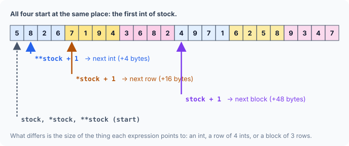

title : Three-Dimensional Arrays

summary : How a three-dimensional array is stored in memory, how to reach any element using pointer notation, and how to pass 3-D arrays to functions, with clear memory diagrams.

# Three-Dimensional Arrays

A one-dimensional array is a **line** of values. A two-dimensional array is a **table**: rows of lines. Add one more level and you get a **three-dimensional array**: a stack of tables.

The good news is that nothing new is needed to understand it. Everything from the previous two articles — *an array's name is its base address*, *`+ 1` moves by the size of what a pointer points to*, *a 2-D array is an array of arrays* — simply applies one level deeper. This article shows how, then passes 3-D arrays to functions.

## What Is a Three-Dimensional Array?

Imagine a company with **2 warehouses**. Each warehouse has **3 shelves**, and each shelf has **4 bins**. To record how many items are in every bin, you need three numbers to identify a bin: which warehouse, which shelf, which bin. That is a 3-D array:

```c
int stock[2][3][4];      /* 2 warehouses × 3 shelves × 4 bins = 24 ints */
```

Read the dimensions from left to right, from the biggest unit to the smallest:

- `stock` is an array of **2** elements — the warehouses.
- Each warehouse is a 2-D array of **3** rows — the shelves.
- Each shelf is a 1-D array of **4** `int`s — the bins.

In other words: a 3-D array is an **array of 2-D arrays**, and each of those is an array of 1-D arrays. The initialiser mirrors that nesting with braces inside braces:

```c runnable
#include <stdio.h>

int main(void)
{
    int stock[2][3][4] = {
        {                       /* warehouse 0 */
            { 5,  8,  2,  6},   /*   shelf 0: bins 0..3 */
            { 7,  1,  9,  4},   /*   shelf 1 */
            { 3,  6,  8,  2}    /*   shelf 2 */
        },
        {                       /* warehouse 1 */
            { 4,  9,  7,  1},
            { 6,  2,  5,  8},
            { 9,  3,  4,  7}
        }
    };

    for (int w = 0; w < 2; w++) {
        printf("warehouse %d\n", w);
        for (int s = 0; s < 3; s++) {
            printf("  shelf %d:", s);
            for (int b = 0; b < 4; b++)
                printf(" %d", stock[w][s][b]);
            printf("\n");
        }
    }

    printf("stock[1][2][0] = %d\n", stock[1][2][0]);
    printf("sizeof stock = %zu, sizeof stock[0] = %zu, sizeof stock[0][0] = %zu\n",
           sizeof stock, sizeof stock[0], sizeof stock[0][0]);

    return 0;
}
```

```
warehouse 0
  shelf 0: 5 8 2 6
  shelf 1: 7 1 9 4
  shelf 2: 3 6 8 2
warehouse 1
  shelf 0: 4 9 7 1
  shelf 1: 6 2 5 8
  shelf 2: 9 3 4 7
stock[1][2][0] = 9
sizeof stock = 96, sizeof stock[0] = 48, sizeof stock[0][0] = 16
```

To name one bin you give all three indexes, outermost first. `stock[1][2][0]` means: warehouse **1** (the second one), shelf **2** (the third), bin **0** (the first) — which holds `9`. As always, every index counts from `0`.

The `sizeof` line confirms the nesting: the whole array is 96 bytes (24 `int`s), one warehouse `stock[0]` is 48 bytes (12 `int`s), and one shelf `stock[0][0]` is 16 bytes (4 `int`s).

### How It Is Really Stored

The picture of two side-by-side tables exists only in our heads. Memory is still one long line, so C stores a 3-D array the same way it stores a 2-D one — by flattening it: **all of warehouse 0, then all of warehouse 1**, and inside each warehouse, shelf after shelf.

![The array stock of 2 blocks, each 3 rows by 4 columns, pictured as two tables, and its real storage as 24 ints in one line: block 0 row by row, then block 1; element stock[1][2][0] is element 20, at byte 80](images/3d-array-in-memory.svg)

That makes it easy to work out where any element lives. To reach `stock[1][2][0]`:

1. Skip **1 whole warehouse**: 1 × (3 × 4) = 12 elements.
2. Skip **2 whole shelves** inside it: 2 × 4 = 8 elements.
3. Move **0 more** bins.

That is element `12 + 8 + 0 = 20` from the start — byte 80 with 4-byte `int`s. In general, for an array `a[SETS][ROWS][COLS]`:

```
position of a[i][j][k] = i × ROWS × COLS  +  j × COLS  +  k      (counted in elements)
```

It is the 2-D formula with one more term in front: each step of the outermost index skips a whole 2-D block.

## Pointers and Three-Dimensional Arrays

Can we reach 3-D elements using pointer notation instead of subscripts? Certainly — and the reasoning is the same as for 2-D arrays, just one level deeper.

Start with the rule that has carried us this far: **an array's name, used in an expression, is the address of its first element.** The question at each level is simply: *what is the first element here?*

- `stock` is an array of warehouses, so **`stock`** is the address of warehouse 0.
- `*stock` is warehouse 0 itself — a 2-D array — so it in turn becomes the address of **its** first element: shelf 0.
- `**stock` is shelf 0 itself — a 1-D array — so it becomes the address of bin 0.
- `***stock` finally reaches an `int`: the value `5`.

All three addresses are the same location — the very first byte of the array — because warehouse 0 starts with shelf 0, which starts with bin 0. What differs is **what each one points to**, and that decides how far `+ 1` moves:

```c runnable
#include <stdio.h>

int main(void)
{
    int stock[2][3][4] = {
        {{5, 8, 2, 6}, {7, 1, 9, 4}, {3, 6, 8, 2}},
        {{4, 9, 7, 1}, {6, 2, 5, 8}, {9, 3, 4, 7}}
    };
    char *base = (char *)stock;      /* to show positions as byte offsets */

    printf("stock      -> +%td\n", (char *)stock - base);
    printf("*stock     -> +%td\n", (char *)*stock - base);
    printf("**stock    -> +%td\n", (char *)**stock - base);
    printf("***stock   =  %d\n", ***stock);

    printf("stock + 1    -> +%td   (next warehouse)\n", (char *)(stock + 1) - base);
    printf("*stock + 1   -> +%td   (next shelf)\n", (char *)(*stock + 1) - base);
    printf("**stock + 1  -> +%td    (next bin)\n", (char *)(**stock + 1) - base);
    printf("***stock + 1 =  %d    (value plus one)\n", ***stock + 1);

    printf("*(*(*(stock + 1) + 2) + 0) = %d\n", *(*(*(stock + 1) + 2) + 0));

    return 0;
}
```

```
stock      -> +0
*stock     -> +0
**stock    -> +0
***stock   =  5
stock + 1    -> +48   (next warehouse)
*stock + 1   -> +16   (next shelf)
**stock + 1  -> +4    (next bin)
***stock + 1 =  6    (value plus one)
*(*(*(stock + 1) + 2) + 0) = 9
```

(Instead of raw addresses, which change on every run, the program prints each position as a byte offset from the start of the array.)

The first three lines are all `+0`: same address, as predicted. The next block is where it gets interesting:

| Expression | Points to | `+ 1` moves | So it lands on |
|---|---|---|---|
| `stock + 1` | a whole warehouse (3 × 4 `int`s) | 48 bytes | warehouse 1 |
| `*stock + 1` | a shelf (4 `int`s) | 16 bytes | shelf 1 of warehouse 0 |
| `**stock + 1` | a single `int` | 4 bytes | bin 1 of shelf 0 |
| `***stock + 1` | — (it is a value) | — | `5 + 1 = 6` |



The last line of the program reaches `stock[1][2][0]` with pointers alone. Read it from the inside out:

1. `stock + 1` — address of warehouse 1.
2. `*(stock + 1)` — warehouse 1, i.e. the address of its shelf 0.
3. `*(stock + 1) + 2` — address of shelf 2 of warehouse 1.
4. `*(*(stock + 1) + 2)` — that shelf, i.e. the address of its bin 0.
5. `*(*(stock + 1) + 2) + 0` — still bin 0.
6. `*(*(*(stock + 1) + 2) + 0)` — the value: `9`.

So, just as `a[i][j]` means `*(*(a + i) + j)`, a 3-D subscript unfolds into three levels of "add, then dereference":

```
stock[i][j][k]   ≡   *(*(*(stock + i) + j) + k)
```

## Passing a 3-D Array to a Function

When a 3-D array is passed to a function, what travels is — as always — the address of its first element. The first element of `stock` is a whole 2-D block of `3 × 4` `int`s, so the function receives a **pointer to a 2-D array**: `int (*)[3][4]`.

Just as with 2-D arrays, there are three ways to write the receiving function:

```c runnable
#include <stdio.h>

/* Way 1: plain int pointer + your own index arithmetic */
void show_flat(int *p, int sets, int rows, int cols)
{
    for (int i = 0; i < sets; i++) {
        for (int j = 0; j < rows; j++) {
            for (int k = 0; k < cols; k++)
                printf("%d ", *(p + i * rows * cols + j * cols + k));
            printf("\n");
        }
        printf("\n");
    }
}

/* Way 2: pointer to a 2-D block of 3 x 4 */
void show_blocks(int (*bp)[3][4], int sets)
{
    for (int i = 0; i < sets; i++) {
        for (int j = 0; j < 3; j++) {
            int *cell = bp[i][j];            /* start of row j in block i */
            for (int k = 0; k < 4; k++)
                printf("%d ", *(cell + k));
            printf("\n");
        }
        printf("\n");
    }
}

/* Way 3: array notation (same as way 2) */
void show_cube(int cube[][3][4], int sets)
{
    for (int i = 0; i < sets; i++) {
        for (int j = 0; j < 3; j++) {
            for (int k = 0; k < 4; k++)
                printf("%d ", cube[i][j][k]);
            printf("\n");
        }
        printf("\n");
    }
}

int main(void)
{
    int stock[2][3][4] = {
        {{5, 8, 2, 6}, {7, 1, 9, 4}, {3, 6, 8, 2}},
        {{4, 9, 7, 1}, {6, 2, 5, 8}, {9, 3, 4, 7}}
    };

    show_flat(&stock[0][0][0], 2, 3, 4);
    show_blocks(stock, 2);
    show_cube(stock, 2);

    return 0;
}
```

All three functions print the same thing:

```
5 8 2 6 
7 1 9 4 
3 6 8 2 

4 9 7 1 
6 2 5 8 
9 3 4 7 

5 8 2 6 
7 1 9 4 
3 6 8 2 

4 9 7 1 
6 2 5 8 
9 3 4 7 

5 8 2 6 
7 1 9 4 
3 6 8 2 

4 9 7 1 
6 2 5 8 
9 3 4 7 

```

**Way 1** receives a plain `int *` to the very first `int` and uses the 3-D position formula: `i × rows × cols + j × cols + k`. It works for any shape because all three sizes arrive as arguments. Note the call passes `&stock[0][0][0]`; passing plain `stock` to an `int *` parameter makes the compiler warn about an *incompatible pointer type*, because `stock` is a pointer to a 2-D block, not to an `int`.

**Way 2** receives `int (*bp)[3][4]` — a pointer to one `3 × 4` block. `bp[i]` is block `i`, `bp[i][j]` is row `j` of that block (which becomes the address of its first `int`), and `*(cell + k)` walks along the row.

**Way 3** writes the same parameter as `int cube[][3][4]`. In a parameter list this is exactly `int (*cube)[3][4]`, but lets you use the natural `cube[i][j][k]`.

Only the **first** dimension may be left empty. The compiler needs the others — `3` and `4` — to know how big one block and one row are, which is what `+ 1` must skip at each level.

:::callout
Way 1 treats the 3-D array as one flat run of `int`s, crossing from one row (and block) into the next. That matches how the array is really stored and works with every mainstream compiler, but the C standard strictly guarantees pointer arithmetic only within a single array. Prefer ways 2 and 3 — or the C99 form below — when you can.
:::

### Reading the Parameter Declarations

These three declarations look alike, so it is worth comparing them side by side:

| Parameter | Meaning |
|---|---|
| `int *q` | `q` is a pointer to an `int` |
| `int (*q)[3][4]` | `q` is a pointer to a 2-D array of 3 rows and 4 columns |
| `int q[][3][4]` | the same as `int (*q)[3][4]` — written in array notation |

### Any Shape With C99

As with 2-D arrays, C99 lets the sizes come from earlier parameters, so one function handles 3-D arrays of any shape with plain subscripts:

```c
void show_any(int sets, int rows, int cols, int cube[sets][rows][cols]);
```

## Key Takeaways

- A 3-D array is an **array of 2-D arrays**: `int stock[2][3][4]` is 2 blocks of 3 rows of 4 `int`s.
- It is stored as one flat line — block after block, row after row. Element `[i][j][k]` is `i × ROWS × COLS + j × COLS + k` elements from the start.
- `stock`, `*stock` and `**stock` hold the same address but point to different things (a block, a row, an `int`), so `+ 1` moves 48, 16 or 4 bytes respectively.
- `a[i][j][k]` ≡ `*(*(*(a + i) + j) + k)`.
- A function receives a 3-D array as a pointer to its first 2-D block: `int (*q)[ROWS][COLS]` or `int q[][ROWS][COLS]`. Only the first dimension may be omitted.

## Practice Questions

:::details[In int box[4][5][6], how many ints are there, and how many bytes does one box[i] occupy (4-byte ints)?]
`4 × 5 × 6 = 120` `int`s. One `box[i]` is a `5 × 6` block: 30 `int`s = 120 bytes.
:::

:::details[In the same array, how many elements from the start is box[2][3][1]?]
`2 × 5 × 6 + 3 × 6 + 1 = 60 + 18 + 1 = 79`.
:::

:::details[Using the stock array, what are **stock + 3 and *stock + 2, as byte offsets from the start?]
`**stock` points to an `int`, so `**stock + 3` is 3 `int`s on: **+12**. `*stock` points to a row of 4 `int`s, so `*stock + 2` is 2 rows on: **+32**.
:::

:::details[Write stock[0][1][3] using only * and +, and give its value.]
`*(*(*(stock + 0) + 1) + 3)`, or simply `*(*(*stock + 1) + 3)`. Its value is `4` (warehouse 0, shelf 1, bin 3).
:::

:::details[A function must receive any int array shaped [n][6][2]. Write its parameter list in two equivalent ways.]
`void f(int (*a)[6][2], int n)` and `void f(int a[][6][2], int n)`. The first dimension is passed separately as `n`.
:::
