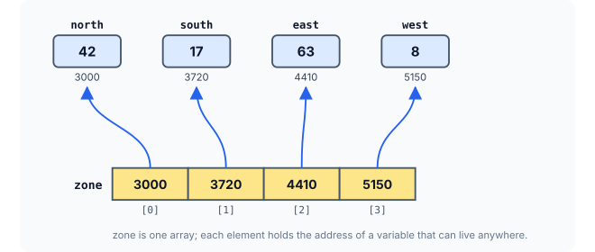
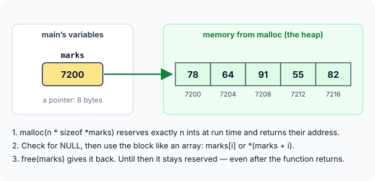

# Arrays of Pointers and Dynamic Memory Allocation

So far every array we have built held ordinary values: `int`s, `double`s, `char`s. But a pointer is a variable too, so nothing stops us from making an **array of pointers** — a collection of addresses. That simple idea turns out to be remarkably useful: it lets one array reach variables scattered all over memory, and it lets us build "tables" whose rows have different lengths.

The second half of this article tackles a limitation that every array so far has had: its size is fixed when the program is written. With **dynamic memory allocation**, a program can ask for exactly as much memory as it needs **while it is running**.

## Arrays of Pointers

Just as there can be an array of `int`s or an array of `float`s, there can be an array of pointers. Since a pointer always holds an address, an array of pointers is nothing more than **a collection of addresses**. Those addresses can belong to separate variables, to elements of other arrays, or to anything else — and all the rules of ordinary arrays apply to it unchanged.

```c
int *zone[4];      /* zone is an array of 4 elements; each element is an int pointer */
```

Read it with the rule from earlier articles: start at the name and go right first. `zone` is **an array of 4**, and each element is **a pointer to `int`**.

### Pointing at Separate Variables

Here an array of pointers collects the addresses of four unrelated variables:

```c runnable
#include <stdio.h>

int main(void)
{
    int north = 42, south = 17, east = 63, west = 8;   /* four separate variables */
    int *zone[4];                                      /* an array of 4 int pointers */

    zone[0] = &north;
    zone[1] = &south;
    zone[2] = &east;
    zone[3] = &west;

    for (int i = 0; i < 4; i++)
        printf("zone[%d] holds %p -> %d\n", i, (void *)zone[i], *zone[i]);

    *zone[2] = 70;                  /* change east through its pointer */
    printf("east is now %d\n", east);

    return 0;
}
```

A sample run:

```
zone[0] holds 0x7ffdd081179c -> 42
zone[1] holds 0x7ffdd08117a0 -> 17
zone[2] holds 0x7ffdd08117a4 -> 63
zone[3] holds 0x7ffdd08117a8 -> 8
east is now 70
```

Each element `zone[i]` is an address, so `*zone[i]` is the value stored there. The loop can now visit four separate variables as if they were one array — and because `zone[2]` holds the address of `east`, writing through `*zone[2]` changes `east` itself.



`zone` itself is stored contiguously, like every array. The variables it points to do not have to be: they can live anywhere in memory.

:::callout
In `*zone[i]`, the subscript is applied first and then the `*`, because `[]` binds more tightly than `*`. So `*zone[i]` means `*(zone[i])`: take element `i`, then follow it.
:::

### Pointing into Another Array

The addresses can just as well be addresses of array elements. Below, `mark` holds a pointer to each element of `levels`:

```c runnable
#include <stdio.h>

int main(void)
{
    int levels[5] = {3, 6, 9, 12, 15};
    int *mark[5] = {levels, levels + 1, levels + 2, levels + 3, levels + 4};

    printf("*mark[3]     = %d\n", *mark[3]);        /* value of levels[3]           */
    printf("**mark       = %d\n", **mark);          /* mark[0] points to levels[0]  */
    printf("*(mark[1]+2) = %d\n", *(mark[1] + 2));  /* two ints after levels[1]     */
    printf("mark[4] - mark[0] = %td elements\n", mark[4] - mark[0]);

    return 0;
}
```

```
*mark[3]     = 12
**mark       = 3
*(mark[1]+2) = 12
mark[4] - mark[0] = 4 elements
```

Work through each line:

- `mark[3]` holds `levels + 3`, so `*mark[3]` is `levels[3]`: `12`.
- `mark` used as a value is the address of `mark[0]`. So `*mark` is `mark[0]` — the address `levels` — and `**mark` follows it to `levels[0]`: `3`. Two `*`, because we go through two addresses.
- `mark[1]` points to `levels[1]`; adding 2 moves two `int`s further to `levels[3]`: `12` again.
- `mark[4]` and `mark[0]` both point into `levels`, so subtracting them is legal and gives the distance in elements: `4`.

### Rows of Different Lengths

The most valuable use of an array of pointers is to build a table whose rows have **different lengths** — something a 2-D array cannot do, since all its rows must be equally long. Each pointer simply points to the start of a separate row:

```c runnable
#include <stdio.h>

int main(void)
{
    int mon[] = {7, 3};                 /* rows of different lengths */
    int tue[] = {5, 9, 2, 8};
    int wed[] = {4};

    int *week[3] = {mon, tue, wed};     /* each element points to one row */
    int  len[3]  = {2, 4, 1};

    for (int d = 0; d < 3; d++) {
        printf("day %d:", d);
        for (int i = 0; i < len[d]; i++)
            printf(" %d", week[d][i]);  /* week[d][i] is *(week[d] + i) */
        printf("\n");
    }

    return 0;
}
```

```
day 0: 7 3
day 1: 5 9 2 8
day 2: 4
```

![An array week of three pointers; week[0] points to mon with 2 ints, week[1] to tue with 4 ints, and week[2] to wed with 1 int](images/jagged-rows-with-pointer-array.svg)

Notice that `week[d][i]` looks exactly like 2-D array syntax, yet the data is completely different: `week[d]` is a **pointer** fetched from the array, and `[i]` then moves along whatever row it points to. Because each row's length is no longer part of the type, the program keeps the lengths in a separate `len` array. This "array of pointers to rows" shape is also exactly how a collection of strings of different lengths is usually stored — the subject of the next chapter.

### Pointer to an Array vs Array of Pointers

The two declarations below differ only by a pair of parentheses, yet they mean completely different things. It is worth fixing the difference firmly in mind:

![Left: int (*rp)[4] is one pointer to a block of four ints. Right: int *ap[4] is an array of four pointers, each pointing to its own int](images/pointer-to-array-vs-array-of-pointers.svg)

| Declaration | What it is | Size on a 64-bit system |
|---|---|---|
| `int (*rp)[4];` | **one** pointer, to an array of 4 `int`s | 8 bytes |
| `int *ap[4];` | an **array** of 4 pointers to `int` | 32 bytes (4 × 8) |

## Dynamic Memory Allocation

### The Problem with Fixed-Size Arrays

Suppose a program stores the marks of a class, declared like this:

```c
int marks[100];
```

The moment this array exists, room for 100 `int`s is reserved. That causes trouble in both directions:

- If the class has only 60 students, the space for 40 `int`s is **wasted**.
- If it has 130 students, the array is **too small**, and there is no way to enlarge it while the program runs.

Arrays like this are sized when the program is written — the size must be known in advance. What we would really like is to **ask for memory while the program is running**, once we know how much we need. That is what the standard library functions `malloc()` and `calloc()` do. Because they allocate memory on the fly, they are called **dynamic memory allocation** functions. They are declared in `<stdlib.h>`.

### Allocating with `malloc()`

`malloc(size)` reserves a block of `size` bytes and returns its address — or `NULL` if no memory is available. The program below allocates exactly enough room for the number of students in the class, stores their marks, and computes the average:

```c runnable
#include <stdio.h>
#include <stdlib.h>

int main(void)
{
    int typed[] = {78, 64, 91, 55, 82};       /* stands in for what the user types */
    int n = 5;                                 /* "how many students?"              */

    int *marks = malloc(n * sizeof *marks);    /* room for exactly n ints */
    if (marks == NULL) {
        printf("Memory allocation failed\n");
        return 1;
    }

    for (int i = 0; i < n; i++)
        *(marks + i) = typed[i];               /* store each mark          */

    int sum = 0;
    for (int i = 0; i < n; i++)
        sum = sum + marks[i];                  /* same as *(marks + i)     */

    printf("students = %d, average = %.1f\n", n, (double)sum / n);

    free(marks);                               /* give the memory back     */
    marks = NULL;
    return 0;
}
```

```
students = 5, average = 74.0
```

(In a real program, `n` and the marks would be read with `scanf`. Here they come from an array so that the example runs on its own.)

Let's go through it piece by piece.

**Asking for the right number of bytes.** `malloc` counts in **bytes**, so we ask for `n * sizeof *marks` — `n` times the size of one `int`. Writing `sizeof *marks` instead of a fixed number like `4` (or the `2` that old 16-bit compilers used) keeps the program correct on every system, and stays correct even if `marks` later becomes a pointer to `double`.

:::callout
Mind the `*`: it is `sizeof *marks`, **not** `sizeof marks`. `*marks` is one `int` — what the pointer points to — so `sizeof *marks` is 4. `marks` is the pointer itself, so `sizeof marks` is the size of a pointer: 8 on a 64-bit system. `n * sizeof marks` would therefore ask for the wrong amount of memory — too much here, and too little for element types larger than a pointer.

It is also safe to write `*marks` before `marks` has a value: `sizeof` never evaluates its operand. It only looks at the operand's **type**, so nothing is actually dereferenced.
:::

**Storing the address.** `malloc` does not know what you will keep in the block, so it returns a generic `void *`. In C, a `void *` converts to any other object pointer automatically, so no cast is needed when assigning it to `marks`. (Older code often writes `(int *) malloc(...)`; the cast is harmless but unnecessary in C. C++ is different and does require it.)

**Checking for failure.** If the system cannot provide the memory, `malloc` returns `NULL`. Using a `NULL` pointer would crash the program, so always check before using the block.

**Using the block.** The block is just a run of `int`s, so pointer arithmetic and subscripts both work: `*(marks + i)` and `marks[i]` are the same element. It behaves exactly like an array of `n` elements — except that `n` was decided while the program was running.

**Giving it back.** Memory from `malloc` stays reserved until you release it with `free(marks)` — it is **not** released automatically when the function ends. Setting the pointer to `NULL` afterwards makes any accidental later use fail loudly instead of quietly reading freed memory.



:::callout
**Every `malloc` needs a matching `free`.** Forgetting it is a **memory leak**: the memory stays reserved but nothing can use it, and a long-running program that leaks repeatedly will eventually run out. Compiling with `-fsanitize=address -g` reports leaks when the program exits — for example, *LeakSanitizer: detected memory leaks — Direct leak of 400 byte(s)* for a forgotten `malloc(100 * sizeof(int))`.
:::

:::callout
After `free(marks)`, the block no longer belongs to you. Reading or writing through `marks` (a **dangling pointer**, again) or calling `free` on it a second time is undefined behaviour. Setting `marks = NULL` right after `free` guards against both: `free(NULL)` is defined to do nothing.
:::

### Allocating with `calloc()`

`calloc()` works like `malloc()`, with two differences:

1. It takes **two** arguments: the number of elements and the size of each.
2. It **clears** the block, so every byte starts as zero. Memory from `malloc` is not cleared — it holds whatever happened to be there, so you must store values before reading them.

```c runnable
#include <stdio.h>
#include <stdlib.h>

int main(void)
{
    int *counts = calloc(6, sizeof *counts);   /* 6 ints, all set to 0 */
    if (counts == NULL)
        return 1;

    counts[2] = 4;

    for (int i = 0; i < 6; i++)
        printf("%d ", counts[i]);
    printf("\n");

    free(counts);
    return 0;
}
```

```
0 0 4 0 0 0 
```

`calloc` is a natural fit for counters and totals that must start at zero. It also checks for you that `count × size` does not overflow, which `malloc(n * size)` does not.

### Growing a Block with `realloc()`

Older texts say that once memory is allocated, its size cannot change. With `realloc()` it can: give it an existing block and a new size, and it returns a block of the new size with the old contents preserved — extending it in place if possible, or moving it to a new location if not.

```c runnable
#include <stdio.h>
#include <stdlib.h>

int main(void)
{
    int n = 3;
    int *data = malloc(n * sizeof *data);
    if (data == NULL)
        return 1;
    for (int i = 0; i < n; i++)
        data[i] = (i + 1) * 10;              /* 10 20 30 */

    /* more students arrive: grow the block to 5 ints */
    int *bigger = realloc(data, 5 * sizeof *data);
    if (bigger == NULL) {                    /* on failure, data is still valid */
        free(data);
        return 1;
    }
    data = bigger;
    data[3] = 40;
    data[4] = 50;
    n = 5;

    for (int i = 0; i < n; i++)
        printf("%d ", data[i]);
    printf("\n");

    free(data);
    return 0;
}
```

```
10 20 30 40 50 
```

Note the pattern: the result goes into a **separate** pointer (`bigger`) first. If `realloc` fails it returns `NULL` but leaves the original block untouched; writing `data = realloc(data, ...)` directly would overwrite your only pointer to it with `NULL` and leak it.

| Function | Arguments | Initial contents | Typical use |
|---|---|---|---|
| `malloc(bytes)` | total size in bytes | unspecified (garbage) | a block you will fill right away |
| `calloc(count, size)` | number of elements, size of each | all zeros | counters, totals, cleared tables |
| `realloc(ptr, bytes)` | existing block, new size | old contents kept | growing or shrinking a block |
| `free(ptr)` | a block from the above | — | releasing it when done |

## Key Takeaways

- An array of pointers is a collection of addresses: `int *zone[4]` holds four `int` addresses. Its elements are stored together; what they point to can be anywhere.
- `*zone[i]` means `*(zone[i])`, because `[]` binds more tightly than `*`.
- An array of pointers to rows builds tables whose rows have different lengths; keep the lengths separately.
- `int (*p)[4]` is one pointer to an array; `int *p[4]` is an array of four pointers.
- `malloc` and `calloc` (from `<stdlib.h>`) allocate memory while the program runs. Size requests with `sizeof`, check for `NULL`, and use the block like an array.
- `calloc` zeroes the block; `malloc` does not. `realloc` resizes a block — store its result in a temporary pointer first.
- Every allocation needs exactly one `free`. Afterwards, set the pointer to `NULL`.

## Practice Questions

:::details[int a = 1, b = 2; int *p[2] = {&a, &b}; — what is *p[1] + **p?]
`*p[1]` is `b` (2) and `**p` is `*p[0]`, which is `a` (1). The sum is `3`.
:::

:::details[What is sizeof(int *[10]) on a 64-bit system, and what is sizeof(int (*)[10])?]
`int *[10]` is an array of 10 pointers: `10 × 8 = 80` bytes. `int (*)[10]` is a single pointer to an array: `8` bytes.
:::

:::details[What is wrong with: int *p = malloc(50); for (int i = 0; i < 50; i++) p[i] = 0;]
`malloc(50)` reserves 50 **bytes** — room for only 12 `int`s with 4-byte `int`s — but the loop writes 50 `int`s, far past the end of the block. Ask for `50 * sizeof *p` bytes (or use `calloc(50, sizeof *p)`, which also zeroes them). The `NULL` check and the `free` are missing too.
:::

:::details[Why is data = realloc(data, newsize); risky?]
If `realloc` fails it returns `NULL`, which then overwrites `data` — the only pointer to the original block. The block can no longer be freed, so it leaks. Store the result in a temporary pointer and only assign it to `data` when it is not `NULL`.
:::

:::details[A function allocates an array with malloc and returns its address. Is that a dangling pointer, like returning the address of a local array?]
No. Memory from `malloc` stays valid until `free` is called, regardless of which function allocated it. That makes `malloc` a third way (alongside `static` and a caller-provided array) to "return" an array from a function — the caller just becomes responsible for calling `free`.
:::
