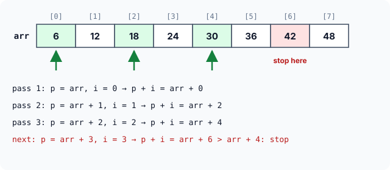
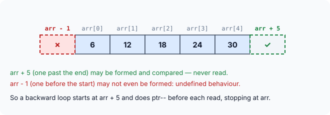

# Walking Arrays with Pointers: Worked Examples

This set of puzzles is all about **movement**: pointers stepping forwards and backwards through arrays, subscripts that turn out to be pointer arithmetic, and functions that change an array through its address. Each puzzle is short, but most hide one precise rule. Predict the output first — draw the array, write the addresses under it, and move your pointer by hand — then open the answer.

As in the previous set, a 64-bit system is assumed (4-byte `int`), and addresses are shown as byte offsets from the start of the array where that matters.

### 1. Three names, one address

```c runnable
#include <stdio.h>

int main(void)
{
    int box[2][3][4] = {
        {{7, 2, 9, 4}, {1, 6, 3, 8}, {5, 5, 2, 0}},
        {{3, 8, 1, 6}, {9, 4, 7, 2}, {6, 0, 3, 1}}
    };
    char *base = (char *)box;

    printf("%td %td %td %d\n",
           (char *)box - base, (char *)*box - base, (char *)**box - base, ***box);
    return 0;
}
```

:::details[Answer]
```
0 0 0 7
```

`box`, `*box` and `**box` all refer to the very beginning of the array, so all three are at offset **0**:

- `box` is the address of its first element — the first `3 × 4` block.
- `*box` is that block, which in turn becomes the address of **its** first element — the first row.
- `**box` is that row, which becomes the address of its first `int`.

Only `***box` goes all the way down to an actual value: `box[0][0][0]`, which is **7**. (They are the same address but not the same type — `box + 1`, `*box + 1` and `**box + 1` move 48, 16 and 4 bytes respectively, as shown in the article on three-dimensional arrays.)
:::

### 2. Four ways to write one element

```c runnable
#include <stdio.h>

int main(void)
{
    int a[] = {3, 5, 7, 9, 11};

    for (int i = 0; i < 5; i++) {
        *(a + i) = a[i] + i[a];
        printf("%d ", *(i + a));
    }
    printf("\n");
    return 0;
}
```

:::details[Answer]
```
6 10 14 18 22 
```

Three facts make this easy:

1. Mentioning an array's name gives its base address.
2. Array elements sit next to each other in memory.
3. Adding 1 to an `int` address gives the address of the next `int`.

So the compiler turns `a[i]` into `*(a + i)`. Since `a + i` is the same as `i + a`, `*(i + a)` is the same element too — and so is `i[a]`, which becomes `*(i + a)`. All four spellings mean "the element `i` places from the start".

The statement `*(a + i) = a[i] + i[a];` is therefore just `a[i] = a[i] + a[i];` — it doubles each element, and the `printf` prints the doubled value. (Writing `i[a]` in real code would only confuse readers; it is here to prove the point.)
:::

### 3. A copy and an address

```c runnable
#include <stdio.h>

void bump(int x, int *y)
{
    x = *y += 3;
    printf("  in bump: x = %d\n", x);
}

int main(void)
{
    int a[3] = {1, 2, 3};
    int total = 10;

    for (int i = 0; i < 3; i++) {
        bump(a[i], &total);
        printf("a[%d] = %d, total = %d\n", i, a[i], total);
    }
    return 0;
}
```

:::details[Answer]
```
  in bump: x = 13
a[0] = 1, total = 13
  in bump: x = 16
a[1] = 2, total = 16
  in bump: x = 19
a[2] = 3, total = 19
```

Each call receives two different kinds of argument: **a copy** of `a[i]` in `x`, and **the address** of `total` in `y`.

Assignment works right to left, so in `x = *y += 3`, the `*y += 3` part runs first. It adds 3 to the value at the address in `y` — that is, to `total` in `main` — and the result (13 the first time) is then also assigned to `x`.

Changing `x` only changes `bump`'s copy; the array element in `main` is untouched. `total`, reached through its address, keeps growing: 13, 16, 19.

![main has a[0] = 1 and total at address 7000; bump gets a copy x of a[0] and a pointer y holding 7000, so x = *y += 3 changes total to 13 but only bump's copy x](images/ws-bump-copy-and-pointer.svg)
:::

### 4. Changing an array through its address

```c runnable
#include <stdio.h>

void square_all(int *b)
{
    for (int i = 0; i < 5; i++) {
        *b = *b * *b;
        b++;
    }
}

int main(void)
{
    int a[5] = {1, 2, 3, 4, 5};

    square_all(a);
    for (int i = 4; i >= 0; i--)
        printf("%d ", a[i]);
    printf("\n");
    return 0;
}
```

:::details[Answer]
```
25 16 9 4 1 
```

`square_all(a)` passes the base address of `a`, so `b` starts at `a[0]`. Each time round the loop, `*b = *b * *b` replaces the element `b` points to with its square, and `b++` moves `b` to the next `int`.

Because `b` held the array's **address**, the squaring happens to the array in `main` itself — no copy was made. Back in `main`, the loop runs from index 4 down to 0, so the squares come out in reverse order.

![The pointer b starts at a[0] and moves one element per loop, squaring each element in place so a becomes 1 4 9 16 25](images/ws-square-all-walk.svg)
:::

### 5. A pointer as the loop counter

```c runnable
#include <stdio.h>

int main(void)
{
    int arr[] = {6, 12, 18, 24, 30};
    int *ptr;

    for (ptr = &arr[0]; ptr <= &arr[4]; ptr++)
        printf("%d ", *ptr);
    printf("\n");
    return 0;
}
```

:::details[Answer]
```
6 12 18 24 30 
```

Here the pointer itself controls the loop. Suppose `arr` starts at 5000:

- **Start:** `ptr = &arr[0]`, so `ptr` holds 5000.
- **Test:** `ptr <= &arr[4]` compares two addresses, 5000 and 5016. True, so `*ptr` (6) is printed.
- **Step:** `ptr++` moves to the next `int`: 5004. The test passes again and 12 is printed.

This continues until `ptr` passes 5016. When `ptr` reaches 5020 — one past the last element — the test fails and the loop ends without ever reading that address.
:::

### 6. A pointer with a subscript

```c runnable
#include <stdio.h>

int main(void)
{
    int arr[] = {6, 12, 18, 24, 30};
    int i, *ptr;

    for (ptr = &arr[0], i = 0; i <= 4; i++)
        printf("%d ", ptr[i]);
    printf("\n");
    return 0;
}
```

:::details[Answer]
```
6 12 18 24 30 
```

The initialisation part does two things, separated by a comma: it points `ptr` at the start of the array and sets `i` to 0.

The interesting part is `ptr[i]`. `ptr` is not an array — but subscripts work on **any** pointer, because `ptr[i]` simply means `*(ptr + i)`. With `ptr` at the base of `arr`, `ptr + i` is the address of element `i`, so `ptr[i]` reads `arr[i]`. `ptr` never moves; only `i` changes.
:::

### 7. Two things moving at once

```c runnable
#include <stdio.h>

int main(void)
{
    int arr[8] = {6, 12, 18, 24, 30, 36, 42, 48};
    int i, *p;

    for (p = arr, i = 0; p + i <= arr + 4; p++, i++)
        printf("%d ", *(p + i));
    printf("\n");
    return 0;
}
```

:::details[Answer]
```
6 18 30 
```

The loop sets up **two** variables and advances **both** on every pass: `p` moves one element and `i` grows by one. So `p + i` moves **two** elements per pass:

| Pass | `p` | `i` | `p + i` | Printed |
|---|---|---|---|---|
| 1 | `arr` | 0 | `arr + 0` | 6 |
| 2 | `arr + 1` | 1 | `arr + 2` | 18 |
| 3 | `arr + 2` | 2 | `arr + 4` | 30 |
| — | `arr + 3` | 3 | `arr + 6` | condition fails |

The condition `p + i <= arr + 4` compares two addresses. In the fourth pass `p + i` has reached `arr + 6`, which is beyond `arr + 4`, so the loop stops — having printed every second element up to index 4.



Notice why the array has **8** elements even though only the first 5 are visited: the final test computes `arr + 6`. Pointer arithmetic is only valid within an array and one position past its end, so with a 5-element array, `arr + 6` would be undefined behaviour — even though it is only compared, never read. (Older books show this puzzle with a 5-element array; the larger array makes it correct.)
:::

### 8. Walking backwards

```c runnable
#include <stdio.h>

int main(void)
{
    int arr[] = {6, 12, 18, 24, 30};
    int *ptr;

    for (ptr = arr + 5; ptr > arr; ) {
        ptr--;                          /* step back first, then read */
        printf("%d ", *ptr);
    }
    printf("\n");
    return 0;
}
```

:::details[Answer]
```
30 24 18 12 6 
```

`ptr` starts at `arr + 5`, one past the last element. Each pass first moves it back one element with `ptr--` and then reads it, so the first value printed is `arr[4]` (30) and the last is `arr[0]` (6). After printing `arr[0]`, `ptr` equals `arr`, the test `ptr > arr` fails, and the loop ends.

Why not write the more obvious loop below?

```c
for (ptr = arr + 4; ptr >= arr; ptr--)      /* tempting, but wrong */
    printf("%d ", *ptr);
```

It prints the same numbers, but to make the test `ptr >= arr` false, the final `ptr--` has to produce `arr - 1` — an address **before** the start of the array. C allows a pointer to sit one position **past** the end of an array, but not one position **before** its start; merely computing `arr - 1` is undefined behaviour. The version above never forms that address.


:::

### 9. Negative subscripts

```c runnable
#include <stdio.h>

int main(void)
{
    int arr[] = {6, 12, 18, 24, 30};
    int i, *ptr;

    for (ptr = arr + 4, i = 0; i <= 4; i++)
        printf("%d ", ptr[-i]);
    printf("\n");
    return 0;
}
```

:::details[Answer]
```
30 24 18 12 6 
```

`ptr` is set to `arr + 4`, the address of the last element, and never changes. What is `ptr[-i]`? Exactly what every subscript is: `*(ptr - i)`.

- `i = 0`: `*(ptr - 0)` is `arr[4]`, **30**.
- `i = 1`: `*(ptr - 1)` is `arr[3]`, **24**.
- … down to `i = 4`: `*(ptr - 4)` is `arr[0]`, **6**.

A negative subscript is perfectly legal **on a pointer**, as long as the result stays inside the array. (On an array name it never makes sense, since nothing comes before element 0.)

![ptr points to arr[4]; ptr[0] is arr[4], ptr[-1] is arr[3], down to ptr[-4] which is arr[0]](images/ws-negative-index.svg)
:::

### 10. Turning a pointer back into an index

```c runnable
#include <stdio.h>

int main(void)
{
    int arr[] = {6, 12, 18, 24, 30};
    int *ptr;

    for (ptr = arr + 5; ptr > arr; ) {
        ptr--;
        printf("%td:%d ", ptr - arr, arr[ptr - arr]);
    }
    printf("\n");
    return 0;
}
```

:::details[Answer]
```
4:30 3:24 2:18 1:12 0:6 
```

This walks backwards like puzzle 8, but prints `arr[ptr - arr]` instead of `*ptr`. What is `ptr - arr`?

Subtracting two pointers into the same array gives the **number of elements** between them — not bytes. If `arr` starts at 5000 and `ptr` holds 5016, the byte difference is 16, but the result is `16 / 4 = 4` elements. Another way to see it: `ptr` is `arr + 4`, so `ptr - arr` is `(arr + 4) - arr`, which is 4.

So `ptr - arr` is simply the **index** of the element `ptr` points to, and `arr[ptr - arr]` is that same element. The program prints each index followed by its value.

![For each element, subtracting arr from a pointer to it gives its index 0 to 4; arr[ptr - arr] is the element itself](images/ws-pointer-minus-base-is-index.svg)
:::

## What These Puzzles Teach

- `a[i]`, `*(a + i)`, `*(i + a)` and `i[a]` are the same element; subscripts are pointer arithmetic.
- Subscripts work on **any** pointer: `ptr[i]` is `*(ptr + i)`, and `ptr[-i]` is `*(ptr - i)`.
- A function given an array's address changes the **caller's** array; a function given a copy of an element changes only its copy.
- Pointers into the same array can be compared (`<`, `<=`, `>`) and subtracted; `ptr - arr` is the element index.
- A pointer may point **one past the end** of an array, but never **before its start** — so loop backwards by starting at `arr + n` and decrementing before each read.
