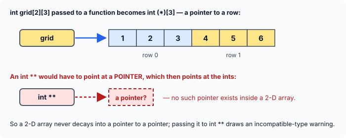

title : Arrays and Pointers: Short Answers

summary : Short questions that test whether you truly understand arrays and pointers: array vs pointer access, when an array name is not its base address, arr vs &arr, char a[] vs char *a, and more.

# Arrays and Pointers: Short Answers

The worked examples asked you to trace programs. This article asks you to **explain** them. Each question below is the kind an interviewer or examiner asks to check whether you really understand how arrays and pointers relate, or only remember the syntax.

Try to answer each one in a sentence or two before you open the answer. Where a short program settles the question, it is included so you can run it.

All answers assume a typical 64-bit system: 4-byte `int`, 8-byte pointers.

### 1. Same character, two declarations

Given these two declarations, do `word[3]` and `wp[3]` give the same character?

```c
char  word[] = "Exploring";
char *wp     = "Exploring";
```

:::details[Answer]
**Yes.** Both give `'l'`, the fourth character (counting from `0`: `E`, `x`, `p`, `l`).

```c runnable
#include <stdio.h>

int main(void)
{
    char  word[] = "Exploring";      /* an array holding its own copy of the text */
    char *wp     = "Exploring";      /* a pointer to text stored elsewhere        */

    printf("word[3] = %c, wp[3] = %c\n", word[3], wp[3]);
    printf("sizeof word = %zu, sizeof wp = %zu\n", sizeof word, sizeof wp);
    return 0;
}
```

```
word[3] = l, wp[3] = l
sizeof word = 10, sizeof wp = 8
```

The second line is a reminder that the two are **not** the same thing. `word` is an array of 10 `char`s (9 letters plus `'\0'`). `wp` is a single pointer variable, 8 bytes, holding the address of a string stored somewhere else.
:::

### 2. Same character, same route?

If `word[3]` and `wp[3]` give the same character, does the program reach it in the same way?

:::details[Answer]
**No.** The compiler turns both into `*(name + 3)`, but what `name` stands for is different.

![word[3] reaches the character in one step from the array's fixed address; wp[3] first loads the address stored inside wp](images/sa-array-vs-pointer-access.svg)

- **`word[3]`** — `word` *is* the array. Its address is fixed and known when the program is built, so the program simply moves 3 places from that address and reads the character.
- **`wp[3]`** — `wp` is a variable that *holds* an address. The program must first **read `wp`** to find out where the text is (9000 in the picture), then move 3 places from there, then read the character.

So the pointer version needs one extra memory read. On modern machines this is rarely measurable, but it is the clearest way to see that an array and a pointer are different objects that just happen to support the same `[]` syntax.
:::

### 3. Declare and allocate in one line

Write a single statement that declares a `char` pointer `buf` and makes it point to a freshly allocated block of 100 bytes.

:::details[Answer]
```c
char *buf = malloc(100);
```

`malloc` (from `<stdlib.h>`) returns a `void *`, which C converts to `char *` automatically — no cast needed. Because `sizeof(char)` is always 1, `100` means 100 `char`s. For other types, write the size in terms of the pointer, for example `int *v = malloc(100 * sizeof *v);`.

In a real program, follow it with a `NULL` check and, eventually, `free(buf);`.
:::

### 4. Does an array name always mean its base address?

:::details[Answer]
**Almost always — but not always.** In most expressions the name of an array is converted ("decays") to a pointer to its first element. There are three exceptions, where the name keeps meaning the **whole array**:

1. **`sizeof arr`** gives the size of the whole array, not of a pointer.
2. **`&arr`** gives a pointer to the whole array (type `int (*)[10]` below), not a pointer to the first element.
3. **A string literal that initialises a `char` array**, as in `char s[] = "abc";`. Here the literal is copied into the array instead of decaying to a pointer.

```c runnable
#include <stdio.h>

int main(void)
{
    int scores[10] = {0};

    printf("sizeof scores       = %zu  (the whole array)\n", sizeof scores);
    printf("sizeof (scores + 0) = %zu   (a pointer: the name decayed)\n", sizeof (scores + 0));
    printf("scores + 1 moves %td bytes, &scores + 1 moves %td bytes\n",
           (char *)(scores + 1) - (char *)scores,
           (char *)(&scores + 1) - (char *)scores);
    return 0;
}
```

```
sizeof scores       = 40  (the whole array)
sizeof (scores + 0) = 8   (a pointer: the name decayed)
scores + 1 moves 4 bytes, &scores + 1 moves 40 bytes
```

`scores + 0` has the same value as `scores`, but because it is an arithmetic expression the name decays first, so `sizeof` sees a pointer.
:::

### 5. arr vs &arr

For `int arr[10];`, what is the difference between `arr` and `&arr`?

:::details[Answer]
They hold the **same address** — where the array starts — but they have **different types**:

| Expression | Type | Points to | `+ 1` moves |
|---|---|---|---|
| `arr` | `int *` (after decay) | the first `int` | 4 bytes |
| `&arr` | `int (*)[10]` | the whole array of 10 `int`s | 40 bytes |

The type decides how far pointer arithmetic moves and what you get when you dereference: `*arr` is an `int`, while `*&arr` is the whole array again. The program in question 4 shows the 4-byte and 40-byte steps.
:::

### 6. char a[] vs char *a

Are `char a[]` and `char *a` the same?

:::details[Answer]
**Only as function parameters.** Anywhere else they are different things.

- **As local or global variables** they differ completely. `char a[] = "Hi";` creates an array of 3 `char`s that owns its text; `sizeof a` is 3, and `a` cannot be made to point elsewhere. `char *a = "Hi";` creates one pointer variable that holds the address of text stored elsewhere; `sizeof a` is 8, and `a` can be reassigned.
- **As function parameters** they are identical. An array is never copied into a function; only its base address is passed. So C rewrites a parameter written as `char a[]` into `char *a`. Inside the function it is an ordinary pointer variable, so you can even increment it:

```c runnable
#include <stdio.h>

void first_two(char s[])             /* exactly the same as: char *s */
{
    printf("%c", *s);
    s++;                              /* allowed: s is a pointer variable */
    printf("%c\n", *s);
}

int main(void)
{
    char word[] = "Exploring";
    first_two(word);
    return 0;
}
```

```
Ex
```

**Watch out:** because `s` is really a pointer, `sizeof s` inside `first_two` gives 8, not 10. GCC warns about exactly this mistake: *'sizeof' on array function parameter 's' will return size of 'char \*'*. That is why functions that take arrays also take the length as a separate argument.
:::

### 7. Assigning to an array

Is anything wrong with this code?

```c
char  a[16] = "Lighthouse";
char *p     = "Harbour";

a = "Harbour";
p = "Lighthouse";
```

:::details[Answer]
`a = "Harbour";` is an **error**. GCC reports *assignment to expression with array type*. An array name is not a variable you can point somewhere else; the array *is* its 16 bytes of storage. To change what it holds, copy new characters **into** it with `strcpy` (from `<string.h>`).

`p = "Lighthouse";` is **fine**: `p` is a pointer variable, and this just makes it point to a different string.

```c runnable
#include <stdio.h>
#include <string.h>

int main(void)
{
    char  a[16] = "Lighthouse";
    char *p     = "Harbour";

    strcpy(a, "Harbour");      /* copy new characters INTO the array */
    p = "Lighthouse";          /* make the pointer point somewhere else */

    printf("%s %s\n", a, p);
    return 0;
}
```

```
Harbour Lighthouse
```

`a` was declared with 16 bytes so that any string up to 15 characters fits. `strcpy` does not check the size, so the destination must always be big enough.
:::

### 8. A malloc'd block vs an array

`malloc` returns a pointer to a block of memory. Can we use that block like an array? If so, how is it different from a real array?

:::details[Answer]
**Yes, it can be used just like an array.** Subscripts are only pointer arithmetic — `block[i]` means `*(block + i)` — so they work on any pointer into a block of elements.

```c runnable
#include <stdio.h>
#include <stdlib.h>

int main(void)
{
    int fixed[5] = {2, 4, 6, 8, 10};
    int *block = malloc(5 * sizeof *block);
    if (block == NULL)
        return 1;

    for (int i = 0; i < 5; i++)
        block[i] = fixed[i] * 10;         /* subscripts work the same way */

    printf("block[4] = %d, *(block + 2) = %d\n", block[4], *(block + 2));
    printf("sizeof fixed = %zu, sizeof block = %zu\n", sizeof fixed, sizeof block);

    free(block);
    return 0;
}
```

```
block[4] = 100, *(block + 2) = 60
sizeof fixed = 20, sizeof block = 8
```

The differences:

| | `int fixed[5]` | `int *block = malloc(…)` |
|---|---|---|
| `sizeof` | 20 — the whole array | 8 — just the pointer |
| Size | fixed when the program is written | chosen at run time, can be resized with `realloc` |
| Lifetime | ends with its block (if local) | lasts until you call `free` |
| Can the name be reassigned? | no | yes — `block` is a variable |

Because `sizeof block` cannot tell you the block's size, you must keep the element count in a separate variable.
:::

### 9. Reading a declaration

What is `ptr` in `int (*ptr)[10];`?

:::details[Answer]
`ptr` is a **pointer to an array of 10 `int`s**.

Read it from the name outwards: the parentheses make `*` bind to `ptr` first, so `ptr` is a pointer; what it points to is `[10]` — an array of 10 — of `int`. Its size is 8 bytes (it is one pointer), and `ptr + 1` moves 40 bytes, a whole array.

Compare `int *ptr[10];` without the parentheses: `[]` binds first, so that is an **array of 10 pointers** to `int`, 80 bytes in total.

A pointer like `int (*ptr)[10]` is exactly what the name of a 2-D array `int t[R][10]` becomes, so it is the natural way to walk through such an array row by row.
:::

### 10. What does a 2-D array decay into?

If the name of a 1-D `int` array becomes an `int *`, does the name of a 2-D `int` array become an `int **`?

:::details[Answer]
**No.** It becomes a **pointer to its first row**. For `int grid[2][3]`, that is `int (*)[3]`.



The rule is the same as in one dimension: an array's name becomes a pointer to its **first element**. The elements of `grid` are its rows, and each row is an array of 3 `int`s — so `grid` becomes a pointer to an array of 3 `int`s.

An `int **` would be something quite different: a pointer to a **pointer variable**, which in turn points at `int`s. A 2-D array stores only `int`s, one row after another; there are no pointers inside it for an `int **` to point at. Passing `grid` to a function that expects `int **` is therefore a mistake. GCC warns *passing argument 1 of 'g' from incompatible pointer type*, and if you run it anyway, the function treats the numbers in the array as addresses.
:::

### 11. Three ways to write "strings"

Are these three declarations the same?

```c
char **apple;
char  *orange[];
char   cherry[][];
```

:::details[Answer]
**No.**

- **`char **apple;`** — a single pointer to a `char` pointer. It is 8 bytes and can be pointed at any `char *`, including the first element of an array of `char *`.
- **`char *orange[];`** — an **array** of `char` pointers. With no size written, it needs an initialiser to fix its length, for example `char *orange[] = {"red", "green"};`. As a function **parameter** only, it would be adjusted to `char **orange` — the same as `apple`.
- **`char cherry[][];`** — an **error**. In a 2-D array only the first size may be left out; the compiler needs the length of each row to know where the next row starts. GCC reports *array type has incomplete element type 'char[]'*. Something like `char cherry[][8] = {"red", "green"};` is fine.
:::

### 12. Four subscripts in pointer form

Write `q[i][j][k][l]`, an element of a 4-D array, using pointer notation.

:::details[Answer]
```c
*(*(*(*(q + i) + j) + k) + l)
```

Apply the rule `x[n] == *(x + n)` one subscript at a time, from left to right: `q[i]` becomes `*(q + i)`; then `[j]` wraps that in `*( … + j)`; and so on for `k` and `l`.

```c runnable
#include <stdio.h>

int main(void)
{
    int q[2][3][4][5];
    int count = 0;

    for (int i = 0; i < 2; i++)
        for (int j = 0; j < 3; j++)
            for (int k = 0; k < 4; k++)
                for (int l = 0; l < 5; l++)
                    q[i][j][k][l] = count++;

    printf("%d %d\n", q[1][2][3][4], *(*(*(*(q + 1) + 2) + 3) + 4));
    return 0;
}
```

```
119 119
```

The array is filled with `0, 1, 2, …` in memory order, so the very last element, `q[1][2][3][4]`, holds `2 × 3 × 4 × 5 − 1 = 119`. Both notations reach it.
:::

### 13. Reading an int through a char pointer

A `char` pointer `p` holds the base address of `int a[] = {15, 25, 35, 45, 55};`. Using only `p`, print the last element, `55`.

:::details[Answer]
Convert `p` back to an `int *` before doing the arithmetic, so that `+ 4` moves 4 **`int`s**:

```c
*((int *)p + 4)
```

```c runnable
#include <stdio.h>

int main(void)
{
    int a[] = {15, 25, 35, 45, 55};
    char *p = (char *)a;                  /* a byte-sized view of the same memory */

    printf("%d\n", *((int *)p + 4));      /* back to int *, then 4 ints along */
    printf("%d\n", *(int *)(p + 4 * sizeof(int)));   /* same thing, counted in bytes */
    return 0;
}
```

```
55
55
```

The second form does the arithmetic on the `char *` — where `+ 1` is one byte — so it has to add `4 * sizeof(int)` = 16 bytes before converting. The common mistake is `*(int *)(p + 4)`: that moves only 4 bytes and reads `a[1]`, which is `25`.
:::

### 14. Receiving a 2-D array

`main` passes a 2-D array `int grid[MAXROW][MAXCOL]` to a function `fun`. Write two ways of declaring `fun`'s parameter.

:::details[Answer]
```c
void fun(int t[][MAXCOL], int rows);      /* array notation      */
void fun(int (*t)[MAXCOL], int rows);     /* pointer to an array */
```

They mean exactly the same thing — the compiler rewrites the first as the second. In both, the column count must be given, because the function needs the row length to find where each row starts. The number of rows is passed separately.

```c runnable
#include <stdio.h>

#define MAXROW 2
#define MAXCOL 3

void show_a(int t[][MAXCOL], int rows)          /* array notation      */
{
    for (int i = 0; i < rows; i++)
        for (int j = 0; j < MAXCOL; j++)
            printf("%d ", t[i][j]);
    printf("\n");
}

void show_b(int (*t)[MAXCOL], int rows)         /* pointer to an array */
{
    for (int i = 0; i < rows; i++)
        for (int j = 0; j < MAXCOL; j++)
            printf("%d ", t[i][j]);
    printf("\n");
}

int main(void)
{
    int grid[MAXROW][MAXCOL] = {{1, 2, 3}, {4, 5, 6}};

    show_a(grid, MAXROW);
    show_b(grid, MAXROW);
    return 0;
}
```

```
1 2 3 4 5 6 
1 2 3 4 5 6 
```

Since C99 a third form is also possible, where the sizes are parameters themselves: `void fun(int rows, int cols, int t[rows][cols]);`.
:::

## Key Takeaways

- An array and a pointer can both be indexed with `[]`, but an array **is** its storage while a pointer **holds the address** of storage. `sizeof` and assignment show the difference.
- An array name decays to a pointer to its first element **except** under `sizeof`, under unary `&`, and when a string literal initialises a `char` array.
- `arr` and `&arr` have the same address but different types, so `+ 1` moves one element vs. the whole array.
- `char a[]` and `char *a` mean the same thing **only** as function parameters.
- Arrays cannot be assigned; copy into them (for strings, `strcpy`).
- A `malloc` block behaves like an array, but `sizeof` gives only the pointer's size, so track its length yourself.
- A 2-D array decays to a **pointer to its first row** (`int (*)[C]`), never to `int **`.
- `x[n]` is `*(x + n)` at every level: `q[i][j][k][l]` is `*(*(*(*(q + i) + j) + k) + l)`.
