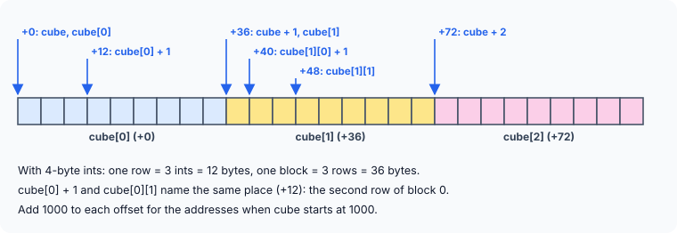

title : Arrays and Pointers: Exercises

summary : Exercises on 3-D array addresses, arrays of pointers to rows and blocks, a spot-the-bug puzzle on undefined behaviour, and shuffled pointer arrays. Full answers with diagrams.

# Arrays and Pointers: Exercises

This last set of chapter 2 exercises puts multi-dimensional arrays, arrays of pointers and pointers to pointers together. Each program is short, but you need to keep track of **types**, because the type of each expression decides where it points and how far `+ 1` moves.

Work each one out on paper first. Draw the array as one long line of memory, label where each expression points, and only then open the answer.

All answers assume 4-byte `int`s and 8-byte pointers. As in the earlier articles, addresses are printed as byte offsets from the start of the array, so the output is the same on every run.

### 1. Addresses in a 3-D array

`int cube[3][3][3];` starts at address 1000. What addresses do these expressions give?

```c
cube        cube + 1       cube + 2
cube[0]     cube[0] + 1    cube[1]
cube[1][1]  cube[1][0] + 1 cube[0][1]
```

:::details[Answer]
```c runnable
#include <stdio.h>

int main(void)
{
    int cube[3][3][3];
    char *base = (char *)cube;

    printf("+%td +%td +%td\n", (char *)cube - base, (char *)(cube + 1) - base, (char *)(cube + 2) - base);
    printf("+%td +%td +%td\n", (char *)cube[0] - base, (char *)(cube[0] + 1) - base, (char *)cube[1] - base);
    printf("+%td +%td +%td\n", (char *)cube[1][1] - base, (char *)(cube[1][0] + 1) - base, (char *)cube[0][1] - base);
    return 0;
}
```

```
+0 +36 +72
+0 +12 +36
+48 +40 +12
```

So, starting from 1000:

| Expression | Points to | Address |
|---|---|---|
| `cube` | block 0 | 1000 |
| `cube + 1` | block 1 | 1036 |
| `cube + 2` | block 2 | 1072 |
| `cube[0]` | row 0 of block 0 | 1000 |
| `cube[0] + 1` | row 1 of block 0 | 1012 |
| `cube[1]` | row 0 of block 1 | 1036 |
| `cube[1][1]` | first `int` of row 1, block 1 | 1048 |
| `cube[1][0] + 1` | second `int` of row 0, block 1 | 1040 |
| `cube[0][1]` | first `int` of row 1, block 0 | 1012 |



The key is the size of the thing each expression points to:

- `cube` is a pointer to a **3 × 3 block** (36 bytes), so `cube + 1` moves 36 bytes.
- `cube[0]` is a pointer to a **row of 3 `int`s** (12 bytes), so `cube[0] + 1` moves 12 bytes.
- `cube[1][0]` is a pointer to a single **`int`** (4 bytes), so `cube[1][0] + 1` moves 4 bytes.

Notice that `cube` and `cube[0]` print the same address, as do `cube[0] + 1` and `cube[0][1]`. They point to the same place but have different types.

**Why `(char *)`?** This program shows each address as its distance in **bytes** from the start of the array. Two rules of C make the cast necessary. First, C can only subtract two pointers of the **same type**, so both are converted to one type. Second, the difference between two pointers is counted in units of the type they point to, not in bytes: two `int *` pointers 8 bytes apart differ by 2 (two `int`s). A `char` is exactly one byte, so subtracting two `char *` pointers counts bytes. The cast does not change any address — it only changes how the subtraction counts. (`%td` is the `printf` format for a pointer difference, whose type is `ptrdiff_t`.)
:::

### 2. Pointers to every row, pointers to every block

What does this program print?

```c runnable
#include <stdio.h>

int main(void)
{
    int a[3][3][3] = {
        {{1, 2, 3}, {4, 5, 6}, {7, 8, 9}},
        {{2, 4, 6}, {8, 10, 12}, {14, 16, 18}},
        {{3, 6, 9}, {12, 15, 18}, {21, 24, 27}}
    };
    int *row[9] = {a[0][0], a[0][1], a[0][2],      /* start of every row */
                   a[1][0], a[1][1], a[1][2],
                   a[2][0], a[2][1], a[2][2]};
    int (*block[3])[3] = {a[0], a[1], a[2]};      /* start of every 3 x 3 block */
    int **rp = row;

    for (int i = 0; i < 9; i++) {
        printf("%d ", **rp);
        rp++;
    }
    printf("\n");

    for (int i = 0; i < 3; i++)
        printf("%d ", **block[i]);
    printf("\n");

    for (int i = 0; i < 9; i++)
        printf("%d ", row[i][2]);          /* last element of every row */
    printf("\n");
    return 0;
}
```

:::details[Answer]
```
1 4 7 2 8 14 3 12 21 
1 2 3 
3 6 9 6 12 18 9 18 27 
```

**The two arrays of pointers.** `a[i][j]` is a 1-D row of 3 `int`s, so it decays to an `int *` — the address of the row's first element. `row` therefore holds 9 `int *`s, one for the start of each row.

`a[i]` is a 3 × 3 block whose elements are rows, so it decays to `int (*)[3]`, a pointer to a row. An array of three such pointers is declared `int (*block[3])[3]`: read it as "`block` is an array of 3 pointers to arrays of 3 `int`s".

**Line 1.** `rp` is an `int **` that starts at `row[0]`. `*rp` is a row pointer, and `**rp` is the first element of that row. `rp++` moves to the next `int *` in `row`. So the loop prints the first element of each of the 9 rows: `1 4 7 2 8 14 3 12 21`.

**Line 2.** `block[i]` points to row 0 of block `i`; `*block[i]` is that row, and `**block[i]` is its first element, `a[i][0][0]`: `1 2 3`.

**Line 3.** `row[i][2]` is `*(row[i] + 2)`, the third element of row `i`: `3 6 9 6 12 18 9 18 27`.

**Watch out:** a common way of writing this puzzle declares `int *block[] = {a[0], a[1], a[2]};`. That does not type-check: `a[0]` is a pointer to a row, `int (*)[3]`, not an `int *`. GCC warns *initialization of 'int \*' from incompatible pointer type 'int (\*)[3]'* for each element. The pointer type must match what the array name decays to.
:::

### 3. Spot the bug

A student wrote this program to practise the `++` and `--` operators with pointers. It compiles, but GCC and Clang print **different** answers. Why?

```c runnable
#include <stdio.h>

void show(int a, int b, int c, int d, int e)
{
    printf("%d %d %d %d %d\n", a, b, c, d, e);
}

int main(void)
{
    int marks[] = {40, 50, 60, 70, 80, 90, 95, 99};
    int *ptr = marks + 1;

    show(*++ptr, *ptr--, *ptr, *ptr++, *++ptr);
    return 0;
}
```

:::details[Answer]
GCC 13 prints:

```
70 70 70 60 60
```

Clang 18 prints:

```
60 60 50 50 70
```

Neither compiler is wrong. **The program has undefined behaviour.**

C does not say in which order a function's arguments are evaluated, and they are **unsequenced** relative to each other. This call changes `ptr` four times (`++ptr`, `ptr--`, `ptr++`, `++ptr`) and also reads it, all inside one argument list. When the same variable is modified more than once with no sequence point in between, the C standard places no requirements on the result at all. Here GCC happened to evaluate the arguments from right to left and Clang from left to right — but a compiler may do anything, and the result can change with the optimisation level.

Both compilers warn about it:

```
gcc:   warning: operation on 'ptr' may be undefined [-Wsequence-point]
clang: warning: multiple unsequenced modifications to 'ptr' [-Wunsequenced]
```

**The fix** is to give each change to `ptr` its own statement. Statements are always executed in order, so the result is guaranteed:

```c runnable
#include <stdio.h>

void show(int a, int b, int c, int d, int e)
{
    printf("%d %d %d %d %d\n", a, b, c, d, e);
}

int main(void)
{
    int marks[] = {40, 50, 60, 70, 80, 90, 95, 99};
    int *ptr = marks + 1;

    int a = *++ptr;        /* each change to ptr now has its own statement */
    int b = *ptr--;
    int c = *ptr;
    int d = *ptr++;
    int e = *++ptr;

    show(a, b, c, d, e);
    return 0;
}
```

```
60 60 50 50 70
```

Step by step, with `ptr` starting at `marks[1]`:

| Statement | `ptr` before → after | Value read |
|---|---|---|
| `*++ptr` | `marks[1]` → `marks[2]` | 60 (read after moving) |
| `*ptr--` | `marks[2]` → `marks[1]` | 60 (read before moving) |
| `*ptr` | `marks[1]` | 50 |
| `*ptr++` | `marks[1]` → `marks[2]` | 50 (read before moving) |
| `*++ptr` | `marks[2]` → `marks[3]` | 70 (read after moving) |

Older books often show one "correct" answer for programs like the original. Now you know why that answer depends on the compiler. Always compile with `-Wall`; it catches this mistake.
:::

### 4. A 3-D array through pointer notation

What does this program print?

```c runnable
#include <stdio.h>

int main(void)
{
    int a[3][3][2] = {
        {{1, 2}, {3, 4}, {5, 6}},
        {{3, 4}, {1, 2}, {5, 6}},
        {{5, 6}, {3, 4}, {1, 2}}
    };

    printf("%d %d %d\n", *(*(a[0] + 2) + 1), *(*(*(a + 2) + 1) + 1), *(a[1][2] + 1));
    return 0;
}
```

:::details[Answer]
```
6 4 6
```

Rewrite each expression in subscript form using `*(x + n) == x[n]`:

- `*(*(a[0] + 2) + 1)` → `*(a[0][2] + 1)` → `a[0][2][1]`. Block 0, row 2 is `{5, 6}`, so the answer is **6**.
- `*(*(*(a + 2) + 1) + 1)` → `a[2][1][1]`. Block 2, row 1 is `{3, 4}`, so the answer is **4**.
- `*(a[1][2] + 1)` → `a[1][2][1]`. Block 1, row 2 is `{5, 6}`, so the answer is **6**.

Once each expression is in subscript form, you only need to look it up in the initialiser.
:::

### 5. A shuffled array of pointers

What does this program print?

```c runnable
#include <stdio.h>

int main(void)
{
    int a[5] = {10, 11, 12, 13, 14};
    int *p[5] = {a, a + 2, a + 1, a + 4, a + 3};
    int **ptr = p;

    (void)**++ptr;     /* only the side effect matters */
    printf("%d %td %td\n", **ptr, ptr - p, *ptr - a);
    return 0;
}
```

:::details[Answer]
```
12 1 2
```

![p holds the addresses of a's elements in shuffled order; after ++ptr, ptr is at p[1], which points to a[2]](images/ex-shuffled-pointer-array.svg)

The pointers in `p` are **not** in order: `p[1]` points to `a[2]` and `p[2]` points to `a[1]`.

- `**++ptr`: unary operators group from right to left, so this is `*(*(++ptr))`. `++ptr` moves `ptr` from `p[0]` to `p[1]`. The value is thrown away (the `(void)` says so, and stops the compiler warning about an unused value); only the move matters.
- `**ptr`: `*ptr` is `p[1]`, which is `a + 2`; one more `*` gives `a[2]` = **12**.
- `ptr - p`: subtracting two pointers into the same array gives the number of **elements** between them — `ptr` is at `p[1]`, so this is **1**.
- `*ptr - a`: `*ptr` is `a + 2`, so `(a + 2) - a` is **2**.

`ptr - p` counts positions in the array of pointers, while `*ptr - a` counts positions in the array of `int`s. The shuffle means these two numbers differ: 1 and 2.

The `%td` format is for `ptrdiff_t`, the type of a pointer difference.
:::

## Key Takeaways

- In a multi-dimensional array, every level of the name has its own type: `cube` points to a block, `cube[i]` to a row, `cube[i][j]` to an `int`. The type decides how far `+ 1` moves.
- Expressions can share an address but differ in type: `cube`, `cube[0]` and `cube[0][0]` all start at the same byte.
- When storing those addresses in arrays of pointers, the pointer type must match: `int *` for rows, `int (*)[3]` for 3 × 3 blocks.
- Modifying the same variable more than once inside one function call's arguments is **undefined behaviour**. Split it into separate statements, and compile with `-Wall` to catch it.
- Pointer subtraction counts **elements**, not bytes, and only works between pointers into the same array.
