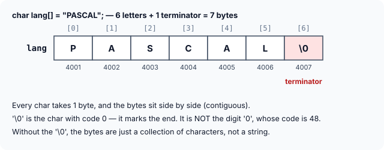

title : Strings: Character Arrays and the Null Terminator

summary : A C string is a char array ending in '\0'. Learn why the terminator matters, how to walk a string with indexes and pointers, and how to print and read strings safely with %s, scanf and fgets.

# Strings: Character Arrays and the Null Terminator

The last two chapters covered arrays of every shape: one, two and three dimensions, initialising them, passing them to functions, and walking through them with pointers. With that behind you, strings are easy, because **a string in C is simply a special kind of array**: an array of characters with a marker at the end.

This article explains what that marker is, why everything depends on it, and the ways to walk through, print and read strings. Later articles cover the standard string functions, how strings and pointers relate, and arrays of strings.

## What Is a String?

A group of integers can be stored in an `int` array. In the same way, a group of characters can be stored in a `char` array. Character arrays are what programs use to handle text: names, words, sentences, file contents.

Many languages (Python, Java, older ones like BASIC and Fortran) also store text as an array of characters internally, but they hide this behind a built-in "string" type. **C does not hide it.** In C a string *is* a `char` array, so you work with the array directly — which is why understanding arrays and pointers is the key to understanding strings.

More precisely:

> A **string** is a one-dimensional array of characters **terminated by a null character, `'\0'`**.

```c
char lang[] = {'P', 'A', 'S', 'C', 'A', 'L', '\0'};
```

Each character occupies **one byte**, and the last character is always `'\0'`.

### The null character, '\0'

`'\0'` looks like two characters, but it is a single character written as an **escape sequence**, just as `'\n'` is a single newline character. It is called the **null character**, and its code is **0**.

Do not confuse it with `'0'`, the digit zero, which is an ordinary printable character with code **48**:

```c runnable
#include <stdio.h>

int main(void)
{
    printf("'\\0' has code %d\n", '\0');
    printf("'0'  has code %d\n", '0');
    printf("'A'  has code %d\n", 'A');
    return 0;
}
```

```
'\0' has code 0
'0'  has code 48
'A'  has code 65
```

(The `\\` inside the format string prints a single backslash.)

### A string in memory

Like every array, the characters of a string are stored in **contiguous** memory locations: one after another, with no gaps.



The program below prints the string, its size, and the code stored in every byte. You can see the terminator in the last byte:

```c runnable
#include <stdio.h>

int main(void)
{
    char lang[] = {'P', 'A', 'S', 'C', 'A', 'L', '\0'};   /* 6 letters + terminator */

    printf("%s\n", lang);
    printf("sizeof lang = %zu bytes\n", sizeof lang);

    for (size_t i = 0; i < sizeof lang; i++) {
        if (lang[i] != '\0')
            printf("lang[%zu] = '%c'   code %d\n", i, lang[i], lang[i]);
        else
            printf("lang[%zu] = '\\0'  code %d\n", i, lang[i]);
    }
    return 0;
}
```

```
PASCAL
sizeof lang = 7 bytes
lang[0] = 'P'   code 80
lang[1] = 'A'   code 65
lang[2] = 'S'   code 83
lang[3] = 'C'   code 67
lang[4] = 'A'   code 65
lang[5] = 'L'   code 76
lang[6] = '\0'  code 0
```

### Why the terminator matters

A `char` array does not record its own length anywhere. When you pass it to a function, only its base address travels (as you saw in the arrays chapter). So how does a function like `printf` know where the text stops?

**The `'\0'` is the only way.** Every function that works with strings reads characters one by one until it meets a `'\0'`. That is why:

> A sequence of characters **without** a terminating `'\0'` is not really a string — just a collection of characters. Passing it to a string function makes that function keep reading past the end of the array, into whatever memory follows. That is undefined behaviour: it may print garbage, crash, or seem to work by luck.

## The Shortcut: Initialising With a String Literal

Strings are used so often that C gives a shortcut for initialising them. Instead of listing characters one by one, write the text in double quotes:

```c
char lang[] = "PASCAL";
```

Here the `'\0'` is **not** written — the compiler adds it automatically. A piece of text in double quotes, like `"PASCAL"`, is called a **string literal**. Both forms produce exactly the same 7-byte array:

```c runnable
#include <stdio.h>

int main(void)
{
    char spelled[] = {'P', 'A', 'S', 'C', 'A', 'L', '\0'};
    char quoted[]  = "PASCAL";             /* the compiler adds the '\0' itself */

    printf("%s %zu\n", spelled, sizeof spelled);
    printf("%s %zu\n", quoted, sizeof quoted);
    return 0;
}
```

```
PASCAL 7
PASCAL 7
```

:::callout
**Leave room for the terminator.** If you give the size yourself, it must count the `'\0'`: `"PASCAL"` needs `char lang[7]`. C has a surprising rule here — `char lang[6] = "PASCAL";` is **legal** and many compilers accept it without any warning (GCC only started warning about it in recent versions, with `-Wextra`), but the 6 letters fill the array and the `'\0'` is silently dropped. The result is not a string. (If the size is too small even for the letters, as in `char lang[5] = "PASCAL";`, GCC does warn: *initializer-string for array of 'char' is too long*.) The safest habit is to leave the size out and let the compiler count: `char lang[] = "PASCAL";`.
:::

## Walking Through a String

Because a string is an array, every way of reaching an array element works on it. The program below prints each character of a string four times, using four equivalent notations:

```c runnable
#include <stdio.h>

int main(void)
{
    char name[] = "Ramanujan";
    int i = 0;

    while (name[i] != '\0') {               /* stop at the terminator, whatever the length */
        printf("%c %c %c %c\n", name[i], *(name + i), *(i + name), i[name]);
        i++;
    }
    return 0;
}
```

```
R R R R
a a a a
m m m m
a a a a
n n n n
u u u u
j j j j
a a a a
n n n n
```

As you saw with integer arrays, `name[i]`, `*(name + i)`, `*(i + name)` and `i[name]` all mean the same element. (The last form is legal but only used in puzzles — never write it in real code.)

Notice the loop condition. The program never uses the length of the string (9). It simply keeps going **until it meets the `'\0'`**. That makes it more general: change `"Ramanujan"` to any other string and the loop still works, without changing a single number. Many programs shorten the condition to `while (name[i])`, because `'\0'` is 0, which counts as false.

### Walking with a pointer

Here is the same idea using a pointer to step through the characters:

```c runnable
#include <stdio.h>

int main(void)
{
    char name[] = "Ramanujan";
    char *ptr = name;                      /* base address of the string */

    while (*ptr != '\0') {
        printf("%c", *ptr);
        ptr++;                             /* step to the next char */
    }
    printf("\n");
    return 0;
}
```

```
Ramanujan
```

![ptr starts at name[0], prints the character, and moves one char at a time until it reaches the '\0' at name[9]](images/str-pointer-walk.svg)

How it works:

1. As with any array, mentioning the name `name` gives its **base address** — the address of element `0`. `ptr = name` stores that address in `ptr`.
2. `*ptr` is the character at that address, and `printf("%c", *ptr)` prints it.
3. `ptr++` moves `ptr` to the next character. This works because array elements are stored contiguously, and incrementing a pointer makes it point to the next element of its type — for a `char *`, the very next byte.
4. The loop repeats until `ptr` reaches the `'\0'` at the end.

This pointer style — "loop until `*p` is `'\0'`" — is the pattern behind nearly every string function in C, as the next article shows.

## Printing a String with %s

Although there are many ways to visit the characters of a string, you rarely need any of them just to print it. `printf` has a format specifier for the whole job, **`%s`**:

```c runnable
#include <stdio.h>

int main(void)
{
    char name[]  = "Ramanujan";
    char early[] = "Hello\0World";         /* a '\0' hidden in the middle */

    printf("%s\n", name);                  /* prints up to, not including, '\0' */
    printf("[%s]\n", early);               /* stops at the first '\0' */
    printf("[%.4s]\n", name);              /* precision: at most 4 characters */
    printf("[%s]\n", name + 5);            /* start printing from element 5 */
    return 0;
}
```

```
Ramanujan
[Hello]
[Rama]
[ujan]
```

What each line shows:

- **`%s` takes the base address of a string** and prints characters from there up to the terminator. The `'\0'` itself is **not** printed.
- `%s` stops at the **first** `'\0'` it finds. `early` really holds `Hello`, a `'\0'`, `World` and another `'\0'`, but only `Hello` is printed.
- A **precision** such as `%.4s` prints at most 4 characters. (This is also the safe way to print a char array that might have no terminator, as long as you know its size.)
- Any address inside the string works as a starting point: `name + 5` is the address of element 5, so printing begins at `'u'`.

## Reading a String with scanf

The same `%s` specifier can read a word typed at the keyboard:

```c
#include <stdio.h>

int main(void)
{
    char name[25];

    printf("Enter your name: ");
    scanf("%24s", name);                   /* no & : name is already an address */
    printf("Hello %s!\n", name);
    return 0;
}
```

A sample run:

```
Enter your name: Srinivasa
Hello Srinivasa!
```

Several details here matter:

- **`char name[25]`** sets aside 25 bytes. `scanf` puts the typed characters into this array and adds the `'\0'` after them.
- **There is no `&` before `name`.** `scanf` needs the address of where to store the input. For an `int` variable you write `&n`, but an array's name already gives its base address, so `name` is exactly what `scanf` needs.
- **`%24s`, not just `%s`.** A plain `%s` has no idea how big the array is. If someone types 40 characters, `scanf` writes all 40 (plus `'\0'`) and overruns the array — a **buffer overflow**, one of the most common security bugs in C. The width `24` caps the input at 24 characters, leaving 1 byte for the `'\0'`. Always use a width of one less than the array size.
- **`%s` reads one word.** It skips leading spaces, then stops at the first whitespace (space, tab or Enter). Typing `Srinivasa Ramanujan` stores only `Srinivasa`; the rest stays waiting in the input.

You can see the whitespace rule without typing anything by using `sscanf`, which reads from a string instead of the keyboard but follows exactly the same rules:

```c runnable
#include <stdio.h>

int main(void)
{
    char first[25];
    const char *typed = "Alan Turing";     /* pretend this was typed */

    sscanf(typed, "%24s", first);          /* works exactly like scanf("%24s", first) */
    printf("Read: [%s]\n", first);
    return 0;
}
```

```
Read: [Alan]
```

### Reading a whole line with fgets

To read a full line, spaces included, use **`fgets`**:

```c
#include <stdio.h>
#include <string.h>

int main(void)
{
    char line[40];

    printf("Enter your full name: ");
    if (fgets(line, sizeof line, stdin) != NULL) {
        line[strcspn(line, "\n")] = '\0';  /* remove the newline fgets keeps */
        printf("Hello %s!\n", line);
    }
    return 0;
}
```

A sample run:

```
Enter your full name: Alan Turing
Hello Alan Turing!
```

`fgets(line, sizeof line, stdin)` reads at most `sizeof line - 1` characters from the keyboard (`stdin`), stops after the Enter key, and always adds the `'\0'`, so it can never overflow the array. Unlike `scanf`, it **keeps the newline** (`'\n'`) that Enter produced. The line `line[strcspn(line, "\n")] = '\0';` removes it: `strcspn` returns the position of the first `'\n'` (or the string's length if there is none), and the `'\0'` written there cuts the string short.

:::callout
Older books and many online examples use **`gets(str)`** to read a line. Never use it. `gets` has no way of knowing the array's size, so a long enough line always overflows it. It was so dangerous that it was **removed from the C language** in the C11 standard. Use `fgets` instead.
:::

## Key Takeaways

- A string is a `char` array whose last character is the **null character `'\0'`** (code 0). The digit `'0'` is a different character (code 48).
- The characters are stored contiguously, one byte each. A string of *n* letters needs *n* + 1 bytes.
- The `'\0'` is the **only** way string functions know where a string ends. Without it, the characters are not a string.
- `char s[] = "text";` copies the literal into the array and adds the `'\0'` automatically. Let the compiler count the size.
- `s[i]`, `*(s + i)` and a pointer that steps with `p++` all walk through a string. Loop until you meet `'\0'`; you never need the length.
- `%s` prints from a given address up to (not including) the first `'\0'`.
- Read a word with `scanf("%24s", s)` — always give a width, and no `&`. Read a whole line with `fgets`. Never use `gets`.

## Practice Questions

:::details[How many bytes does char city[] = "Pune"; occupy?]
**5**: 4 letters plus the `'\0'` the compiler adds. `sizeof city` gives 5.
:::

:::details[What does printf("%s", "Data\0Base"); print?]
`Data`. `%s` stops at the first `'\0'`, so `Base` is never reached.
:::

:::details[What is wrong with: char code[4] = "ABCD"; printf("%s", code);]
`"ABCD"` needs 5 bytes, but the array has 4. C allows this initialisation and silently drops the `'\0'`, so `code` is not a string. `printf` keeps reading past the end of the array looking for a terminator: undefined behaviour. Make it `char code[5]` or, better, `char code[]`.
:::

:::details[Why is there no & in scanf("%19s", word); when word is a char array?]
`scanf` needs the address where it should store the input. The name of an array already gives its base address, so `word` is that address. Writing `&word` gives the same address with a different type (pointer to the whole array), which is wrong for `%s` and makes compilers warn.
:::

:::details[A user types "New Delhi" for scanf("%19s", city);. What does city hold?]
`New`. `%s` stops reading at the first whitespace. Use `fgets` to read a whole line with spaces.
:::

:::details[Write a loop that counts the vowels in a string s using a pointer.]
```c
int count = 0;
for (const char *p = s; *p != '\0'; p++)
    if (*p == 'a' || *p == 'e' || *p == 'i' || *p == 'o' || *p == 'u')
        count++;
```
The loop stops at the terminator, so it works for any string length.
:::
