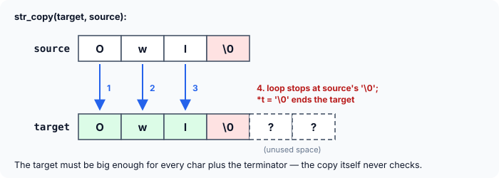
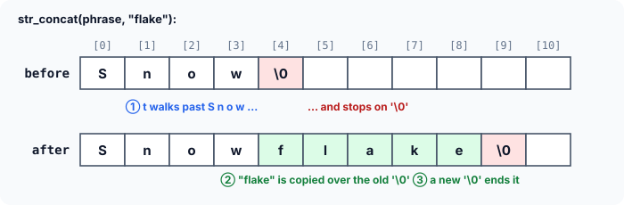
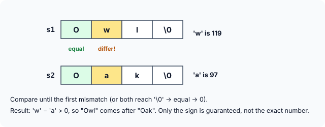

# Standard String Functions — and Writing Your Own

Since a C string is just a `char` array ending in `'\0'`, C has no built-in operators for text: you cannot write `a + b` to join two strings or `a == b` to compare them. Instead, the standard library provides a large set of **string functions**, declared in the header `<string.h>`.

This article covers the four you will use most — `strlen`, `strcpy`, `strcat` and `strcmp` — and then rebuilds each of them with pointers. Writing them yourself is the best way to see that there is no magic in the library: every one of them is a short loop that walks a pointer until it meets a `'\0'`.

## The Four Most Common Functions

| Function | What it does |
|---|---|
| `strlen(s)` | Returns the number of characters in `s`, **not** counting the `'\0'` |
| `strcpy(t, s)` | Copies string `s` into array `t` (including the `'\0'`) |
| `strcat(t, s)` | Appends string `s` to the end of the string already in `t` |
| `strcmp(s1, s2)` | Compares two strings: returns 0 if equal, negative or positive otherwise |

Here they are in one program:

```c runnable
#include <stdio.h>
#include <string.h>

int main(void)
{
    char first[24] = "Snowflake";          /* roomy: will grow later */
    char second[]  = "Owl";
    char copy[24];
    size_t len;
    int k;

    len = strlen(first);
    printf("length of first = %zu\n", len);

    strcpy(copy, first);
    printf("after copying, copy = %s\n", copy);

    k = strcmp(first, second);
    printf("first vs second: %s\n", k < 0 ? "negative" : k > 0 ? "positive" : "zero");

    k = strcmp(copy, first);
    printf("copy vs first:   %s\n", k < 0 ? "negative" : k > 0 ? "positive" : "zero");

    strcat(first, second);
    printf("after joining, first = %s\n", first);
    return 0;
}
```

```
length of first = 9
after copying, copy = Snowflake
first vs second: positive
copy vs first:   zero
after joining, first = SnowflakeOwl
```

Some things to notice:

- Every call passes **base addresses**. Writing `strlen(first)` passes the address of `first[0]`; the function never receives a copy of the array.
- `strlen` returns a value of type **`size_t`** — the unsigned type C uses for sizes and lengths — so it is stored in a `size_t` and printed with `%zu`.
- `strcmp(first, second)` is **positive** because `'S'` comes after `'O'`. `strcmp(copy, first)` is **zero** because the strings are identical. (Why the program prints the *sign* rather than the number is explained in the `strcmp` section below.)
- `first` was declared with 24 bytes, not just 10, so that it has room for `"Owl"` to be appended. More on that shortly.

The rest of this article takes each function in turn and writes our own version of it.

## strlen: Counting Characters

`strlen` receives the base address of a string and returns its length. It does **not** count the `'\0'`: `strlen("Snowflake")` is 9, even though the array holds 10 bytes.

Our own version needs only a counter and a pointer:

```c runnable
#include <stdio.h>

size_t str_length(const char *s)
{
    size_t length = 0;

    while (*s != '\0') {        /* count until the terminator */
        length++;
        s++;
    }
    return length;
}

int main(void)
{
    char word[] = "Snowflake";

    printf("%s has length %zu\n", word, str_length(word));
    printf("%s has length %zu\n", "Thunderstorm", str_length("Thunderstorm"));
    printf("[%s] has length %zu\n", "", str_length(""));
    return 0;
}
```

```
Snowflake has length 9
Thunderstorm has length 12
[] has length 0
```

The function keeps counting characters until `s` points at the `'\0'`. It works for an array (`word`), for a string literal passed directly (`"Thunderstorm"` is converted to the address of its first character), and for the empty string `""`, which is a single `'\0'`.

Two details are worth noticing:

- The parameter is `const char *s`. The `const` promises that the function only **reads** the string. (The `const` qualifier gets a full explanation in the next article.)
- `s++` changes only the function's own copy of the pointer. The caller's `word` is not affected.

:::callout
`strlen` and `sizeof` are different questions. For `char word[] = "Snowflake";`, `strlen(word)` is **9** (characters before the terminator, found at run time by walking the string), while `sizeof word` is **10** (bytes in the whole array, known at compile time). For `char buf[50] = "Owl";`, they are 3 and 50.
:::

## strcpy: Copying a String

You cannot copy a string with `=` (the next article shows why). Instead, `strcpy(target, source)` copies the characters of `source` into `target`, one by one, until it has copied the `'\0'`. Pass the target first and the source second — the same order as an assignment, `target = source`.



The copy is done piecemeal, character by character; there is no shortcut. Here is our own version:

```c runnable
#include <stdio.h>

void str_copy(char *t, const char *s)
{
    while (*s != '\0') {        /* copy every character before the terminator */
        *t = *s;
        s++;
        t++;
    }
    *t = '\0';                  /* then end the target string */
}

int main(void)
{
    char source[] = "Snowflake";
    char target[24];

    str_copy(target, source);
    printf("source = %s, target = %s\n", source, target);
    return 0;
}
```

```
source = Snowflake, target = Snowflake
```

The loop stops **before** copying the `'\0'`, so the last line, `*t = '\0';`, is essential. Without it, `target` would be a collection of characters with no end marker, and printing it would run on into whatever garbage followed.

:::callout
**The target must be big enough.** `strcpy` has no idea how large `target` is; it just keeps writing until the source's `'\0'`. If the target is too small, it writes past the end of the array — a **buffer overflow** that can corrupt other variables, crash the program, or be exploited by attackers. Making sure the target has room for every character **plus the `'\0'`** is the caller's job.
:::

## strcat: Joining Two Strings

`strcat(target, source)` **concatenates** (joins) the source onto the end of the target. `"Snowflake"` and `"Owl"` give `"SnowflakeOwl"`. Again, the target must be big enough to hold the combined string — that is why `first` was declared with 24 bytes in the first program, even though `"Snowflake"` needs only 10.

Writing `str_concat` takes the two ideas we already have: walk to the end of the target, then copy the source from there.



```c runnable
#include <stdio.h>

void str_concat(char *t, const char *s)
{
    while (*t != '\0')          /* 1. walk to the end of the target */
        t++;

    while (*s != '\0') {        /* 2. copy the source from there */
        *t = *s;
        s++;
        t++;
    }
    *t = '\0';                  /* 3. end the joined string */
}

int main(void)
{
    char phrase[24] = "Snow";   /* room for the joined result */

    str_concat(phrase, "flake");
    str_concat(phrase, " Owl");
    printf("%s\n", phrase);
    return 0;
}
```

```
Snowflake Owl
```

The first character of the source **overwrites the target's old `'\0'`**, and a new `'\0'` is written at the very end. Note that `strcat` has to walk the whole target every time to find its end, so joining many pieces in a loop with `strcat` gets slower and slower as the string grows.

## strcmp: Comparing Two Strings

`strcmp(s1, s2)` compares two strings **character by character** until it finds a pair that differs or reaches the end of the strings, whichever comes first.

- If the two strings are identical, it returns **0**.
- Otherwise the result depends on the first pair of characters that differ: it is **negative** if `s1`'s character has the smaller code (`s1` sorts first), and **positive** if it has the larger code.



In practice you rarely care about the exact value; you want to know whether the strings are equal, or which one comes first in dictionary order. Here is our own version:

```c runnable
#include <stdio.h>

int str_compare(const char *s1, const char *s2)
{
    while (*s1 == *s2) {
        if (*s1 == '\0')        /* both ended together: identical */
            return 0;
        s1++;
        s2++;
    }
    /* first mismatch: compare the two characters as unsigned bytes */
    return (unsigned char)*s1 - (unsigned char)*s2;
}

int main(void)
{
    printf("%d\n", str_compare("Owl", "Owl"));
    printf("%d\n", str_compare("Owl", "Oak"));
    printf("%d\n", str_compare("Oak", "Owl"));
    printf("%d\n", str_compare("Snow", "Snowflake"));
    return 0;
}
```

```
0
22
-22
-102
```

How the function works:

- While the characters match, it moves both pointers forward. If the matching character is `'\0'`, both strings ended at the same point, so they are equal: return 0.
- At the first mismatch, it returns the difference between the two character codes. For `"Owl"` vs `"Oak"`, that is `'w' - 'a'` = 119 − 97 = **22**: positive, so `"Owl"` sorts after `"Oak"`.
- `"Snow"` vs `"Snowflake"` matches for four characters; then `"Snow"` reaches its `'\0'` while the other has `'f'`. The result is 0 − 102 = **−102**. A string that is a **prefix** of another always sorts first, because `'\0'` is smaller than every other character.

**Only the sign is guaranteed.** The C standard says `strcmp` returns *a* negative, zero or positive value; it does not say which number. Our version returns the difference of the codes, and some library versions do too, but others return just −1, 0 or 1. So always test the result with `< 0`, `== 0` or `> 0` — never compare it with a specific value such as `-1`. That is why the first program in this article printed only the sign.

The casts to `unsigned char` follow the standard's rule that characters are compared as unsigned bytes. On many systems plain `char` is signed, so without the casts, a non-ASCII character such as `'é'` (stored as a byte above 127) would look negative and sort before `'a'`.

:::callout
`strcmp` compares character **codes**, not "alphabetical order" as people understand it. All uppercase letters (codes 65–90) come before all lowercase letters (97–122), so `strcmp("Zebra", "apple")` is negative. To compare without regard to case, convert both strings to one case first (or use the POSIX function `strcasecmp`, which is available on Linux and macOS but is not part of standard C).
:::

## Shorter Versions: Idiomatic C

Experienced C programmers often write these loops much more compactly. You will meet this style constantly in real code, so it is worth being able to read it:

```c runnable
#include <stdio.h>

size_t str_length(const char *s)
{
    const char *p = s;

    while (*p)                  /* *p is 0 (false) only at the terminator */
        p++;
    return (size_t)(p - s);     /* distance from start to terminator */
}

void str_copy(char *t, const char *s)
{
    while ((*t++ = *s++) != '\0')   /* copy, then test what was copied */
        ;
}

int main(void)
{
    char target[24];

    str_copy(target, "Thunderstorm");
    printf("%s %zu\n", target, str_length(target));
    return 0;
}
```

```
Thunderstorm 12
```

- **`str_length`** moves `p` to the terminator and returns `p - s`. Subtracting two pointers into the same array gives the number of elements between them, so this is the length.
- **`str_copy`** does all its work in the loop condition. `*t++ = *s++` copies one character and then advances both pointers (postfix `++` takes effect after the value is used). The value of an assignment is the value assigned, so the loop ends right **after** the `'\0'` has been copied. This means no separate `*t = '\0';` is needed. The empty statement `;` is the loop body.

Both versions behave exactly like the longer ones. Use whichever you find clearer; there is no speed difference with a modern optimising compiler.

## Safer Alternatives

`strcpy` and `strcat` trust you completely to provide enough space. A common, safer approach is to use **`snprintf`** (from `<stdio.h>`), which is given the size of the target and never writes beyond it:

```c runnable
#include <stdio.h>

void store_city(const char *name)
{
    char city[8];
    int needed = snprintf(city, sizeof city, "%s", name);   /* never writes past 8 bytes */

    if (needed >= (int)sizeof city)
        printf("%s -> truncated to \"%s\" (needed %d chars)\n", name, city, needed);
    else
        printf("%s -> stored whole\n", name);
}

int main(void)
{
    store_city("Pune");
    store_city("Thiruvananthapuram");
    return 0;
}
```

```
Pune -> stored whole
Thiruvananthapuram -> truncated to "Thiruva" (needed 18 chars)
```

`snprintf` writes at most `sizeof city - 1` characters and always adds the `'\0'`. It returns the length the full result **would** have had, so comparing that with the array size tells you whether anything was cut off. To join strings safely, the same call can do the work of `strcat`: `snprintf(buf, sizeof buf, "%s%s", a, b);`.

:::callout
`strncpy(t, s, n)` looks like a "safe `strcpy`", but it has a trap: if `s` is `n` characters or longer, it copies `n` characters and **does not add a `'\0'`**. If you use it, terminate the string yourself: `t[n - 1] = '\0';`.
:::

## Other Useful Functions in <string.h>

| Function | Purpose |
|---|---|
| `strncmp(s1, s2, n)` | Like `strcmp`, but compares at most `n` characters |
| `strncat(t, s, n)` | Appends at most `n` characters of `s`, then a `'\0'` |
| `strchr(s, c)` | Returns a pointer to the first `c` in `s`, or `NULL` |
| `strrchr(s, c)` | Returns a pointer to the **last** `c` in `s`, or `NULL` |
| `strstr(s, sub)` | Returns a pointer to the first occurrence of `sub` in `s`, or `NULL` |
| `strcspn(s, set)` | Returns the length of the start of `s` that has no character from `set` |
| `memcpy(t, s, n)` | Copies exactly `n` bytes (not limited to strings) |

Notice how many of them return a **pointer** into the string rather than an index. That is the C way of saying "here is where I found it" — and since the pointer is an ordinary `char *`, you can print from it, compare it, or subtract the base address to get the position.

## Key Takeaways

- The string functions are declared in `<string.h>` and always receive **base addresses**, never copies of the arrays.
- `strlen` counts characters **before** the `'\0'` and returns a `size_t` (print it with `%zu`). It is not the same as `sizeof`.
- `strcpy(t, s)` and `strcat(t, s)` write into `t` without checking its size. The caller must make sure `t` can hold every character plus the `'\0'`.
- `strcmp` returns 0 for equal strings; otherwise only the **sign** is meaningful. Characters are compared by their codes, so uppercase sorts before lowercase.
- Every one of these functions is a loop that walks a pointer until `'\0'`. A copying function must remember to terminate its result.
- For bounded copying and joining, prefer `snprintf`. Beware `strncpy`, which may leave out the `'\0'`.

## Practice Questions

:::details[For char buf[30] = "Data"; what are strlen(buf) and sizeof buf?]
`strlen(buf)` is **4** (characters before the `'\0'`). `sizeof buf` is **30** (bytes in the array).
:::

:::details[What is wrong with: char t[5]; strcpy(t, "Hello");]
`"Hello"` needs 6 bytes (5 letters + `'\0'`), but `t` has only 5. `strcpy` writes the `'\0'` one byte past the end of the array — a buffer overflow and undefined behaviour.
:::

:::details[Is strcmp("apple", "Apple") positive, negative or zero?]
**Positive.** The first characters differ: `'a'` is 97 and `'A'` is 65, and 97 > 65.
:::

:::details[Why is if (strcmp(a, b) == -1) a bug?]
The standard only promises a negative value when `a` sorts before `b`, not exactly −1. A library that returns, say, −22 would make the test fail. Write `if (strcmp(a, b) < 0)`.
:::

:::details[Write str_count(s, c) that returns how many times the character c appears in the string s.]
```c
size_t str_count(const char *s, char c)
{
    size_t count = 0;

    for (; *s != '\0'; s++)
        if (*s == c)
            count++;
    return count;
}
```
:::

:::details[Write str_reverse(s) that reverses a string in place, using two pointers.]
```c
#include <string.h>

void str_reverse(char *s)
{
    size_t n = strlen(s);
    if (n == 0)
        return;

    char *left = s, *right = s + n - 1;   /* first and last characters */
    while (left < right) {
        char tmp = *left;
        *left = *right;
        *right = tmp;
        left++;
        right--;
    }
}
```
The `'\0'` stays where it is; only the characters before it are swapped, working inwards from both ends. The early return avoids computing `s - 1` for an empty string, which would point outside the array.
:::
