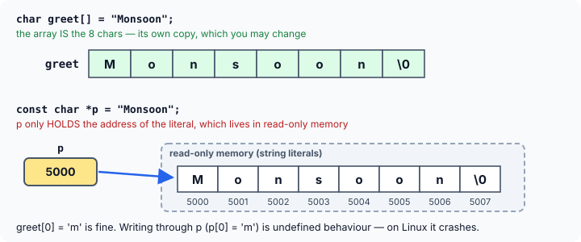
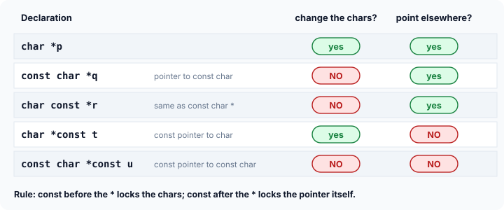

title : Pointers and Strings, and the const Qualifier

summary : char arrays vs pointers to string literals: what can be assigned, what can be changed, and why modifying a literal crashes. Then master const, including const char *, char *const and returning const.

# Pointers and Strings, and the const Qualifier

There are two ways to give a name to a piece of text in C. You can store it in a `char` **array**, or you can let the compiler store it somewhere and keep its address in a `char` **pointer**. The two look almost identical when you use them, but they behave differently in ways that cause real bugs.

This article compares the two forms, and then introduces **`const`** — the keyword that lets you (and the compiler) protect data from being changed by accident. `const` matters for every kind of variable, but it is especially important for strings and pointers.

## Two Ways to Store a String

Suppose we want to store the word `"Monsoon"`. We can either put it in an array, or ask the compiler to store it somewhere in memory and keep its address in a `char` pointer:

```c
char  greet[] = "Monsoon";
const char *p = "Monsoon";
```

(The `const` in the second line is explained later in this article. For now, read it as "a pointer to characters that must not be changed".)

These look similar, and you use them the same way — `greet[0]` and `p[0]` are both `'M'`, and both can be printed with `%s`:

```c runnable
#include <stdio.h>

int main(void)
{
    char  greet[] = "Monsoon";             /* an array: its own 8 bytes        */
    const char *p = "Monsoon";             /* a pointer to a literal elsewhere */

    printf("%s %s\n", greet, p);
    printf("sizeof greet = %zu, sizeof p = %zu\n", sizeof greet, sizeof p);
    printf("greet[0] = %c, p[0] = %c\n", greet[0], p[0]);
    return 0;
}
```

```
Monsoon Monsoon
sizeof greet = 8, sizeof p = 8
greet[0] = M, p[0] = M
```

But what they **are** is quite different:



- **`greet`** is an array of 8 `char`s. The characters of `"Monsoon"` (and the `'\0'`) are **copied into it**. The array is the text; it belongs to your program, and you may change its characters.
- **`p`** is a pointer variable — 8 bytes on a 64-bit system, which is why `sizeof p` happens to be 8 here as well. It holds the **address** of the string literal `"Monsoon"`, which the compiler has stored elsewhere, usually in a **read-only** area of memory.

### Difference 1: an array cannot be assigned, a pointer can

We cannot assign one array to another. We can assign one pointer to another:

```c
char first[] = "Monsoon";
char second[10];

second = first;        /* error */
first = "Winter";      /* error */
```

GCC rejects both lines with the same message:

```
error: assignment to expression with array type
```

The name of an array stands for the array itself — a fixed block of memory. It is not a variable that holds an address, so it cannot be made to "point" somewhere else. To change what an array holds, you copy new characters **into** it with `strcpy`, as the previous article showed. In particular, once an array has been defined, you cannot give it a new string with `=`; the `= "..."` form works **only** in the definition, as an initialiser.

A pointer, on the other hand, is an ordinary variable that holds an address, and it can be given a new address at any time:

```c runnable
#include <stdio.h>

int main(void)
{
    const char *s = "Good Evening";
    const char *q;

    q = s;                                 /* copies an address: fine */
    printf("q = %s\n", q);

    s = "Goodbye";                         /* point s at another string: fine */
    printf("s = %s, q = %s\n", s, q);
    return 0;
}
```

```
q = Good Evening
s = Goodbye, q = Good Evening
```

Notice what `q = s;` did and did not do. It copied the **address** stored in `s`, so now both pointers point to the same characters. **No characters were copied.** And when `s` was later pointed at `"Goodbye"`, `q` kept pointing at `"Good Evening"`.

### Difference 2: an array's characters can be changed, a string literal's cannot

The characters in an array belong to you:

```c runnable
#include <stdio.h>

int main(void)
{
    char word[] = "Monsoon";               /* a copy that belongs to us */

    word[0] = 'm';                         /* fine: arrays are writable */
    printf("%s\n", word);
    return 0;
}
```

```
monsoon
```

A string literal does not belong to you. The C standard says that **attempting to modify a string literal is undefined behaviour**:

```c
char *p = "Monsoon";        /* points INTO the literal itself */
p[0] = 'm';                 /* undefined behaviour! */
```

On Linux with GCC, string literals are placed in read-only memory, and this program is killed with a **segmentation fault** the moment it tries to write. Other systems may let the write happen, or even change every `"Monsoon"` in the program at once (compilers often store identical literals only once).

:::callout
C, unlike C++, still lets you write `char *p = "Monsoon";` without `const`, for compatibility with very old code — and the compiler will not warn when you then write through `p`. Some older books even show `*p = 'M';` as working. Don't rely on it. Get into the habit of writing **`const char *`** whenever a pointer points at a string literal. Then the compiler turns the mistake into an error instead of a crash.
:::

So which form should you use?

- Use an **array** (`char s[] = "..."` or `char s[50]`) when you need to change the text, or need space to build or read a string into.
- Use a **`const char *`** when you only need to refer to fixed text — for example, a message or a name that never changes. It is also cheaper to "move around": passing or assigning it copies only an address.

## The const Qualifier

The keyword **`const`** (short for "constant") can be added to a variable's declaration. It says that **the variable's value will not change** after it has been initialised. Any attempt to change it is a compile-time error.

```c runnable
#include <stdio.h>

int main(void)
{
    const double RATE = 0.18;              /* 18% tax; cannot be changed */
    double price = 250.0;
    double tax;

    tax = price * RATE;
    printf("Tax on %.2f = %.2f\n", price, tax);
    return 0;
}
```

```
Tax on 250.00 = 45.00
```

If any later line tries `RATE = 0.28;`, GCC stops with:

```
error: assignment of read-only variable 'RATE'
```

`const` does two jobs:

1. **It protects the value.** It ensures your program does not accidentally change something that you intended to be constant.
2. **It documents your intent.** Anyone reading the code sees at once that the value is not meant to change. To make this even more obvious, `const` variables that act as fixed settings are often named in all **uppercase**, like `RATE`.

A `const` variable must be given its value when it is defined, because there is no later moment at which it can be assigned.

### const versus #define

`const` is often used where older code would write a `#define`:

```c
#define RATE 0.18           /* preprocessor: text replacement */
const double RATE = 0.18;   /* a real, typed, read-only variable */
```

`const` has several advantages:

- **Scope.** A `const` variable follows the normal scope rules. Define it inside a function and it exists only in that function; define it outside all functions and it is visible throughout the file. A `#define` is a blind text substitution by the preprocessor: it applies from the line where it appears to the end of the file, regardless of functions or blocks. `const` gives you this finer control; `#define` does not.
- **Type.** `RATE` is a `double`, so the compiler checks how it is used. A `#define` has no type at all.
- **Debugging.** A `const` variable has a name and an address that a debugger can show. A `#define` disappears before the compiler even sees the code.

There is one thing a `const` variable **cannot** do in C: it is not a true compile-time constant. It cannot be the size of an array defined outside a function, or a `case` label:

```c
const int SIZE = 5;
int table[SIZE];                        /* outside any function: error */
switch (n) { case SIZE: ... }           /* error */
```

GCC reports `variably modified 'table' at file scope` and `case label does not reduce to an integer constant`. For those uses, C programmers still use `#define` or an `enum`. (C++ allows `const` there, and the newest C standard, C23, adds a `constexpr` keyword for this purpose.)

## const and Pointers

When pointers are involved, there are **two** things that could be constant:

1. the data the pointer points **to**, or
2. the pointer **itself** — the address stored in it.

To see why this matters, take a string copy function like the one from the previous article, but written without `const` — and with two extra lines that should never be there:

```c runnable
#include <stdio.h>

void str_copy(char *t, char *s)            /* nothing stops it touching s */
{
    while (*s != '\0') {
        *t = *s;
        t++;
        s++;
    }
    *t = '\0';

    s = s - 6;                             /* back to the start of the source... */
    *s = 'R';                              /* ...and quietly change it */
}

int main(void)
{
    char from[] = "Jaipur";
    char to[10];

    str_copy(to, from);
    printf("to = %s, from = %s\n", to, from);
    return 0;
}
```

```
to = Jaipur, from = Raipur
```

The copy is correct, but after the loop the function walks `s` back 6 characters to the start of the **source** and overwrites its first letter. The caller's `"Jaipur"` silently becomes `"Raipur"`. A function whose job is to copy a string has no business changing the original, but nothing in its declaration prevents it.

We can make the compiler enforce that promise by declaring the source as a pointer to **constant** characters:

```c
void str_copy(char *t, const char *s);   /* prototype */

void str_copy(char *t, const char *s)    /* definition */
{
    /* ... */
}
```

Now `*s = 'R';` is rejected at compile time:

```
error: assignment of read-only location '*s'
```

Notice that `s = s - 6;` is still allowed. `const char *s` makes the **characters** read-only, not the pointer: the function may move `s` around as much as it likes (which is how the copying loop works), but it can never write through it. This is exactly why the real `strcpy` is declared as `char *strcpy(char *dest, const char *src);` — the `const` is a promise to every caller that their source string is safe.

### The five forms

Here are all the combinations, applied to a string we own:

```c runnable
#include <stdio.h>

int main(void)
{
    char text[] = "Hello";
    char other[] = "Bye";

    char *p = text;                 /* change the chars: yes   move p: yes */
    *p = 'J';
    p = other;

    const char *q = text;           /* change the chars: NO    move q: yes */
    q = other;

    char const *r = text;           /* same as const char *    */
    r = other;

    char *const t = text;           /* change the chars: yes   move t: NO  */
    *t = 'C';

    const char *const u = text;     /* change the chars: NO    move u: NO  */

    printf("%s %s %s %s %s\n", p, q, r, t, u);
    return 0;
}
```

```
Bye Bye Bye Cello Cello
```

(`text` first became `"Jello"` through `p`, then `"Cello"` through `t`; `p`, `q` and `r` were moved to `other`.)



And here is everything those declarations forbid, with GCC's messages:

```c
*q = 'M';       /* error: assignment of read-only location '*q' */
*r = 'M';       /* error: assignment of read-only location '*r' */
t = other;      /* error: assignment of read-only variable 't'  */
*u = 'M';       /* error: assignment of read-only location ...  */
u = other;      /* error: assignment of read-only variable 'u'  */
```

The messages themselves tell you which kind of `const` you hit: a *read-only location* is the data being pointed to; a *read-only variable* is the pointer itself.

**How to read them.** Find the `*`:

- `const` to the **left** of the `*` (`const char *` or `char const *`, which mean the same thing) makes the **characters** constant.
- `const` to the **right** of the `*` (`char *const`) makes the **pointer** constant.

Another reliable trick is to read the declaration **from right to left**, starting at the name:

- `const char *q` — "*q* is a pointer to a char that is const."
- `char *const t` — "*t* is a const pointer to a char."
- `const char *const u` — "*u* is a const pointer to a char that is const."

In practice, `const char *` is by far the most common form. You will see it in almost every function that takes a string it does not need to change.

:::callout
`const char *q = text;` does not make `text` itself unchangeable — it only means that **through `q`** the characters cannot be changed. The program above changes `text` through `t` while `q` and `u` point to it. `const` on a pointer is a restriction on that pointer, not a property of the memory.
:::

## Returning const Values

A function can return a pointer to constant data. This is the correct way to return a string literal:

```c runnable
#include <stdio.h>

const char *forecast(void)
{
    return "Drizzle";                      /* a string literal: must not be changed */
}

int main(void)
{
    const char *p = forecast();

    printf("%s\n", p);
    return 0;
}
```

```
Drizzle
```

Returning the address of a string literal is safe, unlike returning the address of a local array: a string literal exists for the whole run of the program. But its characters must not be changed, and the `const` in the return type makes sure the caller cannot do so by accident. Each of these lines is caught by the compiler:

```c
const char *p = forecast();
*p = 'd';                /* error: assignment of read-only location '*p' */

char *q = forecast();    /* warning: initialization discards 'const' qualifier
                            from pointer target type */

void shout(char *s);
shout(forecast());       /* warning: passing argument 1 of 'shout' discards
                            'const' qualifier from pointer target type */
```

In words, because `forecast` returns a pointer to a constant string:

- the caller cannot use the returned pointer to modify the string;
- the caller cannot store the returned value in a pointer to a non-`const` string (`char *`);
- the caller cannot pass it to a function that expects a pointer to a non-`const` string.

The last two are only **warnings** in C, because C converts the pointer anyway. Treat them as errors: they mean the `const` promise is about to be broken. (Compiling with `-Werror` turns every warning into an error.)

The opposite direction is always fine: a `char *` can be passed wherever a `const char *` is expected. Adding a promise not to modify is safe; removing one is not.

## Key Takeaways

- `char s[] = "text";` creates an **array** holding its own copy of the characters. `const char *p = "text";` creates a **pointer** holding the address of a string literal stored elsewhere.
- Arrays cannot be assigned with `=` (*assignment to expression with array type*); copy into them with `strcpy`. Pointers can be assigned freely — but assigning a pointer copies only an address, never the characters.
- Modifying a string literal is undefined behaviour (a crash on Linux). Point at literals with `const char *`.
- `const` makes a variable read-only, documents intent, and is scoped and typed — advantages over `#define`. It is not a compile-time constant in C, though.
- `const char *p` (or `char const *p`): the characters are read-only, the pointer can move. `char *const p`: the pointer is fixed, the characters can change. `const char *const p`: neither can change.
- Give string parameters that a function only reads the type `const char *`, and return string literals as `const char *`.

## Practice Questions

:::details[char a[] = "Rain"; char *b = a; Is b[0] = 'G'; allowed? What does a hold afterwards?]
Yes. `b` points to the array `a`, which belongs to the program and is writable. After the assignment, `a` holds `"Gain"`.
:::

:::details[char *b = "Rain"; b[0] = 'G'; — what happens?]
Undefined behaviour: `b` points to a string literal, which must not be modified. On Linux with GCC the program crashes with a segmentation fault. Declaring `b` as `const char *` would turn this into a compile-time error.
:::

:::details[Which of these lines compile? const char *x = "Hi"; x = "Bye"; x[0] = 'b';]
`x = "Bye";` compiles: `x` itself is not constant, so it can point to another string. `x[0] = 'b';` does not: the characters are read-only through `x`.
:::

:::details[Declare a pointer that must always point to the array buf, but through which buf's characters may be changed.]
`char *const ptr = buf;` — `const` after the `*` fixes the pointer; the characters stay writable.
:::

:::details[Why is strlen declared as size_t strlen(const char *s) rather than size_t strlen(char *s)?]
`strlen` only reads the string, and the `const` promises this to callers. It also lets you pass a `const char *` — for example, a string literal or the result of a function returning `const char *` — without a warning about discarding the `const` qualifier.
:::

:::details[Give two reasons to prefer const double PI = 3.14159; over #define PI 3.14159.]
Any two of: `const` has a **type** the compiler can check; it obeys **scope**, so it can be limited to one function; it is visible by name in a **debugger**. (A `#define` is plain text substitution with none of these.)
:::
