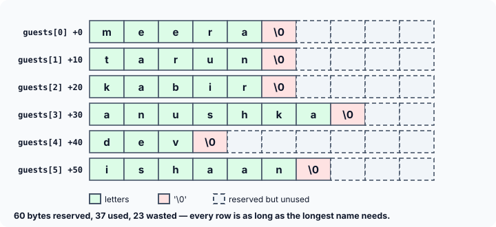
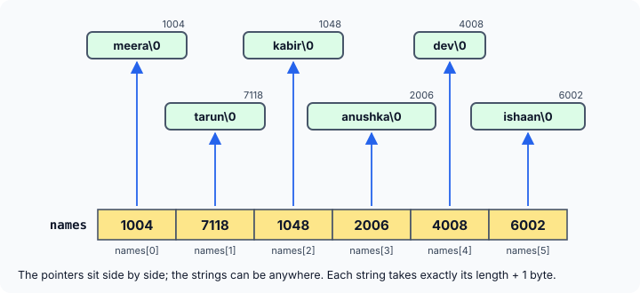

title : Arrays of Strings: 2-D char Arrays vs Arrays of Pointers

summary : Store a list of strings as a 2-D char array or as an array of pointers. Compare memory use on 64-bit systems, swapping strings, and reading strings in with malloc, with clear diagrams.

# Arrays of Strings: 2-D char Arrays vs Arrays of Pointers

One string is a one-dimensional array of characters. So how do you store a **list** of strings — a list of names, words or commands? C gives you two ways:

1. a **two-dimensional `char` array**, where every row is one string; or
2. an **array of pointers to strings**, where every element holds the address of one string.

This article builds both, shows exactly how each one is laid out in memory, and compares them on memory use, convenience and flexibility — including a few surprises that older books, written for 16-bit computers, get wrong on today's machines.

## A Two-Dimensional Array of Characters

The previous chapter used 2-D arrays of numbers. A 2-D array of characters works the same way. The program below asks for your name and checks it against a guest list:

```c
#include <stdio.h>
#include <string.h>

#define FOUND    1
#define NOTFOUND 0

int main(void)
{
    char guests[6][10] = {
        "meera",
        "tarun",
        "kabir",
        "anushka",
        "dev",
        "ishaan"
    };
    char yourname[10];
    int flag = NOTFOUND;

    printf("Enter your name: ");
    if (scanf("%9s", yourname) != 1)
        return 1;

    for (int i = 0; i < 6; i++) {
        if (strcmp(&guests[i][0], yourname) == 0) {
            printf("Welcome, you are on the guest list\n");
            flag = FOUND;
            break;
        }
    }

    if (flag == NOTFOUND)
        printf("Sorry, you are not on the list\n");
    return 0;
}
```

Two sample runs:

```
Enter your name: rohan
Sorry, you are not on the list
```

```
Enter your name: kabir
Welcome, you are on the guest list
```

Let's go through it.

**The declaration.** In `char guests[6][10]`, the order of the sizes matters: the **first** is the number of strings (6), and the **second** is the space reserved for **each** string (10 characters, including its `'\0'`). Each initialiser string fills one row, and the compiler adds the `'\0'` to each. The longest name, `"anushka"`, needs 8 bytes, so 10 is enough. Had a name needed more than 10 bytes, GCC would warn that the *initializer-string for array of 'char' is too long*.

**Reading the name.** `scanf("%9s", yourname)` reads one word into the 10-byte array; the width 9 leaves room for the `'\0'`. Checking that `scanf` returned 1 (one item read) guards against empty input.

**Comparing.** `&guests[i][0]` is the address of the first character of row `i` — that is, the base address of the `i`-th name. That address, together with the address of `yourname`, is passed to `strcmp`, which returns 0 when the two strings match.

Since `guests[i]` is itself a 1-D array (row `i`), its name already gives that same address. So `strcmp(guests[i], yourname)` means exactly the same thing and is how it is usually written.

**The flag.** `flag` records whether the program ever got inside the `if`. It starts as `NOTFOUND`; if a name matches, it is set to `FOUND` and `break` leaves the loop early. If the loop ends with `flag` still `NOTFOUND`, none of the names in `guests` matched.

If the names were to be typed at the keyboard instead of being written into the program, each row can be filled by `scanf`. Every row is already a real array with 10 bytes reserved for it:

```c
for (int i = 0; i < 6; i++)
    scanf("%9s", guests[i]);      /* guests[i] is the same as &guests[i][0] */
```

Here is a version of the guest-list check that runs without typing, with the search moved into a function. Note the parameter `char guests[][10]`: as you saw with numeric 2-D arrays, a function receiving a 2-D array must know the length of each row.

```c runnable
#include <stdio.h>
#include <string.h>

int on_list(char guests[][10], int count, const char *name)
{
    for (int i = 0; i < count; i++)
        if (strcmp(guests[i], name) == 0)   /* guests[i] is the same as &guests[i][0] */
            return 1;
    return 0;
}

int main(void)
{
    char guests[6][10] = {"meera", "tarun", "kabir", "anushka", "dev", "ishaan"};
    const char *visitors[] = {"kabir", "rohan", "dev"};

    for (int v = 0; v < 3; v++)
        printf("%-6s: %s\n", visitors[v],
               on_list(guests, 6, visitors[v]) ? "welcome" : "not on the list");
    return 0;
}
```

```
kabir : welcome
rohan : not on the list
dev   : welcome
```

(`%-6s` prints the string left-aligned in a field 6 characters wide, which lines up the colons.)

### How the names sit in memory

Just like a 2-D array of numbers, the six rows are stored one after another in a single block of 6 × 10 = 60 bytes. Each name ends with its own `'\0'`, and each row starts exactly 10 bytes after the previous one.



The picture shows the weakness of this layout. **Every row is as long as the longest name requires**, whether a name needs it or not. `"anushka"` needs 8 of its 10 bytes, but `"dev"` needs only 4, and the other 6 are wasted. This program measures it:

```c runnable
#include <stdio.h>
#include <string.h>

int main(void)
{
    char guests[6][10] = {"meera", "tarun", "kabir", "anushka", "dev", "ishaan"};
    size_t used = 0;

    for (int i = 0; i < 6; i++) {
        size_t need = strlen(guests[i]) + 1;          /* letters + '\0' */
        used += need;
        printf("row %d at +%2td: %-8s uses %2zu of 10 bytes\n",
               i, guests[i] - guests[0], guests[i], need);
    }
    printf("reserved %zu bytes, used %zu, wasted %zu\n",
           sizeof guests, used, sizeof guests - used);
    return 0;
}
```

```
row 0 at + 0: meera    uses  6 of 10 bytes
row 1 at +10: tarun    uses  6 of 10 bytes
row 2 at +20: kabir    uses  6 of 10 bytes
row 3 at +30: anushka  uses  8 of 10 bytes
row 4 at +40: dev      uses  4 of 10 bytes
row 5 at +50: ishaan   uses  7 of 10 bytes
reserved 60 bytes, used 37, wasted 23
```

(`guests[i] - guests[0]` subtracts two `char` pointers, giving the distance in bytes from the first row — 0, 10, 20, and so on.)

The more names there are, and the more their lengths vary, the more is wasted. Can this be avoided? Yes — with an **array of pointers to strings**.

## An Array of Pointers to Strings

A pointer variable contains an address. So an array of pointers contains a number of addresses — and those can be the addresses of strings. Here is the same list stored that way:

```c
const char *names[] = {
    "meera",
    "tarun",
    "kabir",
    "anushka",
    "dev",
    "ishaan"
};
```

`names` is an **array of 6 pointers**. Each string literal is stored somewhere in memory by the compiler, taking exactly the bytes it needs, and the **base address** of each one is stored in an element of `names`: the address of `"meera"` in `names[0]`, the address of `"tarun"` in `names[1]`, and so on.



Only the pointers have to be stored side by side; the strings themselves can be anywhere. (The pointers are declared `const char *` because they point at string literals, which must not be modified — as the previous article explained.)

Every name is still reached the same way: `names[i]` is the address of the `i`-th string, so `printf("%s", names[i])` prints it and `strcmp(names[i], yourname)` compares it.

### Does it really save memory?

Older books make the following calculation for this list: the 2-D array uses 60 bytes, while the array of pointers uses 37 bytes for the strings plus 12 bytes for six 2-byte pointers — clearly less. That was true on the 16-bit computers those books were written for. **On a modern 64-bit system, a pointer is 8 bytes**, and the sum comes out differently:

```c runnable
#include <stdio.h>
#include <string.h>

int main(void)
{
    const char *names[] = {"meera", "tarun", "kabir", "anushka", "dev", "ishaan"};
    size_t text = 0;

    for (int i = 0; i < 6; i++)
        text += strlen(names[i]) + 1;

    printf("pointers: %zu bytes (6 x %zu)\n", sizeof names, sizeof names[0]);
    printf("text:     %zu bytes\n", text);
    printf("total:    %zu bytes\n", sizeof names + text);
    return 0;
}
```

```
pointers: 48 bytes (6 x 8)
text:     37 bytes
total:    85 bytes
```

For six **short**, similar-length names, the array of pointers now uses **more** memory (85 bytes) than the 2-D array (60 bytes): each 8-byte pointer costs more than the few bytes of padding it saves.

The saving appears when the string lengths **vary a lot**. In a 2-D array, a single long string forces every row to be that long:

```c runnable
#include <stdio.h>
#include <string.h>

int main(void)
{
    char        table[4][34] = {"Li", "Bo", "Ana", "Bartholomew Montgomery-Fitzgerald"};
    const char *list[4]      = {"Li", "Bo", "Ana", "Bartholomew Montgomery-Fitzgerald"};
    size_t text = 0;

    for (int i = 0; i < 4; i++)
        text += strlen(list[i]) + 1;

    printf("2-D array:          %zu bytes\n", sizeof table);
    printf("array of pointers:  %zu + %zu = %zu bytes\n", sizeof list, text, sizeof list + text);
    return 0;
}
```

```
2-D array:          136 bytes
array of pointers:  32 + 44 = 76 bytes
```

Here the array of pointers needs barely half the memory, and the difference grows with every string added. So the honest rule is: an array of pointers saves memory when **strings vary widely in length** (real names, sentences, lines of a file) or are long, and costs memory when they are all short and similar.

Memory, however, is not the main reason C programmers use arrays of pointers. The bigger reason is **how easy they are to manipulate**.

## Rearranging Strings: Swap the Pointers

Suppose we want to exchange the positions of `"kabir"` and `"anushka"` in the list. With an array of pointers, we don't move any characters at all — we just exchange the two **addresses**:

```c runnable
#include <stdio.h>

int main(void)
{
    const char *names[] = {"meera", "tarun", "kabir", "anushka", "dev", "ishaan"};
    const char *temp;

    printf("Before: %s %s\n", names[2], names[3]);

    temp     = names[2];                   /* exchange two addresses... */
    names[2] = names[3];
    names[3] = temp;                       /* ...not a single character moves */

    printf("After:  %s %s\n", names[2], names[3]);
    return 0;
}
```

```
Before: kabir anushka
After:  anushka kabir
```

![Before the swap names[2] points to kabir and names[3] to anushka; after it, the two addresses have been exchanged while the strings stay where they were](images/swap-string-pointers.svg)

Three pointer assignments, whatever the lengths of the strings. Compare this with the 2-D array, where the names **are** the rows. There, the characters themselves must be moved — three full string copies, through a temporary buffer that is big enough for the longest name:

```c runnable
#include <stdio.h>
#include <string.h>

int main(void)
{
    char guests[6][10] = {"meera", "tarun", "kabir", "anushka", "dev", "ishaan"};
    char temp[10];

    strcpy(temp, guests[2]);               /* the characters themselves must move */
    strcpy(guests[2], guests[3]);
    strcpy(guests[3], temp);

    printf("%s %s\n", guests[2], guests[3]);
    return 0;
}
```

```
anushka kabir
```

This difference is why sorting a list of strings is so much cheaper with an array of pointers: every swap moves 8 bytes, no matter how long the strings are. From the point of view of both convenience and (usually) memory, the array of pointers to strings wins. That is why, even though strings **can** be stored in a 2-D `char` array, in real programs an array of pointers to strings is the more common choice. The `argv` parameter that `main` can receive, which holds a program's command-line arguments, is an array of pointers to strings.

### Swapping through a function

Now suppose the exchange should be done by a function `swap()`, called with the addresses of the two elements, `names + 2` and `names + 3`. What type should its parameters have?

Each element of `names` is a `const char *`. The address of such an element is therefore a **pointer to a pointer**: `const char **`. And it has to be the address — passing `names[2]` and `names[3]` themselves would give the function copies of the two pointers, and swapping copies would change nothing in `main` (the same reason a `swap` for two `int`s needs `int *` parameters).

```c runnable
#include <stdio.h>

void swap(const char **s1, const char **s2)
{
    const char *t;

    t   = *s1;                             /* *s1 is names[2] itself */
    *s1 = *s2;
    *s2 = t;
}

int main(void)
{
    const char *names[] = {"meera", "tarun", "kabir", "anushka", "dev", "ishaan"};

    swap(names + 2, names + 3);            /* same as &names[2], &names[3] */
    for (int i = 0; i < 6; i++)
        printf("%s ", names[i]);
    printf("\n");
    return 0;
}
```

```
meera tarun anushka kabir dev ishaan 
```

Inside `swap`, `*s1` **is** `names[2]` (not a copy of it), so assigning to `*s1` changes the element in `main`'s array.

## The Limitation of an Array of Pointers

With a 2-D `char` array, you can either initialise the strings where the array is defined, or read them from the keyboard later, because each row is real storage. An array of pointers is different. You can initialise it with string literals, but you **cannot** simply read strings into it. This program looks reasonable but is badly broken:

```c
#include <stdio.h>

int main(void)
{
    char *names[6];

    for (int i = 0; i < 6; i++) {
        printf("Enter name: ");
        scanf("%s", names[i]);      /* names[i] points nowhere! */
    }
    return 0;
}
```

The array `names` holds six **pointers**, and nothing else. No space for any characters has been set aside. Since the pointers were never given a value, they contain garbage, and passing a garbage address to `scanf` as "the place to store the string" makes it write wherever that garbage points. That is undefined behaviour: a crash if you are lucky, silently corrupted memory if you are not. Worse, the compiler cannot help here: GCC compiles this program without a single warning, even with `-Wall -Wextra`.

### The solution: allocate space for each string

The fix is to give each pointer something to point to. Read each name into one temporary buffer, then use `malloc` to allocate **exactly** enough memory for it, copy it there, and store the address returned by `malloc` in the array:

```c
#include <stdio.h>
#include <stdlib.h>
#include <string.h>

#define COUNT 5

int main(void)
{
    char *names[COUNT];
    char buffer[40];                       /* one reusable buffer for typing */
    int n = 0;

    while (n < COUNT) {
        printf("Enter a name: ");
        if (fgets(buffer, sizeof buffer, stdin) == NULL)
            break;                         /* no more input */
        buffer[strcspn(buffer, "\n")] = '\0';

        names[n] = malloc(strlen(buffer) + 1);
        if (names[n] == NULL)
            break;
        strcpy(names[n], buffer);
        n++;
    }

    printf("\n");
    for (int i = 0; i < n; i++)
        printf("%s\n", names[i]);

    for (int i = 0; i < n; i++)
        free(names[i]);
    return 0;
}
```

A sample run:

```
Enter a name: Meera Iyer
Enter a name: Tarun
Enter a name: Kabir Khan
Enter a name: Anushka
Enter a name: Dev

Meera Iyer
Tarun
Kabir Khan
Anushka
Dev
```

The important points:

- **One buffer, reused.** Each name is first read into `buffer`, which is big enough for any reasonable line. Using `fgets` instead of `scanf("%s")` allows names with spaces, and it never overflows `buffer`.
- **`strlen(buffer) + 1`.** The `+ 1` is for the `'\0'`. Allocating only `strlen(buffer)` bytes — a very common mistake — makes `strcpy` write the terminator one byte past the end of the block.
- **Check for `NULL`.** `malloc` returns `NULL` if no memory is available.
- **`free` each block.** Every `malloc` needs a matching `free` once the strings are no longer needed.

Here is the same technique in a runnable form, with the "typed" names supplied by an array:

```c runnable
#include <stdio.h>
#include <stdlib.h>
#include <string.h>

int main(void)
{
    /* stand-ins for what a user would type, one name per line */
    const char *typed[] = {"meera", "tarun", "kabir", "anushka", "dev"};
    char *names[5];

    for (int i = 0; i < 5; i++) {
        names[i] = malloc(strlen(typed[i]) + 1);   /* + 1 for the '\0' */
        if (names[i] == NULL)
            return 1;
        strcpy(names[i], typed[i]);
    }

    for (int i = 0; i < 5; i++)
        printf("%s (%zu bytes)\n", names[i], strlen(names[i]) + 1);

    for (int i = 0; i < 5; i++)
        free(names[i]);                    /* one free for every malloc */
    return 0;
}
```

```
meera (6 bytes)
tarun (6 bytes)
kabir (6 bytes)
anushka (8 bytes)
dev (4 bytes)
```

Each name now occupies exactly the bytes it needs, on the heap. And because these blocks belong to the program (unlike string literals), the array is declared `char *names[]` without `const`: the names can be changed, swapped, sorted and freed.

The pattern "`malloc(strlen(s) + 1)` then `strcpy`" is so common that many systems provide a function for it, **`strdup(s)`**. It was long available only on POSIX systems such as Linux and macOS, and became part of standard C in C23. The returned copy must still be released with `free`.

:::callout
Older books write this program with `#include <alloc.h>`, `gets(str)` and `malloc(strlen(str))`, and without `free`. Each of these is a problem today. `<alloc.h>` was specific to old DOS compilers (`malloc` is declared in `<stdlib.h>`). `gets` was removed from C because it cannot prevent overflows. `strlen(str)` leaves no room for the `'\0'`. And without `free`, the memory leaks.
:::

## 2-D Array vs Array of Pointers: Summary

| | `char s[6][10]` | `const char *s[6]` / `char *s[6]` |
|---|---|---|
| Storage | one block of rows × columns bytes | an array of pointers + strings stored elsewhere |
| Each string's space | fixed: the longest needed | exactly its length + 1 |
| Memory | wasteful when lengths vary | saves memory when lengths vary; costs 8 bytes per pointer |
| Swapping two strings | copy the characters (3 × `strcpy`) | exchange two addresses |
| Reading strings in | straightforward: rows are real storage | must first allocate space for each (`malloc`) |
| Changing characters | allowed | not for literals (use `const char *`); allowed for `malloc` blocks |

## Key Takeaways

- A list of strings can be a **2-D `char` array** (`char s[N][LEN]`), where each row is one string, or an **array of pointers** (`char *s[N]`), where each element holds a string's address.
- In `char s[N][LEN]`, the first size is the number of strings; the second is the space for each, including `'\0'`. `s[i]` (the same as `&s[i][0]`) is the address of string `i`.
- A 2-D array reserves the longest row for every string, wasting the rest. An array of pointers lets each string take exactly its length + 1 — but each pointer costs 8 bytes on a 64-bit system, so it saves memory only when lengths vary.
- Exchanging strings in an array of pointers swaps addresses, not characters. A `swap` function for it takes `char **` (or `const char **`) parameters.
- The pointers in an uninitialised array of pointers point nowhere; never read into them. Allocate each string with `malloc(strlen(s) + 1)`, copy it in, and `free` it later.

## Practice Questions

:::details[How many bytes does char words[5][12]; occupy, and how long can each word be?]
5 × 12 = **60** bytes. Each word can have at most **11** characters, leaving one byte for the `'\0'`.
:::

:::details[For char words[5][12], what is the type of words[2], and what is words[2] + 1?]
`words[2]` is a `char[12]` array (row 2), which decays to a `char *` — the address of `words[2][0]`. `words[2] + 1` is the address of `words[2][1]`, the second character of the third word.
:::

:::details[On a 64-bit system, which uses less memory for {"yes", "no", "ok"}: char a[3][4] or const char *a[3]?]
`char a[3][4]` uses **12** bytes. `const char *a[3]` uses 24 bytes of pointers plus 4 + 3 + 3 = 10 bytes of text, **34** in total. For short, similar strings the 2-D array is smaller.
:::

:::details[What is wrong with: char *list[3]; strcpy(list[0], "alpha");]
`list[0]` is an uninitialised pointer: it holds a garbage address, and no memory has been set aside for the characters. `strcpy` writes `"alpha"` to wherever that garbage points — undefined behaviour. Allocate first: `list[0] = malloc(strlen("alpha") + 1);`, check for `NULL`, then copy.
:::

:::details[Why must swap() receive names + 2 and names + 3 rather than names[2] and names[3]?]
`names[2]` and `names[3]` are pointer **values**. A function receives copies of its arguments, so swapping those copies would leave `main`'s array unchanged. Passing their addresses (`const char **`) lets the function change the elements of the array itself.
:::

:::details[Using an array of pointers, write a loop that prints the longest name in const char *names[6].]
```c
const char *longest = names[0];

for (int i = 1; i < 6; i++)
    if (strlen(names[i]) > strlen(longest))
        longest = names[i];
printf("%s\n", longest);
```
Only an address is copied into `longest`; the strings never move.
:::
