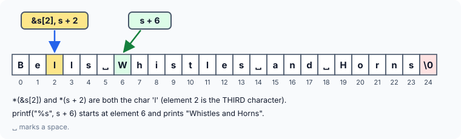

title : Strings: Worked Examples

summary : Worked puzzles on strings: the '\0' terminator, adding numbers to string literals, comparing strings with ==, sizeof on arrays of pointers and more. Predict the output, then check the explanation.

# Strings: Worked Examples

These puzzles test everything from the strings articles: the `'\0'` terminator, string literals, `%s` and `%c`, `strlen`, `sizeof`, and the difference between an array and a pointer. As before, work out each answer **before** opening the solution — a sketch of the characters in memory, numbered from 0, settles almost every one of them.

All answers assume a typical 64-bit system: 4-byte `int`, 8-byte pointers.

### 1. What is at the end?

```c runnable
#include <stdio.h>
#include <string.h>

int main(void)
{
    char s[] = "Checkmate!";

    printf("%d\n", *(s + strlen(s)));
    return 0;
}
```

:::details[Answer]
```
0
```

Not the text — a zero. `s` gives the base address of the string, and `strlen(s)` is its length, 10. So `s + strlen(s)` is the address 10 characters past the start: one past the `'!'`, exactly where the compiler stored the terminating `'\0'`. `*(s + strlen(s))` reads that character, and printing it with `%d` shows its code, **0**.

In general, `s[strlen(s)]` is always the `'\0'` of a string.
:::

### 2. Adding a number to a string literal

```c runnable
#include <stdio.h>

int main(void)
{
    printf("%s\n", 4 + "Snowflake");
    return 0;
}
```

:::details[Answer]
```
flake
```

A string literal such as `"Snowflake"`, like any `char` array, gives the address of its first character when used in an expression. Adding 4 gives the address of element 4, the `'f'`. When a string is passed to a function, what is actually passed is an address, and `%s` prints from whatever address it receives up to the `'\0'` — so `flake` is printed.

Older code sometimes writes this as `printf(4 + "Snowflake");`, passing the string as the **format** itself. That happens to work here, but it is a bad habit: if the text ever contains a `%`, `printf` will treat it as a conversion and read arguments that were never passed. Always print text through a `"%s"` format.
:::

### 3. Building a string by hand

```c runnable
#include <stdio.h>

int main(void)
{
    char ch[16];
    int i;

    for (i = 0; i < 15; i++)
        *(ch + i) = 90;
    *(ch + i) = '\0';
    printf("%s\n", ch);
    return 0;
}
```

:::details[Answer]
```
ZZZZZZZZZZZZZZZ
```

Fifteen `Z`s. `ch` gives the base address of the array, so `ch + i` is the address of element `i` and `*(ch + i)` is the element itself. The loop stores **90** — the code for uppercase `'Z'` — in elements 0 to 14.

When the loop ends, `i` is 15, so `*(ch + i) = '\0';` puts the terminator in the last element. This line is essential: a `char` array has no other way of saying where the string ends. Without it, `printf` would keep printing whatever garbage follows until it happened to meet a zero byte.
:::

### 4. Numbers in a char array

```c runnable
#include <stdio.h>

int main(void)
{
    char str[] = {49, 49, 49, 49, 49, 49, 49, 49};
    char *s = str;

    for (int i = 0; i <= 7; i++) {
        if (*s)
            printf("%c ", *s);
        s++;
    }
    printf("\n");
    return 0;
}
```

:::details[Answer]
```
1 1 1 1 1 1 1 1 
```

Can a `char` array hold numbers? Yes: a `char` **is** a small integer. The number 49 is not stored as the text "49"; it is stored as one byte with the value 49, which, read as a character, is the digit `'1'`.

`s` starts at the base address. Each time round the loop, `if (*s)` tests the character `s` points to. Its value is 49, which is non-zero, so the test is true and `%c` prints `1`. Then `s` moves on to the next element. The loop does this 8 times.

Notice that `str` has **no** `'\0'` — it is not a string, just 8 characters. That is fine here, because the loop counts to 8 instead of looking for a terminator. Passing `str` to `%s` or `strlen` would be a bug.
:::

### 5. Comparing two strings with ==

```c runnable
#include <stdio.h>

int main(void)
{
    char first[]  = "Tiger";
    char second[] = "Tiger";

    if (first == second)
        printf("Equal\n");
    else
        printf("Unequal\n");
    return 0;
}
```

:::details[Answer]
```
Unequal
```

Mentioning an array's name gives its base address. `first` and `second` are two **different** arrays, each holding its own copy of `"Tiger"`, so their base addresses are always different. `first == second` compares those addresses — not the characters — and is never true.

To compare the **contents** of two strings, compare them character by character, or use `strcmp`:

```c runnable
#include <stdio.h>
#include <string.h>

int main(void)
{
    char first[]  = "Tiger";
    char second[] = "Tiger";

    printf("same address?  %s\n", &first[0] == &second[0] ? "yes" : "no");
    printf("same contents? %s\n", strcmp(first, second) == 0 ? "yes" : "no");
    return 0;
}
```

```
same address?  no
same contents? yes
```

With `-Wall`, GCC catches the original mistake: *comparison between two arrays [-Warray-compare]*.
:::

### 6. A string of zeros

```c runnable
#include <stdio.h>

int main(void)
{
    char str[8] = {0, 0, 0, 0, 0, 0, 0, 0};
    char *s = str;

    printf("[");
    for (int i = 0; i <= 7; i++) {
        if (*s)
            printf("%c", *s);
        s++;
    }
    printf("]\n");
    return 0;
}
```

:::details[Answer]
```
[]
```

Nothing is printed between the brackets. This time every element holds the value **0** — not the digit `'0'` (code 48), but the character with code 0, which is `'\0'`.

The loop visits all 8 elements, but each time `*s` is 0, so the condition `if (*s)` is `if (0)`, which is false. `printf` is never reached; `s` is simply incremented and the loop continues. Compare this with puzzle 4: there the value was 49, which is true.
:::

### 7. Indexing a string literal

```c runnable
#include <stdio.h>

int main(void)
{
    printf("%c\n", "pointers"[3]);
    return 0;
}
```

:::details[Answer]
```
n
```

`a[3]` is converted to `*(a + 3)`, where `a` gives a base address. A string literal is an array too, so `"pointers"[3]` becomes `*("pointers" + 3)`: base address of the literal, plus 3, then the character there. Counting from 0 — `p`, `o`, `i`, `n` — that is `'n'`.
:::

### 8. An array exactly the size of the letters

```c
#include <stdio.h>

int main(void)
{
    char word[6] = "Arrays";
    printf("%s\n", word);
    return 0;
}
```

:::details[Answer]
**Cannot be predicted** — the program has undefined behaviour.

`"Arrays"` has 6 letters and needs 7 bytes with its `'\0'`, but `word` has only 6. You might expect the `'\0'` to be written into a 7th byte beyond the array, overwriting something else. In fact C has a special rule for this exact case: when the array has room for the letters but not the terminator, the letters are copied and the **`'\0'` is simply left out**. Nothing is overwritten, and GCC 13 compiles it without a single warning, even with `-Wall -Wextra`.

The problem appears at the `printf`. `word` is not a string, so `%s` keeps reading past the end of the array, looking for a zero byte that is not there. It may print `Arrays` followed by garbage, print exactly `Arrays` by luck, or crash. AddressSanitizer reports it as a *stack-buffer-overflow*.

The fix is to let the compiler count:

```c runnable
#include <stdio.h>

int main(void)
{
    char word[] = "Arrays";            /* the compiler counts: 7 bytes */

    printf("%s (%zu bytes)\n", word, sizeof word);
    return 0;
}
```

```
Arrays (7 bytes)
```
:::

### 9. sizeof an array of pointers

```c runnable
#include <stdio.h>

int main(void)
{
    const char *str[] = {"Keep", "calm", "and", "write", "C", "code"};

    printf("%zu %zu\n", sizeof(str), sizeof(str[0]));
    return 0;
}
```

:::details[Answer]
```
48 8
```

Mentioning the name of an array gives its base address — except with `sizeof`, which gives the number of bytes the **whole array** occupies. `str` is an array of 6 pointers (the strings themselves live elsewhere), and each pointer is 8 bytes on a 64-bit system, so `sizeof(str)` is 6 × 8 = **48**.

`str[0]` is one element: the address of `"Keep"`. Its size is the size of a pointer, **8** — however long the string it points to. (On the 16-bit systems older books were written for, pointers were 2 bytes and this printed `12 2`.)

A useful consequence: `sizeof(str) / sizeof(str[0])` gives the number of elements, **6**.
:::

### 10. Four ways to reach a character

```c runnable
#include <stdio.h>

int main(void)
{
    char s[] = "Go far!";

    for (int i = 0; s[i]; i++)
        printf("%c %c %c %c\n", s[i], *(s + i), i[s], *(i + s));
    return 0;
}
```

:::details[Answer]
```
G G G G
o o o o
       
f f f f
a a a a
r r r r
! ! ! !
```

(The third line is the space between the words, printed four times.)

`s[i]`, `*(s + i)`, `i[s]` and `*(i + s)` are four ways of writing the same thing, the `i`-th element of `s`, so each character is printed four times.

The loop condition is just `s[i]`. The loop continues while `s[i]` is non-zero, and stops when it yields the `'\0'`, whose value is 0. That works because every string ends with a `'\0'` — no length is needed.
:::

### 11. Characters, substrings and addresses

```c runnable
#include <stdio.h>

int main(void)
{
    char s[] = "Bells Whistles and Horns";

    printf("%c\n", *(&s[2]));
    printf("%s\n", s + 6);
    printf("%s\n", s);
    printf("%c\n", *(s + 2));
    printf("%p\n", (void *)s);
    return 0;
}
```

:::details[Answer]
```
l
Whistles and Horns
Bells Whistles and Horns
l
0x7ffd5c2b1a30
```

(The last line is an address, so yours will be different.)



- `&s[2]` is the address of element 2, and `*` gives back the value there: the first `'l'`. `&` and `*` cancel each other out.
- `s + 6` is the address of element 6, the `'W'`. `%s` prints from there to the end of the string.
- `s` alone is the base address, so the whole string is printed.
- `*(s + 2)` is just another way of writing `s[2]` — the **third** character (counting starts at 0), `'l'` again.
- The last line prints the base address itself. `%p` is the correct conversion for an address (cast to `void *`). Older books print it with `%u`, which is wrong on 64-bit systems: an address does not fit in an `unsigned int`.
:::

### 12. Moving an array

```c
#include <stdio.h>

int main(void)
{
    char motto[] = "Measure twice, cut once";

    printf("%c\n", *motto);
    motto++;
    printf("%c\n", *motto);
    return 0;
}
```

:::details[Answer]
It does not compile. GCC reports:

```
error: lvalue required as increment operand
```

The first `printf` is fine — `*motto` is `'M'`. But `motto++` tries to change the array's name. The name stands for the array's base address, which is the only way the program can find the array; if it could be changed, the array would be lost. So C treats it as a fixed value, not a variable. An **lvalue** is something that can be modified, and an array name is not one.

To walk through the string, copy the base address into a pointer and move the pointer instead:

```c runnable
#include <stdio.h>

int main(void)
{
    char motto[] = "Measure twice, cut once";
    char *p = motto;                   /* a pointer we are free to move */

    printf("%c\n", *p);
    p++;
    printf("%c\n", *p);
    return 0;
}
```

```
M
e
```
:::
