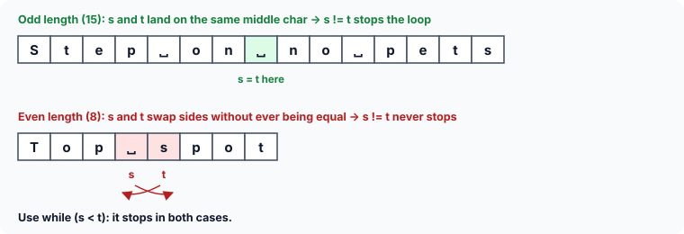

# Strings and Pointers: Worked Examples

This second set of puzzles moves from single characters to **pointers walking through strings**: pointers that start in the middle, run backwards, meet in the middle, copy strings, and even a pointer to a pointer to a pointer. It ends with arrays of strings. For each one, draw the characters with their positions, mark where each pointer is, and move the marks as the code runs.

All answers assume a typical 64-bit system: 4-byte `int`, 8-byte pointers.

### 13. Starting from an element, then going back

```c runnable
#include <stdio.h>

int main(void)
{
    char str[] = "Sonnets";
    char *s;

    s = &str[5] - 5;
    while (*s)
        printf("%c", *s++);
    printf("\n");
    return 0;
}
```

:::details[Answer]
```
Sonnets
```

`&str[5]` is the address of element 5 (the second `'t'`) — the same address as `str + 5`. Subtracting 5 moves back five `char`s, which lands on good old `str`, the address of element 0. So `s` starts at the beginning.

In `printf("%c", *s++)`, the postfix `++` applies to `s`, not to the character: the value at the address in `s` is printed, and **then** `s` is incremented to the next character. The loop keeps going until `s` points to the `'\0'`, where `*s` is 0 — false — and the loop ends.
:::

### 14. Three levels of pointers

This one looks like a galaxy of stars. Take it one star at a time.

```c runnable
#include <stdio.h>

int main(void)
{
    const char *s[] = {"owl", "raven", "crow", "pigeon"};
    const char **ptr[] = {s + 3, s + 2, s + 1, s};
    const char ***p = ptr;

    printf("%s\n", **++p);
    printf("%s\n", *--*++p + 3);
    printf("%s\n", *p[-2] + 3);
    printf("%s\n", p[-1][-1] + 1);
    return 0;
}
```

:::details[Answer]
```
crow

eon
aven
```

(The second line is empty.)

First, what is where:

![Four strings; the array s holds their addresses; the array ptr holds s + 3, s + 2, s + 1 and s; p points to ptr[0]](images/three-level-string-pointers.svg)

- `s` is an array of 4 pointers, each holding the base address of one string.
- `ptr` is an array of 4 **pointers to pointers**. Its elements are addresses of elements of `s`, in reverse order: `ptr[0]` is `s + 3` (the address of `s[3]`), `ptr[1]` is `s + 2`, and so on. Since each element holds the address of an address, its type is `const char **`.
- `p` holds the base address of `ptr`, so it is a pointer to a pointer to a pointer: `const char ***`.

Remember that incrementing a pointer moves it to the next element **of its type**. `p` points into `ptr`, whose elements are 8-byte pointers, so `++p` moves 8 bytes to the next element of `ptr`.

**Line 1: `**++p`.** Unary operators group right to left, so `++p` happens first: `p` now points to `ptr[1]`. `*p` is `ptr[1]`, which is `s + 2`. `**p` is `*(s + 2)`, which is `s[2]`, the address of `"crow"`. That string is printed: **`crow`**.

**Line 2: `*--*++p + 3`.** Again, right to left:

1. `++p` moves `p` to `ptr[2]`.
2. `*++p` is `ptr[2]` itself, which holds `s + 1`.
3. `--*++p` decrements **`ptr[2]`** — the element of the array, not a copy — from `s + 1` to `s`.
4. `*--*++p` is `*s`, which is `s[0]`, the address of `"owl"`.
5. `+ 3` moves 3 characters into `"owl"`: past `o`, `w`, `l`, onto its `'\0'`.

`%s` receives the address of a `'\0'` — an empty string — and prints nothing, so the line is **empty**. (Older books describe the `'\0'` as "printed as a blank". In fact nothing at all is printed; only the `\n` appears.)

**Line 3: `*p[-2] + 3`.** `p` still points to `ptr[2]`. `p[-2]` means `*(p - 2)`: two elements back, `ptr[0]`, which holds `s + 3`. Then `*` gives `s[3]`, the address of `"pigeon"`, and `+ 3` skips `p`, `i`, `g`: **`eon`**.

(`[]` binds more tightly than `*`, so `*p[-2]` is `*(p[-2])`.)

**Line 4: `p[-1][-1] + 1`.** `p[-1]` is `ptr[1]`, which holds `s + 2`. Then `[-1]` means `*(s + 2 - 1)`, which is `s[1]`, the address of `"raven"`. `+ 1` skips the `r`: **`aven`**.

Negative subscripts are legal here because `p` and `p[-1]` point into the **middle** of arrays: `p[-1]` and `(s + 2)[-1]` are still elements inside `ptr` and `s`.

(Older code declares `s` and `ptr` as `static`, because very old compilers would only accept addresses in the initialiser of a `static` array. Since C99, an ordinary local array can be initialised with `s + 3` and the like.)
:::

### 15. Two counters at once

```c runnable
#include <stdio.h>
#include <string.h>

int main(void)
{
    char str[] = "Slow and steady win";
    int i;
    char *p;

    for (p = str, i = 0; p + i <= str + strlen(str); p++, i++)
        printf("%c", *(p + i));
    printf("|\n");
    return 0;
}
```

:::details[Answer]
```
So n taywn|
```

(The `|` was added to show where the output ends.)

A `for` loop may have two initialisations and two increments, separated by commas — but it still has a single test condition.

`p` starts at the base address and `i` at 0. Each time round, `p` and `i` both go up by 1, so `p + i` goes up by **2**: it is `str + 0`, `str + 2`, `str + 4`, … The loop therefore prints every other character: elements 0, 2, 4, …, 18. With `S`, `o`, ` `, `n`, ` `, `t`, `a`, `y`, `w`, `n` at those positions, that is `So n taywn`.

The test `p + i <= str + strlen(str)` compares two addresses. `strlen(str)` is 19, so `str + strlen(str)` is the address of the `'\0'`. After element 18 is printed, `p + i` becomes `str + 20`, which is past the `'\0'`, and the loop ends.

Two details matter here:

- The string has 19 characters — an **odd** number — so the even positions never land on the `'\0'` at position 19. With an even length, the last position printed would be the `'\0'` itself. `%c` would then output a zero byte, which most terminals show as nothing.
- With an even length, the final test would also compute `str + len + 2`, an address **two** past the end of the array. C only allows a pointer to go one past the end of an array, so that version has undefined behaviour, even though it usually seems to work. A loop that counts an index (`for (i = 0; i <= len; i += 2)`) avoids the problem entirely.
:::

### 16. Printing backwards

```c runnable
#include <stdio.h>

int main(void)
{
    char str[] = "Rotator";
    char *s = str + 7;                /* one past the last letter: the '\0' */

    while (s > str) {
        s--;                          /* step back first, then print */
        printf("%c", *s);
    }
    printf("\n");
    return 0;
}
```

:::details[Answer]
```
rotatoR
```

`s` starts at `str + 7`, the position of the `'\0'`. Each time round the loop, `s` first steps back one character and then prints it, so the output is `r`, `o`, `t`, `a`, `t`, `o`, `R` — the string reversed. The loop stops once `s` has reached `str`, the first character.

"Rotator" reads the same in both directions, apart from the capital `R`. A word or phrase like that is called a **palindrome**.

**Watch out:** a common way to write this loop is `s = str + 6; while (s >= str) { printf("%c", *s); s--; }`. It prints the same thing, but after printing `str[0]` it decrements `s` to `str - 1` — an address **before** the start of the array. C does not allow a pointer to point before an array's first element, so even computing it, just to compare it with `str`, is undefined behaviour. Stepping back **before** printing, as above, keeps `s` inside the array the whole time.
:::

### 17. Two pointers meeting in the middle

```c runnable
#include <stdio.h>
#include <string.h>

int main(void)
{
    char a[] = "Step on no pets";
    char *s, *t;

    s = a;
    t = a + strlen(a) - 1;
    while (s != t) {
        printf("%c", *s);
        s++;
        printf("%c", *t);
        t--;
    }
    printf("\n");
    return 0;
}
```

:::details[Answer]
```
Sstteepp  oonn
```

`s` starts at the first character. `strlen(a)` is 15, so `a + 15 - 1` is the address of the **last** character, the final `'s'`, and `t` starts there.

Each time round the loop, the character at `s` is printed and `s` moves right, then the character at `t` is printed and `t` moves left. Since the phrase is a palindrome, each pair is the same letter: `S` and `s`, then `t` and `t`, and so on. When both pointers reach the middle character, position 7 (the space after `on`), `s != t` becomes false and the loop ends — without printing the middle character.



**This loop only works because the length is odd.** With an even number of characters, there is no middle character: `s` and `t` move past each other without ever being equal. `s != t` then stays true, and both pointers run off the ends of the array — undefined behaviour. Testing `s < t` instead stops in both cases:

```c runnable
#include <stdio.h>
#include <string.h>

int main(void)
{
    char a[] = "Top spot";
    char *s = a, *t = a + strlen(a) - 1;

    while (s < t) {                   /* stops whether they meet or cross */
        printf("%c%c", *s, *t);
        s++;
        t--;
    }
    printf("\n");
    return 0;
}
```

```
Ttoopp s
```

`s < t` compares two pointers into the same array: it is true while `s` is still to the left of `t`. This "two pointers from both ends" pattern is the standard way to reverse a string or check whether it is a palindrome.
:::

### 18. Copying a string

```c runnable
#include <stdio.h>

int main(void)
{
    char s[] = "Code is poetry";
    char t[40];
    char *ss = s, *tt = t;

    while (*ss)
        *tt++ = *ss++;
    *tt = '\0';
    printf("%s\n", t);
    return 0;
}
```

:::details[Answer]
```
Code is poetry
```

`ss` and `tt` start at the base addresses of `s` and `t`. The `while` tests the character at `ss`. The first time, it is `'C'` (code 67) — non-zero, so true — and `*tt++ = *ss++;` copies it into `t[0]`. Because the `++` operators are postfix, they take effect after the values are used: the character is copied first, and then both pointers move to the next element. The space (code 32) is non-zero too, so it is copied the same way.

At the end of `s`, `*ss` is the `'\0'`, whose value is 0, and the loop stops — **before** copying it. That is why `*tt = '\0';` is needed after the loop: without it, `t` would have no end marker. (`*tt++` means `*(tt++)`: the pointer is incremented, not the character.)
:::

### 19. Copying in a single line

```c runnable
#include <stdio.h>

int main(void)
{
    char s[] = "Patience, practice, persistence";
    char t[40];
    char *ss = s, *tt = t;

    while ((*tt++ = *ss++))
        ;
    printf("%s\n", t);
    return 0;
}
```

:::details[Answer]
```
Patience, practice, persistence
```

The assignment, the test and the increments are all in the `while` condition; the body is an empty statement, `;`.

The condition works like this: the character at `ss` is copied to the place `tt` points to, and both pointers advance. The **value of an assignment is the value assigned**, so the condition is the character just copied. For every ordinary character it is non-zero, and the loop continues. When the `'\0'` is copied, the value is 0 and the loop ends.

So this version copies the `'\0'` **as part of the loop** — no separate `*tt = '\0';` is needed. This is the classic one-line string copy. The extra parentheses around the assignment tell the compiler (and the reader) that `=` was meant, not `==`; without them, GCC's `-Wall` warns *suggest parentheses around assignment used as truth value*.
:::

### 20. sizeof an int array

```c runnable
#include <stdio.h>

int main(void)
{
    int arr[15];

    printf("%zu\n", sizeof(arr));
    return 0;
}
```

:::details[Answer]
```
60
```

`sizeof` gives the size of its operand in bytes. `arr` is an array of 15 `int`s, and each `int` is 4 bytes, so the array occupies 15 × 4 = **60** bytes. (With the 2-byte `int`s of old 16-bit compilers, it would have been 30.)
:::

### 21. sizeof an array of string pointers

```c runnable
#include <stdio.h>

int main(void)
{
    const char *mess[] = {
        "Early to bed",
        "early to rise",
        "makes a coder",
        "healthy and wise",
        "(mostly)"
    };

    printf("%zu %zu\n", sizeof(mess), sizeof(mess[1]));
    return 0;
}
```

:::details[Answer]
```
40 8
```

`mess` is an array of pointers to strings. It stores only the **starting addresses** of the 5 strings: `mess[0]` the address of `"Early to bed"`, `mess[1]` the address of `"early to rise"`, and so on. Five 8-byte addresses take 40 bytes, so `sizeof(mess)` is **40**.

`mess[1]` is one element of that array — an address — so its size is always the size of a pointer, **8**, no matter how long the string is. The characters themselves are stored elsewhere and are not counted at all.
:::

### 22. Reading names into a 2-D array

```c
#include <stdio.h>

int main(void)
{
    char names[3][20];

    for (int i = 0; i <= 2; i++) {
        printf("ENTER NAME: ");
        if (scanf("%19s", names[i]) != 1)
            return 1;
        printf("You entered %s\n", names[i]);
    }
    return 0;
}
```

:::details[Answer]
A sample run:

```
ENTER NAME: Asha
You entered Asha
ENTER NAME: Bilal
You entered Bilal
ENTER NAME: Chen
You entered Chen
```

`names[3][20]` is a 2-D array of characters: an array of 3 elements, each of which is itself an array of 20 characters.

In the `scanf` and `printf`, `names[i]` is row `i` — a 1-D array — so it gives the base address of the `i`-th string. If `names` starts at 4001, `names[0]` is 4001, `names[1]` is 20 bytes further at 4021, and `names[2]` is at 4041:

```c runnable
#include <stdio.h>

int main(void)
{
    char names[3][20];

    for (int i = 0; i <= 2; i++)
        printf("names[%d] starts at +%td\n", i, names[i] - names[0]);
    return 0;
}
```

```
names[0] starts at +0
names[1] starts at +20
names[2] starts at +40
```

Each time round the loop, `scanf` stores the typed name at the address `names[i]`, and `printf` reads it back from the same address. The width in `%19s` keeps each name within its 20 bytes, leaving room for the `'\0'`.
:::

### 23. Swapping rows of a 2-D array

```c
int main(void)
{
    char crew[5][20] = {"Asha", "Bilal", "Chen", "Dara", "Elif"};
    char *t;

    t = crew[3];
    crew[3] = crew[4];
    crew[4] = t;
    return 0;
}
```

:::details[Answer]
It does not compile. GCC reports, for the second and third assignments:

```
error: assignment to expression with array type
```

The program is trying to swap two names by exchanging addresses, the way you would with an array of **pointers** to strings. But `crew` is a 2-D `char` array. `crew[3]` is not a pointer variable that stores an address — it **is** row 3, a block of 20 characters. Its "address" is just where that row happens to be, and it cannot be changed. (`t = crew[3];` on its own is fine: it stores the row's address in the pointer `t`.)

In a 2-D `char` array, the only way to exchange two strings is to move their **characters**:

```c runnable
#include <stdio.h>
#include <string.h>

int main(void)
{
    char crew[5][20] = {"Asha", "Bilal", "Chen", "Dara", "Elif"};
    char t[20];

    strcpy(t, crew[3]);               /* move the characters, not addresses */
    strcpy(crew[3], crew[4]);
    strcpy(crew[4], t);

    for (int i = 0; i <= 4; i++)
        printf("%s\n", crew[i]);
    return 0;
}
```

```
Asha
Bilal
Chen
Elif
Dara
```
:::

### 24. Three ways to name one character

```c runnable
#include <stdio.h>

int main(void)
{
    char quotes[4][30] = {
        "Simple is better",
        "than complex;",
        "flat is better",
        "than nested."
    };

    printf("%c %c %c\n", quotes[2][5], *(quotes[2] + 5), *(*(quotes + 2) + 5));
    return 0;
}
```

:::details[Answer]
```
i i i
```

The 2-D array is made of four 1-D arrays, each 30 characters long. `quotes[2][5]` is element 5 of row 2 — in `"flat is better"`, counting from 0, `f l a t ␣ i`, the `'i'`.

`quotes[2]` gives the base address of row 2. If that is 4001, `quotes[2] + 5` is 4006, the address of the `'i'`, and `*(quotes[2] + 5)` is the `'i'` itself. And since the compiler turns `quotes[2]` into `*(quotes + 2)`, the same element can also be written `*(*(quotes + 2) + 5)`.

So `quotes[2][5]`, `*(quotes[2] + 5)` and `*(*(quotes + 2) + 5)` are three ways of naming the same character, and it is printed three times.
:::
