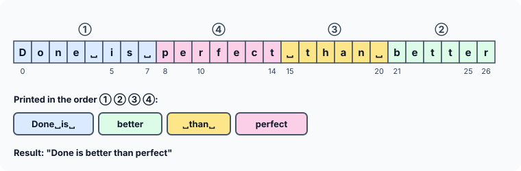

title : Strings: Short Answers and Output Puzzles

summary : Short questions on strcat with literals, defining your own strcpy, and processing strings, followed by output puzzles that combine pointers, strcmp, strcat and 3-D char arrays.

# Strings: Short Answers and Output Puzzles

This article has two parts. The first asks short questions about strings and pointers — the kind that check whether you understand **why** C behaves as it does. The second is a set of output puzzles that combine several ideas at once. As always, answer each one yourself before opening the solution.

All answers assume a typical 64-bit system: 4-byte `int`, 8-byte pointers.

## Part 1: Short Answers

### 1. Joining two string literals

Is this program correct?

```c
#include <stdio.h>
#include <string.h>

int main(void)
{
    char *str1 = "Hello";
    char *str2 = "World";
    char *str3;

    str3 = strcat(str1, str2);
    printf("%s\n", str3);
    return 0;
}
```

:::details[Answer]
**No.** There are two separate problems with `strcat(str1, str2)`:

1. **There is no room.** `strcat` appends `"World"` after the end of `"Hello"`, so it writes 5 characters and a `'\0'` into the bytes that follow `"Hello"` in memory. Those bytes do not belong to the string; whatever is stored there gets overwritten.
2. **The target is a string literal.** `str1` points to the literal `"Hello"`, and modifying a string literal is undefined behaviour. On Linux, literals are stored in read-only memory, so the program is killed with a **segmentation fault** at the first byte `strcat` tries to write.

Note that the compiler gives no warning, because `str1` was declared as `char *`. Declaring it as `const char *str1` would turn the call into a compile-time warning (*passing argument 1 of 'strcat' discards 'const' qualifier*).
:::

### 2. Fixing it

How would you improve the program above?

:::details[Answer]
Give `strcat` a **writable** target that is **big enough** for the result: a `char` array with room for both strings plus the `'\0'`.

```c runnable
#include <stdio.h>
#include <string.h>

int main(void)
{
    char str1[16] = "Hello";               /* writable, with room to grow */
    const char *str2 = "World";
    char *str3;

    str3 = strcat(str1, str2);             /* strcat returns its first argument */
    printf("%s\n", str3);
    printf("str3 == str1? %s\n", str3 == str1 ? "yes" : "no");
    return 0;
}
```

```
HelloWorld
str3 == str1? yes
```

`"Hello"` + `"World"` + `'\0'` needs 11 bytes, and `str1` has 16. Also notice what `strcat` returns: the address of its **first argument**. `str3` does not point to a new string — it points to `str1`, which now holds the joined text.
:::

### 3. Your own strcpy

In the following code, which function is called: the `strcpy` defined below, or the one in the standard library?

```c
#include <stdio.h>
#include <string.h>

char *strcpy(char *t, const char *s)
{
    char *start = t;
    while (*s) { *t = *s; t++; s++; }
    *t = '\0';
    printf("(my strcpy called)\n");
    return start;
}

int main(void)
{
    char str1[] = "Practice makes progress";
    char str2[40];
    strcpy(str2, str1);
    printf("%s\n", str2);
    return 0;
}
```

:::details[Answer]
**You cannot rely on either.** Older books answer "the user-defined one", and with GCC and no optimisation that is what happens:

```
(my strcpy called)
Practice makes progress
```

But compile the same program with `-O2` and the output becomes just:

```
Practice makes progress
```

GCC knows what `strcpy` is supposed to do, so with optimisation on it replaces the call with its own built-in copy, and your function is never called.

The C standard says the names of standard library functions are **reserved**. Defining your own function with the same name as one in a header you have included is undefined behaviour, so neither result is "wrong". (With the book's original definition, which had no return type, a modern compiler stops with *conflicting types for 'strcpy'*.)

The lesson: give your own functions your own names — `str_copy`, `my_strcpy` — as the earlier articles did.
:::

### 4. strcpy in one line

Can you write the body of the copy function above as a single statement?

:::details[Answer]
Yes:

```c
char *str_copy(char *t, const char *s)
{
    char *start = t;
    while ((*t++ = *s++))
        ;
    return start;
}
```

`*t++ = *s++` copies one character and moves both pointers on. The value of the assignment is the character copied, so the loop stops right after the `'\0'` has been copied — no separate terminator line is needed. The extra parentheses tell the compiler the `=` is intentional (without them, `-Wall` suggests you may have meant `==`). The empty statement `;` is the body.
:::

### 5. Lengths of strings in an array of pointers

How would you print each string in `const char *str[] = {"Keep", "calm", "and", "write", "C", "code"};` together with its length?

:::details[Answer]
Loop over the array and call `strlen` on each element. Each element is the address of a string, which is exactly what `strlen` needs:

```c runnable
#include <stdio.h>
#include <string.h>

int main(void)
{
    const char *str[] = {"Keep", "calm", "and", "write", "C", "code"};
    size_t count = sizeof str / sizeof str[0];     /* 48 / 8 = 6 elements */

    for (size_t i = 0; i < count; i++)
        printf("%-6s %zu\n", str[i], strlen(str[i]));
    return 0;
}
```

```
Keep   4
calm   4
and    3
write  5
C      1
code   4
```

Note the difference: `sizeof str / sizeof str[0]` counts the **elements** of the array (6), while `strlen(str[i])` measures each **string**. `sizeof str[i]` would be 8 for every element — the size of a pointer — and is no help here.
:::

### 6. A number indexed by a string

Would this compile?

```c runnable
#include <stdio.h>

int main(void)
{
    printf("%c\n", 3["Matrix"]);
    return 0;
}
```

:::details[Answer]
**Yes**, and it prints:

```
r
```

`a[i]` is defined as `*(a + i)`, and addition does not care about order, so `i[a]` is `*(i + a)` — the same thing. `3["Matrix"]` is therefore `"Matrix"[3]`: element 3 of the literal, counting `M`, `a`, `t`, `r`. It is legal, but useful only in puzzles like this one.
:::

### 7. Pointer or array?

What is the difference between these two declarations?

```c
char *p = "Samuel";
char a[] = "Samuel";
```

:::details[Answer]
- **`a`** is an **array**, just big enough to hold the characters and the `'\0'` that follows them (7 bytes). Its characters can be changed (`a[0] = 's';`), but `a` itself always refers to the same storage — it cannot be made to point anywhere else.
- **`p`** is a **pointer**, initialised to point to a string literal stored elsewhere. The pointer can be changed to point to another string (`p = "Daniel";`). But if you try to change the characters it points to (`p[0] = 's';`), the result is undefined — on Linux, a crash. That is why such pointers should be declared `const char *`.

Also, `sizeof a` is 7, while `sizeof p` is 8 — the size of a pointer. (The article on pointers and strings covers this in full.)
:::

### 8. One character at a time?

When handling a string, do we always have to process it character by character, or is there a way to process the entire string as one unit?

:::details[Answer]
At the level of the language, **a string is always processed character by character**. C has no operator that works on a whole string: `=` cannot copy one, `==` compares only addresses, and `+` does not join them.

What C does provide are **functions** that hide the loop — `strcpy`, `strcmp`, `strcat`, `printf("%s")`, and so on. From your code they look like whole-string operations, but every one of them walks through the characters one at a time until it reaches the `'\0'`, exactly like the versions written in the earlier articles.
:::

## Part 2: What Is the Output?

### 1. Two pointers, one odd string

```c
#include <stdio.h>

int main(void)
{
    char string[] = "OddOneOut";
    char *ptr1 = string, *ptr2 = string + sizeof(string) - 1;
    int i;

    for (i = 0; ptr1 != ptr2; i++) {
        ++ptr1;
        --ptr2;
    }
    printf("%d\n", i);
    return 0;
}
```

:::details[Answer]
**Nothing useful: the loop never ends properly.** The program has undefined behaviour.

`sizeof(string)` is 10 (9 letters plus `'\0'`), so `ptr2` starts at `string + 9`, the `'\0'`. `ptr1` starts at `string + 0`. The pointers are 9 apart, and each time round the loop the gap shrinks by 2: 9, 7, 5, 3, 1, −1, … It is never **0**, so `ptr1 != ptr2` never becomes false. The pointers pass each other in the middle and keep going, past both ends of the array. In practice the program runs until it is stopped or crashes.

The name of the string is the hint: with an **odd** distance the pointers can never meet. (The worked-examples article has a diagram of two pointers meeting and crossing.) Testing `ptr1 < ptr2` instead stops the loop as soon as they meet **or** cross:

```c runnable
#include <stdio.h>

int main(void)
{
    char string[] = "OddOneOut";
    char *ptr1 = string, *ptr2 = string + sizeof(string) - 1;
    int i;

    for (i = 0; ptr1 < ptr2; i++) {        /* < instead of != */
        ++ptr1;
        --ptr2;
    }
    printf("%d\n", i);
    return 0;
}
```

```
5
```

The gap goes 9, 7, 5, 3, 1 (five passes, all with `ptr1 < ptr2`), then −1, and the loop stops.
:::

### 2. strcmp of two strcats

```c runnable
#include <stdio.h>
#include <string.h>

int main(void)
{
    char str1[] = "Rain";
    char str2[20];
    char str3[20] = "Bow";
    int l;

    l = strcmp(strcat(str3, strcpy(str2, str1)), strcat(str3, "drop"));
    printf("%d\n", l);
    printf("%s\n", str3);
    return 0;
}
```

:::details[Answer]
```
0
BowdropRain
```

The key is what these functions **return**. `strcpy` and `strcat` both return their first argument, the target:

- `strcpy(str2, str1)` copies `"Rain"` into `str2` and returns `str2`.
- `strcat(str3, …)` appends that to `str3` and returns `str3`.
- `strcat(str3, "drop")` appends `"drop"` to `str3` and **also** returns `str3`.

So both arguments of `strcmp` are the same address, `str3`. A string compared with itself is always equal, so the result is **0**.

The second line is a bonus surprise. C does not specify the order in which a function's arguments are evaluated. GCC happened to evaluate the right-hand `strcat` first, giving `"Bowdrop"` and then `"BowdropRain"`. Another compiler might give `"BowRaindrop"`. The `0` is the same either way.
:::

### 3. Printing in pieces

```c runnable
#include <stdio.h>

int main(void)
{
    char str[] = "Done is perfect than better";
    int i;

    for (i = 0; i <= 7; i++)
        printf("%c", *(str + i));
    for (i = 0; i <= 5; i++)
        printf("%c", *(str + 21 + i));
    for (i = 0; i <= 5; i++)
        printf("%c", *(str + 15 + i));
    for (i = 0; i <= 6; i++)
        printf("%c", *(str + 8 + i));
    printf("\n");
    return 0;
}
```

:::details[Answer]
```
Done is better than perfect
```

Each loop prints a run of characters starting at a different offset: elements 0–7, then 21–26, then 15–20, then 8–14.



Counting positions carefully is all this needs: `str + 21 + i` is element `21 + i`, and so on. The string itself is never changed; the program just visits it in a different order.
:::

### 4. Merging words from two strings

```c runnable
#include <stdio.h>

int main(void)
{
    char s[] = "Simple better complex";
    char t[] = "is than ";
    char u[40];
    char *ss = s, *tt = t, *uu = u;

    while (*ss || *tt) {
        while (*ss) {
            if ((*uu++ = *ss++) == ' ')
                break;
        }
        while (*tt) {
            if ((*uu++ = *tt++) == ' ')
                break;
        }
    }
    *uu = '\0';
    puts(u);
    return 0;
}
```

:::details[Answer]
```
Simple is better than complex
```

Each pass of the outer loop copies **one word** from `s` and then **one word** from `t` into `u`.

- The first inner loop copies characters from `s` to `u`. The condition `(*uu++ = *ss++) == ' '` copies a character and then checks whether it was a space; if it was, `break` ends the inner loop, so exactly one word (with its space) is copied: `"Simple "`.
- The second inner loop does the same with `t`: `"is "`.
- The outer loop repeats while either string still has characters (`*ss || *tt`): `"better "`, `"than "`, and finally `"complex"`, which has no space after it, so its inner loop runs until the `'\0'` of `s`. By then `t` is also used up, and the outer loop ends.

The final `*uu = '\0';` terminates the result, since neither inner loop copies a `'\0'`. `puts` prints a string followed by a newline.
:::

### 5. Addresses inside a 3-D char array

```c runnable
#include <stdio.h>

int main(void)
{
    char a[2][2][25] = {
        {
            "Twinkle twinkle",
            "little star"
        },
        {
            "How I wonder",
            "what you are"
        }
    };

    printf("%s %s %s %s\n", &a[0][0][8], &a[0][1][7], &a[1][0][6], &a[1][1][5]);
    return 0;
}
```

:::details[Answer]
```
twinkle star wonder you are
```

`a` is a 3-D array of characters: 2 blocks, each holding 2 strings of up to 25 characters. `a[i][j]` is one string, and `a[i][j][k]` is character `k` of that string. So `&a[i][j][k]` is the address of that character, and `%s` prints from there to the end of that string:

- `&a[0][0][8]`: in `"Twinkle twinkle"`, element 8 is the lowercase `t` → `twinkle`
- `&a[0][1][7]`: in `"little star"`, element 7 is the `s` → `star`
- `&a[1][0][6]`: in `"How I wonder"`, element 6 is the `w` → `wonder`
- `&a[1][1][5]`: in `"what you are"`, element 5 is the `y` → `you are`
:::
