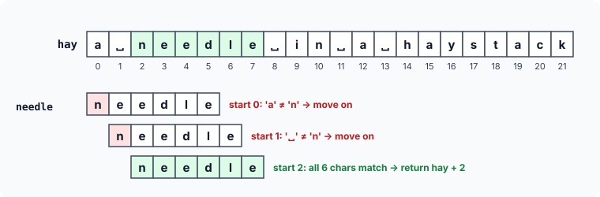

# Strings: Programming Exercises

Time to write string code yourself. Each exercise below asks for a function or a small program. Try it on your own first — the hints describe the idea without giving the code away — and then compare with the solution. Every solution is a complete, runnable program, so you can also experiment with it: change the inputs, break it on purpose, and see what happens.

All these exercises use the same tools: a pointer walking through characters, a loop that stops at `'\0'`, and pointer arithmetic to say "where" something is.

### 1. Find a character

Write a function `str_find_char()` that scans a string from beginning to end, looking for a given character. If the character is found, it should return a **pointer to its first occurrence** in the string. If it is not found, it should return `NULL`. Its prototype:

```c
char *str_find_char(const char *s, char ch);
```

:::details[Hint]
Walk a pointer through the string. At each character, compare it with `ch`; on a match, return the pointer itself. If the loop reaches the `'\0'`, the character was not there.
:::

:::details[Solution]
```c runnable
#include <stdio.h>

char *str_find_char(const char *s, char ch)
{
    while (*s != '\0') {
        if (*s == ch)
            return (char *)s;          /* found: return its address */
        s++;
    }
    return NULL;                       /* reached the end: not found */
}

int main(void)
{
    char text[] = "Hello, pointer world";
    char *where;

    where = str_find_char(text, 'p');
    if (where != NULL)
        printf("'p' found at index %td: \"%s\"\n", where - text, where);

    where = str_find_char(text, 'z');
    printf("'z' %s\n", where == NULL ? "not found" : "found");
    return 0;
}
```

```
'p' found at index 7: "pointer world"
'z' not found
```

Returning a **pointer** rather than an index is the C way of saying "here it is". The caller can print from it (`%s` printed `pointer world`), or subtract the base address to get the position (`where - text` is 7).

Two details:

- The parameter is `const char *` because the function only reads the string. The return type is plain `char *` so that a caller who passed a writable array can modify the character it found. That requires a cast in the `return`. The standard function `strchr` from `<string.h>`, which does exactly this job, has the same signature for the same reason.
- Always check for `NULL` before using the result. `printf("%s", NULL)` is undefined behaviour.
:::

### 2. Find a substring

Write a function `str_find()` that scans a string for the occurrence of a given substring. It should return a **pointer to the element of the first string where the substring begins**, or `NULL` if the substring does not occur. For example, searching `"somewhere over the rainbow"` for `"over"` should return the address of the `'o'` of `over`. Its prototype:

```c
char *str_find(const char *hay, const char *needle);
```

:::details[Hint]
Try each position of `hay` as a possible starting point. From there, compare `needle` with `hay` character by character, using two extra pointers so the starting point is not lost. If you reach the end of `needle` with every character matching, you have found it. Otherwise, move on to the next starting position.
:::

:::details[Solution]
```c runnable
#include <stdio.h>

char *str_find(const char *hay, const char *needle)
{
    if (*needle == '\0')               /* an empty needle matches at once */
        return (char *)hay;

    for (; *hay != '\0'; hay++) {
        const char *h = hay, *n = needle;

        while (*n != '\0' && *h == *n) {   /* compare while they match */
            h++;
            n++;
        }
        if (*n == '\0')                /* every char of needle matched */
            return (char *)hay;
    }
    return NULL;
}

int main(void)
{
    const char *line = "a needle in a haystack, then another needle";
    char *at;

    at = str_find(line, "needle");
    printf("first \"needle\" at index %td\n", at - line);

    at = str_find(at + 1, "needle");   /* search again, after the first */
    printf("next  \"needle\" at index %td\n", at - line);

    at = str_find(line, "pin");
    printf("\"pin\" %s\n", at == NULL ? "not found" : "found");
    return 0;
}
```

```
first "needle" at index 2
next  "needle" at index 37
"pin" not found
```



How it works:

- The outer loop moves `hay` to each possible starting position.
- At each position, `h` and `n` walk forward together while the characters match. Note the order of the test: `*n != '\0'` is checked **first**, so the loop stops as soon as the needle is used up.
- If the inner loop stopped because `n` reached the needle's `'\0'`, every character matched, and `hay` is the answer. If it stopped on a mismatch, the outer loop tries the next position.
- The inner loop also stops safely at the end of `hay`: `*h` is then `'\0'`, which cannot equal a character of the needle that is not yet at its own end.

Because the result is a pointer, searching for the **next** occurrence is easy: start a new search one character after the previous result (`at + 1`).

The standard library function for this is `strstr`. This simple method compares up to `strlen(needle)` characters at each position. That is fine for everyday use; for searching huge texts, there are faster algorithms such as Knuth–Morris–Pratt and Boyer–Moore.
:::

### 3. Sort names alphabetically

Seven names are stored in an array of pointers:

```c
const char *names[] = {
    "Meera", "Arjun", "Meera Nair", "Kiran", "Rohan", "Arjunkumar", "Hari"
};
```

Write a program to arrange these names in alphabetical order.

:::details[Hint]
Use `strcmp` to decide which of two names comes first. Any simple sorting method works — for example, selection sort: find the smallest remaining name and swap it into place. And remember the advantage of an array of pointers: you never need to move the characters; swapping two **pointers** is enough.
:::

:::details[Solution]
```c runnable
#include <stdio.h>
#include <string.h>

int main(void)
{
    const char *names[] = {
        "Meera", "Arjun", "Meera Nair", "Kiran", "Rohan", "Arjunkumar", "Hari"
    };
    int n = sizeof names / sizeof names[0];

    for (int i = 0; i < n - 1; i++) {          /* selection sort */
        int min = i;
        for (int j = i + 1; j < n; j++)
            if (strcmp(names[j], names[min]) < 0)
                min = j;
        if (min != i) {                        /* swap two pointers */
            const char *t = names[i];
            names[i] = names[min];
            names[min] = t;
        }
    }

    for (int i = 0; i < n; i++)
        printf("%s\n", names[i]);
    return 0;
}
```

```
Arjun
Arjunkumar
Hari
Kiran
Meera
Meera Nair
Rohan
```

For each position `i`, the inner loop finds the name that comes first alphabetically among the remaining names, and the swap moves it into position `i`. Each swap exchanges two 8-byte addresses — the strings themselves never move.

Notice the order of `"Arjun"` and `"Arjunkumar"`, and of `"Meera"` and `"Meera Nair"`. When one string is the start of another, `strcmp` reaches the `'\0'` of the shorter one while the other still has characters. `'\0'` has the smallest code of all, so the shorter string comes first.

In real programs, you would normally use the standard library's `qsort` (from `<stdlib.h>`), passing it a comparison function:

```c runnable
#include <stdio.h>
#include <stdlib.h>
#include <string.h>

int compare_names(const void *a, const void *b)
{
    const char *const *x = a;          /* a points to an element: a const char * */
    const char *const *y = b;
    return strcmp(*x, *y);
}

int main(void)
{
    const char *names[] = {
        "Meera", "Arjun", "Meera Nair", "Kiran", "Rohan", "Arjunkumar", "Hari"
    };
    size_t n = sizeof names / sizeof names[0];

    qsort(names, n, sizeof names[0], compare_names);
    for (size_t i = 0; i < n; i++)
        printf("%s\n", names[i]);
    return 0;
}
```

```
Arjun
Arjunkumar
Hari
Kiran
Meera
Meera Nair
Rohan
```

`qsort` can sort an array of anything, so it passes the comparison function the **addresses of two elements** as `const void *`. Here each element is a `const char *`, so each argument is really a pointer to a `const char *`. The function converts them back to that type, and `*x` and `*y` are the two strings. Passing `a` and `b` straight to `strcmp` is a classic bug: they are addresses of pointers, not addresses of characters.
:::

### 4. Squeeze out repeated spaces

Write a function that **compresses** a string by eliminating multiple blanks, storing the result in another string. Also write a **decompress** function that gets back the original string, with all its spaces restored. Test them with a message such as:

```
"Base camp.   Weather    clear. Climb at dawn,   rope team two.      Over."
```

:::details[Hint]
Simply deleting the extra spaces loses information: afterwards, nothing says how many there were. The compressed form must **record** each run's length. One simple scheme: leave single spaces alone, and replace a run of 2 to 9 spaces with two characters — a marker character that never appears in normal text (say `'~'`), followed by the count as a digit. To decompress, copy characters until you meet the marker, then write that many spaces.
:::

:::details[Solution]
```c runnable
#include <stdio.h>
#include <string.h>

/* A run of 2 to 9 spaces becomes two chars: '~' and the count as a digit.
   Longer runs are split into pieces of at most 9. A single space stays
   as it is. ('~' must not appear in the original text.) */
void compress(char *out, const char *in)
{
    while (*in != '\0') {
        if (*in != ' ') {
            *out++ = *in++;
            continue;
        }

        int run = 0;
        while (*in == ' ') {           /* count the whole run of spaces */
            run++;
            in++;
        }
        while (run > 0) {
            if (run == 1) {
                *out++ = ' ';
                run = 0;
            } else {
                int piece = run > 9 ? 9 : run;
                *out++ = '~';
                *out++ = (char)('0' + piece);
                run -= piece;
            }
        }
    }
    *out = '\0';
}

void decompress(char *out, const char *in)
{
    while (*in != '\0') {
        if (*in == '~') {
            int run = in[1] - '0';     /* the digit after the marker */
            in += 2;
            while (run-- > 0)
                *out++ = ' ';
        } else {
            *out++ = *in++;
        }
    }
    *out = '\0';
}

int main(void)
{
    const char *message =
        "Base camp.   Weather    clear. Climb at dawn,   rope team two.      Over.";
    char small[100], restored[100];

    compress(small, message);
    decompress(restored, small);

    printf("original:   %zu chars\n", strlen(message));
    printf("compressed: %zu chars: %s\n", strlen(small), small);
    printf("restored matches original? %s\n",
           strcmp(restored, message) == 0 ? "yes" : "no");
    return 0;
}
```

```
original:   73 chars
compressed: 65 chars: Base camp.~3Weather~4clear. Climb at dawn,~3rope team two.~6Over.
restored matches original? yes
```

How it works:

- **`compress`** copies ordinary characters straight across. On meeting a space, it first counts the whole run. A run of one is written back as a single space. Longer runs become `'~'` plus a digit: `'0' + 3` is the character `'3'`, because the digit characters have consecutive codes. A run longer than 9 is written as several pieces, since one digit can only count to 9.
- **`decompress`** reverses this. On meeting `'~'`, `in[1] - '0'` turns the digit character back into a number, and that many spaces are written.
- Both functions write through `*out++` and finish with `*out = '\0'`.

This scheme saves space for runs of 3 or more spaces (2 characters instead of 3+); a run of exactly 2 stays the same length. The compressed text can never be longer than the original, so an output buffer the same size as the input is always enough.

The scheme's one assumption is that `'~'` never appears in the text. Real compression formats solve this with an **escape** rule (for example, writing a literal `'~'` as `"~~"`). Compressing runs of a repeated character this way is a simple form of **run-length encoding**.
:::

### 5. Encode and decode a message

Write a program to **encode** a string so that it is converted into an unrecognisable form. Also write a **decode** function to get back the original string. Try to make the scheme hard to break.

:::details[Hint]
A classic approach is to **shift** each character by some amount, as in the Caesar cipher (`'A'` → `'D'`, `'B'` → `'E'`, …). A single fixed shift is easy to break, though: try all possible shifts and see which result makes sense. It is much harder if the shift **changes from character to character**, taken in turn from a secret **key** word. That is the Vigenère cipher. To keep the result printable, shift only within the 95 printable characters (codes 32 to 126) and wrap around at the end, using `%`.
:::

:::details[Solution]
```c runnable
#include <stdio.h>
#include <string.h>

#define FIRST 32                       /* ' ' : the first printable char */
#define RANGE 95                       /* ' ' to '~' : 95 printable chars */

/* Shift every printable character by an amount taken from the key,
   cycling through the key. Characters outside the range are kept. */
void encode(char *s, const char *key)
{
    size_t klen = strlen(key);

    for (size_t i = 0; s[i] != '\0'; i++) {
        if (s[i] >= FIRST && s[i] < FIRST + RANGE) {
            int shift = key[i % klen] - FIRST;
            s[i] = (char)(FIRST + (s[i] - FIRST + shift) % RANGE);
        }
    }
}

void decode(char *s, const char *key)
{
    size_t klen = strlen(key);

    for (size_t i = 0; s[i] != '\0'; i++) {
        if (s[i] >= FIRST && s[i] < FIRST + RANGE) {
            int shift = key[i % klen] - FIRST;
            s[i] = (char)(FIRST + (s[i] - FIRST - shift + RANGE) % RANGE);
        }
    }
}

int main(void)
{
    char text[] = "Meet me at the old library at 7 pm.";
    const char *key = "Kestrel";

    encode(text, key);
    printf("encoded: %s\n", text);
    decode(text, key);
    printf("decoded: %s\n", text);
    return 0;
}
```

```
encoded: xKYirSRKGhtgNRKU`YrRV.XUgleN@e+tcSz
decoded: Meet me at the old library at 7 pm.
```

How it works:

- Each printable character is turned into a number from 0 to 94 (`s[i] - FIRST`), shifted, wrapped around with `% RANGE`, and turned back into a character (`FIRST + …`).
- The shift for character `i` comes from character `i % klen` of the key, so the key is reused in a cycle: `K`, `e`, `s`, `t`, `r`, `e`, `l`, `K`, `e`, …. The same letter in the message is encoded differently depending on its position — notice that the three `e`s of `"Meet me"` do not all come out the same.
- `decode` subtracts the same shifts. Adding `RANGE` before taking `%` keeps the value from going negative (in C, `%` of a negative number gives a negative result).
- The functions change the string **in place**, which is why `text` is an array, not a pointer to a string literal.

**Important:** this makes a good exercise, but it is **not** real security. Ciphers like this one have been breakable since the 19th century, by analysing letter frequencies and repeated patterns. To protect real data, always use a well-tested cryptography library (for example, libsodium or OpenSSL) with a modern algorithm such as AES. Never invent your own encryption scheme.
:::

## Key Takeaways

- Functions that search a string return a **pointer** to what they found, or `NULL`. Subtract the base address to get an index, and always check for `NULL`.
- A substring search tries every starting position, comparing with two extra pointers so the starting point is not lost.
- Sorting an array of pointers to strings swaps addresses, never characters. `strcmp` decides the order, and a prefix sorts before the longer string.
- `qsort` passes the comparison function the **addresses of elements** — for an array of strings, pointers to pointers.
- Information that is thrown away cannot be recovered: a compressed form must record what it removed.
- `'0' + n` turns a digit value into a digit character, and `c - '0'` turns it back.
