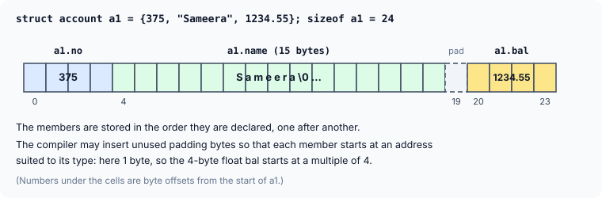
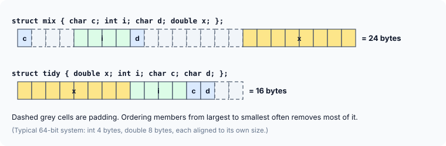

title : Structures: Grouping Different Types Together

summary : Real-world data rarely comes as a single int or float. Learn how a C structure groups dissimilar data into one unit: declaring structures, the dot operator, how members sit in memory (including padding), arrays of structures, nesting, copying and passing structures to functions.

# Structures: Grouping Different Types Together

Every program so far has worked with **one kind of data at a time**: an `int`, a `char` array, an array of `float`s. Real-world data is rarely like that. Think about a book in a library. It has a title, an author, a call number, a publisher, a number of pages, a date of publication and a price. These belong together — they describe *one* book — but they are of different types: the title and author are strings, the price is a `float`, the number of pages is an `int`.

You could keep them in separate variables, or in separate parallel arrays (`titles[]`, `prices[]`, `pages[]`), but then nothing in the program says that `titles[7]` and `prices[7]` belong to the same book. Sort one array and forget the other, and the data is scrambled.

For dealing with such collections, C provides a data type called a **structure**. A structure gathers together different pieces of information that form one entity, and lets you treat that entity as a single unit.

This article covers structures themselves. The next one adds pointers to structures, which is where structures become really powerful — they are the building blocks of linked lists, stacks, queues and almost every data structure in C.

## A First Structure

Here is a program that keeps three bank accounts, each with an account number, a holder's name and a balance:

```c
#include <stdio.h>

int main(void)
{
    struct account
    {
        int no;
        char acc_name[15];
        float bal;
    };
    struct account a1, a2, a3;

    printf("Enter account numbers, names and balances\n");
    scanf("%d %14s %f", &a1.no, a1.acc_name, &a1.bal);
    scanf("%d %14s %f", &a2.no, a2.acc_name, &a2.bal);
    scanf("%d %14s %f", &a3.no, a3.acc_name, &a3.bal);

    printf("%d %s %.2f\n", a1.no, a1.acc_name, a1.bal);
    printf("%d %s %.2f\n", a2.no, a2.acc_name, a2.bal);
    printf("%d %s %.2f\n", a3.no, a3.acc_name, a3.bal);
    return 0;
}
```

A sample run:

```
Enter account numbers, names and balances
375 Sameera 1234.55
376 Rohit 980.00
377 Leela 15000.75
375 Sameera 1234.55
376 Rohit 980.00
377 Leela 15000.75
```

Let us go through it piece by piece.

**(a) The declaration.** The lines starting with `struct account` combine three dissimilar data types into a single new type, called `struct account`. Here `struct` is a keyword, `account` is the **structure name** (also called its *tag*), and the variables declared inside the braces — `no`, `acc_name` and `bal` — are the **structure elements**, usually called **members**. The declaration ends with a semicolon after the closing brace; forgetting it is a classic error.

A structure declaration on its own creates **no variable** and reserves **no memory**. It is a blueprint: it describes what every `struct account` will look like.

**(b) The variables.** `a1`, `a2` and `a3` are **structure variables** of the type `struct account`. Each of them contains its own `no`, its own `acc_name` and its own `bal`.

**(c) The dot operator.** Members are reached with the `.` (dot) operator. To refer to `no` of `a1` we write `a1.no`, and to refer to its name, `a1.acc_name`. **Before the dot there must always be a structure variable, and after it, a member of that structure.** Each `a1.no` behaves exactly like an ordinary `int` variable: you can assign to it, print it, or take its address with `&a1.no`.

**(d) No `&` for the name.** `scanf` needs addresses, so `&a1.no` and `&a1.bal` are passed. But `a1.acc_name` is a `char` array, and mentioning an array gives its base address, so the `&` is dropped for it — exactly as with any other string. The width `%14s` keeps the name within the 15-byte array, leaving room for the `'\0'`.

**(e) Contiguous storage.** The members of a structure variable are stored in memory **one after another, in the order they were declared**. The next section looks at this more closely.

Here is the same program with the data built in, so that it runs on its own:

```c runnable
#include <stdio.h>

struct account
{
    int no;
    char acc_name[15];
    float bal;
};

int main(void)
{
    struct account a1 = {375, "Sameera", 1234.55f};
    struct account a2 = {376, "Rohit", 980.00f};
    struct account a3 = {377, "Leela", 15000.75f};

    printf("%d %s %.2f\n", a1.no, a1.acc_name, a1.bal);
    printf("%d %s %.2f\n", a2.no, a2.acc_name, a2.bal);
    printf("%d %s %.2f\n", a3.no, a3.acc_name, a3.bal);
    return 0;
}
```

```
375 Sameera 1234.55
376 Rohit 980.00
377 Leela 15000.75
```

Two things changed. The values are given in an **initialiser list**, in the same order as the members were declared. And the structure is declared **outside** `main`, which makes the type available to every function in the file — something we will need as soon as structures are passed to functions. (The `f` in `1234.55f` makes the literal a `float`, matching the member's type.)

## How a Structure Sits in Memory

The members of a structure are stored in contiguous memory, in declaration order. But there is a detail that older books, written for compilers that packed everything tightly, do not show: the compiler may insert unused **padding** bytes between members.



Why padding? Most processors read a 4-byte `float` fastest — and some can only read it at all — when it starts at an address that is a multiple of 4. `acc_name` ends at byte 18, so the compiler skips byte 19 and starts `bal` at byte 20. The result is that `sizeof(struct account)` is **24**, not 4 + 15 + 4 = 23.

You do not have to guess where the members are. The standard macro `offsetof` (from `<stddef.h>`) gives the byte offset of each member from the start of the structure:

```c runnable
#include <stdio.h>
#include <stddef.h>

struct account
{
    int no;
    char acc_name[15];
    float bal;
};

int main(void)
{
    struct account a1 = {375, "Sameera", 1234.55f};
    char *base = (char *)&a1;

    printf("a1.no       at +%td (offsetof says %zu)\n", (char *)&a1.no - base, offsetof(struct account, no));
    printf("a1.acc_name at +%td (offsetof says %zu)\n", a1.acc_name - base, offsetof(struct account, acc_name));
    printf("a1.bal      at +%td (offsetof says %zu)\n", (char *)&a1.bal - base, offsetof(struct account, bal));
    printf("sizeof a1 = %zu bytes\n", sizeof a1);
    return 0;
}
```

```
a1.no       at +0 (offsetof says 0)
a1.acc_name at +4 (offsetof says 4)
a1.bal      at +20 (offsetof says 20)
sizeof a1 = 24 bytes
```

:::callout
**Why `(char *)`?** This program shows each address as its distance in **bytes** from the start of the structure. Two rules of C make the cast necessary. First, C can only subtract two pointers of the **same type**, so both are converted to one type. Second, the difference between two pointers is counted in units of the type they point to, not in bytes: two `int *` pointers 8 bytes apart differ by 2 (two `int`s). A `char` is exactly one byte, so subtracting two `char *` pointers counts bytes. The cast does not change any address — it only changes how the subtraction counts. `&a1.no` is an `int *` and `&a1.bal` a `float *`, so both are cast; `a1.acc_name` needs no cast, because it is a `char` array and its name already gives a `char *`. (`%td` is the `printf` format for a pointer difference, whose type is `ptrdiff_t`.)
:::

Padding depends on the order of the members. Putting a `char` between two larger members wastes space; grouping members from largest to smallest usually avoids most of it:



```c runnable
#include <stdio.h>

struct mix  { char c; int i; char d; double x; };
struct tidy { double x; int i; char c; char d; };

int main(void)
{
    printf("sizeof(struct mix)  = %zu\n", sizeof(struct mix));
    printf("sizeof(struct tidy) = %zu\n", sizeof(struct tidy));
    return 0;
}
```

```
sizeof(struct mix)  = 24
sizeof(struct tidy) = 16
```

:::callout
The exact padding is chosen by the compiler for the target machine, so never assume a structure's size by adding up its members — always use `sizeof`. Two consequences follow. First, structures cannot be compared with `==`; compare them member by member. Second, writing a structure's raw bytes to a file or network and reading them on a different machine or compiler may not work, because the layout can differ.
:::

## An Array of Structures

In the program above, storing data for 100 accounts would need 100 structure variables, `a1` to `a100` — clearly not convenient. The better approach is an **array of structures**. Just as you can have an array of `int`s, you can have an array whose every element is a whole structure:

```c
struct account a[10];
```

The elements are stored one after another, as in every array; each one is a complete `struct account` of 24 bytes.

![The array a: a[0] at offset 0, a[1] at 24, a[2] at 48, … a[9] at 216, each element holding no, name and bal](images/array-of-structures.svg)

The members are still reached with the dot operator, and the elements with the usual subscript: `a[i].no` means "the `no` member of element `i`". Here is a program that reads 10 account numbers and balances:

```c
#include <stdio.h>

struct account
{
    int no;
    float bal;
};

int main(void)
{
    struct account a[10];

    for (int i = 0; i <= 9; i++) {
        printf("Enter account no. and balance: ");
        if (scanf("%d %f", &a[i].no, &a[i].bal) != 2)
            return 1;
    }

    for (int i = 0; i <= 9; i++)
        printf("%d %.2f\n", a[i].no, a[i].bal);
    return 0;
}
```

`&a[i].no` means `&(a[i].no)`: the `[]` and `.` operators bind more tightly than `&`, so this is the address of the `no` member of element `i`.

:::callout
Older books read the values into separate variables first (`scanf("%d %f", &acc, &balance);`) and then copy them into the structure. That was a workaround for some old DOS compilers, whose linker did not include `float` support when the only `float`s in a program were inside structures, and which then failed at run time with *floating point formats not linked*. Modern compilers have no such problem, so you can read straight into `&a[i].bal`.
:::

And a version that runs without typing, which also shows a typical use of an array of structures — searching it:

```c runnable
#include <stdio.h>

struct account
{
    int no;
    float bal;
};

int main(void)
{
    struct account a[] = {
        {101, 2000.55f}, {134, 4892.30f}, {122, 6432.90f}, {157, 120.00f}
    };
    int count = sizeof a / sizeof a[0];
    int richest = 0;

    for (int i = 0; i < count; i++) {
        printf("%d %8.2f\n", a[i].no, a[i].bal);
        if (a[i].bal > a[richest].bal)
            richest = i;
    }
    printf("Highest balance: account %d\n", a[richest].no);
    return 0;
}
```

```
101  2000.55
134  4892.30
122  6432.90
157   120.00
Highest balance: account 122
```

Each `{…}` in the initialiser fills one element, and `sizeof a / sizeof a[0]` counts the elements, exactly as for any other array.

## More About Structures

Now let us explore a few more features of structures that make programming more convenient.

### (a) Declaring the type and the variable together

The declaration of a structure type and of a structure variable can be combined in one statement. All three of these create the same variable `p1`:

```c
struct player
{
    char name[20];
    int age;
};
struct player p1 = {"Nick Yates", 30};
```

```c
struct player
{
    char name[20];
    int age;
} p1 = {"Nick Yates", 30};
```

```c
struct
{
    char name[20];
    int age;
} p1 = {"Nick Yates", 30};
```

The third form leaves out the structure name. Such an **anonymous** structure type can only be used in that one declaration: since it has no name, you cannot later declare another variable of the same type, or a function parameter of it. Use it only for one-off variables.

Since C99, members can also be initialised **by name**, in any order. Members you leave out are set to zero:

```c
struct player p2 = {.age = 27, .name = "Ira Bose"};
```

### (b) Copying a whole structure with =

The value of one structure variable can be assigned to another structure variable **of the same type** using the ordinary assignment operator. It is not necessary to copy the members piecemeal:

```c runnable
#include <stdio.h>

struct player
{
    char name[20];
    int age;
};

int main(void)
{
    struct player p1 = {"Nick Yates", 30};
    struct player p2;

    p2 = p1;                       /* copies every member, including the array */
    p2.name[0] = 'R';              /* change the copy only */
    p2.age = 31;

    printf("p1: %s, %d\n", p1.name, p1.age);
    printf("p2: %s, %d\n", p2.name, p2.age);
    return 0;
}
```

```
p1: Nick Yates, 30
p2: Rick Yates, 31
```

This is worth noticing: you cannot assign one **array** to another with `=`, but an array **inside a structure** is copied along with the rest of the structure. `p2` gets its own copy of all 20 bytes of `name`, which is why changing `p2.name[0]` leaves `p1` untouched.

Be careful when a structure contains a **pointer**: the assignment copies the address, not the data it points to, so both structures then point to the same memory. This is called a *shallow copy*, and it comes up again when structures hold `malloc`ed memory.

### (c) Structures inside structures

One structure can be nested within another. A member of the inner structure is reached by using the dot operator twice:

```c runnable
#include <stdio.h>

struct part
{
    char type;
    int qty;
};

struct vehicle
{
    char model[20];
    struct part bolt;              /* a whole structure as a member */
};

int main(void)
{
    struct vehicle v = {"Roadster", {'H', 120}};

    v.bolt.qty = 300;              /* outer variable . inner member . its member */
    printf("%s needs %d bolts of type %c\n", v.model, v.bolt.qty, v.bolt.type);
    return 0;
}
```

```
Roadster needs 300 bolts of type H
```

`v.bolt` is a `struct part`, and `v.bolt.qty` is the `qty` member of that. Read the dots left to right; each one goes one level deeper. The initialiser mirrors the nesting with an inner pair of braces.

### (d) Passing structures to functions

Like an ordinary variable, a structure variable can be passed to a function. There are four possibilities: pass **individual members**, the **entire structure** at one go, the **addresses of members**, or the **address of the structure**:

```c runnable
#include <stdio.h>

struct player
{
    char name[20];
    int age;
};

void display(const char *name, int age)     /* individual members */
{
    printf("display: %s, %d\n", name, age);
}

void show(struct player p)                  /* the entire structure (a copy) */
{
    p.age = 99;                             /* changes only the copy */
    printf("show:    %s, %d\n", p.name, p.age);
}

void birthday(int *age)                     /* the address of a member */
{
    (*age)++;
}

void print(const struct player *p)          /* the address of the structure */
{
    printf("print:   %s, %d\n", (*p).name, (*p).age);
}

int main(void)
{
    struct player p1 = {"Nick Yates", 30};

    display(p1.name, p1.age);
    show(p1);
    birthday(&p1.age);
    print(&p1);
    return 0;
}
```

```
display: Nick Yates, 30
show:    Nick Yates, 99
print:   Nick Yates, 31
```

Each choice follows the rules you already know:

- **Members** are passed like any other values. `p1.name` is an array, so its base address is passed; `p1.age` is an `int`, so its value is copied.
- **A whole structure** is passed **by value**: the function receives a complete copy. That is why `show` setting `p.age = 99` did not affect `p1`. For a large structure this copying also costs time and stack space.
- **The address of a member** lets the function change that member: `birthday` added 1 to `p1.age` through the pointer.
- **The address of the structure** gives the function access to the original, without copying it. Inside `print`, `p` is a **pointer to a structure**, and `(*p).name` means "the `name` member of the structure `p` points to". The parentheses are needed because `.` binds more tightly than `*`.

Passing the address is how real C programs usually pass structures, and `(*p).name` is so common that C has a special operator for it — the arrow, `->`. It is the subject of the next article.

## Key Takeaways

- A **structure** groups variables of different types into one unit. `struct tag { members };` declares a type; `struct tag var;` creates a variable.
- Members are reached with the **dot operator**: `variable.member`. Each member behaves like an ordinary variable of its type.
- Members are stored in declaration order, but the compiler may add **padding** for alignment. Use `sizeof` and `offsetof`, never manual arithmetic.
- An **array of structures** stores whole structures side by side: `a[i].member`.
- A structure can be initialised with `{…}` (or by member name since C99), copied with `=` (arrays inside are copied too), and nested inside another structure (`v.bolt.qty`).
- Structures cannot be compared with `==`.
- Passing a structure to a function copies it; passing its address lets the function use (and change) the original.

## Practice Questions

:::details[What is wrong with this declaration? struct point { int x; int y; } — followed directly by int main(void)]
The semicolon after the closing brace is missing. Without it, the compiler tries to read the structure declaration and `int main(void)` as one declaration and stops at `int`. GCC reports *expected ';', identifier or '(' before 'int'* — pointing at the line **after** the real mistake, which is what makes this error confusing the first time you see it.
:::

:::details[struct point { int x, y; } p = {3, 4}, q; How do you make q a copy of p, and can you then test p == q?]
`q = p;` copies both members. But `p == q` does not compile: C has no `==` for structures. Test `p.x == q.x && p.y == q.y` instead.
:::

:::details[Why might sizeof(struct { char a; int b; char c; }) be 12 rather than 6?]
Padding. After the 1-byte `a`, three bytes are skipped so that the 4-byte `b` starts at offset 4. After `c` at offset 8, three more bytes are added at the end so that, in an array of these structures, every element's `b` is also correctly aligned. Total: 12. Reordering the members as `int b; char a; char c;` brings it down to 8.
:::

:::details[In struct vehicle v; (from above), what are the types of v.bolt and v.bolt.qty?]
`v.bolt` is a `struct part`; `v.bolt.qty` is an `int`.
:::

:::details[A function void reset(struct player p) { p.age = 0; } is called as reset(p1);. Why does p1.age not change, and how would you fix it?]
The function receives a copy of `p1`, and only the copy's `age` is set to 0. Pass the address instead: `void reset(struct player *p) { (*p).age = 0; }`, called as `reset(&p1);`.
:::
