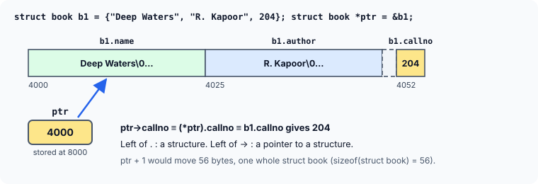
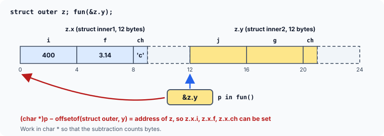

title : Pointers to Structures and Member Offsets

summary : Point at a structure, reach its members with ->, pass structures by address, walk arrays of structures with pointers and create structures with malloc. Then see how member offsets work, and how offsetof finds a whole structure from a pointer to one member.

# Pointers to Structures and Member Offsets

Just as we can have a pointer pointing to an `int`, or a pointer pointing to a `char`, we can have a pointer pointing to a **structure**. Such pointers are known as **structure pointers**, and they are everywhere in real C code. Passing a structure's address to a function avoids copying it; and, as the next articles show, linked lists, stacks, queues and trees are nothing but structures that point to other structures.

This article introduces the `->` operator, shows the common ways structure pointers are used, and then looks at a more advanced idea: using the **offsets** of members to get from a member back to the structure that contains it.

## The Arrow Operator

Here is a program that uses a structure pointer:

```c runnable
#include <stdio.h>

struct book
{
    char name[25];
    char author[25];
    int callno;
};

int main(void)
{
    struct book b1 = {"Deep Waters", "R. Kapoor", 204};
    struct book *ptr;

    ptr = &b1;
    printf("%s %s %d\n", b1.name, b1.author, b1.callno);
    printf("%s %s %d\n", ptr->name, ptr->author, ptr->callno);
    return 0;
}
```

```
Deep Waters R. Kapoor 204
Deep Waters R. Kapoor 204
```

The first `printf` is as usual. The second one is new. We cannot write `ptr.name` or `ptr.callno`, because `ptr` is not a structure variable but a **pointer** to a structure, and the dot operator requires a structure variable on its left. For this situation C provides the operator `->`, called the **arrow operator**, to refer to the members of the structure a pointer points to.

So, remember:

> On the left of the `.` operator there must always be a **structure variable**. On the left of the `->` operator there must always be a **pointer to a structure**.

Get them the wrong way round and the compiler tells you:

```
error: 'ptr' is a pointer; did you mean to use '->'?
error: invalid type argument of '->' (have 'struct book')
```

The arrangement of the structure variable and the pointer in memory looks like this:



### -> is shorthand

`ptr->callno` means exactly the same as `(*ptr).callno`: "go to the structure `ptr` points to, and take its `callno` member". The parentheses in the long form are necessary, because `.` binds more tightly than `*`. Without them, `*ptr.callno` would mean `*(ptr.callno)`, which is an error. The arrow exists because the long form is clumsy to type and to read, especially in chains such as `a->next->next->data`.

```c runnable
#include <stdio.h>

struct book
{
    char name[25];
    char author[25];
    int callno;
};

int main(void)
{
    struct book b1 = {"Deep Waters", "R. Kapoor", 204};
    struct book *ptr = &b1;

    ptr->callno = 315;                         /* change b1 through the pointer */
    printf("%d %d %d\n", b1.callno, (*ptr).callno, ptr->callno);
    printf("%c %c\n", ptr->name[0], *ptr->author);   /* first letters */
    return 0;
}
```

```
315 315 315
D R
```

`ptr->name[0]` is the first character of `name`. `*ptr->author` means `*(ptr->author)`: `->` binds more tightly than `*`, so this is the first character of `author`.

## Passing the Address of a Structure to a Function

As we saw in the last article, passing a whole structure to a function copies it. Passing its **address** is usually better: only one pointer is copied, and the function can work with the original. Here is how it looks:

```c runnable
#include <stdio.h>

struct book
{
    char name[25];
    char author[25];
    int callno;
};

void display(const struct book *b);            /* b is a pointer to a structure */

int main(void)
{
    struct book b1 = {"Deep Waters", "R. Kapoor", 204};

    display(&b1);
    return 0;
}

void display(const struct book *b)
{
    printf("%s\n%s\n%d\n", b->name, b->author, b->callno);
}
```

```
Deep Waters
R. Kapoor
204
```

Two things to note:

- To reach the members through the pointer, `display` uses `->`.
- `struct book` is declared **outside** `main`, at the top of the file. A structure type declared inside `main` is known only inside `main`, so `display` could not use it to declare its parameter. Declaring it at file level makes the type available to every function in the file.

The `const` in `const struct book *b` promises that `display` only reads the structure. This is the usual way to pass a structure that a function should not modify: no copy is made, and the original is still protected. A function that **should** modify the structure takes a plain `struct book *`.

## Walking an Array of Structures with a Pointer

Pointer arithmetic works for structure pointers exactly as for any other pointer: adding 1 moves the pointer to the **next structure**, skipping `sizeof(struct book)` bytes — not 1 byte.

```c runnable
#include <stdio.h>

struct book
{
    char name[25];
    char author[25];
    int callno;
};

int main(void)
{
    struct book shelf[] = {
        {"Deep Waters", "R. Kapoor", 204},
        {"Night Train", "A. Menon", 118},
        {"Paper Boats", "S. Iyer", 342}
    };
    int n = sizeof shelf / sizeof shelf[0];

    for (struct book *p = shelf; p < shelf + n; p++)
        printf("+%-3td %-12s %d\n", (char *)p - (char *)shelf, p->name, p->callno);
    return 0;
}
```

```
+0   Deep Waters  204
+56  Night Train  118
+112 Paper Boats  342
```

`shelf` gives the address of `shelf[0]`, so `p` starts at the first structure. Each `p++` moves 56 bytes — one whole `struct book` (25 + 25 + 2 bytes of padding + 4) — so `p->name` is the name of the next book. The loop stops when `p` reaches `shelf + n`, one past the last element.

### Operator precedence with ->

Because `->` binds more tightly than unary operators such as `++` and `*`, expressions that combine them need care:

| Expression | Means | Effect |
|---|---|---|
| `++p->callno` | `++(p->callno)` | increments the **member** |
| `(++p)->callno` | | moves `p` to the next structure, then reads its member |
| `p++->callno` | `(p++)->callno` | reads the member, then moves `p` |
| `*p->name` | `*(p->name)` | the first character of `name` |
| `p->name + 1` | | address of the second character of `name` |

```c runnable
#include <stdio.h>

struct book
{
    char name[25];
    int callno;
};

int main(void)
{
    struct book shelf[] = {{"Deep Waters", 204}, {"Night Train", 118}};
    struct book *p = shelf;

    printf("%d\n", ++p->callno);      /* 205: the member grows, p stays */
    printf("%d\n", p++->callno);      /* 205: read, then p moves to shelf[1] */
    printf("%d\n", p->callno);        /* 118 */
    printf("%c %s\n", *p->name, p->name + 6);
    return 0;
}
```

```
205
205
118
N Train
```

These combinations appear again and again in the worked examples later in this chapter.

## Creating a Structure with malloc

A structure pointer does not have to point to a structure variable. It can also point to a structure **created at run time** with `malloc`. The structure then lives until it is freed, no matter which function created it — so a function can safely return its address:

```c runnable
#include <stdio.h>
#include <stdlib.h>
#include <string.h>

struct book
{
    char name[25];
    char author[25];
    int callno;
};

struct book *new_book(const char *name, const char *author, int callno)
{
    struct book *b = malloc(sizeof *b);       /* room for one struct book */
    if (b == NULL)
        return NULL;

    snprintf(b->name, sizeof b->name, "%s", name);
    snprintf(b->author, sizeof b->author, "%s", author);
    b->callno = callno;
    return b;                                   /* still valid after we return */
}

int main(void)
{
    struct book *b = new_book("Paper Boats", "S. Iyer", 342);
    if (b == NULL)
        return 1;

    printf("%s by %s, call no. %d\n", b->name, b->author, b->callno);
    free(b);
    return 0;
}
```

```
Paper Boats by S. Iyer, call no. 342
```

`sizeof *b` is the size of what `b` points to — a whole `struct book` — so the request is right even if the structure later gains members. This pattern, *allocate a structure, fill it in, return its address*, is exactly how the nodes of a linked list are created in the next article.

(Returning the address of a **local** structure variable would be wrong: like any local variable, it disappears when the function returns, leaving a dangling pointer.)

## Offsets of Structure Elements

Every member of a structure is at a fixed distance — its **offset** — from the start of the structure. The compiler uses these offsets for every `.` and `->`: `ptr->callno` simply means "the `int` at `ptr` + 52 bytes".

Knowing this lets us do something that looks impossible at first. Consider this structure, which contains two other structures:

```c
struct inner1
{
    int i;
    float f;
    char ch;
};

struct inner2
{
    int j;
    float g;
    char ch;
};

struct outer
{
    struct inner1 x;
    struct inner2 y;
};

struct outer z;
```

Suppose we call a function with the address of `z.y` only:

```c
fun(&z.y);
```

Inside `fun`, can we reach the members of `z.x` — the **other** member of the structure that contains `y`? `fun` was given a pointer to an `inner2`, so it has no direct access to `x`. But we can work it out:

1. `y` is at some fixed offset inside `struct outer`. If we subtract that offset from the address we were given, we get the address where `z` itself starts.
2. From the address of `z`, `x` is reachable as usual.



### The standard way: offsetof

The macro `offsetof(type, member)`, from `<stddef.h>`, gives the offset of a member in bytes. With it, the program is short and clear:

```c runnable
#include <stdio.h>
#include <stddef.h>

struct inner1 { int i; float f; char ch; };
struct inner2 { int j; float g; char ch; };

struct outer
{
    struct inner1 x;
    struct inner2 y;
};

void fun(struct inner2 *p)
{
    /* step back from y to the start of the structure that contains it */
    struct outer *whole = (struct outer *)((char *)p - offsetof(struct outer, y));

    whole->x.i = 400;
    whole->x.f = 3.14f;
    whole->x.ch = 'c';
}

int main(void)
{
    struct outer z = {0};

    printf("offset of y in struct outer: %zu bytes\n", offsetof(struct outer, y));
    fun(&z.y);
    printf("%d %f %c\n", z.x.i, z.x.f, z.x.ch);
    return 0;
}
```

```
offset of y in struct outer: 12 bytes
400 3.140000 c
```

The key line is:

```c
struct outer *whole = (struct outer *)((char *)p - offsetof(struct outer, y));
```

- `(char *)p` converts the pointer to a `char *`, so that arithmetic on it counts **bytes**. (Subtracting 12 from a `struct inner2 *` would move back 12 whole structures.)
- Subtracting `offsetof(struct outer, y)` — 12 here — gives the address of the start of the enclosing `struct outer`.
- The cast turns that address back into a `struct outer *`, through which `whole->x.i` and the other members can be set.

Back in `main`, the values stored by `fun` are printed through `z.x`. This technique is famous: the Linux kernel wraps it in a macro called `container_of`, and uses it everywhere to get from a list link embedded inside a structure back to the structure itself.

### The old way: pretending a structure lives at address 0

Before `offsetof` was widely available, programmers computed offsets with a trick, and older books still show it:

```c
offset = (char *)&(((struct outer *)0)->y.j) - (char *)((struct outer *)0);
```

Read it from the inside out:

- `(struct outer *)0` converts `0` into a pointer to `struct outer`. This **pretends** that there is a `struct outer` variable at address 0.
- `((struct outer *)0)->y.j` names the member `j` of `y` inside that imaginary structure, and `&` takes its address. Since the structure "starts" at 0, that address is simply the offset of `j`.
- The address is converted to `char *`, so that subtracting `(char *)0` gives the difference in bytes — the offset.

It usually works, and early C libraries even implemented `offsetof` this way. But it pretends to use a structure at address 0 — through a null pointer — which the C standard does **not** allow: it is undefined behaviour, and modern compilers are free to assume it never happens. `offsetof` exists so that you never need this trick; use it instead.

## Key Takeaways

- A pointer to a structure is declared as `struct tag *p;` and set with `p = &var;`.
- `p->member` means `(*p).member`. Left of `.` is a structure; left of `->` is a pointer to a structure.
- Pass large structures to functions by address. Use `const struct tag *` when the function only reads them.
- Declare structure types at file level, so that every function can use them.
- `p + 1` moves one whole structure (`sizeof(struct tag)` bytes). `->` binds more tightly than `++` and `*`: `++p->x` changes the member, `(++p)->x` moves the pointer.
- `malloc(sizeof *p)` creates a structure that outlives the function that created it.
- `offsetof(type, member)` gives a member's byte offset. Subtracting it from a member's address (as a `char *`) gives the address of the containing structure.

## Practice Questions

:::details[struct point { int x, y; } pt = {2, 5}, *pp = &pt; Write three expressions that give the value 5.]
`pt.y`, `pp->y` and `(*pp).y`.
:::

:::details[Why is *pp.y wrong?]
`.` binds more tightly than `*`, so `*pp.y` means `*(pp.y)`. `pp` is a pointer, not a structure, so `pp.y` is an error. Write `(*pp).y` or `pp->y`.
:::

:::details[struct point pts[3] = {{1, 2}, {3, 4}, {5, 6}}, *p = pts; What do p[1].x, (p + 2)->y and (++p)->x give?]
`p[1].x` is 3 (`p[1]` is the structure `pts[1]`). `(p + 2)->y` is 6. `(++p)->x` moves `p` to `pts[1]` and gives 3.
:::

:::details[A function struct point *make(void) { struct point p = {1, 2}; return &p; } compiles. What is wrong with it?]
It returns the address of a local variable. `p` stops existing when `make` returns, so the caller receives a dangling pointer. Allocate the structure with `malloc` (and have the caller `free` it), or return the structure by value: `struct point make(void) { struct point p = {1, 2}; return p; }`.
:::

:::details[For struct rec { char tag; double value; }, what does offsetof(struct rec, value) give on a typical 64-bit system, and why?]
**8**. `tag` takes 1 byte at offset 0, but a `double` must be aligned to 8 bytes, so 7 bytes of padding follow and `value` starts at offset 8.
:::
