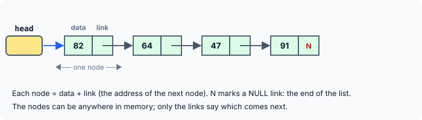
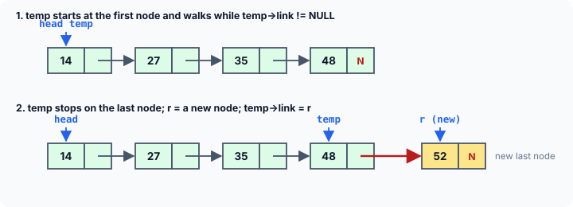
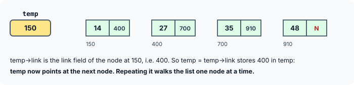
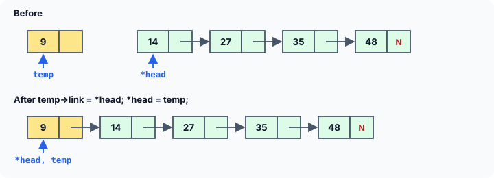
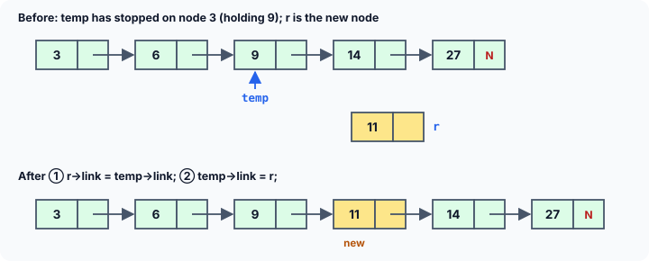
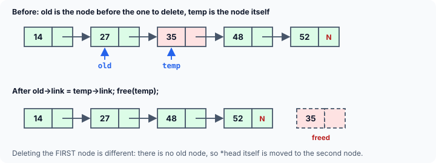

title : Linked Lists: Building a Singly Linked List

summary : A linked list stores data in nodes scattered through memory, chained together by pointers. Build one step by step: append, add at the beginning, insert after a node, display, count, delete and free, with diagrams of every link change and the reason functions take a struct node **.

# Linked Lists: Building a Singly Linked List

The last two articles introduced structures and pointers to structures. Put them together — a structure that contains a pointer to **another structure of the same type** — and you get one of the most important data structures in programming: the **linked list**.

A linked list is a very common way to store similar data in memory. While the elements of an array occupy **contiguous** memory locations, those of a linked list are not constrained to be stored in adjacent locations. The individual elements are stored "somewhere" in memory, rather like a family dispersed across different cities but still bound together. The order of the elements is maintained by **explicit links** between them.

For instance, the marks obtained by different students can be stored in a linked list like this:



Observe that a linked list is a collection of elements called **nodes**, each of which stores two items of information:

- an element of the list — the **data** part, here the marks of one student; and
- a **link** — a pointer, that is, an address — that explicitly indicates the location of the node containing the next element.

In the figure, the arrows represent the links. The `NULL` in the link of the last node (shown as `N`) indicates that it is the last node in the list. And one more pointer, outside the list, holds the address of the **first** node; without it, there would be no way to find the list at all.

## Why Not Just Use an Array?

| | Array | Linked list |
|---|---|---|
| Size | fixed when the array is created | grows and shrinks one node at a time |
| Memory | one contiguous block | each node allocated separately with `malloc` |
| Reach element *i* | instantly: `a[i]` | walk from the first node, *i* steps |
| Insert or delete in the middle | shift all following elements | change two or three links |
| Extra memory | none | one pointer per node |

Neither is better in general. A linked list is the right choice when the number of items is not known in advance, or when items are frequently inserted and removed; an array wins when items are mostly read, and reached by position.

## The Node

A node is a structure with a data member and a link to the next node:

```c
struct node
{
    int data;
    struct node *link;
};
```

`link` is a pointer to a `struct node` — a structure of the very type being declared. This is allowed because a pointer's size does not depend on what it points to; the compiler does not need to know the full contents of `struct node` to reserve space for a pointer to one. (A structure cannot contain a whole `struct node` **inside** itself — that would be infinitely large — but it can contain a pointer to one.) Such a structure is called **self-referential**.

## A Complete Linked List Program

There are several operations we can think of performing on a linked list. The following program builds a list by adding new nodes at the end, at the beginning and in the middle. It also contains a function `display()` that shows all the nodes, `count()` that counts them, `delete_node()` that can delete any node, and `free_list()` that releases the whole list at the end. Go through the program carefully, a step at a time; each function is explained in detail after it.

```c runnable
#include <stdio.h>
#include <stdlib.h>

/* a node: a data part and a link part */
struct node
{
    int data;
    struct node *link;
};

struct node *new_node(int num);
void append(struct node **q, int num);
void add_at_beg(struct node **q, int num);
void add_after(struct node *q, int loc, int num);
void display(const struct node *q);
int count(const struct node *q);
void delete_node(struct node **q, int num);
void free_list(struct node **q);

int main(void)
{
    struct node *p = NULL;                     /* empty linked list */

    printf("No. of elements in the linked list = %d\n", count(p));

    append(&p, 14);
    append(&p, 27);
    append(&p, 35);
    append(&p, 48);
    append(&p, 52);
    display(p);

    add_at_beg(&p, 9);
    add_at_beg(&p, 6);
    add_at_beg(&p, 3);
    display(p);

    add_after(p, 8, 60);                       /* after the 8th node */
    add_after(p, 3, 11);                       /* after the 3rd node */
    add_after(p, 1, 4);                        /* after the 1st node */
    add_after(p, 20, 99);                      /* there is no 20th node */
    display(p);
    printf("No. of elements in the linked list = %d\n", count(p));

    delete_node(&p, 3);                        /* the first node */
    delete_node(&p, 35);                       /* a node in the middle */
    delete_node(&p, 60);                       /* the last node */
    delete_node(&p, 77);                       /* not in the list */
    display(p);
    printf("No. of elements in the linked list = %d\n", count(p));

    free_list(&p);
    return 0;
}

/* creates a node holding num, with an empty link */
struct node *new_node(int num)
{
    struct node *r = malloc(sizeof *r);
    if (r == NULL) {
        printf("Out of memory\n");
        exit(EXIT_FAILURE);
    }
    r->data = num;
    r->link = NULL;
    return r;
}

/* adds a node at the end of the linked list */
void append(struct node **q, int num)
{
    struct node *temp, *r;

    if (*q == NULL) {                          /* the list is empty: */
        *q = new_node(num);                    /* the new node is the first node */
        return;
    }

    temp = *q;
    while (temp->link != NULL)                 /* go to the last node */
        temp = temp->link;

    r = new_node(num);                         /* add the node at the end */
    temp->link = r;
}

/* adds a new node at the beginning of the linked list */
void add_at_beg(struct node **q, int num)
{
    struct node *temp = new_node(num);

    temp->link = *q;                           /* new node points to the old first node */
    *q = temp;                                 /* and becomes the first node */
}

/* adds a new node after node number loc (1 = the first node) */
void add_after(struct node *q, int loc, int num)
{
    struct node *temp = q, *r;

    /* skip to the loc-th node */
    for (int i = 1; i < loc && temp != NULL; i++)
        temp = temp->link;

    if (loc < 1 || temp == NULL) {             /* no such node */
        printf("There are less than %d elements in the list\n", loc);
        return;
    }

    /* insert the new node after temp */
    r = new_node(num);
    r->link = temp->link;
    temp->link = r;
}

/* displays the contents of the linked list */
void display(const struct node *q)
{
    while (q != NULL) {                        /* traverse the entire list */
        printf("%d ", q->data);
        q = q->link;
    }
    printf("\n");
}

/* counts the number of nodes in the linked list */
int count(const struct node *q)
{
    int c = 0;

    while (q != NULL) {                        /* traverse the entire list */
        q = q->link;
        c++;
    }
    return c;
}

/* deletes the first node holding num */
void delete_node(struct node **q, int num)
{
    struct node *old = NULL, *temp = *q;

    while (temp != NULL) {
        if (temp->data == num) {
            if (temp == *q)                    /* it is the first node */
                *q = temp->link;
            else                               /* it is any other node */
                old->link = temp->link;
            free(temp);                        /* release the node's memory */
            return;
        }
        old = temp;                            /* old points to the previous node */
        temp = temp->link;                     /* go to the next node */
    }
    printf("Element %d not found\n", num);
}

/* frees every node, leaving an empty list */
void free_list(struct node **q)
{
    while (*q != NULL) {
        struct node *next = (*q)->link;        /* save the link before freeing */
        free(*q);
        *q = next;
    }
}
```

```
No. of elements in the linked list = 0
14 27 35 48 52 
3 6 9 14 27 35 48 52 
There are less than 20 elements in the list
3 4 6 9 11 14 27 35 48 52 60 
No. of elements in the linked list = 11
Element 77 not found
4 6 9 11 14 27 48 52 
No. of elements in the linked list = 8
```

## How the Program Works

### The list pointer p

To begin with, we have defined a structure for a node, containing a data part and a link part. The variable `p` in `main` is declared as a pointer to a node, and it is used as a pointer to the **first node** of the list. No matter how many nodes get added, `p` continues to point to the first node. When the list has no nodes at all, `p` is set to `NULL` to indicate that the list is empty — which is why the very first `count(p)` reports 0.

### Why some functions take struct node **

Look at the function headers. `display` and `count` take a `struct node *`, but `append`, `add_at_beg`, `delete_node` and `free_list` take a `struct node **` — a pointer to a pointer — and are called with `&p`.

The reason is that these functions may need to **change `p` itself**. When the first node is added to an empty list, or a node is added at the beginning, or the first node is deleted, the list starts at a different node, so `p` must hold a different address. A function receives copies of its arguments; to change a variable of the caller — here the pointer `p` — it must be given that variable's address. Inside the function, `*q` **is** `p`: reading `*q` gives the address of the first node, and assigning to `*q` changes `p` in `main`.

`display` and `count` only **read** the list, so a copy of `p` is enough. They even move their copy (`q = q->link`) as they walk, without affecting `p`. `add_after` also takes a plain pointer: it never adds a node in front of the first one, so the first node never changes.

### new_node(): creating a node

Every function that adds a node needs a new one, so `new_node` does that job in one place. `malloc(sizeof *r)` allocates space for one `struct node` — the size of what `r` points to — and returns its address. If memory has run out, `malloc` returns `NULL`, and the program stops with a message rather than writing through a `NULL` pointer. Otherwise the data part is filled with `num` and the link with `NULL`, since a new node is not yet linked to anything.

### append(): adding a node at the end

`append` has to deal with two situations:

**(a) The node is being added to an empty list.** In this case the condition `if (*q == NULL)` is satisfied. A new node is created and `*q` — which is `p` — is made to point to it. Since this is the first node of the list, `p` must point to it.

**(b) The node is being added at the end of an existing list.** Now `*q` is not `NULL`, so `temp` is made to point to the first node through `temp = *q;`. Then `temp` walks along the list:

```c
while (temp->link != NULL)
    temp = temp->link;
```

When `temp` reaches the last node, the condition `temp->link != NULL` fails, because the last node's link is `NULL`. Outside the loop, a new node `r` is created; it will be the new last node, so its link is `NULL`. All that remains is to connect the previous last node to it, through `temp->link = r;`.



### How temp = temp->link moves to the next node

There is often confusion about how the statement `temp = temp->link` makes `temp` point to the next node in the list. Let us understand it with an example. Suppose the list has 4 nodes, and `temp` is pointing at the first one. Instead of showing the links as arrows, this figure shows the **address** stored in each link:



When we execute `temp = temp->link;`, the right-hand side `temp->link` is the link field of the node at address 150, which holds **400**. This address is now stored in `temp`. As a result, `temp` starts pointing to the node at address 400. In effect, the statement has shifted `temp` so that it points to the next node in the list. Do it again, and `temp` holds 700; once more, 910; and once more, `NULL`.

### add_at_beg(): adding a node at the beginning

Suppose there are already some nodes in the list and we wish to add a new node at the beginning. First a new node is created, holding the data. Now we need to make the link part of this node point to the existing first node:

```c
temp->link = *q;
```

Lastly, the new node must become the first node of the list:

```c
*q = temp;
```



The order of these two statements matters. If `*q = temp;` came first, the address of the old first node would be overwritten before it was saved in `temp->link`, and the whole old list would be lost.

Notice that `add_at_beg` also works on an **empty** list: `*q` is then `NULL`, so the new node's link becomes `NULL` and it is the only node.

### add_after(): inserting in the middle

`add_after` adds a new node after a given node of the list — after node number `loc`, counting the first node as 1. To begin with, a loop skips forward to node number `loc`. Suppose we wish to add a node containing 11 after the 3rd node of the list. The positions of the pointers once control reaches outside the loop, and after the insertion, are shown below:



A new node `r` is created with 11 in its data part. All that remains is to readjust the links so that 11 goes in between 9 and 14:

```c
r->link = temp->link;
temp->link = r;
```

The first statement makes the link of the new node point to the node containing 14 — the node that used to follow 9. The second makes the link of the node containing 9 point to the new node. At that moment the old link between 9 and 14 is replaced: 9 no longer points to 14, it points to 11. Again the order matters: doing the second statement first would lose the address of 14.

If the list has fewer than `loc` nodes, `temp` becomes `NULL` before reaching node `loc`, and a message is printed instead. That is what happened with `add_after(p, 20, 99)`. The test `loc < 1` rejects nonsense positions such as 0.

### display() and count()

These two are straightforward. Each walks through the list with `q = q->link` until `q` becomes `NULL`: `display` prints each node's data on the way, and `count` adds 1 for each node it passes. They take a `const struct node *`, which promises that they do not change the nodes.

### delete_node(): removing a node

`delete_node` traverses the entire list with a `while` loop, checking at each node whether it holds the value to be deleted. Two pointers walk together: `temp` points to the current node and `old` to the node **before** it. This is needed because, in a singly linked list, a node has no link back to its predecessor; to remove a node, it is the predecessor's link that must be changed.

If the node to be deleted is the **first** node of the list, there is no predecessor. Instead, `*q` — that is, `p` — is simply shifted to the next node, and then the earlier first node is freed.

If it is any **other** node, the link of the previous node is made to skip over it:

```c
old->link = temp->link;
free(temp);
```



`free(temp)` returns the node's memory to the system. This is essential: every node was created with `malloc`, and memory that is never freed is lost for the rest of the program's run — a **memory leak**. After the `free`, `temp` must not be used again. If the loop reaches the end without finding the value, a message is printed.

### free_list(): releasing the whole list

When the program no longer needs the list, every node must be freed. `free_list` frees the first node, moves `*q` to the next, and repeats. It must save the link **before** freeing the node: once a node is freed, reading `(*q)->link` would be reading freed memory. At the end, `*q` — that is, `p` — is `NULL`, correctly marking the list as empty.

:::callout
Older programs often leave out `free_list`, because the operating system reclaims all memory when a program ends. In a short demo that is harmless, but in a long-running program — a server, an editor, a game — nodes that are never freed add up until memory runs out. Make freeing part of the design from the start. Tools such as AddressSanitizer and Valgrind report any blocks still allocated when the program ends.
:::

## Linked Lists of Other Data

A common and wrong impression that beginners carry is that a linked list is used only for storing integers. A linked list can store **any** kind of data; only the data part of the node changes:

```c
struct fnode                   /* a linked list of floats */
{
    float value;
    struct fnode *link;
};

struct name_node               /* a linked list of names */
{
    char name[20];
    struct name_node *link;
};

struct employee                /* a linked list of records */
{
    char name[20];
    int age;
    float salary;
    struct employee *link;
};
```

The functions stay almost the same: they only ever look at the `link` member to move along the list. Here, for example, is a list of employee records:

```c runnable
#include <stdio.h>
#include <stdlib.h>
#include <string.h>

struct employee
{
    char name[20];
    int age;
    float salary;
    struct employee *link;
};

void add_at_beg(struct employee **q, const char *name, int age, float salary)
{
    struct employee *e = malloc(sizeof *e);
    if (e == NULL)
        exit(EXIT_FAILURE);

    snprintf(e->name, sizeof e->name, "%s", name);
    e->age = age;
    e->salary = salary;
    e->link = *q;
    *q = e;
}

int main(void)
{
    struct employee *staff = NULL;

    add_at_beg(&staff, "Renu", 25, 7000.0f);
    add_at_beg(&staff, "Nimish", 28, 3000.0f);
    add_at_beg(&staff, "Rama", 30, 9000.0f);
    add_at_beg(&staff, "Ajay", 24, 5000.0f);

    for (const struct employee *e = staff; e != NULL; e = e->link)
        printf("%-8s %2d %8.2f\n", e->name, e->age, e->salary);

    while (staff != NULL) {                    /* free every record */
        struct employee *next = staff->link;
        free(staff);
        staff = next;
    }
    return 0;
}
```

```
Ajay     24  5000.00
Rama     30  9000.00
Nimish   28  3000.00
Renu     25  7000.00
```

Because each record is added at the beginning, they come out in reverse order of addition. The `for` loop is a compact way of writing the familiar traversal: start at the first node, stop at `NULL`, step with `e = e->link`.

## Key Takeaways

- A linked list is a chain of nodes. Each node holds data and a **link**, the address of the next node; the last link is `NULL`. A separate pointer holds the address of the first node; `NULL` there means an empty list.
- A node is a **self-referential structure**: it contains a pointer to its own type.
- Nodes are created with `malloc` and must be released with `free`; deleting a node without freeing it, or never freeing the list, leaks memory.
- `p = p->link` moves a pointer to the next node. Walking until `NULL` visits every node.
- A function that may change which node is first takes the **address** of the list pointer (`struct node **`) and works through `*q`.
- Inserting and deleting only re-link nodes; the order of the link assignments matters, so that no address is lost.
- To delete a node from a singly linked list, you need the node **before** it.

## Practice Questions

:::details[In add_at_beg, what goes wrong if the two statements are swapped: *q = temp; temp->link = *q;?]
After `*q = temp;`, `*q` is the new node, so `temp->link = *q;` makes the new node point to **itself**. The address of the old first node is lost, so the rest of the list is unreachable (and leaked), and traversing the list loops forever on one node.
:::

:::details[Why does count() take struct node * while append() takes struct node **?]
`count` only reads the list, so a copy of the pointer to the first node is enough. `append` may have to change that pointer — when the list is empty, the new node becomes the first node — and a function can only change the caller's variable through its address.
:::

:::details[Write a function int sum(const struct node *q) that returns the total of all data values.]
```c
int sum(const struct node *q)
{
    int total = 0;

    for (; q != NULL; q = q->link)
        total += q->data;
    return total;
}
```
:::

:::details[What is wrong with this loop for freeing a list? for (struct node *t = p; t != NULL; t = t->link) free(t);]
After `free(t)`, the loop's increment reads `t->link` — a member of a node that has just been freed. That is a use-after-free: undefined behaviour. Save the link first: `while (p) { struct node *next = p->link; free(p); p = next; }`.
:::

:::details[How many links must change to delete a node from the middle of a singly linked list, and which pointer do you need to find first?]
One link changes: the link of the node **before** the one being deleted is set to the node after it. So you must first find that previous node, which is why `delete_node` keeps the `old` pointer one step behind `temp`.
:::
