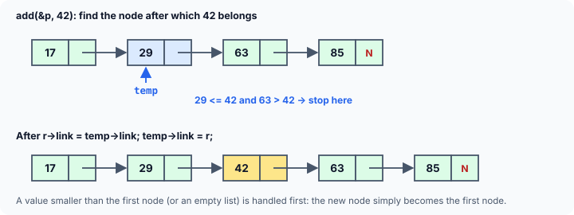
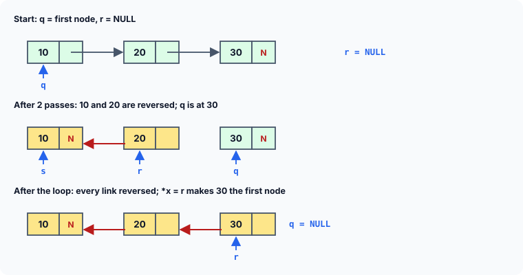

title : Sorted Linked Lists and Reversing a List

summary : Keep a linked list in ascending order as nodes are added, by finding the right gap and splicing the new node in. Then reverse a whole list in place with three pointers. Includes a short-circuit bug that crashes the classic version, and a neat pointer-to-pointer technique.

# Sorted Linked Lists and Reversing a List

The previous article built a linked list and added nodes at the beginning, at the end and after a given node. Now that we understand how a linked list is maintained, two natural questions follow:

1. How about making sure that every element added to the list is inserted at the right place, so that the list is **always in ascending order**?
2. How about **reversing** the links of an existing list, so that the last node becomes the first and the first becomes the last?

Both are classic linked-list exercises, and both are really exercises in moving pointers in the right order.

## Keeping a List in Ascending Order

Here is a program in which `add()` inserts each new value at its correct position, so the list is sorted no matter in which order the values arrive. `display()`, `count()` and `delete_node()` are the same as in the previous article.

```c runnable
#include <stdio.h>
#include <stdlib.h>

struct node
{
    int data;
    struct node *link;
};

void add(struct node **q, int num);
void display(const struct node *q);
int count(const struct node *q);
void delete_node(struct node **q, int num);
void free_list(struct node **q);

int main(void)
{
    struct node *p = NULL;                     /* empty linked list */

    add(&p, 42);
    add(&p, 17);
    add(&p, 63);
    add(&p, 29);
    add(&p, 85);
    add(&p, 29);                               /* a duplicate */

    display(p);
    printf("No. of elements in the linked list = %d\n", count(p));

    delete_node(&p, 85);
    delete_node(&p, 29);
    delete_node(&p, 17);
    delete_node(&p, 90);

    display(p);
    printf("No. of elements in the linked list = %d\n", count(p));

    free_list(&p);
    return 0;
}

/* adds a node to an ascending-order linked list */
void add(struct node **q, int num)
{
    struct node *r, *temp = *q;

    r = malloc(sizeof *r);
    if (r == NULL)
        exit(EXIT_FAILURE);
    r->data = num;

    /* if the list is empty, or the new node goes before the first node */
    if (*q == NULL || (*q)->data > num) {
        r->link = *q;
        *q = r;
        return;
    }

    /* traverse the list to find the position to insert the new node */
    while (temp != NULL) {
        if (temp->data <= num &&
            (temp->link == NULL || temp->link->data > num)) {
            r->link = temp->link;
            temp->link = r;
            return;
        }
        temp = temp->link;                     /* go to the next node */
    }
}

/* displays the contents of the linked list */
void display(const struct node *q)
{
    for (; q != NULL; q = q->link)
        printf("%d ", q->data);
    printf("\n");
}

/* counts the number of nodes in the linked list */
int count(const struct node *q)
{
    int c = 0;

    for (; q != NULL; q = q->link)
        c++;
    return c;
}

/* deletes the first node holding num */
void delete_node(struct node **q, int num)
{
    struct node *old = NULL, *temp = *q;

    while (temp != NULL) {
        if (temp->data == num) {
            if (temp == *q)                    /* the first node */
                *q = temp->link;
            else                               /* any other node */
                old->link = temp->link;
            free(temp);
            return;
        }
        old = temp;
        temp = temp->link;
    }
    printf("Element %d not found\n", num);
}

/* frees every node, leaving an empty list */
void free_list(struct node **q)
{
    while (*q != NULL) {
        struct node *next = (*q)->link;
        free(*q);
        *q = next;
    }
}
```

```
17 29 29 42 63 85 
No. of elements in the linked list = 6
Element 90 not found
29 42 63 
No. of elements in the linked list = 3
```

The values were added in the order 42, 17, 63, 29, 85, 29, yet the list is displayed in ascending order. After deleting 85 (the last node), one of the 29s and 17 (the first node), and failing to find 90, three nodes remain.

### How add() finds the right place

A new node holding `num` is created first. Then there are two cases.

**The new node becomes the first node.** This happens when the list is empty (`*q == NULL`), or when `num` is smaller than the data in the current first node. Either way, the new node is linked in front of the old first node — or to `NULL` for an empty list — and `*q` is made to point to it. This is exactly the "add at the beginning" operation from the previous article.

**The new node goes after some node.** Otherwise, `temp` walks along the list looking for the node **after which** `num` belongs. That is the node whose data is less than or equal to `num`, and that is either the last node or followed by a node whose data is greater than `num`:

```c
if (temp->data <= num &&
    (temp->link == NULL || temp->link->data > num))
```

When it is found, the new node is spliced in after `temp`, with the same two statements used by `add_after`:



Because the test uses `<=`, a value equal to an existing one is placed **after** it. So duplicates keep the order in which they were added (the second 29 goes after the first) — a property called being **stable**.

### Why the order of the test matters

Look closely at the inner condition: `temp->link == NULL || temp->link->data > num`. The `||` operator evaluates its left side first, and **only if that is false** does it evaluate the right side. This is called **short-circuit evaluation**, and here it is what keeps the program safe:

- If `temp` is the last node, `temp->link == NULL` is true, so the whole condition is true and `temp->link->data` is never evaluated.
- Only when there **is** a next node does the program look at its data.

:::callout
Older books write the condition the other way round: `temp->link->data > num || temp->link == NULL`. That version reads `temp->link->data` **before** checking whether `temp->link` is `NULL`. As soon as a value larger than every node in the list is added, `temp` reaches the last node, and the program follows a `NULL` pointer — undefined behaviour, which on a modern system is an immediate crash (a segmentation fault). Older systems often let a `NULL` read return garbage silently, which is how the bug went unnoticed. **When a condition checks a pointer and also uses it, the check must come first.**
:::

### A shorter version with a pointer to a pointer

The function above handles "insert at the front" and "insert after a node" as two separate cases. There is a neat technique that merges them, using a pointer to a **link** rather than a pointer to a node:

```c runnable
#include <stdio.h>
#include <stdlib.h>

struct node
{
    int data;
    struct node *link;
};

void add(struct node **q, int num)
{
    struct node *r = malloc(sizeof *r);
    if (r == NULL)
        exit(EXIT_FAILURE);
    r->data = num;

    /* q points at a link: first at the list pointer, then at each node's link */
    while (*q != NULL && (*q)->data <= num)
        q = &(*q)->link;

    r->link = *q;                              /* the node that should follow r */
    *q = r;                                    /* the link that should point to r */
}

int main(void)
{
    struct node *p = NULL;
    int values[] = {42, 17, 63, 29, 85, 29};

    for (int i = 0; i < 6; i++)
        add(&p, values[i]);

    for (const struct node *t = p; t != NULL; t = t->link)
        printf("%d ", t->data);
    printf("\n");

    while (p != NULL) {
        struct node *next = p->link;
        free(p);
        p = next;
    }
    return 0;
}
```

```
17 29 29 42 63 85 
```

Here `q` is a `struct node **`. It starts out pointing at `p` itself — the link that leads to the first node. Each step of the loop, `q = &(*q)->link;`, makes it point at the `link` member of the next node instead. When the loop stops, `*q` is exactly the link that must be changed to point to the new node — whether that link is `p` (insert at the front) or some node's `link` (insert in the middle or at the end). No special case is needed.

This idea — iterating over the **links** rather than the nodes — is widely used in experienced C code. It also simplifies deletion: when `*q` is the node to remove, `*q = (*q)->link;` unlinks it, wherever it is.

## Reversing a Linked List

Next, reversing the links in an existing list, so that the last node becomes the first. No node is copied or moved; only the links are turned around.

```c runnable
#include <stdio.h>
#include <stdlib.h>

struct node
{
    int data;
    struct node *link;
};

void add_at_beg(struct node **q, int num);
void reverse(struct node **x);
void display(const struct node *q);
int count(const struct node *q);
void free_list(struct node **q);

int main(void)
{
    struct node *p = NULL;                     /* empty linked list */

    add_at_beg(&p, 10);
    add_at_beg(&p, 20);
    add_at_beg(&p, 30);
    add_at_beg(&p, 40);
    add_at_beg(&p, 50);
    add_at_beg(&p, 60);

    display(p);
    printf("No. of elements in the linked list = %d\n", count(p));

    reverse(&p);
    display(p);
    printf("No. of elements in the linked list = %d\n", count(p));

    free_list(&p);
    return 0;
}

/* adds a new node at the beginning of the linked list */
void add_at_beg(struct node **q, int num)
{
    struct node *temp = malloc(sizeof *temp);
    if (temp == NULL)
        exit(EXIT_FAILURE);

    temp->data = num;
    temp->link = *q;
    *q = temp;
}

/* reverses the links of the list */
void reverse(struct node **x)
{
    struct node *q = *x, *r = NULL, *s;

    /* traverse the entire linked list */
    while (q != NULL) {
        s = r;                                 /* s: the node before r      */
        r = q;                                 /* r: the node being turned  */
        q = q->link;                           /* q: the rest of the list   */
        r->link = s;                           /* turn r's link backwards   */
    }
    *x = r;                                    /* the old last node is now first */
}

/* displays the contents of the linked list */
void display(const struct node *q)
{
    for (; q != NULL; q = q->link)
        printf("%d ", q->data);
    printf("\n");
}

/* counts the number of nodes in the linked list */
int count(const struct node *q)
{
    int c = 0;

    for (; q != NULL; q = q->link)
        c++;
    return c;
}

/* frees every node, leaving an empty list */
void free_list(struct node **q)
{
    while (*q != NULL) {
        struct node *next = (*q)->link;
        free(*q);
        *q = next;
    }
}
```

```
60 50 40 30 20 10 
No. of elements in the linked list = 6
10 20 30 40 50 60 
No. of elements in the linked list = 6
```

Because every node was added at the beginning, the list is built "backwards": 60 50 40 30 20 10. After `reverse`, it reads 10 20 30 40 50 60. The count is unchanged — reversing never adds or removes nodes.

### How the three pointers work

The difficulty in reversing a singly linked list is this: when we turn a node's link around to point to its predecessor, we **overwrite** the only record of where the rest of the list is. So `reverse` uses three pointers:

- `q` — the part of the list **not yet** reversed (it starts at the first node);
- `r` — the node **currently** being reversed;
- `s` — the node **before** `r`, which `r`'s link must now point to.

Each time through the loop, the four statements do this, in this order:

1. `s = r;` — the node reversed last time becomes "the node before".
2. `r = q;` — the next unreversed node becomes the current node.
3. `q = q->link;` — **save** the rest of the list, before `r`'s link is changed.
4. `r->link = s;` — turn `r`'s link backwards.

Step 3 must come before step 4: once `r->link` is overwritten, the rest of the list could no longer be reached. Here is the process on a three-node list:



- On the first pass, `r` becomes the first node (10), `q` moves to 20, and 10's link is set to `s`, which is `NULL`. The old first node is now the last node, so its link must be `NULL` — and it is.
- On each later pass, the next node's link is turned to point at the previous one.
- When `q` becomes `NULL`, every link has been reversed, and `r` points to what was the last node. `*x = r;` makes it the new first node. As in the earlier functions, `x` is the address of `p`, so this changes `p` in `main`.

The function also works for the edge cases without any special code: an empty list (the loop never runs, `r` stays `NULL`, and `p` stays `NULL`) and a single node (one pass sets its link to `NULL`, and it stays first).

Reversing visits each node once, so it takes time proportional to the length of the list, and it needs only three extra pointers, however long the list is.

## Key Takeaways

- To keep a list sorted, insert each new node after the last node whose data is `<=` the new value; if the list is empty or the new value is smaller than the first node, insert at the front.
- In a condition such as `p->link == NULL || p->link->data > num`, the `NULL` check must come **first**: `||` and `&&` evaluate left to right and stop as soon as the answer is known.
- A `struct node **` that walks over the **links** (`q = &(*q)->link`) removes the special case for the first node.
- Reversing a list turns each link around. Save the rest of the list (`q = q->link`) **before** overwriting the current node's link; at the end, the old last node becomes the first.

## Practice Questions

:::details[In the sorted add(), why is (*q)->data > num checked only after *q == NULL?]
For an empty list, `*q` is `NULL`, and `(*q)->data` would follow a `NULL` pointer. Because `||` stops as soon as its left side is true, writing the `NULL` check first guarantees that `(*q)->data` is only read when there is a first node.
:::

:::details[If the condition in add() used < instead of <=, where would a duplicate value be inserted?]
`temp` would stop at a node whose data is less than `num`, so a new value equal to existing ones would be inserted **before** all of them rather than after. The list would still be sorted; only the order among equal values changes.
:::

:::details[In reverse(), what happens if steps 3 and 4 are swapped, i.e. r->link = s; is done before q = q->link;?]
After `r->link = s;`, `q->link` (which is `r->link`, since `q` and `r` point to the same node) has just been changed to `s`. So `q = q->link;` moves `q` backwards to `s` instead of forwards. The rest of the list is lost, and the loop never progresses correctly.
:::

:::details[Write a function that returns the largest value in a sorted (ascending) linked list.]
In an ascending list the largest value is in the last node:
```c
int largest(const struct node *q)       /* q must not be NULL */
{
    while (q->link != NULL)
        q = q->link;
    return q->data;
}
```
:::

:::details[How could you print a linked list in reverse order without changing any links?]
With recursion: print the rest of the list first, then the current node.
```c
void print_reverse(const struct node *q)
{
    if (q == NULL)
        return;
    print_reverse(q->link);
    printf("%d ", q->data);
}
```
Each call waits on the stack until the calls for the following nodes have printed. (For a very long list this uses a lot of stack space; reversing in place does not.)
:::
