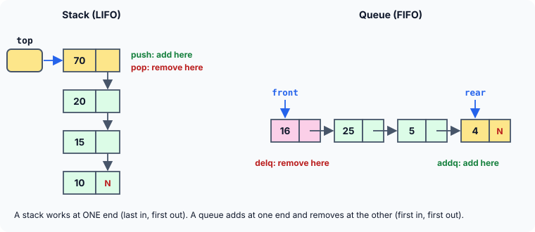
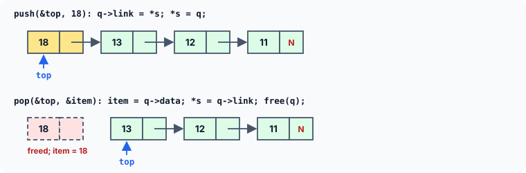
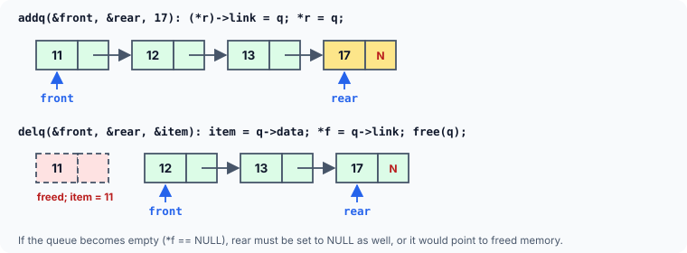
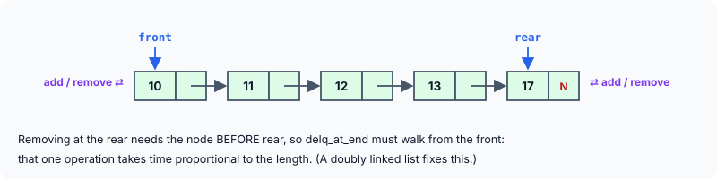

title : Stacks, Queues and Deques with Linked Lists

summary : Build a stack (last in, first out), a queue (first in, first out) and a deque (both ends) on top of linked lists, so they can grow without a fixed size. Learn push, pop, enqueue and dequeue, why front and rear must stay in sync, and how to report an empty structure safely.

# Stacks, Queues and Deques with Linked Lists

Stacks and queues are two very common and popular data structures. They are often implemented using **arrays**, since most programming languages provide arrays as a predefined data type, and such an implementation is therefore quite easy. However, when implemented as an array, these data structures suffer from the basic limitation of an array: its size cannot be increased or decreased once it is declared. As a result, you end up reserving either too much space or too little for the array, and in turn for the stack or queue.

This difficulty disappears when we implement these data structures using **linked lists**: they then grow one node at a time, exactly as far as needed, and give memory back as items are removed.

## What Are Stacks and Queues?

A **stack** is a data structure in which the addition of a new element, and the deletion of an existing element, always take place at the **same end**. This end is known as the **top** of the stack. A stack can be compared to a pile of plates in a cafeteria: every new plate is added at the top, and every plate taken off the pile is also taken from the top. Because the last element added is the first one removed, a stack is called a **Last-In-First-Out (LIFO)** structure.

Stacks have many applications. When one function calls another, the computer keeps track of where to return to on a stack — which is what makes recursion possible. Stacks are also used to evaluate arithmetic expressions, to check that brackets are balanced, and to implement "undo" in editors.

Unlike a stack, in a **queue** the addition of a new element takes place at one end, called the **rear** of the queue, whereas deletion takes place at the other end, called the **front**. It works like a queue of people at a ticket counter: the first to join is the first to be served. A queue is therefore called a **First-In-First-Out (FIFO)** structure. Queues are used wherever things must be handled in order of arrival: print jobs waiting for a printer, keystrokes waiting to be read, tasks waiting for a processor.



The figure shows how both look as linked lists. The stack needs one pointer, `top`, to its first node. The queue needs two: `front`, where items leave, and `rear`, where they join.

## A Stack as a Linked List

```c runnable
#include <stdio.h>
#include <stdlib.h>
#include <stdbool.h>

struct node
{
    int data;
    struct node *link;
};

void push(struct node **s, int item);
bool pop(struct node **s, int *item);
void stack_display(const struct node *q);
int count(const struct node *q);

int main(void)
{
    struct node *top = NULL;                   /* top always points to the top of the stack */
    int item;

    push(&top, 31);
    push(&top, 32);
    push(&top, 33);
    push(&top, 34);
    push(&top, 35);
    push(&top, 36);
    push(&top, 37);

    stack_display(top);
    printf("No. of items in stack = %d\n", count(top));

    printf("Items extracted from stack: ");
    for (int i = 0; i < 3; i++)
        if (pop(&top, &item))
            printf("%d ", item);
    printf("\n");

    stack_display(top);
    printf("No. of items in stack = %d\n", count(top));

    while (pop(&top, &item))                   /* empty the stack */
        ;
    if (!pop(&top, &item))
        printf("Stack is empty\n");
    return 0;
}

/* adds a new element on the top of the stack */
void push(struct node **s, int item)
{
    struct node *q = malloc(sizeof *q);
    if (q == NULL) {
        printf("Stack overflow: out of memory\n");
        exit(EXIT_FAILURE);
    }
    q->data = item;
    q->link = *s;                              /* new node points to the old top */
    *s = q;                                    /* and becomes the new top */
}

/* removes the element on the top of the stack;
   returns false if the stack is empty */
bool pop(struct node **s, int *item)
{
    struct node *q = *s;

    if (q == NULL)                             /* the stack is empty */
        return false;

    *item = q->data;                           /* save the value */
    *s = q->link;                              /* the next node becomes the top */
    free(q);
    return true;
}

/* displays the whole stack, top first */
void stack_display(const struct node *q)
{
    for (; q != NULL; q = q->link)
        printf("%2d ", q->data);
    printf("\n");
}

/* counts the nodes in the stack */
int count(const struct node *q)
{
    int c = 0;

    for (; q != NULL; q = q->link)
        c++;
    return c;
}
```

```
37 36 35 34 33 32 31 
No. of items in stack = 7
Items extracted from stack: 37 36 35 
34 33 32 31 
No. of items in stack = 4
Stack is empty
```

The items were pushed in the order 31 to 37, and they are displayed — and popped — in the opposite order. The last item pushed, 37, is the first popped.

If you observe carefully, you will notice that **pushing is just adding a node at the beginning of a linked list, and popping is deleting the node at the beginning**. Both take the same small amount of time however big the stack is, since neither has to walk the list.



### Reporting an empty stack

What should `pop` do when the stack is empty? There is no value to return. Older programs print *"stack is empty"* inside `pop` and then simply fall off the end of the function without returning anything — but the caller still uses the "returned" value, which is then garbage. In C, using the value of a function that did not return one is undefined behaviour.

Here `pop` returns a `bool` (from `<stdbool.h>`) saying whether it succeeded, and passes the popped value back through the pointer `item`. The caller decides what to do about an empty stack — and in `main`, `while (pop(&top, &item));` uses this to empty the stack, which also frees every node. Another common design is to return the value and have a separate `is_empty()` function that callers must check first.

## A Queue as a Linked List

```c runnable
#include <stdio.h>
#include <stdlib.h>
#include <stdbool.h>

struct node
{
    int data;
    struct node *link;
};

void addq(struct node **f, struct node **r, int item);
bool delq(struct node **f, struct node **r, int *item);
void q_display(const struct node *q);
int count(const struct node *q);

int main(void)
{
    struct node *front = NULL, *rear = NULL;   /* empty queue */
    int item;

    addq(&front, &rear, 31);
    addq(&front, &rear, 32);
    addq(&front, &rear, 33);
    addq(&front, &rear, 34);
    addq(&front, &rear, 35);
    addq(&front, &rear, 36);
    addq(&front, &rear, 37);

    q_display(front);
    printf("No. of items in queue = %d\n", count(front));

    printf("Items extracted from queue: ");
    for (int i = 0; i < 3; i++)
        if (delq(&front, &rear, &item))
            printf("%d ", item);
    printf("\n");

    q_display(front);
    printf("No. of items in queue = %d\n", count(front));

    while (delq(&front, &rear, &item))         /* empty the queue */
        ;
    printf("front %s NULL, rear %s NULL\n",
           front == NULL ? "is" : "is not", rear == NULL ? "is" : "is not");
    return 0;
}

/* adds a new element at the rear of the queue */
void addq(struct node **f, struct node **r, int item)
{
    struct node *q = malloc(sizeof *q);
    if (q == NULL) {
        printf("Out of memory\n");
        exit(EXIT_FAILURE);
    }
    q->data = item;
    q->link = NULL;                            /* it will be the last node */

    if (*f == NULL)                            /* the queue is empty */
        *f = q;
    else
        (*r)->link = q;                        /* link it after the old rear */

    *r = q;                                    /* it is the new rear */
}

/* removes the element at the front of the queue;
   returns false if the queue is empty */
bool delq(struct node **f, struct node **r, int *item)
{
    struct node *q = *f;

    if (q == NULL)                             /* the queue is empty */
        return false;

    *item = q->data;
    *f = q->link;                              /* the next node is the new front */
    free(q);

    if (*f == NULL)                            /* the queue has become empty */
        *r = NULL;
    return true;
}

/* displays all elements of the queue */
void q_display(const struct node *q)
{
    printf("front -> ");
    for (; q != NULL; q = q->link)
        printf("%2d ", q->data);
    printf("<- rear\n");
}

/* counts the nodes in the queue */
int count(const struct node *q)
{
    int c = 0;

    for (; q != NULL; q = q->link)
        c++;
    return c;
}
```

```
front -> 31 32 33 34 35 36 37 <- rear
No. of items in queue = 7
Items extracted from queue: 31 32 33 
front -> 34 35 36 37 <- rear
No. of items in queue = 4
front is NULL, rear is NULL
```

This time the items come out in the **same** order they went in: 31, 32 and 33 were added first, and they are the first removed.

To begin with, `front` and `rear` are both set to `NULL` to indicate that the queue is empty.

**Adding** a node to a queue is similar to adding a node at the end of a linked list — with one big improvement. In the previous article, `append` had to walk through the whole list to find the last node. Here the `rear` pointer always points to the last node, so the new node is linked after it at once: `(*r)->link = q;`. After adding a new node, `rear` is made to point to it. When the queue is empty there is no last node to link from, so the new node becomes the `front` as well.

**Deleting** a node from a queue is the same as deleting the first node of a linked list: the value is saved, `front` moves to the next node, and the old node is freed.



### Keep front and rear in step

There is one subtle case. If, on deletion of a node, the queue becomes **empty**, then `front` becomes `NULL` — but `rear` still holds the address of the node that has just been freed. Such a pointer is called a **dangling pointer**. `addq` happens to be safe, because it checks `front` first. But any other code that trusts `rear` — a function that peeks at the last item, or a later version of `addq` that tests `rear` instead of `front` — would read or write freed memory.

That is why `delq` sets `*r = NULL` when the queue becomes empty, so that both pointers agree that the queue is empty; the last line of the program confirms it. Two pointers that describe the same structure must always be updated together.

`q_display` marks the two ends of the queue. (Older versions of this function print the `<- rear` marker **before** the last value, so it ends up glued to it. Printing it after the loop puts it where it belongs.)

## A Deque: Adding and Removing at Both Ends

A **deque** (pronounced "deck", short for *double-ended queue*) is a queue in which elements can be added or deleted at **both** ends: the front and the rear. Since the addition and deletion of nodes have been discussed in detail already, the following program combines those operations.



```c runnable
#include <stdio.h>
#include <stdlib.h>
#include <stdbool.h>

struct node
{
    int data;
    struct node *link;
};

void addq_at_end(struct node **f, struct node **r, int item);
void addq_at_beg(struct node **f, struct node **r, int item);
bool delq_at_beg(struct node **f, struct node **r, int *item);
bool delq_at_end(struct node **f, struct node **r, int *item);
void q_display(const struct node *q);

int main(void)
{
    struct node *front = NULL, *rear = NULL;   /* empty deque */
    int item;

    addq_at_end(&front, &rear, 31);
    addq_at_beg(&front, &rear, 30);
    addq_at_end(&front, &rear, 32);
    addq_at_end(&front, &rear, 33);
    addq_at_end(&front, &rear, 34);
    addq_at_end(&front, &rear, 35);
    q_display(front);

    printf("Items extracted: ");
    delq_at_beg(&front, &rear, &item); printf("%d ", item);
    delq_at_beg(&front, &rear, &item); printf("%d ", item);
    delq_at_end(&front, &rear, &item); printf("%d ", item);
    printf("\n");
    q_display(front);

    printf("Emptying from the rear: ");
    while (delq_at_end(&front, &rear, &item))
        printf("%d ", item);
    printf("\n");
    q_display(front);
    return 0;
}

/* adds a new element at the rear */
void addq_at_end(struct node **f, struct node **r, int item)
{
    struct node *q = malloc(sizeof *q);
    if (q == NULL)
        exit(EXIT_FAILURE);
    q->data = item;
    q->link = NULL;

    if (*f == NULL)
        *f = q;
    else
        (*r)->link = q;
    *r = q;
}

/* adds a new element at the front */
void addq_at_beg(struct node **f, struct node **r, int item)
{
    struct node *q = malloc(sizeof *q);
    if (q == NULL)
        exit(EXIT_FAILURE);
    q->data = item;
    q->link = *f;

    if (*f == NULL)                            /* the deque was empty */
        *r = q;
    *f = q;
}

/* removes the element at the front */
bool delq_at_beg(struct node **f, struct node **r, int *item)
{
    struct node *q = *f;

    if (q == NULL)
        return false;
    *item = q->data;
    *f = q->link;
    free(q);
    if (*f == NULL)                            /* the deque has become empty */
        *r = NULL;
    return true;
}

/* removes the element at the rear */
bool delq_at_end(struct node **f, struct node **r, int *item)
{
    struct node *q = *r, *before;

    if (q == NULL)                             /* the deque is empty */
        return false;
    *item = q->data;

    if (*f == *r) {                            /* only one node */
        *f = *r = NULL;
    } else {
        before = *f;                           /* find the node before rear */
        while (before->link != q)
            before = before->link;
        before->link = NULL;                   /* it becomes the last node */
        *r = before;
    }
    free(q);
    return true;
}

/* displays all elements */
void q_display(const struct node *q)
{
    printf("front -> ");
    for (; q != NULL; q = q->link)
        printf("%2d ", q->data);
    printf("<- rear\n");
}
```

```
front -> 30 31 32 33 34 35 <- rear
Items extracted: 30 31 35 
front -> 32 33 34 <- rear
Emptying from the rear: 34 33 32 
front -> <- rear
```

Three of the four operations are ones you have already seen: adding at the end is `addq`, adding at the beginning is the familiar `add_at_beg` (plus setting `rear` when the deque was empty), and removing from the front is `delq`.

The new operation is **removing from the rear**, and it has a cost. To make the second-to-last node the new rear, its link must be set to `NULL` — but in a singly linked list, nodes only point forwards, so the only way to find the node **before** `rear` is to walk from `front`. That makes `delq_at_end` the one operation whose time grows with the length of the deque.

The other point to notice is the special case of **a single node**. Then `front` and `rear` point to the same node, there is no "node before", and removing it must leave **both** pointers `NULL`.

:::callout
A widespread version of `delq_at_end` walks with `while (temp != *r) { rleft = temp; temp = temp->link; }` and then sets `*r = rleft;`. With only one node, `temp` equals `*r` immediately, the loop never runs, and `rleft` is used **without ever being given a value** — so the program writes through a garbage pointer. It also checks for emptiness only after `*r` has been overwritten, so `front` is never reset. Always test your data-structure functions on an empty structure and on a single element: that is where most of the bugs live.
:::

The next article introduces the **doubly linked list**, in which each node also points to the node before it. With that, removing from either end takes the same short time.

## Key Takeaways

- A **stack** is LIFO: push and pop both happen at the top. As a linked list, push is "add at the beginning" and pop is "delete the first node".
- A **queue** is FIFO: add at the rear, delete at the front. Keeping a `rear` pointer lets `addq` link a node without walking the list.
- A **deque** allows adding and removing at both ends. In a singly linked list, removing from the rear requires walking to the node before it.
- Linked implementations grow and shrink as needed, with no fixed capacity.
- When a structure has two end pointers, update them together: when the last node is removed, both `front` and `rear` must become `NULL`.
- Never let a function that "returns a value" fall off its end. Report "empty" explicitly, for example with a `bool` result and an output parameter.

## Practice Questions

:::details[Items 4, 7 and 1 are pushed onto an empty stack, then one item is popped and 9 is pushed. What does the stack hold, from the top?]
After the pushes, the stack is 1, 7, 4 (top first). Popping removes 1. Pushing 9 gives **9, 7, 4**.
:::

:::details[The same operations are done on a queue: add 4, 7, 1; delete one; add 9. What does the queue hold, from the front?]
After the adds, the queue is 4, 7, 1. Deleting removes 4 (the first in). Adding 9 gives **7, 1, 9**.
:::

:::details[Why does addq need the address of front as well as of rear?]
When the queue is empty, the new node becomes the first node too, so `front` must change. A function can only change the caller's `front` through its address.
:::

:::details[Write a function bool peek(const struct node *top, int *item) that gives the top item of a stack without removing it.]
```c
bool peek(const struct node *top, int *item)
{
    if (top == NULL)
        return false;
    *item = top->data;
    return true;
}
```
It takes a plain pointer, since it does not change the stack.
:::

:::details[Using a stack, how could you check whether the brackets in "{[()]}" are balanced?]
Scan the string. Push every opening bracket. For every closing bracket, pop the stack and check that the popped bracket is the matching opening one; if the stack is empty or they do not match, the string is unbalanced. At the end, the string is balanced only if the stack is empty. For `{[()]}`, the pushes are `{`, `[`, `(`; then `)`, `]`, `}` pop `(`, `[`, `{` in turn — every pair matches and the stack ends empty, so it is balanced.
:::
