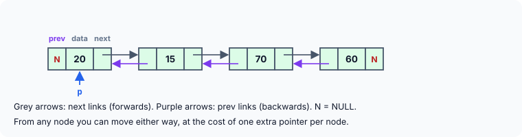
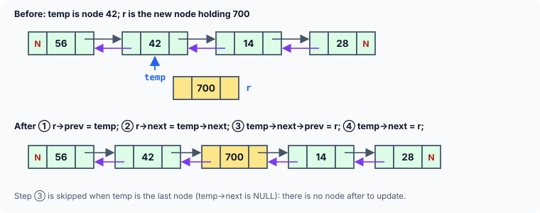
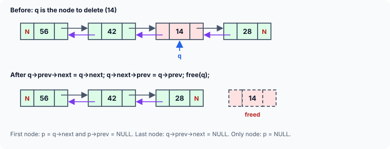

title : Doubly Linked Lists

summary : In a doubly linked list every node points both to the next node and to the previous one, so you can walk the list in either direction and delete a node without searching for its predecessor. Build one with append, add at the beginning, insert after, delete and display both ways, with every link change drawn.

# Doubly Linked Lists

In the linked lists we have used so far, each node provides information about where the **next** node is. It has no knowledge of where the **previous** node lies in memory. If we are at, say, the 15th node in the list, then to reach the 14th node we have to traverse the list right from the first node. The same limitation forced the deque in the previous article to walk the whole list just to remove its last node.

To avoid this, we can store in each node not only the address of the next node, but also the address of the **previous** node. This arrangement is known as a **doubly linked list**:



Each node now has three parts: a `prev` link, the data, and a `next` link. The first node's `prev` and the last node's `next` are `NULL`.

What this buys:

- The list can be traversed **in both directions**.
- Given a pointer to any node, it can be **deleted directly**, because the node itself knows its predecessor — no search for "the node before" is needed.
- A new node can be inserted **before** a given node as easily as after it.

What it costs: one more pointer per node (8 bytes on a 64-bit system), and twice as many links to keep correct on every insertion and deletion.

## A Doubly Linked List Program

```c runnable
#include <stdio.h>
#include <stdlib.h>

/* a node of the doubly linked list */
struct dnode
{
    struct dnode *prev;
    int data;
    struct dnode *next;
};

struct dnode *d_new(int num);
void d_append(struct dnode **s, int num);
void d_add_at_beg(struct dnode **s, int num);
void d_add_after(struct dnode *q, int loc, int num);
void d_display(const struct dnode *q);
void d_display_backwards(const struct dnode *q);
int d_count(const struct dnode *q);
void d_delete(struct dnode **s, int num);
void d_free(struct dnode **s);

int main(void)
{
    struct dnode *p = NULL;                    /* empty doubly linked list */

    d_append(&p, 14);
    d_append(&p, 28);
    d_display(p);
    printf("No. of elements in the DLL = %d\n", d_count(p));

    d_add_at_beg(&p, 42);
    d_add_at_beg(&p, 56);
    d_display(p);
    printf("No. of elements in the DLL = %d\n", d_count(p));

    d_add_after(p, 1, 700);                    /* after the 1st node */
    d_add_after(p, 2, 900);                    /* after the 2nd node */
    d_add_after(p, 6, 99);                     /* after the last node */
    d_add_after(p, 10, 5);                     /* there is no 10th node */
    d_display(p);
    d_display_backwards(p);
    printf("No. of elements in the DLL = %d\n", d_count(p));

    d_delete(&p, 61);                          /* not in the list */
    d_delete(&p, 28);                          /* a middle node */
    d_delete(&p, 56);                          /* the first node */
    d_delete(&p, 99);                          /* the last node */
    d_display(p);
    printf("No. of elements in the DLL = %d\n", d_count(p));

    d_free(&p);
    return 0;
}

/* creates an unlinked node holding num */
struct dnode *d_new(int num)
{
    struct dnode *r = malloc(sizeof *r);
    if (r == NULL) {
        printf("Out of memory\n");
        exit(EXIT_FAILURE);
    }
    r->prev = NULL;
    r->data = num;
    r->next = NULL;
    return r;
}

/* adds a new node at the end of the doubly linked list */
void d_append(struct dnode **s, int num)
{
    struct dnode *r = d_new(num), *q = *s;

    if (*s == NULL) {                          /* the list is empty */
        *s = r;
        return;
    }

    while (q->next != NULL)                    /* go to the last node */
        q = q->next;

    r->prev = q;                               /* link the new node in */
    q->next = r;
}

/* adds a new node at the beginning of the list */
void d_add_at_beg(struct dnode **s, int num)
{
    struct dnode *q = d_new(num);

    q->next = *s;                              /* new node points to the old first node */
    if (*s != NULL)
        (*s)->prev = q;                        /* old first node points back to it */
    *s = q;                                    /* make the new node the first node */
}

/* adds a new node after node number loc (1 = the first node) */
void d_add_after(struct dnode *q, int loc, int num)
{
    struct dnode *temp = q, *r;

    for (int i = 1; i < loc && temp != NULL; i++)   /* skip to the loc-th node */
        temp = temp->next;

    if (loc < 1 || temp == NULL) {
        printf("There are less than %d elements\n", loc);
        return;
    }

    r = d_new(num);
    r->prev = temp;                            /* (1) */
    r->next = temp->next;                      /* (2) */
    if (temp->next != NULL)
        temp->next->prev = r;                  /* (3) */
    temp->next = r;                            /* (4) */
}

/* displays the list from the first node to the last */
void d_display(const struct dnode *q)
{
    printf("NULL <- ");
    for (; q != NULL; q = q->next)
        printf("%d%s", q->data, q->next != NULL ? " <-> " : "");
    printf(" -> NULL\n");
}

/* displays the list from the last node back to the first */
void d_display_backwards(const struct dnode *q)
{
    if (q == NULL)
        return;
    while (q->next != NULL)                    /* go to the last node */
        q = q->next;

    printf("backwards: ");
    for (; q != NULL; q = q->prev)             /* follow the prev links */
        printf("%d ", q->data);
    printf("\n");
}

/* counts the number of nodes in the list */
int d_count(const struct dnode *q)
{
    int c = 0;

    for (; q != NULL; q = q->next)
        c++;
    return c;
}

/* deletes the first node holding num */
void d_delete(struct dnode **s, int num)
{
    struct dnode *q = *s;

    while (q != NULL) {                        /* traverse the entire list */
        if (q->data == num) {                  /* the node to delete is found */
            if (q->prev != NULL)
                q->prev->next = q->next;       /* bypass it going forwards */
            else
                *s = q->next;                  /* it was the first node */

            if (q->next != NULL)
                q->next->prev = q->prev;       /* bypass it going backwards */

            free(q);
            return;                            /* return back after deletion */
        }
        q = q->next;                           /* go to the next node */
    }
    printf("%d not found\n", num);
}

/* frees every node, leaving an empty list */
void d_free(struct dnode **s)
{
    while (*s != NULL) {
        struct dnode *next = (*s)->next;
        free(*s);
        *s = next;
    }
}
```

```
NULL <- 14 <-> 28 -> NULL
No. of elements in the DLL = 2
NULL <- 56 <-> 42 <-> 14 <-> 28 -> NULL
No. of elements in the DLL = 4
There are less than 10 elements
NULL <- 56 <-> 700 <-> 900 <-> 42 <-> 14 <-> 28 <-> 99 -> NULL
backwards: 99 28 14 42 900 700 56 
No. of elements in the DLL = 7
61 not found
NULL <- 700 <-> 900 <-> 42 <-> 14 -> NULL
No. of elements in the DLL = 4
```

Any operation on a linked list involves adjusting links, and a doubly linked list has twice as many of them. Let us look at each operation, with a figure for each.

## Adding a Node at the End: d_append()

**Case I: the list is empty.** The new node is the only node: both its links are `NULL`, and `p` (that is, `*s`) is made to point to it.

**Case II: the list already has nodes.** As in a singly linked list, `q` walks to the last node. The new node `r` is then joined to it in **both** directions:

```c
r->prev = q;        /* the new node points back to the old last node */
q->next = r;        /* the old last node points forward to the new node */
```

`r->next` is already `NULL`, since the new node is now the last.

## Adding a Node at the Beginning: d_add_at_beg()

The new node's `next` is set to the old first node, the old first node's `prev` is set back to the new node, and `p` is moved to the new node. Its own `prev` stays `NULL`, since it is now first.

There is one catch. If the list is **empty**, there is no "old first node" whose `prev` can be set, so `(*s)->prev = q;` must be skipped — writing through `*s` when it is `NULL` would crash the program. That is what the `if (*s != NULL)` is for.

:::callout
Older versions of this program do `(*s)->prev = q;` unconditionally. They work only because the example happens to call `d_append` first. Call the "add at beginning" function on an empty list and it follows a `NULL` pointer. In the same way, deleting the **only** node of a list in those versions runs `(*s)->prev = NULL;` right after `*s` has become `NULL`. Every operation on a linked structure must be checked against an empty list and a one-element list.
:::

## Inserting After a Given Node: d_add_after()

First, `temp` is moved to the node after which the new node is to go — node number `loc`, counting the first as 1. Then **four** links are set:



```c
r->prev = temp;                /* (1) new node points back to temp        */
r->next = temp->next;          /* (2) new node points on to temp's old next */
if (temp->next != NULL)
    temp->next->prev = r;      /* (3) that node now points back to r       */
temp->next = r;                /* (4) temp now points forward to r         */
```

The order matters once again: step (4) overwrites `temp->next`, so steps (2) and (3), which **use** `temp->next`, must come before it. If `temp` is the last node, there is no node after it, and step (3) is skipped; that is how `d_add_after(p, 6, 99)` appended 99 at the end.

## Deleting a Node: d_delete()

Once `q` points to the node to be deleted, it is taken out of the chain by making its neighbours point **past** it, in both directions:



```c
q->prev->next = q->next;       /* the node before now skips q going forwards  */
q->next->prev = q->prev;       /* the node after now skips q going backwards  */
free(q);
```

Notice that no `old` pointer is needed, as it was for a singly linked list: `q->prev` **is** the node before. There are three special cases, each handled by one of the `if`s:

- **The first node** (`q->prev == NULL`): there is no node before, so `p` itself moves to `q->next`.
- **The last node** (`q->next == NULL`): there is no node after, so there is no `prev` link to fix.
- **The only node**: both of the above. `p` becomes `NULL` and the list is empty.

## Walking Backwards

`d_display_backwards` shows the new ability. It walks forwards to the last node, then follows the `prev` links all the way back to the first. The output confirms that every `prev` link was set correctly: the list read backwards is exactly the forward list reversed. A program that keeps a pointer to the **last** node as well as the first (as the queue kept `rear`) can start backward walks immediately.

## Where Doubly Linked Lists Are Used

Doubly linked lists appear wherever moving both ways, or deleting from the middle, must be fast:

- browser history, with *back* and *forward*;
- the list of open documents or tabs, and undo/redo histories;
- music playlists with *previous* and *next*;
- caches that move a used item to the front and drop the oldest from the back (an "LRU cache");
- the C++ `std::list` and the lists inside operating-system kernels.

## Key Takeaways

- Each node of a doubly linked list has a `prev` link and a `next` link. The first `prev` and the last `next` are `NULL`.
- The list can be traversed in both directions, and a node can be removed using only a pointer to that node.
- Inserting a node sets up to four links; deleting fixes two. Use a link before overwriting it.
- Always handle the special cases: empty list, first node, last node, only node. Never write through a link without checking it is not `NULL`.
- The extra flexibility costs one pointer per node and more care on every update.

## Practice Questions

:::details[In a doubly linked list, which links change when a new node is added at the beginning of a non-empty list?]
Two existing values change and one new one is set: the new node's `next` is set to the old first node; the old first node's `prev` is set to the new node; and the list pointer `p` is moved to the new node. (The new node's `prev` stays `NULL`.)
:::

:::details[Given only a pointer q to a node in the middle of a doubly linked list, write the code to insert a new node r BEFORE q.]
```c
r->next = q;
r->prev = q->prev;
q->prev->next = r;     /* q is in the middle, so q->prev is not NULL */
q->prev = r;
```
This is easy in a doubly linked list, because `q->prev` gives the node before. In a singly linked list it would need a search from the start.
:::

:::details[After d_delete(&p, x) removes the last node, what must be true of the new last node's next link, and which line makes it so?]
It must be `NULL`. The line `q->prev->next = q->next;` does it: for the last node, `q->next` is `NULL`, so the new last node's `next` becomes `NULL`.
:::

:::details[How many bytes does a struct dnode (prev, int data, next) usually take on a 64-bit system, compared with the singly linked struct node?]
Typically **24** bytes: 8 for `prev`, 4 for `data`, 4 bytes of padding so that `next` is aligned, and 8 for `next`. A singly linked `struct node` (int data, link) takes 16. Placing `data` last does not help here: the structure is padded to 24 anyway so that it can be used in arrays.
:::

:::details[Write a function that reverses a doubly linked list.]
Swap the `prev` and `next` links of every node; the old last node becomes the first.
```c
void d_reverse(struct dnode **s)
{
    struct dnode *q = *s, *t;

    while (q != NULL) {
        t = q->prev;           /* swap prev and next */
        q->prev = q->next;
        q->next = t;
        *s = q;                /* the last node visited becomes first */
        q = q->prev;           /* prev now holds the old next */
    }
}
```
:::
