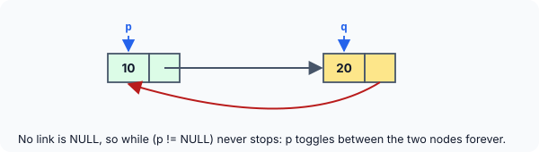

title : Linked Structures: Worked Examples

summary : Harder puzzles on structures that point to structures: ++ and -- inside ->, arrays of pointers to structures, swapping through structure pointers, malloc'd nodes, a two-node doubly linked list, and a circular list that never ends. Predict each output, then follow the step-by-step explanation.

# Linked Structures: Worked Examples

The previous set of puzzles used structures that contain pointers. This set goes one step further: structures that point to **other structures**, arrays of pointers to structures, and small linked lists built by hand. Expressions such as `a[(++ptr)->i].z` or `++(*++(*p)->next).str` look intimidating, but each one yields to the same strategy: **cross the bridges one at a time**. Start from the innermost parentheses, work out what each piece points to, and write it down before moving on.

All answers assume a typical 64-bit system: 4-byte `int`, 8-byte pointers.

### 8. ++ and -- around the arrow

```c runnable
#include <stdio.h>

int main(void)
{
    struct s1
    {
        const char *z;
        int i;
        struct s1 *p;
    };

    struct s1 a[] = {
        {"Agra", 1, a + 1},
        {"Pune", 2, a + 2},
        {"Goa", 3, a}
    };
    struct s1 *ptr = a;

    printf("%s\n", ++(ptr->z));
    printf("%s\n", a[(++ptr)->i].z);
    printf("%s\n", a[--(ptr->p->i)].z);
    return 0;
}
```

:::details[Answer]
```
gra
Goa
Goa
```

The set-up is the same as in puzzle 6 of the previous article: three structures linked in a ring, with `ptr` pointing to `a[0]`.

![a[0].p points to a[1], a[1].p to a[2], a[2].p back to a[0]; ptr points to a[0]](images/struct-array-self-links.svg)

**`++(ptr->z)`.** `ptr` holds the base address of the array, which is also the address of the zeroth structure. So `ptr->z` is the member `z` of `a[0]`: the starting address of `"Agra"`. Incrementing it with `++` gives the address of the next character, the `'g'`, and the string is printed from there: `gra`.

**`a[(++ptr)->i].z`.** Intimidating? Not once it is dissected. Starting from the parentheses, `++ptr` increments the contents of `ptr`. It held the address of `a[0]`; adding 1 does not move it 1 byte but one **whole structure** (24 bytes here), because on incrementing any pointer, it points to the next location of its type. So `ptr` now points to `a[1]`. Then `(++ptr)->i` is `a[1].i`, which is 2. The expression reduces to plain and simple `a[2].z`, the address of `"Goa"`, and the same is printed.

**`a[--(ptr->p->i)].z`.** Again, start inside the parentheses, moving left to right. `ptr` now points to `a[1]`, so `ptr->p` is `a[1].p`, which holds `a + 2` — the address of `a[2]`. So `ptr->p->i` is `a[2].i`, which is 3. The `--` decrements it to 2 (permanently: `a[2].i` is now 2). The expression that almost succeeded in putting us off was only a camouflage for `a[2].z`, which yields `"Goa"` once again.
:::

### 9. An array of pointers to structures

```c runnable
#include <stdio.h>

int main(void)
{
    struct s1
    {
        const char *str;
        struct s1 *next;
    };

    struct s1 arr[] = {
        {"Meena", arr + 1},
        {"Kabir", arr + 2},
        {"Devika", arr}
    };
    struct s1 *p[3];

    for (int i = 0; i <= 2; i++)
        p[i] = arr[i].next;

    printf("%s\n", p[0]->str);
    printf("%s\n", (*p)->str);
    printf("%s\n", (**p).str);
    return 0;
}
```

:::details[Answer]
```
Kabir
Kabir
Kabir
```

`struct s1` comprises two pointers: a `char` pointer and a pointer to `struct s1`. `arr[]`, an array of such structures, is declared and initialised. Next, `p[3]` is declared as an **array of pointers to structures**: each element of `p[]` holds the address of a `struct s1`.

The first time through the `for` loop, `arr[0].next` is assigned to `p[0]`. It holds `arr + 1`, the address of `arr[1]`. Likewise, `p[1]` gets the address of `arr[2]`, and `p[2]` the address of `arr[0]`:

![p[0] points to arr[1], p[1] to arr[2], p[2] to arr[0]; the structures are linked in a ring through their next members](images/array-of-struct-pointers.svg)

Now the `printf`s:

- `p[0]` is the address of `arr[1]`, so `p[0]->str` is the member `str` of `arr[1]` — the starting address of `"Kabir"`.
- Mentioning `p` gives the base address of the array `p[]`, so `*p` is the value stored at that address — which is nothing but `p[0]`. (Recall that `n[i]` is the same as `*(n + i)`.) So `(*p)->str` is `"Kabir"` once again.
- `*p` is the address of `arr[1]`, so `**p` is the structure `arr[1]` itself, and `(**p).str` is `"Kabir"` a third time.

:::callout
Older versions of this puzzle print the third line with `printf("%s", **p);` — passing the whole **structure** `arr[1]` where `%s` expects a `char *`. It "works" on some systems only because `str` happens to be the first member, so the structure's first bytes are the string's address. It is still wrong: GCC warns *format '%s' expects argument of type 'char \*', but argument 2 has type 'struct s1'*, and the behaviour is undefined. To get the string, name the member: `(**p).str`, or `(*p)->str`.
:::
:::

### 10. Swapping strings through structure pointers

This one is long, but each line is a small step.

```c runnable
#include <stdio.h>

struct s1
{
    const char *str;
    struct s1 *next;
};

void swap(struct s1 *p1, struct s1 *p2)
{
    const char *temp;

    temp = p1->str;
    p1->str = p2->str;
    p2->str = temp;
}

int main(void)
{
    struct s1 arr[] = {
        {"Meena", arr + 1},
        {"Kabir", arr + 2},
        {"Devika", arr}
    };
    struct s1 *p[3];

    for (int i = 0; i <= 2; i++)
        p[i] = arr[i].next;

    printf("%s %s %s\n", p[0]->str, (*p)->str, (**p).str);

    swap(*p, arr);

    printf("%s\n", p[0]->str);
    printf("%s\n", (*p)->str);
    printf("%s\n", (*p)->next->str);

    swap(p[0], p[0]->next);

    printf("%s\n", p[0]->str);
    printf("%s\n", (*++p[0]).str);
    printf("%s\n", ++(*++(*p)->next).str);
    return 0;
}
```

:::details[Answer]
```
Kabir Kabir Kabir
Meena
Meena
Devika
Devika
Meena
evika
```

The set-up of the arrays is exactly as in the previous puzzle, so `p[]` holds the addresses of `arr[1]`, `arr[2]` and `arr[0]`, in that order.

**First `printf`.** As before, `p[0]->str`, `(*p)->str` and `(**p).str` all refer to `arr[1].str`, so `Kabir` is printed three times.

**`swap(*p, arr)`.** The function receives the base addresses of two structures: `*p`, which equals `arr + 1`, and `arr`. Hence in `swap()`, `p1` and `p2` are declared as structure pointers. Using an auxiliary pointer `temp`, the strings at `(arr + 1)->str` and `arr->str` are exchanged. Note that only the `str` pointers are swapped; the `next` members stay where they are. The array now contains:

```
arr[0]: "Kabir",  arr + 1
arr[1]: "Meena",  arr + 2
arr[2]: "Devika", arr
```

**The next two `printf`s.** `p[0]->str` and `(*p)->str` both refer to `arr[1].str`, which is now `"Meena"`. So `Meena` shows up for the next two lines.

**`(*p)->next->str`.** `(*p)->next` is the same as `p[0]->next`, i.e. `arr[1].next`, which holds `arr + 2`. So the expression is `(arr + 2)->str`, the base address of `"Devika"`.

**`swap(p[0], p[0]->next)`.** This time `p[0]` is the address of `arr[1]` and `p[0]->next` is the address of `arr[2]`. The strings in these two structures are interchanged, so the array now looks like this:

```
arr[0]: "Kabir",  arr + 1
arr[1]: "Devika", arr + 2
arr[2]: "Meena",  arr
```

With this changed array, let us look at the last set of `printf`s.

**`p[0]->str`** is `arr[1].str`, which is now `"Devika"`.

**`(*++p[0]).str`.** In the parentheses, `p[0]` is incremented by the `++` operator. So `p[0]`, which stored `arr + 1`, now contains `arr + 2`. `*(arr + 2)` is `arr[2]`, so the `printf` prints `arr[2].str`, which is `"Meena"`.

**`++(*++(*p)->next).str`.** Not allowing ourselves to be impressed by its length, we start within the parentheses, on the left of the arrow operator:

1. `*p`, i.e. `p[0]`, having been incremented in the preceding `printf`, currently contains `arr + 2`.
2. Since `->` has a higher priority than `++`, `(arr + 2)->next` is evaluated next. `arr[2].next` holds `arr`.
3. Now the `++` goes to work on **that member**: `arr[2].next` becomes `arr + 1`.
4. `*` gives the structure `*(arr + 1)`, which is `arr[1]`, and `.str` its string pointer, the starting address of `"Devika"`.
5. The outer `++` increments **that** pointer, so it points to the `'e'` of `"Devika"`, and the string is printed from there: `evika`.

Notice that the expressions in the last two `printf`s did not just **read** the structures — they changed them: `p[0]` now points to `arr[2]`, `arr[2].next` points to `arr[1]`, and `arr[1].str` points one character into its string. Code like this is excellent practice for reading C, and a bad idea to write: a reader has to trace five steps to see that three different objects are modified.
:::

### 11. sizeof a pointer to a structure

```c runnable
#include <stdio.h>
#include <stdlib.h>

int main(void)
{
    struct node
    {
        int data;
        struct node *link;
    };
    struct node *p, *q;

    p = malloc(sizeof(struct node));
    q = malloc(sizeof(struct node));

    printf("%zu %zu\n", sizeof(p), sizeof(q));
    printf("%zu\n", sizeof(struct node));

    free(p);
    free(q);
    return 0;
}
```

:::details[Answer]
```
8 8
16
```

`p` and `q` have been declared as pointers to structures of the type `struct node`. Next comes `malloc()`, a standard library function that reserves as many bytes of memory as its argument specifies and returns the base address of that block. Unlike arrays, which put aside a fixed number of bytes when they are declared, `malloc()` can be given a variable as its argument, allowing flexibility in the size of memory to be allocated. Here each call reserves room for one `struct node`, and the two base addresses are collected in `p` and `q`.

But the first `printf` asks for `sizeof(p)` and `sizeof(q)`: the sizes of the **pointers**, not of what they point to. Every pointer is 8 bytes on a 64-bit system (older books, written for 16-bit systems, print `2 2`). The size of the structure itself is asked for separately: 4 bytes for `data`, 4 bytes of padding, and 8 for `link` — 16. To get the size of what `p` points to, write `sizeof *p`.
:::

### 12. Two nodes linked by hand

```c runnable
#include <stdio.h>
#include <stdlib.h>

int main(void)
{
    struct node
    {
        int data;
        struct node *link;
    };
    struct node *p, *q, *first;

    p = malloc(sizeof(struct node));
    q = malloc(sizeof(struct node));
    if (p == NULL || q == NULL)
        return 1;

    p->data = 55;
    p->link = q;
    q->data = 71;
    q->link = NULL;

    first = p;                             /* remember where the list starts */
    printf("%d ", p->data);
    p = p->link;
    printf("%d\n", p->data);

    free(first->link);
    free(first);
    return 0;
}
```

:::details[Answer]
```
55 71
```

`p` and `q` are given the starting addresses of two blocks of memory, each big enough for one `struct node`. When we say `p->data`, we are referring to the `int` at the start of the block whose address is in `p`; 55 is stored there. In `p->link` is stored the address present in `q` — the base address of the second block. In the structure starting at the address in `q`, 71 and `NULL` are stored.

On printing `p->data`, we get the 55 stored there. Then the contents of `p` are changed to `p->link`, so `p` is now equal to `q`, and `p->data` evaluates to 71.

This arrangement of data — each structure holding the address of the next, the last holding `NULL` — is exactly the popular **linked list** data structure.

Notice why the program keeps `first`. After `p = p->link;`, `p` no longer holds the address of the first block. Without another copy of that address, the first block could never be freed — a **memory leak**. (The original form of this puzzle, which has no `first` and no `free`, leaks both blocks; AddressSanitizer reports them as soon as the program ends.) When walking a list, always walk with a copy of the pointer to its start.
:::

### 13. Two nodes linked both ways

```c runnable
#include <stdio.h>
#include <stdlib.h>

int main(void)
{
    struct node
    {
        struct node *previous;
        int data;
        struct node *next;
    };
    struct node *p, *q, *first;

    p = malloc(sizeof(struct node));
    q = malloc(sizeof(struct node));
    if (p == NULL || q == NULL)
        return 1;

    p->data = 18;
    q->data = 27;
    p->previous = NULL;
    p->next = q;
    q->previous = p;
    q->next = NULL;

    first = p;
    while (p != NULL) {
        printf("%d\n", p->data);
        p = p->next;
    }

    free(first->next);
    free(first);
    return 0;
}
```

:::details[Answer]
```
18
27
```

The structure comprises an integer `data` and two structure pointers, `previous` and `next`. The `malloc()`s allocate two blocks of memory, and the whole arrangement can be thought of as a chain of two structures. As the names suggest, `previous` of the first node is `NULL`, indicating there is no structure before it, and `next` of the first node stores the address of the second. Similarly, `previous` of the second node points back to the first, and its `next` is `NULL`, signifying there are no more structures after it. This arrangement is a two-node **doubly linked list**.

The body of the `while` loop runs as long as `p` is not `NULL`. `p` starts at the first node, so 18 is printed; then `p` is assigned `p->next`, the address of the second node, and 27 is printed. The next time, `p->next` is `NULL`, so `p` becomes `NULL`, the condition fails, and the loop ends. (`first` keeps the address of the first node, so that both blocks can be freed.)
:::

### 14. A list that never ends

What does this program print?

```c
#include <stdio.h>
#include <stdlib.h>

int main(void)
{
    struct node
    {
        int data;
        struct node *next;
    };
    struct node *p, *q;

    p = malloc(sizeof(struct node));
    q = malloc(sizeof(struct node));

    p->data = 10;
    q->data = 20;
    p->next = q;
    q->next = p;

    while (p != NULL) {
        printf("%d\n", p->data);
        p = p->next;
    }
    return 0;
}
```

:::details[Answer]
It prints `10`, `20`, `10`, `20`, … **forever** — the loop never ends.

`p` and `q` collect the starting addresses of two blocks of memory, each the size of a `struct node`. 10 and 20 are stored in their `data` parts. Then `p->next` is assigned the address of the second node, and `q->next` the address of the **first**.



The `while` checks the contents of `p`. The first time, the condition is satisfied, and `p->data`, which is 10, is printed. Now `p` is assigned `p->next`, the address of the second node, so 20 is printed. After this, `p->next` is the address of the **first** node again. Thus the contents of `p` toggle between the two addresses, and since `p` never becomes `NULL`, the loop is an indefinite one.

A list whose last node links back to the first is called a **circular linked list**, and it is useful — for round-robin scheduling, or a playlist that repeats. But a loop over it must stop by a different rule, for example when it gets back to where it started. Here is a version that runs safely, stopping after three trips around the circle:

```c runnable
#include <stdio.h>
#include <stdlib.h>

int main(void)
{
    struct node
    {
        int data;
        struct node *next;
    };
    struct node *p = malloc(sizeof(struct node));
    struct node *q = malloc(sizeof(struct node));
    if (p == NULL || q == NULL)
        return 1;

    p->data = 10;
    q->data = 20;
    p->next = q;
    q->next = p;

    const struct node *t = p;
    for (int laps = 0; laps < 3; ) {
        printf("%d ", t->data);
        t = t->next;
        if (t == p)                        /* back at the start: one lap done */
            laps++;
    }
    printf("\n");

    free(p);
    free(q);
    return 0;
}
```

```
10 20 10 20 10 20 
```
:::
