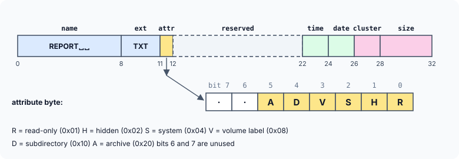
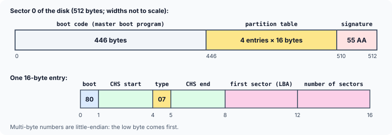

title : Structures and Linked Lists: Programming Exercises

summary : Five programming exercises with full solutions: a recursive determinant with calloc, decoding and changing file attributes in a raw directory entry, listing a directory alphabetically with a linked list, and decoding a disk's boot sector and partition table byte by byte — and why a struct cannot simply be laid over raw disk bytes.

# Structures and Linked Lists: Programming Exercises

These exercises put structures, pointers and dynamic memory to work on real problems. Three of them come from the world of **disks**: how a file system records a file's name and attributes, how a disk describes its own layout, and how it is divided into partitions. Older books solve them with functions of old DOS compilers (`absread()`, `abswrite()`, `biosdisk()`, `findfirst()`) that read raw disk sectors directly. Those functions no longer exist, and modern operating systems do not let ordinary programs read raw disk sectors anyway. So each solution here works on the **bytes of a sector held in an array** — exactly what such a function would have read — and shows how the same code would be fed from a real disk image.

The skills are the same either way, and they are some of the most practical in C: walking through raw bytes with pointers, decoding little-endian numbers, testing and setting individual bits, and turning raw data into a structure.

Try each exercise before opening the solution.

### 1. The determinant of an n × n matrix

Write a program to find the determinant of a square matrix of any given size n × n. Use recursion, and `calloc()` for dynamic allocation of memory.

:::details[Hint]
Use **cofactor expansion** along the first row. For each column `col`, build the **minor** — the (n − 1) × (n − 1) matrix left when row 0 and column `col` are removed — and add `(−1)^col × m[0][col] × det(minor)`. The determinant of a 1 × 1 matrix is its single element; that stops the recursion. Since the size of the minor depends on `n`, allocate it with `calloc` inside the function, and free it before returning.
:::

:::details[Solution]
```c runnable
#include <stdio.h>
#include <stdlib.h>

/* determinant of the n x n matrix m, stored row by row in n*n doubles */
double determinant(const double *m, int n)
{
    if (n == 1)
        return m[0];
    if (n == 2)
        return m[0] * m[3] - m[1] * m[2];

    double det = 0.0;
    double *minor = calloc((size_t)(n - 1) * (n - 1), sizeof *minor);
    if (minor == NULL) {
        printf("Out of memory\n");
        exit(EXIT_FAILURE);
    }

    for (int col = 0; col < n; col++) {         /* expand along the first row */
        int k = 0;
        for (int i = 1; i < n; i++)             /* copy every row but the first ... */
            for (int j = 0; j < n; j++)
                if (j != col)                   /* ... and every column but col */
                    minor[k++] = m[i * n + j];

        double sign = (col % 2 == 0) ? 1.0 : -1.0;
        det += sign * m[col] * determinant(minor, n - 1);
    }

    free(minor);
    return det;
}

int main(void)
{
    double a[] = {
        2, 0, 1,
        1, 3, 2,
        1, 1, 4
    };
    double b[] = {
        1, 2, 3, 4,
        5, 6, 7, 8,
        2, 6, 4, 8,
        3, 1, 1, 2
    };
    int n = 3;

    printf("det(a) = %g\n", determinant(a, n));
    printf("det(b) = %g\n", determinant(b, 4));
    return 0;
}
```

```
det(a) = 18
det(b) = 72
```

How it works:

- The matrix is stored **row by row** in a one-dimensional block of `n * n` `double`s, so element (i, j) is `m[i * n + j]`. A 2-D array's size must be known when it is declared; a flat block can have any size, which is what "any given size" requires.
- For `n` of 1 or 2 the answer is computed directly; otherwise the function expands along the first row. For each column, the double loop copies every element that is not in row 0 and not in column `col` into `minor`, which `calloc` allocated for (n − 1)² values.
- The signs alternate `+ − + − …` across the row, and each term multiplies an element of the first row by the determinant of its minor — computed by the function **calling itself** with a smaller matrix.
- `minor` is allocated once per call and freed before the call returns, so no memory is leaked however deep the recursion goes.

For matrix `a`: 2 × (3·4 − 2·1) − 0 × (…) + 1 × (1·1 − 3·1) = 20 − 2 = **18**.

To read the matrix from the keyboard instead, allocate it with `calloc(n * n, sizeof(double))` after reading `n`, and fill it with `scanf("%lf", &m[i * n + j])`.

Cofactor expansion is the natural recursive definition, but its cost grows like n! — fine for small matrices, hopeless for a 20 × 20 one. Real programs use **Gaussian elimination**, which reduces the matrix to triangular form in about n³ steps; the determinant is then the product of the diagonal.
:::

### 2. Displaying and changing file attributes

On the FAT file system (used by DOS, and still used by USB sticks and memory cards today), every file is described by a **32-byte directory entry** on the disk:

| Field | Size | Format |
|---|---|---|
| File name | 8 bytes | ASCII characters, padded with spaces |
| Extension | 3 bytes | ASCII characters, padded with spaces |
| Attribute | 1 byte | bit coded |
| Reserved | 10 bytes | unused, zeros |
| Time | 2 bytes | encoded |
| Date | 2 bytes | encoded |
| Starting cluster | 2 bytes | integer |
| Size | 4 bytes | long integer |

The individual bits of the attribute byte control the current attributes of the file:



Write a program that displays the entries of a directory with their attributes, and changes the attributes of a file.

:::details[Hint]
Treat the directory as an array of bytes, 32 per entry; `dir + i * 32` is the address of entry `i`. The attribute is the single byte at offset 11: test a bit with `&` (`attr & 0x02` is non-zero if the file is hidden), set it with `|=`, and clear it with `&= ~mask`. Multi-byte numbers are stored **little-endian** (low byte first), so build them from bytes: `p[0] | p[1] << 8`. The time packs hours, minutes and seconds/2 into 5, 6 and 5 bits; the date packs year − 1980, month and day into 7, 4 and 5 bits.
:::

:::details[Solution]
```c runnable
#include <stdio.h>
#include <string.h>

/* bit masks for the attribute byte of a directory entry */
#define ATTR_READ_ONLY 0x01
#define ATTR_HIDDEN    0x02
#define ATTR_SYSTEM    0x04
#define ATTR_VOLUME    0x08
#define ATTR_DIRECTORY 0x10
#define ATTR_ARCHIVE   0x20

#define ENTRY_SIZE 32

/* read little-endian numbers from a byte buffer */
unsigned read16(const unsigned char *p) { return p[0] | (unsigned)p[1] << 8; }
unsigned long read32(const unsigned char *p)
{
    return p[0] | (unsigned long)p[1] << 8 | (unsigned long)p[2] << 16 | (unsigned long)p[3] << 24;
}
void write16(unsigned char *p, unsigned v) { p[0] = v & 0xFF; p[1] = (v >> 8) & 0xFF; }
void write32(unsigned char *p, unsigned long v)
{
    for (int i = 0; i < 4; i++)
        p[i] = (v >> (8 * i)) & 0xFF;
}

/* builds one 32-byte entry (used here instead of reading a real disk) */
void make_entry(unsigned char *e, const char *name, const char *ext, unsigned attr,
                int hour, int min, int year, int month, int day,
                unsigned cluster, unsigned long size)
{
    memset(e, 0, ENTRY_SIZE);
    memset(e, ' ', 11);                       /* names are padded with spaces */
    memcpy(e, name, strlen(name));
    memcpy(e + 8, ext, strlen(ext));
    e[11] = (unsigned char)attr;
    write16(e + 22, (unsigned)(hour << 11 | min << 5));
    write16(e + 24, (unsigned)((year - 1980) << 9 | month << 5 | day));
    write16(e + 26, cluster);
    write32(e + 28, size);
}

/* "REPORT  TXT" (8 + 3 chars, space-padded) -> "REPORT.TXT" */
void entry_name(const unsigned char *e, char *out)
{
    int n = 0;

    for (int i = 0; i < 8 && e[i] != ' '; i++)
        out[n++] = (char)e[i];
    if (e[8] != ' ') {
        out[n++] = '.';
        for (int i = 8; i < 11 && e[i] != ' '; i++)
            out[n++] = (char)e[i];
    }
    out[n] = '\0';
}

void show_entry(const unsigned char *e)
{
    char name[13];
    unsigned attr = e[11];
    unsigned time = read16(e + 22), date = read16(e + 24);

    entry_name(e, name);
    printf("%-12s %6lu bytes  %04u-%02u-%02u %02u:%02u  cluster %3u  [%c%c%c%c%c%c]\n",
           name, read32(e + 28),
           1980 + (date >> 9), (date >> 5) & 0x0F, date & 0x1F,
           time >> 11, (time >> 5) & 0x3F, read16(e + 26),
           attr & ATTR_READ_ONLY ? 'R' : '-',
           attr & ATTR_HIDDEN    ? 'H' : '-',
           attr & ATTR_SYSTEM    ? 'S' : '-',
           attr & ATTR_VOLUME    ? 'V' : '-',
           attr & ATTR_DIRECTORY ? 'D' : '-',
           attr & ATTR_ARCHIVE   ? 'A' : '-');
}

int main(void)
{
    unsigned char dir[3 * ENTRY_SIZE];         /* stands in for a directory sector */

    make_entry(dir,      "REPORT", "TXT", ATTR_ARCHIVE, 9, 41, 1998, 7, 14, 3, 5120);
    make_entry(dir + 32, "IO",     "SYS", ATTR_READ_ONLY | ATTR_HIDDEN | ATTR_SYSTEM,
               6, 0, 1994, 5, 31, 2, 40566);
    make_entry(dir + 64, "GAMES",  "",    ATTR_DIRECTORY, 18, 5, 1999, 1, 2, 12, 0);

    for (int i = 0; i < 3; i++)
        show_entry(dir + i * ENTRY_SIZE);

    /* change attributes: make REPORT.TXT read-only and hidden, clear its archive bit */
    unsigned char *report = dir;
    report[11] |= ATTR_READ_ONLY | ATTR_HIDDEN;
    report[11] &= (unsigned char)~ATTR_ARCHIVE;

    printf("after changing REPORT.TXT:\n");
    show_entry(report);
    return 0;
}
```

```
REPORT.TXT     5120 bytes  1998-07-14 09:41  cluster   3  [-----A]
IO.SYS        40566 bytes  1994-05-31 06:00  cluster   2  [RHS---]
GAMES             0 bytes  1999-01-02 18:05  cluster  12  [----D-]
after changing REPORT.TXT:
REPORT.TXT     5120 bytes  1998-07-14 09:41  cluster   3  [RH----]
```

The key ideas:

- **Bit masks.** Each attribute has a `#define` with exactly one bit set. `attr & ATTR_HIDDEN` is non-zero only if bit 1 is set, which is how the `[RHSVDA]` column is built. To change attributes, `|=` turns bits **on** (`report[11] |= ATTR_READ_ONLY | ATTR_HIDDEN;`) and `&= ~` turns a bit **off** (`~ATTR_ARCHIVE` has every bit set except bit 5).
- **Byte offsets, not a structure.** Each field is read from its documented offset, with `read16` and `read32` assembling little-endian numbers. This works whatever the compiler's padding rules and whatever the byte order of the machine running the program. (The next exercise shows what goes wrong when a structure is laid directly over raw bytes.)
- **Packed time and date.** The 16-bit time holds the hour in its top 5 bits, so `time >> 11` extracts it; `(time >> 5) & 0x3F` extracts the 6 minute bits. The date works the same way, with the year stored as an offset from 1980.
- **Names.** Names are padded with spaces, not terminated with `'\0'`, so `entry_name` copies characters up to the first space and adds the dot.

`make_entry` stands in for reading a real directory. To work with a real FAT disk image (for example a file `floppy.img`), open it with `fopen(..., "r+b")`, `fseek` to the directory's position (which the boot sector of exercise 4 tells you), `fread` the bytes into `dir`, change them, and `fwrite` them back. On a running system, change attributes through the operating system instead: `SetFileAttributes()` on Windows, `chmod()` for permissions on Linux and macOS.
:::

### 3. Listing a directory in alphabetical order

Write a program to list the current directory in alphabetical order, using a linked list. Read the directory entries one by one, store each name in a node of a linked list, then display the list in sorted order.

:::details[Hint]
On Linux, macOS and other POSIX systems, `opendir(".")` opens the current directory, each call to `readdir()` returns the next entry (its name is in `entry->d_name`), and `closedir()` closes it. (On old DOS compilers the same job was done by `findfirst()` and `findnext()`, and on Windows by `_findfirst()` and `_findnext()`.) Rather than reading everything and sorting afterwards, insert each name **in its sorted position** as it arrives, using the sorted-insert technique from the linked-list articles. Copy each name into memory of its own: the buffer `readdir` returns is reused by the next call.
:::

:::details[Solution]
First the heart of the solution — a linked list that keeps names in alphabetical order — shown with a fixed set of names so that it runs anywhere:

```c runnable
#include <stdio.h>
#include <stdlib.h>
#include <string.h>

struct node
{
    char *name;                                /* a copy of the file name */
    struct node *next;
};

/* inserts a copy of name so that the list stays in alphabetical order */
void insert_sorted(struct node **q, const char *name)
{
    struct node *r = malloc(sizeof *r);
    if (r == NULL || (r->name = malloc(strlen(name) + 1)) == NULL) {
        printf("Out of memory\n");
        exit(EXIT_FAILURE);
    }
    strcpy(r->name, name);

    while (*q != NULL && strcmp((*q)->name, name) <= 0)
        q = &(*q)->next;                       /* walk the links */
    r->next = *q;
    *q = r;
}

void free_list(struct node **q)
{
    while (*q != NULL) {
        struct node *next = (*q)->next;
        free((*q)->name);
        free(*q);
        *q = next;
    }
}

int main(void)
{
    /* stand-ins for the names a directory listing would return */
    const char *found[] = {"notes.txt", "main.c", "Makefile", "build", "README.md", "list.c", "a.out"};
    struct node *list = NULL;

    for (size_t i = 0; i < sizeof found / sizeof found[0]; i++)
        insert_sorted(&list, found[i]);

    for (const struct node *t = list; t != NULL; t = t->next)
        printf("%s\n", t->name);

    free_list(&list);
    return 0;
}
```

```
Makefile
README.md
a.out
build
list.c
main.c
notes.txt
```

Notice the order: `strcmp` compares character codes, and all uppercase letters (65–90) come before all lowercase letters (97–122), so `Makefile` and `README.md` come first. For a case-insensitive order, compare with `strcasecmp()` (POSIX) instead.

And here is the complete program for a POSIX system, which reads the real directory:

```c
#include <stdio.h>
#include <stdlib.h>
#include <string.h>
#include <dirent.h>                            /* POSIX: Linux, macOS, BSD */

struct node
{
    char *name;
    struct node *next;
};

void insert_sorted(struct node **q, const char *name)
{
    struct node *r = malloc(sizeof *r);
    if (r == NULL || (r->name = malloc(strlen(name) + 1)) == NULL) {
        printf("Out of memory\n");
        exit(EXIT_FAILURE);
    }
    strcpy(r->name, name);

    while (*q != NULL && strcmp((*q)->name, name) <= 0)
        q = &(*q)->next;
    r->next = *q;
    *q = r;
}

void free_list(struct node **q)
{
    while (*q != NULL) {
        struct node *next = (*q)->next;
        free((*q)->name);
        free(*q);
        *q = next;
    }
}

int main(void)
{
    DIR *dir = opendir(".");                   /* the current directory */
    struct dirent *entry;
    struct node *list = NULL;

    if (dir == NULL) {
        perror("opendir");
        return 1;
    }
    while ((entry = readdir(dir)) != NULL)     /* one entry per call, NULL at the end */
        insert_sorted(&list, entry->d_name);
    closedir(dir);

    for (const struct node *t = list; t != NULL; t = t->next)
        printf("%s\n", t->name);

    free_list(&list);
    return 0;
}
```

A sample run, in a directory holding a few files and a `build` folder:

```
.
..
Makefile
README.md
build
main.c
notes.txt
```

Every directory contains the entries `.` (itself) and `..` (its parent); skip names starting with `.` if you do not want them, or hidden files in general.

Points to note:

- Each node stores a **copy** of the name in memory from `malloc(strlen(name) + 1)`. Storing `entry->d_name` itself would be a bug: `readdir` reuses that buffer, so every node would end up pointing at the last name read.
- `insert_sorted` walks the **links** with a `struct node **` (the technique from the sorted-list article), so inserting at the front, in the middle or at the end is one piece of code.
- `free_list` frees the name **and** the node, for every node: two `malloc`s per node mean two `free`s.
:::

### 4. Displaying the boot sector

The first sector of a FAT-formatted disk is its **boot sector**. Besides a little start-up code, it describes the disk:

| Field | Offset | Length |
|---|---|---|
| Jump instruction | 0 | 3 bytes |
| System ID | 3 | 8 bytes |
| Bytes per sector | 11 | 2 bytes |
| Sectors per cluster | 13 | 1 byte |
| Reserved sectors | 14 | 2 bytes |
| Number of copies of the FAT | 16 | 1 byte |
| Root directory entries | 17 | 2 bytes |
| Total number of sectors | 19 | 2 bytes |
| Media descriptor | 21 | 1 byte |
| Sectors per FAT | 22 | 2 bytes |
| Sectors per track | 24 | 2 bytes |
| Number of sides | 26 | 2 bytes |
| Hidden sectors | 28 | 2 bytes |

Write a program that displays the contents of the boot sector.

:::details[Hint]
Read the 512-byte sector into an array of `unsigned char`, then copy each field into the member of a structure, reading it from its offset. Resist the temptation to declare a structure with these members and simply point it at the array: work out where the compiler would put each member, and compare with the table.
:::

:::details[Solution]
```c runnable
#include <stdio.h>
#include <string.h>

/* read little-endian numbers from a byte buffer */
unsigned read16(const unsigned char *p) { return p[0] | (unsigned)p[1] << 8; }
void write16(unsigned char *p, unsigned v) { p[0] = v & 0xFF; p[1] = (v >> 8) & 0xFF; }

/* the fields of the boot sector, with their byte offsets */
struct boot_info
{
    unsigned char jump[3];                     /* offset  0 */
    char system_id[9];                         /* offset  3, 8 bytes + '\0' */
    unsigned bytes_per_sector;                 /* offset 11 */
    unsigned sectors_per_cluster;              /* offset 13 */
    unsigned reserved_sectors;                 /* offset 14 */
    unsigned fat_copies;                       /* offset 16 */
    unsigned root_entries;                     /* offset 17 */
    unsigned total_sectors;                    /* offset 19 */
    unsigned media_descriptor;                 /* offset 21 */
    unsigned sectors_per_fat;                  /* offset 22 */
    unsigned sectors_per_track;                /* offset 24 */
    unsigned sides;                            /* offset 26 */
    unsigned hidden_sectors;                   /* offset 28 */
};

/* decodes the raw 512 bytes into the structure, field by field */
void decode_boot_sector(const unsigned char *s, struct boot_info *b)
{
    memcpy(b->jump, s, 3);
    memcpy(b->system_id, s + 3, 8);
    b->system_id[8] = '\0';
    b->bytes_per_sector    = read16(s + 11);
    b->sectors_per_cluster = s[13];
    b->reserved_sectors    = read16(s + 14);
    b->fat_copies          = s[16];
    b->root_entries        = read16(s + 17);
    b->total_sectors       = read16(s + 19);
    b->media_descriptor    = s[21];
    b->sectors_per_fat     = read16(s + 22);
    b->sectors_per_track   = read16(s + 24);
    b->sides               = read16(s + 26);
    b->hidden_sectors      = read16(s + 28);
}

/* builds the boot sector of a 1.44 MB floppy (instead of reading a real disk) */
void make_floppy_boot_sector(unsigned char *s)
{
    memset(s, 0, 512);
    s[0] = 0xEB; s[1] = 0x3C; s[2] = 0x90;      /* jump over the data to the code */
    memcpy(s + 3, "MYDISK10", 8);
    write16(s + 11, 512);
    s[13] = 1;
    write16(s + 14, 1);
    s[16] = 2;
    write16(s + 17, 224);
    write16(s + 19, 2880);
    s[21] = 0xF0;
    write16(s + 22, 9);
    write16(s + 24, 18);
    write16(s + 26, 2);
    write16(s + 28, 0);
    s[510] = 0x55; s[511] = 0xAA;               /* boot signature */
}

int main(void)
{
    unsigned char sector[512];
    struct boot_info b;

    make_floppy_boot_sector(sector);
    decode_boot_sector(sector, &b);

    printf("Jump instruction         : %02X %02X %02X\n", b.jump[0], b.jump[1], b.jump[2]);
    printf("System ID                : %s\n", b.system_id);
    printf("Bytes per sector         : %u\n", b.bytes_per_sector);
    printf("Sectors per cluster      : %u\n", b.sectors_per_cluster);
    printf("Reserved sectors         : %u\n", b.reserved_sectors);
    printf("Copies of FAT            : %u\n", b.fat_copies);
    printf("Root directory entries   : %u\n", b.root_entries);
    printf("Total sectors            : %u\n", b.total_sectors);
    printf("Media descriptor         : %02X\n", b.media_descriptor);
    printf("Sectors per FAT          : %u\n", b.sectors_per_fat);
    printf("Sectors per track        : %u\n", b.sectors_per_track);
    printf("Sides                    : %u\n", b.sides);
    printf("Hidden sectors           : %u\n", b.hidden_sectors);
    printf("Disk size                : %u KB\n", b.total_sectors * b.bytes_per_sector / 1024);
    return 0;
}
```

```
Jump instruction         : EB 3C 90
System ID                : MYDISK10
Bytes per sector         : 512
Sectors per cluster      : 1
Reserved sectors         : 1
Copies of FAT            : 2
Root directory entries   : 224
Total sectors            : 2880
Media descriptor         : F0
Sectors per FAT          : 9
Sectors per track        : 18
Sides                    : 2
Hidden sectors           : 0
Disk size                : 1440 KB
```

`decode_boot_sector` fills a `struct boot_info` field by field, from the documented offsets. From the decoded values, other facts follow — for instance, 2880 sectors × 512 bytes = 1440 KB: this is a 1.44 MB floppy disk.

**Why not just point a structure at the bytes?** It is tempting to declare a structure with one member per field, in disk order, and write `struct naive_boot *b = (struct naive_boot *)sector;`. But a structure's layout is chosen by the compiler, not by the disk format:

```c runnable
#include <stdio.h>
#include <stddef.h>
#include <stdint.h>

struct naive_boot              /* one member per field, in disk order */
{
    uint8_t  jump[3];
    char     system_id[8];
    uint16_t bytes_per_sector;
    uint8_t  sectors_per_cluster;
    uint16_t reserved_sectors;
    uint8_t  fat_copies;
    uint16_t root_entries;
    uint16_t total_sectors;
    uint8_t  media_descriptor;
    uint16_t sectors_per_fat;
    uint16_t sectors_per_track;
    uint16_t sides;
    uint16_t hidden_sectors;
};

int main(void)
{
    printf("bytes_per_sector: on disk at 11, in the struct at %zu\n",
           offsetof(struct naive_boot, bytes_per_sector));
    printf("reserved_sectors: on disk at 14, in the struct at %zu\n",
           offsetof(struct naive_boot, reserved_sectors));
    printf("hidden_sectors:   on disk at 28, in the struct at %zu\n",
           offsetof(struct naive_boot, hidden_sectors));
    printf("on disk the fields take 30 bytes; sizeof(struct naive_boot) = %zu\n",
           sizeof(struct naive_boot));
    return 0;
}
```

```
bytes_per_sector: on disk at 11, in the struct at 12
reserved_sectors: on disk at 14, in the struct at 16
hidden_sectors:   on disk at 28, in the struct at 32
on disk the fields take 30 bytes; sizeof(struct naive_boot) = 34
```

On disk, "bytes per sector" starts at offset 11. But a `uint16_t` is aligned to 2 bytes, so the compiler inserts a padding byte and puts it at offset **12** — and every field after it is shifted too. Reading through such a structure would get every number wrong. Even with padding removed (compilers offer non-standard extensions such as `__attribute__((packed))`), the approach would still break on a machine that stores numbers **big-endian**, and reading an `unsigned char` array through a pointer to an unrelated structure type breaks C's aliasing rules. Decoding byte by byte from known offsets avoids all three problems, and it is how portable programs read file formats and network packets.

`make_floppy_boot_sector` stands in for reading a real disk. To decode a real disk image, read its first 512 bytes: `FILE *f = fopen("floppy.img", "rb"); fread(sector, 1, 512, f);`. (Reading a physical disk directly, such as `/dev/sdb` on Linux, works the same way but needs administrator rights.) Newer FAT versions add more fields after offset 28 and store the hidden-sector count in 4 bytes, but the first part of the layout has not changed since the days of DOS.
:::

### 5. Displaying the partition table

A hard disk can be divided into **partitions**, and the first sector of the disk — the **master boot record (MBR)** — says where they are. It contains 446 bytes of start-up code, a 64-byte **partition table** of four 16-byte entries, and the two-byte signature `55 AA`:



Each 16-byte entry is laid out like this:

| Bytes | Meaning |
|---|---|
| 0 | Boot indicator: `80` hex for the active (bootable) partition, `0` for all others |
| 1 | Side (head) where the partition begins |
| 2 | Low six bits: the sector where the partition begins. High two bits: the two high bits of the starting track (cylinder) |
| 3 | Low eight bits of the starting track |
| 4 | Partition type, for example `01` FAT12, `04` FAT16 (under 32 MB), `05` extended, `06` FAT16 ("huge"), `07` NTFS/exFAT, `0B`/`0C` FAT32, `83` Linux, `EE` GPT protective; `00` means unused |
| 5 | Side where the partition ends |
| 6 | Low six bits: the ending sector. High two bits: the two high bits of the ending track |
| 7 | Low eight bits of the ending track |
| 8–11 | Number of sectors preceding the partition (its first sector), low byte first |
| 12–15 | Number of sectors in the partition, low byte first |

Write a program that displays the partition table.

:::details[Hint]
The table starts at offset 446, and entry `i` is at `446 + 16 * i`. Check the signature at offsets 510 and 511 first. A starting **cylinder** is 10 bits long, split across two bytes: take the top two bits of byte 2 (`b2 & 0xC0`), shift them left by 2 to make bits 8–9, and OR in byte 3. The sector is the low six bits of byte 2 (`b2 & 0x3F`).
:::

:::details[Solution]
```c runnable
#include <stdio.h>
#include <string.h>

#define TABLE_START 446                        /* the partition table follows the code */
#define ENTRY_SIZE  16

unsigned long read32(const unsigned char *p)
{
    return p[0] | (unsigned long)p[1] << 8 | (unsigned long)p[2] << 16 | (unsigned long)p[3] << 24;
}
void write32(unsigned char *p, unsigned long v)
{
    for (int i = 0; i < 4; i++)
        p[i] = (v >> (8 * i)) & 0xFF;
}

const char *type_name(unsigned t)
{
    switch (t) {
    case 0x00: return "unused";
    case 0x01: return "FAT12";
    case 0x04: return "FAT16 (< 32 MB)";
    case 0x05: return "extended";
    case 0x06: return "FAT16 (huge)";
    case 0x07: return "NTFS / exFAT";
    case 0x0B: return "FAT32";
    case 0x0C: return "FAT32 (LBA)";
    case 0x0F: return "extended (LBA)";
    case 0x82: return "Linux swap";
    case 0x83: return "Linux";
    case 0xEE: return "GPT protective";
    default:   return "other";
    }
}

/* one partition entry: CHS start and end, type, and LBA position */
void make_entry(unsigned char *e, int active, unsigned type,
                unsigned sh, unsigned ssec, unsigned scyl,
                unsigned eh, unsigned esec, unsigned ecyl,
                unsigned long start, unsigned long count)
{
    e[0] = active ? 0x80 : 0x00;
    e[1] = (unsigned char)sh;
    e[2] = (unsigned char)((ssec & 0x3F) | ((scyl >> 2) & 0xC0));  /* 6 bits sector + 2 high cylinder bits */
    e[3] = (unsigned char)(scyl & 0xFF);                            /* low 8 cylinder bits */
    e[4] = (unsigned char)type;
    e[5] = (unsigned char)eh;
    e[6] = (unsigned char)((esec & 0x3F) | ((ecyl >> 2) & 0xC0));
    e[7] = (unsigned char)(ecyl & 0xFF);
    write32(e + 8, start);
    write32(e + 12, count);
}

void show_entry(int n, const unsigned char *e)
{
    unsigned scyl = ((e[2] & 0xC0u) << 2) | e[3];
    unsigned ecyl = ((e[6] & 0xC0u) << 2) | e[7];
    unsigned long start = read32(e + 8), count = read32(e + 12);

    printf("%d  %-6s %-15s  CHS %4u/%3u/%2u to %4u/%3u/%2u  LBA %8lu  %6lu MB\n",
           n, e[0] == 0x80 ? "active" : "", type_name(e[4]),
           scyl, e[1], e[2] & 0x3Fu, ecyl, e[5], e[6] & 0x3Fu,
           start, count / 2048);              /* 2048 sectors of 512 bytes = 1 MB */
}

int main(void)
{
    unsigned char mbr[512];                    /* stands in for sector 0 of a disk */

    memset(mbr, 0, sizeof mbr);
    make_entry(mbr + TABLE_START,      1, 0x07, 1, 1, 0,     254, 63, 1023, 63,       20480000);
    make_entry(mbr + TABLE_START + 16, 0, 0x83, 254, 63, 1023, 254, 63, 1023, 20480063, 40960000);
    mbr[510] = 0x55;
    mbr[511] = 0xAA;

    if (mbr[510] != 0x55 || mbr[511] != 0xAA) {
        printf("No valid partition table\n");
        return 1;
    }
    for (int i = 0; i < 4; i++) {
        const unsigned char *e = mbr + TABLE_START + i * ENTRY_SIZE;
        if (e[4] != 0x00)                      /* skip unused entries */
            show_entry(i + 1, e);
    }
    return 0;
}
```

```
1  active NTFS / exFAT     CHS    0/  1/ 1 to 1023/254/63  LBA       63   10000 MB
2         Linux            CHS 1023/254/63 to 1023/254/63  LBA 20480063   20000 MB
```

How it works:

- After checking the `55 AA` signature, the program visits the four entries with a pointer, `mbr + TABLE_START + i * ENTRY_SIZE`, and skips those whose type is `00`.
- The **CHS** (cylinder/head/sector) values are decoded with masks and shifts: `(e[2] & 0xC0) << 2` moves the two high cylinder bits from the top of byte 2 to bits 8 and 9, and `| e[3]` adds the low eight bits.
- The **LBA** (logical block address) fields are 32-bit little-endian numbers: the first sector of the partition and its number of sectors. With 512-byte sectors, 2048 sectors make 1 MB.

Notice that the second partition reports its **start** as CHS 1023/254/63. A 10-bit cylinder number can only count to 1023, so CHS can only describe the first 8 GB or so of a disk; beyond that, partitioning programs store the maximum values and everything relies on the LBA fields instead. LBA has a limit too: 32 bits of sectors × 512 bytes = 2 TB. That is why modern disks use a newer format, the **GUID Partition Table (GPT)**. A GPT disk still has an MBR, holding a single "protective" entry of type `EE` that covers the whole disk, so that old programs see the disk as in use rather than empty.

`main` builds a sample MBR so that the program runs anywhere. To read the real thing, read the first 512 bytes of a disk image file — or, with administrator rights, of the disk device itself (`/dev/sda` on Linux) — into `mbr`, and the rest of the program is unchanged. Only read it: writing to sector 0 of a real disk can make every partition on it inaccessible.
:::

## Key Takeaways

- Allocate working memory whose size depends on the input with `malloc`/`calloc`, and free it on every path out of the function — including in recursive functions.
- A raw block of data (a disk sector, a file header, a network packet) is best handled as an array of `unsigned char`, reached with a pointer plus a known offset.
- Read multi-byte numbers from such data byte by byte, in the stated byte order. Never lay a C structure directly over raw bytes: padding, byte order and aliasing rules all get in the way.
- Test bits with `&`, set them with `|=`, clear them with `&= ~mask`; extract a packed field with a shift followed by a mask.
- When storing strings from a library call in a linked list, store **copies**: buffers such as the one `readdir` returns are reused.
