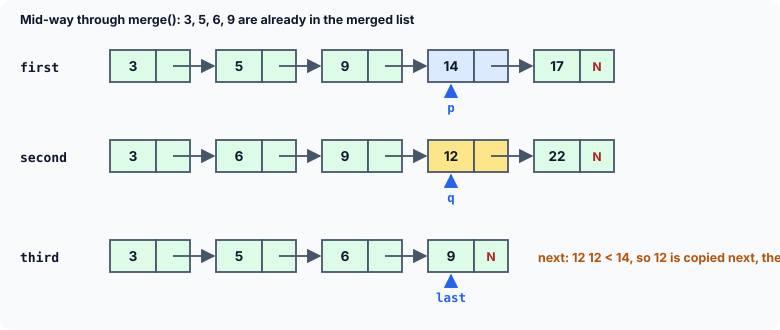

title : Merging Two Sorted Linked Lists

summary : Why linked lists beat arrays when data grows and shrinks, then merge two sorted linked lists into a third one in a single pass, keeping common values only once. Every pointer move is explained, including the empty-list case that the classic version crashes on.

# Merging Two Sorted Linked Lists

In computer science, linked lists are used everywhere: database systems, process management in operating systems, text editors and much more. The previous chapter showed how singly and doubly linked lists are built with pointers. This chapter uses them to solve bigger problems: merging lists, storing polynomials, sorting, and then two new structures — **trees** and **graphs**.

## Why Linked Lists?

Recall the problems with arrays:

- The list of items to store is very often either **too short or too big** compared with the declared size of the array.
- While the program runs, the list **cannot grow** beyond the declared size.
- Inserting or deleting at a given position needs a lot of **movement of data**: every element after that position must shift. That makes such operations slow.

A linked list solves these problems:

1. **It grows and shrinks during its lifetime.** Its maximum size need not be known in advance. In practice this also lets several data structures share the same memory, without anyone planning in advance how big each one may become.
2. **Items can be rearranged efficiently.** Inserting, deleting or reordering means changing a few links; no data moves.

This flexibility has a price: there is no quick access to an arbitrary item. To reach the 50th node you must walk past the first 49. Whether that matters depends on how the data is used.

## The Problem

Suppose we have two linked lists, pointed to by two independent pointers, and we want to **merge** them into a third list. While merging, an element that is present in **both** lists must occur only **once** in the result.

We will assume that within each list all elements are unique, and that both lists are kept in **ascending order**. That assumption is what makes merging fast: we can walk through both lists once, side by side, always taking the smaller value — exactly like merging two sorted piles of exam papers into one.

## The Program

```c runnable
#include <stdio.h>
#include <stdlib.h>

struct node
{
    int data;
    struct node *link;
};

void add(struct node **q, int num);
void merge(const struct node *p, const struct node *q, struct node **s);
void append_node(struct node **s, struct node **last, int num);
void display(const struct node *q);
int count(const struct node *q);
void free_list(struct node **q);

int main(void)
{
    struct node *first = NULL, *second = NULL, *third = NULL;   /* empty lists */
    int a[] = {14, 3, 22, 9, 31, 17, 5};
    int b[] = {9, 40, 22, 6, 31, 12, 3};

    for (int i = 0; i < 7; i++) {
        add(&first, a[i]);
        add(&second, b[i]);
    }

    printf("First linked list : ");
    display(first);
    printf("No. of elements in Linked List : %d\n", count(first));

    printf("Second linked list : ");
    display(second);
    printf("No. of elements in Linked List : %d\n", count(second));

    merge(first, second, &third);

    printf("The merged list : ");
    display(third);
    printf("No. of elements in Linked List : %d\n", count(third));

    free_list(&first);
    free_list(&second);
    free_list(&third);
    return 0;
}

/* adds a node to an ascending-order linked list */
void add(struct node **q, int num)
{
    struct node *r = malloc(sizeof *r);
    if (r == NULL)
        exit(EXIT_FAILURE);
    r->data = num;

    while (*q != NULL && (*q)->data < num)   /* walk the links to the right gap */
        q = &(*q)->link;

    r->link = *q;
    *q = r;
}

/* adds a node holding num after *last; the very first node becomes *s */
void append_node(struct node **s, struct node **last, int num)
{
    struct node *r = malloc(sizeof *r);
    if (r == NULL)
        exit(EXIT_FAILURE);
    r->data = num;
    r->link = NULL;

    if (*last == NULL)          /* the merged list is still empty */
        *s = r;
    else
        (*last)->link = r;      /* link it after the current last node */
    *last = r;                  /* it is now the last node */
}

/* merges two ascending lists into a third, keeping common elements once */
void merge(const struct node *p, const struct node *q, struct node **s)
{
    struct node *last = NULL;   /* last node of the merged list so far */

    *s = NULL;

    /* while both lists have elements left */
    while (p != NULL && q != NULL) {
        if (p->data < q->data) {
            append_node(s, &last, p->data);
            p = p->link;
        } else if (q->data < p->data) {
            append_node(s, &last, q->data);
            q = q->link;
        } else {                /* equal: store it only once */
            append_node(s, &last, p->data);
            p = p->link;
            q = q->link;
        }
    }

    /* copy whatever is left of either list */
    for (; p != NULL; p = p->link)
        append_node(s, &last, p->data);
    for (; q != NULL; q = q->link)
        append_node(s, &last, q->data);
}

void display(const struct node *q)
{
    for (; q != NULL; q = q->link)
        printf("%d ", q->data);
    printf("\n");
}

int count(const struct node *q)
{
    int c = 0;

    for (; q != NULL; q = q->link)
        c++;
    return c;
}

void free_list(struct node **q)
{
    while (*q != NULL) {
        struct node *next = (*q)->link;
        free(*q);
        *q = next;
    }
}
```

```
First linked list : 3 5 9 14 17 22 31 
No. of elements in Linked List : 7
Second linked list : 3 6 9 12 22 31 40 
No. of elements in Linked List : 7
The merged list : 3 5 6 9 12 14 17 22 31 40 
No. of elements in Linked List : 10
```

The values were added to `first` and `second` in no particular order, but `add()` keeps each list sorted. In the merged list, 3, 9, 22 and 31 — which are in both lists — appear only once: 7 + 7 = 14 values went in, and 10 came out.

## How It Works

### Building the two lists: add()

`add()` inserts each value at its correct position, so the list is always in ascending order. It uses the pointer-to-a-link technique from the sorted-list article:

```c
while (*q != NULL && (*q)->data < num)
    q = &(*q)->link;
```

This line confuses many students, so let us read it slowly.

- `q` is a `struct node **` — it does not point to a **node**, it points to a **link** (a variable that holds the address of a node). At the start it points to `first` itself.
- `*q` is the link it points to, and `(*q)->data` is the data of the node that link leads to.
- `&(*q)->link` means `&((*q)->link)`: the **address** of the `link` member of that node. Assigning it to `q` moves `q` one link further along the list.

When the loop stops, `*q` is exactly the link that must lead to the new node. So `r->link = *q;` makes the new node point to what came after the gap, and `*q = r;` makes the link before the gap point to the new node. Because `q` started at `first` itself, inserting at the very front needs no special case.

### Merging: merge()

`merge()` uses two pointers, `p` and `q`, one for each list. They are declared `const struct node *`, because `merge()` only **reads** the two input lists: it builds a new list, and never changes `first` or `second`.



As long as **both** lists still have nodes, the loop compares the two current values:

- If `p->data` is smaller, it is copied to the merged list and `p` moves on.
- If `q->data` is smaller, it is copied and `q` moves on.
- If they are **equal**, the value is copied **once** and **both** pointers move on. This is how common elements end up only once in the result.

Since both lists are in ascending order, the value copied at each step is always the smallest value not yet copied, so the merged list comes out in ascending order too.

When one list runs out, everything left in the other list is larger than anything copied so far, so the two `for` loops copy the rest. (Only one of them ever does anything: at that point at least one of `p` and `q` is `NULL`.)

### Adding at the end: append_node()

Each copied value is added at the **end** of the merged list. Walking the whole list every time to find its end would be slow, so `merge()` keeps a pointer `last` to the last node added so far.

Why does `append_node()` take `struct node **s` and `struct node **last` — pointers to pointers? Because it has to **change** two pointer variables that belong to its caller:

- When the very first node is added, `*last` is `NULL` (the merged list is empty), so the new node becomes the head: `*s = r;`. Here `s` is `&third` from `main`, so this sets `third` itself.
- After that, the new node is linked after the last one: `(*last)->link = r;`. The parentheses matter: `->` binds more tightly than `*`, so without them `*last->link` would mean `*(last->link)`, which is wrong.
- Either way, `*last = r;` makes the new node the last one, by changing `merge()`'s own variable `last` through its address.

Each new node's `link` is set to `NULL` as soon as it is created, so the merged list is always correctly terminated, even halfway through.

:::callout
A widely printed version of this program creates each new node with `z->link = malloc(...)` in the two "copy the rest" loops, assuming `z` already points to a node. If one list is **empty**, the main loop never runs, `z` is still `NULL`, and the very first copy writes through a `NULL` pointer — a crash, although the text of that version claims it handles empty lists. Keeping "is the merged list still empty?" in **one** helper function, as `append_node()` does, makes every path handle it.
:::

Here is the same program with an empty `first` list:

```c runnable
#include <stdio.h>
#include <stdlib.h>

struct node
{
    int data;
    struct node *link;
};

void add(struct node **q, int num);
void merge(const struct node *p, const struct node *q, struct node **s);
void append_node(struct node **s, struct node **last, int num);
void display(const struct node *q);
int count(const struct node *q);
void free_list(struct node **q);

int main(void)
{
    struct node *first = NULL, *second = NULL, *third = NULL;   /* empty lists */
    int b[] = {9, 40, 22, 6, 31, 12, 3};

    for (int i = 0; i < 7; i++)
        add(&second, b[i]);         /* first stays empty */

    printf("First linked list : ");
    display(first);
    printf("No. of elements in Linked List : %d\n", count(first));

    printf("Second linked list : ");
    display(second);
    printf("No. of elements in Linked List : %d\n", count(second));

    merge(first, second, &third);

    printf("The merged list : ");
    display(third);
    printf("No. of elements in Linked List : %d\n", count(third));

    free_list(&first);
    free_list(&second);
    free_list(&third);
    return 0;
}

/* adds a node to an ascending-order linked list */
void add(struct node **q, int num)
{
    struct node *r = malloc(sizeof *r);
    if (r == NULL)
        exit(EXIT_FAILURE);
    r->data = num;

    while (*q != NULL && (*q)->data < num)   /* walk the links to the right gap */
        q = &(*q)->link;

    r->link = *q;
    *q = r;
}

/* adds a node holding num after *last; the very first node becomes *s */
void append_node(struct node **s, struct node **last, int num)
{
    struct node *r = malloc(sizeof *r);
    if (r == NULL)
        exit(EXIT_FAILURE);
    r->data = num;
    r->link = NULL;

    if (*last == NULL)          /* the merged list is still empty */
        *s = r;
    else
        (*last)->link = r;      /* link it after the current last node */
    *last = r;                  /* it is now the last node */
}

/* merges two ascending lists into a third, keeping common elements once */
void merge(const struct node *p, const struct node *q, struct node **s)
{
    struct node *last = NULL;   /* last node of the merged list so far */

    *s = NULL;

    /* while both lists have elements left */
    while (p != NULL && q != NULL) {
        if (p->data < q->data) {
            append_node(s, &last, p->data);
            p = p->link;
        } else if (q->data < p->data) {
            append_node(s, &last, q->data);
            q = q->link;
        } else {                /* equal: store it only once */
            append_node(s, &last, p->data);
            p = p->link;
            q = q->link;
        }
    }

    /* copy whatever is left of either list */
    for (; p != NULL; p = p->link)
        append_node(s, &last, p->data);
    for (; q != NULL; q = q->link)
        append_node(s, &last, q->data);
}

void display(const struct node *q)
{
    for (; q != NULL; q = q->link)
        printf("%d ", q->data);
    printf("\n");
}

int count(const struct node *q)
{
    int c = 0;

    for (; q != NULL; q = q->link)
        c++;
    return c;
}

void free_list(struct node **q)
{
    while (*q != NULL) {
        struct node *next = (*q)->link;
        free(*q);
        *q = next;
    }
}
```

```
First linked list : 
No. of elements in Linked List : 0
Second linked list : 3 6 9 12 22 31 40 
No. of elements in Linked List : 7
The merged list : 3 6 9 12 22 31 40 
No. of elements in Linked List : 7
```

The merge simply copies the second list.

### Freeing the lists

Every node was created with `malloc`, so `main` frees all three lists at the end. Notice that the merged list does not share any nodes with `first` or `second`: `merge()` makes new nodes. That is why all three lists can be freed independently. (If `merge()` had **re-linked** the original nodes instead of copying their values, `first` and `second` would no longer be separate lists, and freeing them all would free some nodes twice.)

## How Fast Is It?

Each step of the main loop copies one node and moves at least one of `p` and `q` forward. So for lists of lengths *m* and *n*, merging takes at most *m* + *n* steps — it looks at every node once. This is the same merging step that the **merge sort** algorithm uses to sort.

## Key Takeaways

- Linked lists grow and shrink while the program runs and can be rearranged by changing links, but they give up fast access to the *i*-th item.
- Two sorted lists are merged in one pass: compare the two current nodes, copy the smaller, and advance; on equal values copy once and advance both.
- A `last` pointer makes adding at the end fast. A function that must change the caller's pointers takes their addresses (`struct node **`).
- Read `q = &(*q)->link` as "move `q` to the next link"; read `(*last)->link` as "the link of the node `last` points to".
- Always test list functions with an empty list.

## Practice Questions

:::details[The first list is 2 4 6 8 and the second is 1 4 8 9. What does the merged list contain?]
`1 2 4 6 8 9` — the common values 4 and 8 appear once.
:::

:::details[Why do p and q have the type const struct node * in merge()?]
`merge()` only reads the input lists. The `const` promises that it will not change any node of `first` or `second`, and the compiler enforces that promise. (The pointers themselves can still move, since the `const` applies to the nodes, not to `p` and `q`.)
:::

:::details[What goes wrong if merge() is given lists that are not sorted, say 5 1 and 3?]
The result is just not sorted, and duplicates may survive. First 3 is compared with 5: 3 is copied. Then `q` is empty, so 5 and 1 are copied: `3 5 1`. The algorithm relies on both inputs being in ascending order.
:::

:::details[How would you change merge() so that common elements appear twice instead of once?]
In the "equal" case, copy the value twice (or copy `p`'s value and advance only `p`, letting `q`'s copy be added on the next step). Then the merged list contains every element of both lists.
:::
