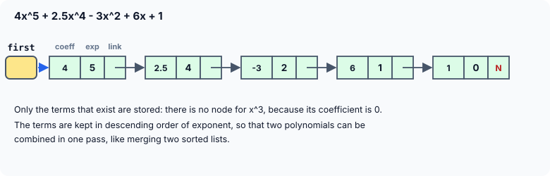

title : Polynomials with Linked Lists: Addition and Multiplication

summary : Store a polynomial such as 4x^5 + 2.5x^4 - 3x^2 + 6x + 1 as a linked list of terms, then add two polynomials in one pass and multiply them term by term, combining equal powers and removing terms that cancel. Every tricky line is explained.

# Polynomials with Linked Lists: Addition and Multiplication

A polynomial such as

```
4x^5 + 2.5x^4 - 3x^2 + 6x + 1
```

is a sum of **terms**, and each term has two parts: a **coefficient** (4, 2.5, −3, …) and an **exponent** (5, 4, 2, …). A linked list is a natural way to store one: each node holds one term.

Why not an array, with the coefficient of x^k in element k? For a polynomial like x^1000 + 1, that array would need 1001 elements, 999 of them zero. A linked list stores **only the terms that exist**, and it can grow as terms are added.

## Representing a Polynomial

Each node has three members: the coefficient, the exponent, and a link to the next term.

```c
struct polynode
{
    double coeff;
    int exp;
    struct polynode *link;
};
```

The coefficient is a `double`, because coefficients can be fractions such as 2.5. The exponent is an `int`: powers are whole numbers.



We will always keep the terms in **descending order of exponent**, and never store two terms with the same exponent. This one rule is what makes adding and multiplying simple, as you will see.

## Adding Two Polynomials

```c runnable
#include <stdio.h>
#include <stdlib.h>

/* one term of a polynomial: coeff * x^exp */
struct polynode
{
    double coeff;
    int exp;
    struct polynode *link;
};

void poly_append(struct polynode **q, double c, int e);
void display_poly(const struct polynode *q);
void poly_addition(const struct polynode *x, const struct polynode *y, struct polynode **s);
void free_poly(struct polynode **q);

int main(void)
{
    struct polynode *first = NULL, *second = NULL, *total = NULL;

    /* 4x^5 + 2.5x^4 - 3x^2 + 6x + 1 */
    poly_append(&first, 4.0, 5);
    poly_append(&first, 2.5, 4);
    poly_append(&first, -3.0, 2);
    poly_append(&first, 6.0, 1);
    poly_append(&first, 1.0, 0);

    /* 2x^6 - 2.5x^4 + 5x^3 + 3x^2 - 7 */
    poly_append(&second, 2.0, 6);
    poly_append(&second, -2.5, 4);
    poly_append(&second, 5.0, 3);
    poly_append(&second, 3.0, 2);
    poly_append(&second, -7.0, 0);

    printf("  ");
    display_poly(first);
    printf("+ ");
    display_poly(second);
    printf("----------------------------------------\n");

    poly_addition(first, second, &total);
    printf("= ");
    display_poly(total);

    free_poly(&first);
    free_poly(&second);
    free_poly(&total);
    return 0;
}

/* adds a term at the end of the polynomial */
void poly_append(struct polynode **q, double c, int e)
{
    struct polynode *r = malloc(sizeof *r);
    if (r == NULL)
        exit(EXIT_FAILURE);
    r->coeff = c;
    r->exp = e;
    r->link = NULL;

    while (*q != NULL)          /* go to the last link */
        q = &(*q)->link;
    *q = r;
}

/* prints a polynomial such as 4x^5 + 2.5x^4 - 3x^2 + 6x + 1 */
void display_poly(const struct polynode *q)
{
    if (q == NULL) {
        printf("0\n");
        return;
    }

    for (int first = 1; q != NULL; q = q->link, first = 0) {
        double c = q->coeff;

        if (first)
            printf(c < 0 ? "-" : "");
        else
            printf(c < 0 ? " - " : " + ");
        if (c < 0)
            c = -c;                 /* the sign has been printed already */

        if (c != 1.0 || q->exp == 0)        /* write 1x^2 as just x^2 */
            printf("%g", c);
        if (q->exp == 1)
            printf("x");
        else if (q->exp > 1)
            printf("x^%d", q->exp);
    }
    printf("\n");
}

/* adds two polynomials whose terms are in descending order of exponent */
void poly_addition(const struct polynode *x, const struct polynode *y, struct polynode **s)
{
    *s = NULL;

    while (x != NULL && y != NULL) {
        if (x->exp > y->exp) {          /* only x has this power */
            poly_append(s, x->coeff, x->exp);
            x = x->link;
        } else if (y->exp > x->exp) {   /* only y has this power */
            poly_append(s, y->coeff, y->exp);
            y = y->link;
        } else {                        /* same power: add the coefficients */
            double sum = x->coeff + y->coeff;
            if (sum != 0.0)             /* 2.5x^4 - 2.5x^4 leaves no term */
                poly_append(s, sum, x->exp);
            x = x->link;
            y = y->link;
        }
    }

    for (; x != NULL; x = x->link)      /* terms left in either polynomial */
        poly_append(s, x->coeff, x->exp);
    for (; y != NULL; y = y->link)
        poly_append(s, y->coeff, y->exp);
}

void free_poly(struct polynode **q)
{
    while (*q != NULL) {
        struct polynode *next = (*q)->link;
        free(*q);
        *q = next;
    }
}
```

```
  4x^5 + 2.5x^4 - 3x^2 + 6x + 1
+ 2x^6 - 2.5x^4 + 5x^3 + 3x^2 - 7
----------------------------------------
= 2x^6 + 4x^5 + 5x^3 + 6x - 6
```

Check the answer by hand: 2.5x^4 − 2.5x^4 cancels, −3x^2 + 3x^2 cancels, and 1 − 7 = −6. The other terms are copied unchanged.

### poly_append(): adding a term at the end

`poly_append()` creates a node and attaches it at the end of a polynomial. It walks the **links** with `q = &(*q)->link;`, the technique from the sorted-list articles: `q` always points to a link, so when the loop stops, `*q` is the final `NULL` link, and `*q = r;` makes it point to the new node. If the polynomial is empty, `q` still points to `first` itself, so the new node becomes the first term — no special case needed.

`poly_append()` assumes that each new term has a smaller exponent than the previous one; `main` adds the terms in that order.

### poly_addition(): one pass through both polynomials

Adding polynomials means adding the coefficients of **equal powers**. Because both lists are in descending order of exponent, this works exactly like merging two sorted lists:

- `x` and `y` walk through the two polynomials.
- If `x`'s current exponent is **larger**, no term of `y` has that power (all of `y`'s remaining terms have smaller powers), so `x`'s term is copied as it is, and `x` moves on.
- If `y`'s exponent is larger, `y`'s term is copied.
- If the exponents are **equal**, the coefficients are added, and both pointers move on.
- When one polynomial runs out, the rest of the other is copied.

Notice the test `if (sum != 0.0)`. When two terms cancel — like 2.5x^4 and −2.5x^4 — the sum is 0, and a term `0x^4` should not appear in the result at all. (Comparing a `double` with `0.0` is exact here, because 2.5 and −2.5 add up to exactly 0. With values that come out of long calculations, rounding errors can leave a tiny non-zero result, and real programs then compare against a small tolerance instead.)

The parameters `x` and `y` are `const struct polynode *`, since the function only reads the two inputs. `s` is a `struct polynode **`, because the function must set the caller's `total` to the first node of the new polynomial — and changing a caller's pointer needs that pointer's address.

### display_poly(): printing it nicely

`display_poly()` prints the terms with proper signs: `- 3x^2` rather than `+ -3x^2`, `6x` rather than `6x^1`, `x^4` rather than `1x^4`, and just `1` for the constant term.

It does this by printing the **sign separately**. For the first term, only a minus sign is printed, if needed. For every other term, `" + "` or `" - "` is printed, followed by the coefficient's absolute value. The loop header

```c
for (int first = 1; q != NULL; q = q->link, first = 0)
```

uses the **comma operator** to do two things after every term: move `q` to the next term **and** set `first` to 0. So `first` is 1 only while the very first term is printed.

`%g` prints a `double` in its shortest form: `4` for 4.0 and `2.5` for 2.5, without trailing zeros.

:::callout
Older programs print each term as `"%.1f x^%d : "` and then print `"\b\b\b"` — three backspace characters — to rub out the last separator on the screen. That only works on a terminal that interprets backspaces; the characters are still in the output, which shows if the output is redirected to a file. Deciding **before** printing each term whether a separator is needed, as here, works everywhere.
:::

## Multiplying Two Polynomials

To multiply two polynomials, multiply **every term of the first by every term of the second**, and add up the results. For one pair of terms:

```
(a·x^m) × (b·x^n) = (a·b)·x^(m + n)
```

The coefficients **multiply** and the exponents **add**. Several pairs can give the same power — for example x^2 · x and x · x^2 both give x^3 — so each new term must be **combined** with any existing term of the same power.

```c runnable
#include <stdio.h>
#include <stdlib.h>

/* one term of a polynomial: coeff * x^exp */
struct polynode
{
    double coeff;
    int exp;
    struct polynode *link;
};

void poly_append(struct polynode **q, double c, int e);
void display_poly(const struct polynode *q);
void padd(struct polynode **s, double c, int e);
void poly_multiply(const struct polynode *x, const struct polynode *y, struct polynode **m);
void free_poly(struct polynode **q);

int main(void)
{
    struct polynode *first = NULL, *second = NULL, *mult = NULL;

    /* 3x^2 + 2x - 1 */
    poly_append(&first, 3.0, 2);
    poly_append(&first, 2.0, 1);
    poly_append(&first, -1.0, 0);

    /* 2x^3 - x^2 + 4 */
    poly_append(&second, 2.0, 3);
    poly_append(&second, -1.0, 2);
    poly_append(&second, 4.0, 0);

    printf("  ");
    display_poly(first);
    printf("x ");
    display_poly(second);
    printf("----------------------------------------\n");

    poly_multiply(first, second, &mult);
    printf("= ");
    display_poly(mult);

    free_poly(&first);
    free_poly(&second);
    free_poly(&mult);

    /* (x + 1)(x - 1): the x terms cancel */
    poly_append(&first, 1.0, 1);
    poly_append(&first, 1.0, 0);
    poly_append(&second, 1.0, 1);
    poly_append(&second, -1.0, 0);
    poly_multiply(first, second, &mult);
    printf("\n(x + 1)(x - 1) = ");
    display_poly(mult);

    free_poly(&first);
    free_poly(&second);
    free_poly(&mult);
    return 0;
}

/* adds a term at the end of the polynomial */
void poly_append(struct polynode **q, double c, int e)
{
    struct polynode *r = malloc(sizeof *r);
    if (r == NULL)
        exit(EXIT_FAILURE);
    r->coeff = c;
    r->exp = e;
    r->link = NULL;

    while (*q != NULL)          /* go to the last link */
        q = &(*q)->link;
    *q = r;
}

/* prints a polynomial such as 4x^5 + 2.5x^4 - 3x^2 + 6x + 1 */
void display_poly(const struct polynode *q)
{
    if (q == NULL) {
        printf("0\n");
        return;
    }

    for (int first = 1; q != NULL; q = q->link, first = 0) {
        double c = q->coeff;

        if (first)
            printf(c < 0 ? "-" : "");
        else
            printf(c < 0 ? " - " : " + ");
        if (c < 0)
            c = -c;                 /* the sign has been printed already */

        if (c != 1.0 || q->exp == 0)        /* write 1x^2 as just x^2 */
            printf("%g", c);
        if (q->exp == 1)
            printf("x");
        else if (q->exp > 1)
            printf("x^%d", q->exp);
    }
    printf("\n");
}

/* adds the term c*x^e to a polynomial kept in descending order of exponent */
void padd(struct polynode **s, double c, int e)
{
    /* walk the links until the next term's power is not larger than e */
    while (*s != NULL && (*s)->exp > e)
        s = &(*s)->link;

    if (*s != NULL && (*s)->exp == e) {     /* this power exists already */
        (*s)->coeff += c;
        if ((*s)->coeff == 0.0) {           /* the terms cancelled out */
            struct polynode *dead = *s;
            *s = dead->link;
            free(dead);
        }
        return;
    }

    struct polynode *r = malloc(sizeof *r); /* a new power: insert it here */
    if (r == NULL)
        exit(EXIT_FAILURE);
    r->coeff = c;
    r->exp = e;
    r->link = *s;
    *s = r;
}

/* multiplies two polynomials: every term of x times every term of y */
void poly_multiply(const struct polynode *x, const struct polynode *y, struct polynode **m)
{
    *m = NULL;                              /* an empty product means 0 */

    for (const struct polynode *p = x; p != NULL; p = p->link)
        for (const struct polynode *q = y; q != NULL; q = q->link)
            padd(m, p->coeff * q->coeff, p->exp + q->exp);
}

void free_poly(struct polynode **q)
{
    while (*q != NULL) {
        struct polynode *next = (*q)->link;
        free(*q);
        *q = next;
    }
}
```

```
  3x^2 + 2x - 1
x 2x^3 - x^2 + 4
----------------------------------------
= 6x^5 + x^4 - 4x^3 + 13x^2 + 8x - 4

(x + 1)(x - 1) = x^2 - 1
```

You can check the first answer by hand: (3x^2 + 2x − 1)(2x^3 − x^2 + 4) = 6x^5 − 3x^4 + 12x^2 + 4x^4 − 2x^3 + 8x − 2x^3 + x^2 − 4, and collecting equal powers gives 6x^5 + x^4 − 4x^3 + 13x^2 + 8x − 4.

### poly_multiply()

Two nested loops produce every pair of terms: `p` walks the first polynomial, and for each of its terms, `q` walks the **whole** second polynomial. Because `q` is declared in the inner `for`, it starts again from the first term of `y` for every term of `x`. Each product term is handed to `padd()`, which puts it in the right place.

If either polynomial is empty (that is, the polynomial 0), the loops never call `padd()`, and the product stays empty — 0, as it should be.

:::callout
A common older version handles an empty first polynomial with `*m = y;`, making the "product" point at the **same nodes** as the second polynomial. That is wrong twice over. Mathematically, 0 × anything is 0, not the other polynomial. And in memory, `mult` and `second` would share nodes, so freeing both would free the same nodes twice. The same version stores the exponent sum in a `float` and, when inserting, reads `temp->link->exp` before checking whether `temp->link` is `NULL`, which crashes when a term belongs at the end. A function that builds a new structure should build **new** nodes, and check every pointer before using it.
:::

### padd(): adding one term in the right place

`padd()` keeps the product in descending order of exponent, even though the terms arrive in any order. It walks the links until the next term's exponent is **not larger** than the new term's:

```c
while (*s != NULL && (*s)->exp > e)
    s = &(*s)->link;
```

The order of the test matters: `*s != NULL` is checked first, so `(*s)->exp` is only read when there **is** a next term. (`&&` stops as soon as its left side is false.)

When the loop stops, there are two possibilities:

1. **A term with the same exponent exists** (`(*s)->exp == e`). The coefficients are added. If they cancel to 0, the term is removed: `dead` remembers the node, `*s = dead->link;` makes the link skip over it, and `free(dead)` releases it. That is what happens to the x terms in (x + 1)(x − 1).
2. **The next term has a smaller exponent, or the end is reached.** Either way, the new term belongs exactly here: `r->link = *s;` points the new node at whatever came next (possibly `NULL`), and `*s = r;` makes the previous link point to the new node.

Because `s` walks **links** rather than nodes, inserting before the first term works exactly like inserting anywhere else.

## Key Takeaways

- A polynomial is stored as a linked list of (coefficient, exponent) terms, only for the powers that exist, in descending order of exponent.
- Adding two polynomials is a merge: copy the term with the larger exponent; on equal exponents add the coefficients, and drop the term if the sum is 0.
- Multiplying multiplies every pair of terms (coefficients multiply, exponents add) and inserts each product with a function that combines equal powers.
- Build results from **new** nodes; never let two polynomials share nodes.
- `while (*s != NULL && (*s)->exp > e)` relies on `&&` checking `NULL` first.

## Practice Questions

:::details[Add (5x^3 - 2x + 7) and (-5x^3 + x^2 + 2x). Which terms survive?]
5x^3 − 5x^3 cancels and −2x + 2x cancels. The result is **x^2 + 7**: only two nodes.
:::

:::details[How many times does poly_multiply() call padd() for polynomials with 4 and 5 terms? How many terms can the product have at most?]
4 × 5 = **20** calls — one per pair of terms. The product has at most 20 terms, but usually far fewer, because pairs with the same exponent sum are combined.
:::

:::details[Why does poly_addition() not need to sort its result?]
Both inputs are in descending order of exponent, and at every step the term with the largest remaining exponent is copied (or two equal ones combined). So terms are appended in descending order, and the result is sorted automatically.
:::

:::details[Write a function that evaluates a polynomial for a given value of x.]
```c
#include <math.h>

double evaluate(const struct polynode *q, double x)
{
    double sum = 0.0;

    for (; q != NULL; q = q->link)
        sum += q->coeff * pow(x, q->exp);
    return sum;
}
```
For 4x^5 + 2.5x^4 − 3x^2 + 6x + 1 at x = 1, it returns 4 + 2.5 − 3 + 6 + 1 = 10.5. (On Linux, link with `-lm` to use `pow`.)
:::
