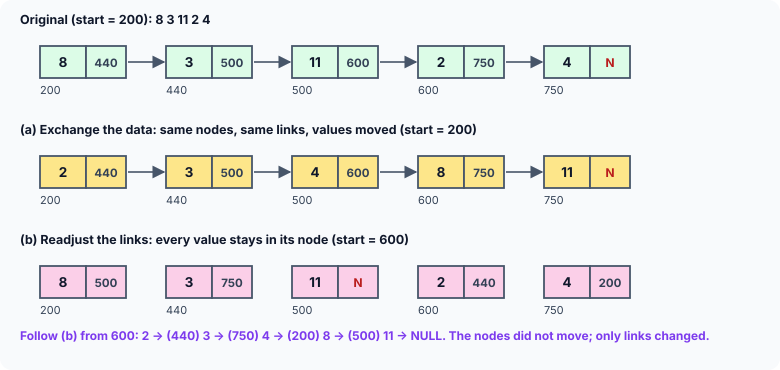
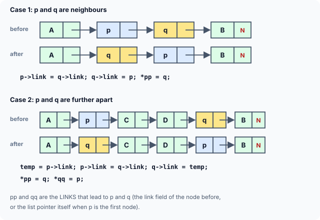

title : Sorting a Linked List: Swapping Data vs Relinking Nodes

summary : Sort a linked list with selection sort and bubble sort in two ways: by exchanging the data inside the nodes, and by rearranging the links so the nodes themselves change order. See when each is better, and how a pointer to a link turns the four special cases of node swapping into two.

# Sorting a Linked List: Swapping Data vs Relinking Nodes

Sorting an array means moving its elements around. A linked list offers a choice. To bring its elements into ascending order we can either:

1. **exchange the data** stored in the nodes, leaving the nodes and their links where they are; or
2. **readjust the links**, so that the nodes themselves change order while the data in each node stays put.

Here is the difference on a five-node list. In the picture, the number under each node is its address, and the number in its link part is the address of the next node:



In (a), the node at address 200 used to hold 8 and now holds 2: values were copied between nodes, but every link is as it was. In (b), the node at 200 still holds 8, but the links have changed: the list now **starts** at 600, which links to 440, then 750, 200 and 500. Reading the values in that order gives 2 3 4 8 11.

The first method is easier to program. The second is the better choice when the data part of each node is **large** — say, a full employee record with name, address, age and salary. Swapping two such records means copying the whole record three times (through a temporary), whereas readjusting links only ever copies 8-byte pointers. There is a second reason too: other parts of a program may hold pointers to particular **records**; if the data moves between nodes, those pointers suddenly point to different records.

This article sorts the same list both ways, with two classic algorithms: **selection sort** and **bubble sort**.

## Method 1: Exchanging the Data

```c runnable
#include <stdio.h>
#include <stdlib.h>

struct node
{
    int data;
    struct node *link;
};

void append(struct node **q, int num);
void display(const struct node *q);
void selection_sort(struct node *start);
void bubble_sort(struct node *start);
void free_list(struct node **q);

int main(void)
{
    int values[] = {42, 17, 63, 8, 29, 51, 3};
    struct node *list = NULL;

    for (int i = 0; i < 7; i++)
        append(&list, values[i]);
    printf("Before selection sort: ");
    display(list);
    selection_sort(list);
    printf("After selection sort:  ");
    display(list);
    free_list(&list);

    for (int i = 0; i < 7; i++)
        append(&list, values[i]);
    printf("Before bubble sort:    ");
    display(list);
    bubble_sort(list);
    printf("After bubble sort:     ");
    display(list);
    free_list(&list);
    return 0;
}

/* selection sort: put the smallest remaining value at p, then move p on */
void selection_sort(struct node *start)
{
    for (struct node *p = start; p != NULL; p = p->link)
        for (struct node *q = p->link; q != NULL; q = q->link)
            if (p->data > q->data) {           /* exchange the DATA only */
                int temp = p->data;
                p->data = q->data;
                q->data = temp;
            }
}

/* bubble sort: compare neighbours; each pass carries the largest to the end */
void bubble_sort(struct node *start)
{
    struct node *end = NULL;                   /* nodes from end onwards are in place */

    while (start != NULL && start->link != end) {
        struct node *p = start;

        while (p->link != end) {               /* compare p with the node after it */
            struct node *q = p->link;
            if (p->data > q->data) {
                int temp = p->data;
                p->data = q->data;
                q->data = temp;
            }
            p = q;
        }
        end = p;                               /* p holds this pass's largest value */
    }
}

void append(struct node **q, int num)
{
    struct node *r = malloc(sizeof *r);
    if (r == NULL)
        exit(EXIT_FAILURE);
    r->data = num;
    r->link = NULL;

    while (*q != NULL)
        q = &(*q)->link;
    *q = r;
}

void display(const struct node *q)
{
    for (; q != NULL; q = q->link)
        printf("%d ", q->data);
    printf("\n");
}

void free_list(struct node **q)
{
    while (*q != NULL) {
        struct node *next = (*q)->link;
        free(*q);
        *q = next;
    }
}
```

```
Before selection sort: 42 17 63 8 29 51 3 
After selection sort:  3 8 17 29 42 51 63 
Before bubble sort:    42 17 63 8 29 51 3 
After bubble sort:     3 8 17 29 42 51 63 
```

Both functions receive the address of the first node, `start`, as a plain `struct node *`. That is enough here, because exchanging data never changes **which** node is first: the first node stays first and just receives a different value.

### Selection sort

Selection sort works position by position. `p` marks the position being filled, starting at the first node. The inner loop moves `q` over every node **after** `p`, and whenever `q` holds a smaller value than `p`, the two values are exchanged. When the inner loop ends, `p` holds the smallest value among all nodes from `p` onwards. Then `p` moves to the next node and the process repeats.

The loop conditions are `p != NULL` and `q != NULL`, so no count of the nodes is needed: the `NULL` at the end of the list says when to stop.

### Bubble sort

Bubble sort compares **neighbouring** nodes, `p` and the node after it, `q`, and exchanges their values if they are in the wrong order. One pass over the list carries the largest value all the way to the end — it "bubbles" up — so it never needs to be compared again.

The pointer `end` marks where the sorted part begins. It starts as `NULL` (nothing is sorted yet). Each pass stops when `p->link` reaches `end`; at that moment `p` is the last unsorted node, and it holds the largest value of the pass, so `end = p;` adds it to the sorted part. The outer loop stops when only one unsorted node is left: `start->link != end` fails. The test `start != NULL` comes first so that an empty list is handled, too.

## Method 2: Readjusting the Links

Exchanging two **nodes** is harder than exchanging two values, because the nodes around them must be updated as well. To move a node, you must change the link that **leads to** it — and that link belongs to the node before it, or, if it is the first node, it is the list pointer itself.

Older presentations of this program keep two extra pointers, `r` (the node before `p`) and `s` (the node before `q`), and handle four separate cases: the nodes are neighbours or not, and `p` is the first node or not. The same idea from the earlier articles — working with a **pointer to the link** that leads to a node, a `struct node **` — removes the "first node or not" question entirely, leaving two cases:



```c runnable
#include <stdio.h>
#include <stdlib.h>

struct node
{
    int data;
    struct node *link;
};

void append(struct node **q, int num);
void display(const struct node *q);
void swap_nodes(struct node **pp, struct node **qq);
void selection_sort(struct node **start);
void bubble_sort(struct node **start);
void free_list(struct node **q);

int main(void)
{
    int values[] = {42, 17, 63, 8, 29, 51, 3};
    struct node *list = NULL;

    for (int i = 0; i < 7; i++)
        append(&list, values[i]);
    printf("Before selection sort: ");
    display(list);
    selection_sort(&list);
    printf("After selection sort:  ");
    display(list);
    free_list(&list);

    for (int i = 0; i < 7; i++)
        append(&list, values[i]);
    printf("Before bubble sort:    ");
    display(list);
    bubble_sort(&list);
    printf("After bubble sort:     ");
    display(list);
    free_list(&list);
    return 0;
}

/* exchanges the nodes *pp and *qq; *pp must come before *qq in the list.
   pp and qq are the LINKS that point to the two nodes. */
void swap_nodes(struct node **pp, struct node **qq)
{
    struct node *p = *pp, *q = *qq;

    if (p->link == q) {                        /* neighbours: p -> q */
        p->link = q->link;                     /* p now points past q */
        q->link = p;                           /* q now points to p */
        *pp = q;                               /* the link before p now leads to q */
    } else {                                   /* not neighbours */
        struct node *temp = p->link;
        p->link = q->link;                     /* exchange what they point to */
        q->link = temp;
        *pp = q;                               /* exchange which links lead to them */
        *qq = p;
    }
}

/* selection sort that moves nodes, not data */
void selection_sort(struct node **start)
{
    /* pp: the link that leads to the position being filled */
    for (struct node **pp = start; *pp != NULL; pp = &(*pp)->link) {
        struct node **min = pp;                /* link that leads to the smallest node */

        for (struct node **qq = &(*pp)->link; *qq != NULL; qq = &(*qq)->link)
            if ((*qq)->data < (*min)->data)
                min = qq;

        if (min != pp)
            swap_nodes(pp, min);               /* bring the smallest node to *pp */
    }
}

/* bubble sort that moves nodes, not data */
void bubble_sort(struct node **start)
{
    struct node *end = NULL;                   /* nodes from end onwards are in place */

    while (*start != NULL && (*start)->link != end) {
        struct node **pp = start;              /* the link that leads to p */

        while ((*pp)->link != end) {
            struct node *p = *pp, *q = p->link;
            if (p->data > q->data)
                swap_nodes(pp, &p->link);      /* afterwards q comes first, then p */
            pp = &(*pp)->link;                 /* step to the link of the first node */
        }
        end = *pp;                             /* the largest of this pass is now here */
    }
}

void append(struct node **q, int num)
{
    struct node *r = malloc(sizeof *r);
    if (r == NULL)
        exit(EXIT_FAILURE);
    r->data = num;
    r->link = NULL;

    while (*q != NULL)
        q = &(*q)->link;
    *q = r;
}

void display(const struct node *q)
{
    for (; q != NULL; q = q->link)
        printf("%d ", q->data);
    printf("\n");
}

void free_list(struct node **q)
{
    while (*q != NULL) {
        struct node *next = (*q)->link;
        free(*q);
        *q = next;
    }
}
```

```
Before selection sort: 42 17 63 8 29 51 3 
After selection sort:  3 8 17 29 42 51 63 
Before bubble sort:    42 17 63 8 29 51 3 
After bubble sort:     3 8 17 29 42 51 63 
```

### swap_nodes(): exchanging two nodes

`swap_nodes()` receives two **links**: `pp` is the link that leads to node `p`, and `qq` the link that leads to node `q`. Each is either the `link` member of the node before, or `&list` itself when the node is the first one. That is why a single function handles every position: changing `*pp` changes "whatever leads to `p`", wherever that link lives.

**Case 1: the nodes are neighbours** (`p->link == q`). Three links change, in this order:

```c
p->link = q->link;      /* p now points to whatever came after q */
q->link = p;            /* q now points to p */
*pp = q;                /* the link that led to p now leads to q */
```

Here `qq` is not used, because the link that led to `q` was `p->link`, which has just been rewritten.

**Case 2: the nodes are not neighbours.** Each node takes over the other's position completely: their outgoing links are exchanged (through `temp`), and so are the incoming links:

```c
temp = p->link;   p->link = q->link;   q->link = temp;
*pp = q;          *qq = p;
```

Why does case 1 need its own code? If `p` and `q` are neighbours, then `qq` is `&p->link` — the incoming link of `q` is the outgoing link of `p`. Exchanging "outgoing" and "incoming" links separately would then write the same variable twice, and `q->link` would end up pointing to `q` itself. Checking `p->link == q` first avoids that.

### Selection sort with links

`pp` walks the **links** of the list: first `start` itself (the link to the first node), then the `link` member of the first node, and so on. `*pp` is the node currently at the position being filled.

The inner loop does not exchange anything; it only **remembers** the link that leads to the smallest node so far, in `min`. After the inner loop, one call to `swap_nodes(pp, min)` brings that smallest node to the position `*pp`. This is how selection sort is normally written: one exchange per position, instead of one per comparison.

Note the line `pp = &(*pp)->link;` in the `for` header. After the swap, `*pp` is the smallest node, now in its final place, and `&(*pp)->link` is the address of **its** link — the link to the next position.

### Bubble sort with links

The idea is the same as before, but a pass now walks a link `pp` instead of a node `p`. For each pair, `*pp` is the first node and `(*pp)->link` the second. If they are in the wrong order, `swap_nodes(pp, &p->link)` exchanges them; they are neighbours, so this is always case 1.

Then `pp = &(*pp)->link;` moves on to the link of whichever node is now **first** in the pair. If the nodes were swapped, that is `q`, whose link leads to `p` — so `p`, which holds the larger value, is compared with the next node in the following step. That is exactly how the largest value bubbles to the end.

The functions take `struct node **start`, and `main` passes `&list`, because relinking **can** change which node is first: after sorting, `list` must point to the node holding 3, which was the last node originally.

## Which Method to Use?

| | Exchange data | Readjust links |
|---|---|---|
| Code | short and simple | needs care with links |
| Cost of one exchange | copies the data (3 copies of each record) | copies a few pointers |
| Best when | data is small, like an `int` | data is large, like a record |
| Pointers to individual records | now point to different data | still valid |

Both versions of both algorithms compare every pair of values in the worst case, so they take time proportional to *n*² for *n* nodes. That is fine for short lists. For long lists, **merge sort** is the usual choice for linked lists: it splits the list, sorts the halves and merges them with the technique from the merging article, taking time proportional to *n* log *n* and needing no extra memory for the nodes.

## Key Takeaways

- A linked list can be sorted by exchanging the **data** in its nodes, or by changing the **links** so that the nodes change order.
- Exchanging data is simple, and never changes which node is first; relinking avoids copying large records and keeps pointers to records valid.
- Moving a node means changing the link that leads to it. Working with a `struct node **` that points to that link handles the first node like any other.
- Swapping two nodes has two cases: neighbours (three links change) and not neighbours (incoming and outgoing links are exchanged).
- A sort that may change the first node must receive the address of the list pointer.

## Practice Questions

:::details[Sort 9 2 7 4 with the data-exchanging selection sort. What does the list hold after the first pass of the outer loop?]
`p` is on 9. Comparing with 2 exchanges them (2 9 7 4); 7 and 4 are not smaller than 2. After the first pass: **2 9 7 4**. The smallest value is in the first node.
:::

:::details[In the link-based bubble sort, why does pp = &(*pp)->link move to the right place whether or not a swap happened?]
`*pp` is always the node that is now **first** in the pair. Without a swap it is `p`; after a swap it is `q`. Either way, the node that should be compared next is the second node of the pair — the larger value — and `&(*pp)->link` is the link leading to it.
:::

:::details[What would go wrong if swap_nodes() always used the case 2 code, even for neighbours p -> q?]
With neighbours, `qq` is `&p->link`. The case 2 code sets `p->link = q->link` (p now skips q), `q->link = temp` where `temp` was `q` — so `q->link` points to `q` itself. Then `*pp = q` and `*qq = p` (which writes `p->link = p`). The list now contains loops; traversing it never ends.
:::

:::details[Why must the link-based sort functions take struct node ** while the data-based ones can take struct node *?]
Relinking can move a different node to the front — for example, the smallest node — so the caller's list pointer must change, which needs its address. Exchanging data never changes which node is first, so a copy of the pointer is enough.
:::
