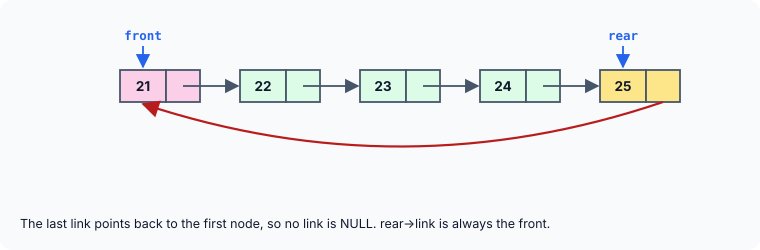

title : Circular Linked Lists and Circular Queues

summary : In a circular linked list the last node links back to the first, so the list has no NULL end. Build a queue on a circular list, learn how to traverse a list that never ends, keep the circle closed on every deletion, and see why a single rear pointer is enough.

# Circular Linked Lists and Circular Queues

In every linked list so far, the link of the last node has been `NULL`. That `NULL` marks the end, and every traversal stops when it reaches it.

In a **circular linked list**, the last node's link is not `NULL`: it points back to the **first** node. The nodes form a ring.



Strictly speaking, a ring has no natural first or last node. By convention, we keep a pointer to one node and call it the last (or `rear`) node, and the node after it — `rear->link` — the first (or `front`) node.

Circular lists suit problems that go round and round: taking turns between players, an operating system giving each running program a short slice of processor time in rotation ("round-robin" scheduling), a playlist on repeat, or a buffer that is reused from the start once it is full. A circular list can also be used to represent a stack or a queue. Here we build a queue.

## A Circular Queue

```c runnable
#include <stdio.h>
#include <stdlib.h>
#include <stdbool.h>

struct node
{
    int data;
    struct node *link;
};

void addcirq(struct node **f, struct node **r, int item);
bool delcirq(struct node **f, struct node **r, int *item);
void cirq_display(const struct node *f);

int main(void)
{
    struct node *front = NULL, *rear = NULL;   /* empty queue */
    int item;

    addcirq(&front, &rear, 21);
    addcirq(&front, &rear, 22);
    addcirq(&front, &rear, 23);
    addcirq(&front, &rear, 24);
    addcirq(&front, &rear, 25);
    addcirq(&front, &rear, 26);
    cirq_display(front);

    printf("Deleted: ");
    for (int i = 0; i < 3; i++)
        if (delcirq(&front, &rear, &item))
            printf("%d ", item);
    printf("\n");

    printf("After deletion:\n");
    cirq_display(front);

    while (delcirq(&front, &rear, &item))      /* empty the queue */
        ;
    cirq_display(front);
    return 0;
}

/* adds a new element at the rear of the queue */
void addcirq(struct node **f, struct node **r, int item)
{
    struct node *q = malloc(sizeof *q);
    if (q == NULL)
        exit(EXIT_FAILURE);
    q->data = item;

    if (*f == NULL)                            /* the queue is empty */
        *f = q;
    else
        (*r)->link = q;                        /* link it after the old rear */

    *r = q;                                    /* it is the new rear */
    (*r)->link = *f;                           /* and the rear always links back to the front */
}

/* removes the element at the front; returns false if the queue is empty */
bool delcirq(struct node **f, struct node **r, int *item)
{
    struct node *q = *f;

    if (q == NULL)                             /* the queue is empty */
        return false;

    *item = q->data;
    if (*f == *r) {                            /* only one node */
        *f = *r = NULL;
    } else {
        *f = q->link;                          /* the next node is the new front */
        (*r)->link = *f;                       /* keep the circle closed */
    }
    free(q);
    return true;
}

/* displays the queue once around, starting at the front */
void cirq_display(const struct node *f)
{
    const struct node *q = f;

    if (q == NULL) {
        printf("The queue is empty\n");
        return;
    }
    printf("front -> ");
    do {
        printf("%d ", q->data);
        q = q->link;
    } while (q != f);                          /* stop when we are back at the front */
    printf("-> (back to front)\n");
}
```

```
front -> 21 22 23 24 25 26 -> (back to front)
Deleted: 21 22 23 
After deletion:
front -> 24 25 26 -> (back to front)
The queue is empty
```

`front` and `rear` start as `NULL`, which means the queue is empty. Six items are added at the rear, three are removed from the front, and the rest are then removed to empty the queue.

### addcirq(): adding at the rear

Adding works like the ordinary linked-list queue from earlier, with one extra line:

```c
if (*f == NULL)
    *f = q;              /* empty queue: the new node is also the front */
else
    (*r)->link = q;      /* otherwise link it after the old rear */

*r = q;                  /* the new node is the rear */
(*r)->link = *f;         /* close the circle: rear links back to front */
```

The last statement is what makes the list circular. It runs on every addition, so whatever the size of the queue, the rear always links to the front. When the very first node is added, it is both the front and the rear, so it links to **itself**.

As before, `f` and `r` are pointers to `main`'s `front` and `rear` (type `struct node **`). The function must change those pointers, and a function can only change a caller's variable through its address. `(*r)->link` means "the link of the node that `rear` points to"; the parentheses are needed because `->` binds more tightly than `*`.

### delcirq(): removing at the front

There are three cases:

- **The queue is empty** (`*f == NULL`): nothing can be removed, and the function returns `false`.
- **There is only one node** (`*f == *r`, the front is also the rear): after removing it the queue is empty, so both `front` and `rear` must become `NULL`.
- **Otherwise**, the front moves to the next node, and the rear's link is updated to the new front, so that the circle stays closed: `(*r)->link = *f;`. Forgetting this line would leave the rear pointing to the node that has just been freed.

The removed value is passed back through the pointer `item`, and the return value says whether there was anything to remove.

:::callout
Older versions of `delcirq()` print *"queue is empty"* and then reach the end of the function without returning a value, while the caller still expects the removed item. In C, using the result of a function that did not return one is undefined behaviour. Returning a success flag, as here, lets the caller check before using the value.
:::

### cirq_display(): traversing a ring

A loop like `while (q != NULL)` would never end on a circular list, because no link is `NULL`. Instead, the traversal starts at the front and stops when it gets **back** to the front:

```c
do {
    printf("%d ", q->data);
    q = q->link;
} while (q != f);
```

Why a `do`-`while` and not a `while`? `q` **starts** at `f`. A `while (q != f)` loop would test the condition before printing anything, find `q` equal to `f`, and print nothing at all. A `do`-`while` runs its body once before the first test, so the front is printed, `q` moves on, and the loop then continues until it comes round to the front again. The empty queue is checked separately, before the loop, because `q->data` must not be read through a `NULL` pointer.

(Older versions use two pointers, `q` and `p`: `p` starts as `NULL`, so that the first test `q != p` succeeds, and is then set to the front inside the loop. It works, but the `do`-`while` says the same thing more directly.)

## One Pointer Is Enough

Because the rear always links to the front, a circular queue does not really need a separate `front` pointer: the front is simply `rear->link`. Here is the same queue kept with `rear` alone:

```c runnable
#include <stdio.h>
#include <stdlib.h>
#include <stdbool.h>

struct node
{
    int data;
    struct node *link;
};

/* the queue is reached through rear alone: the front is always rear->link */
void enqueue(struct node **rear, int item)
{
    struct node *q = malloc(sizeof *q);
    if (q == NULL)
        exit(EXIT_FAILURE);
    q->data = item;

    if (*rear == NULL) {
        q->link = q;                           /* a single node links to itself */
    } else {
        q->link = (*rear)->link;               /* new node links to the front */
        (*rear)->link = q;                     /* old rear links to the new node */
    }
    *rear = q;
}

bool dequeue(struct node **rear, int *item)
{
    if (*rear == NULL)
        return false;

    struct node *front = (*rear)->link;
    *item = front->data;
    if (front == *rear)                        /* it was the only node */
        *rear = NULL;
    else
        (*rear)->link = front->link;           /* skip the old front */
    free(front);
    return true;
}

int main(void)
{
    struct node *rear = NULL;
    int item;

    for (int v = 1; v <= 4; v++)
        enqueue(&rear, v * 10);

    while (dequeue(&rear, &item))
        printf("%d ", item);
    printf("\n");
    return 0;
}
```

```
10 20 30 40 
```

- **`enqueue()`** links the new node between the rear and the front: `q->link = (*rear)->link;` makes the new node point to the front, and `(*rear)->link = q;` makes the old rear point to it. Then the new node becomes the rear. A node added to an empty queue links to itself.
- **`dequeue()`** finds the front as `(*rear)->link`, removes it by making the rear skip over it, and frees it. If the front was also the rear, the queue becomes empty.

Both operations take the same small amount of time however long the queue is, and the whole queue is reached through a single pointer. This compactness is one of the main attractions of circular lists.

## Key Takeaways

- In a circular linked list the last node links back to the first; no link is `NULL`.
- Keep a pointer to the rear: the front is `rear->link`.
- On every insertion and deletion, re-close the circle: the rear must link to the (new) front. A single node links to itself.
- Traverse a ring by stopping when you get **back** to the starting node, using a `do`-`while` so that the starting node is processed first. Check for an empty list before the loop.

## Practice Questions

:::details[A circular queue holds one node. What does that node's link point to, and what are front and rear?]
Its link points to **itself**, and `front` and `rear` both point to that node.
:::

:::details[Why would while (q != NULL) never end on a circular list, and what should the condition be instead?]
No link in a circular list is `NULL`, so `q` never becomes `NULL`. Stop when `q` returns to the starting node: `do { ... q = q->link; } while (q != start);`.
:::

:::details[Write a function that counts the nodes in a circular list given its rear pointer.]
```c
int count(const struct node *rear)
{
    if (rear == NULL)
        return 0;

    int c = 0;
    const struct node *q = rear->link;     /* start at the front */
    do {
        c++;
        q = q->link;
    } while (q != rear->link);
    return c;
}
```
:::

:::details[In delcirq(), what goes wrong if (*r)->link = *f; is left out when deleting from a queue of 3 nodes?]
The rear still links to the old front, which has just been freed. The next traversal, or the next deletion, follows that link into freed memory — undefined behaviour.
:::
