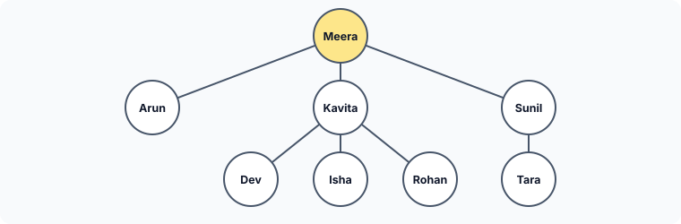
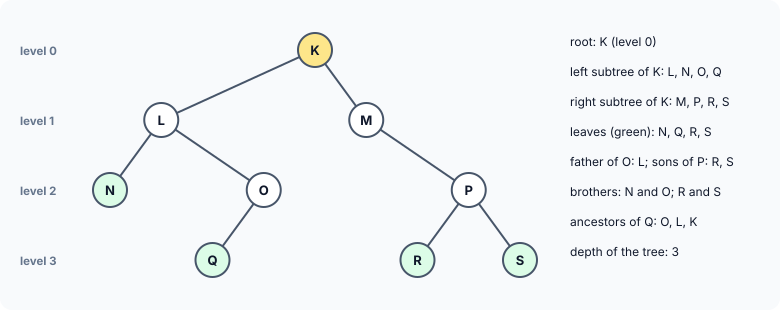
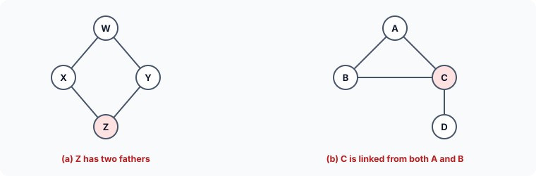
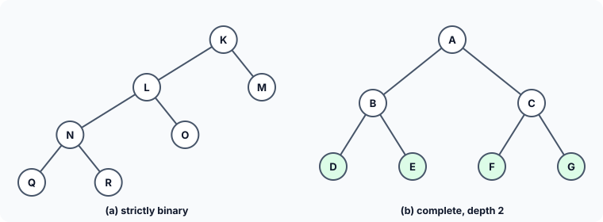
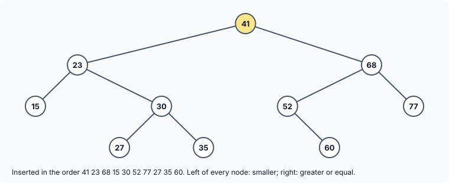

title : Binary Trees and Binary Search Trees

summary : Meet the tree, a non-linear data structure: binary tree terminology (root, leaf, level, depth, strictly binary, complete), the three traversals inorder, preorder and postorder, and a binary search tree in C that sorts numbers by inserting them and reading them back in order.

# Binary Trees and Binary Search Trees

Every structure so far — arrays, linked lists, stacks, queues — has been **linear**: each element has at most one element after it, and the elements form a single line. Many kinds of information are not shaped like a line, though. A family is a good example:



This kind of structure is called a **tree**. Data structures shaped like this appear everywhere: the folders on a disk, the chapters and sections of a book, an organisation chart, the way a compiler represents an arithmetic expression.

In a tree such as the family tree, a node can have any number of children. Such a **general tree** needs a variable number of pointers in each node. In this article we study the most useful special case, in which every node has **at most two** children: the **binary tree**.

## What Is a Binary Tree?

A binary tree is a finite set of elements that is either **empty**, or is split into three disjoint parts:

- a single element called the **root** of the tree;
- a binary tree called the **left subtree** of the root; and
- a binary tree called the **right subtree** of the root.

Either subtree may itself be empty. Notice that the definition is **recursive**: a binary tree is defined in terms of smaller binary trees. This is why recursion fits trees so naturally, as the programs below show.

Each element of a binary tree is called a **node**. Here is an example:



### The vocabulary of trees

- **Root**: the top node, K. It has no father.
- **Father and sons**: if A is the root of a subtree and B is the root of A's left (or right) subtree, A is the **father** of B, and B is the **left son** (or **right son**) of A. In the picture, L is the father of N and O. (Many books say *parent* and *child*.)
- **Leaf**: a node with no sons — N, Q, R and S.
- **Ancestor and descendant**: A is an ancestor of B if A is B's father, or the father of some ancestor of B. So K, L and O are the ancestors of Q, and Q is their **descendant**. B is a **left descendant** of A if it lies in A's left subtree.
- **Brothers**: two nodes with the same father, such as N and O. (Also called *siblings*.)
- **Level**: the root is at level 0, and every other node is one level below its father. N is at level 2 and Q at level 3.
- **Depth**: the largest level of any leaf — the length of the longest path from the root to a leaf. This tree has depth 3. (Some books call this the *height*.)

Trees are traditionally drawn with the root at the **top** and the leaves at the bottom. Moving from the root towards the leaves is called going **down** or **descending** the tree; moving from the leaves towards the root is going **up** or **climbing**.

### What a binary tree cannot have

In a binary tree, every node except the root has **exactly one** father, and no node can be reached by two different paths. These structures are therefore **not** binary trees:



### Strictly binary and complete binary trees

If **every** non-leaf node has both a left and a right son, the tree is a **strictly binary tree**. The tree with root K above is **not** strictly binary, because O and M each have only one son.

A **complete binary tree** of depth *d* is a strictly binary tree whose leaves are **all** at level *d*. Every level is completely full: level *k* has 2^k nodes, so a complete binary tree of depth *d* has 2^(d+1) − 1 nodes in all.



## Traversing a Binary Tree

**Traversing** a tree means visiting each of its nodes **exactly once** — to print it, sum it, search it, and so on. For a linked list the order is obvious: first to last. A tree has no natural linear order, so we must choose one. There are three popular ones, and they differ only in **when** the root is visited relative to its two subtrees.

To traverse a non-empty binary tree in **preorder** (also called depth-first order):

1. visit the root;
2. traverse the left subtree in preorder;
3. traverse the right subtree in preorder.

To traverse it in **inorder** (symmetric order):

1. traverse the left subtree in inorder;
2. visit the root;
3. traverse the right subtree in inorder.

To traverse it in **postorder**:

1. traverse the left subtree in postorder;
2. traverse the right subtree in postorder;
3. visit the root.

An empty tree needs nothing done. Each subtree is traversed by **the same method**, which is exactly what a recursive function does. A useful memory aid: the name says where the **root** (the "data", D) goes. **Pre**order is D-L-R, **in**order is L-D-R, **post**order is L-R-D.

For the tree with root K above:

| Traversal | Order |
|---|---|
| Preorder (D-L-R) | K L N O Q M P R S |
| Inorder (L-D-R) | N L Q O K M R P S |
| Postorder (L-R-D) | N Q O L R S P M K |

## Binary Search Trees

Many algorithms that use binary trees work in two phases: first **build** a tree, then **traverse** it. Here is a classic example: sorting.

Suppose we read a list of numbers and want to print them in ascending order. As each number is read, it is placed in a binary tree:

- the first number becomes the root;
- each later number is compared with the root. If it is **smaller**, we go to the left subtree; if it is **greater than or equal**, to the right subtree. We repeat the comparison at each node we reach, until we find an empty place, and attach the new node there.

Inserting 41 23 68 15 30 52 77 27 35 60 this way produces this tree:



Such a tree has a special property: for every node *n*, all elements in the **left** subtree of *n* are **less** than *n*, and all elements in the **right** subtree are **greater than or equal** to *n*. A binary tree with this property is called a **binary search tree (BST)**.

And here is the payoff: if a binary search tree is traversed **inorder**, the values come out in **ascending order**. Inorder visits everything in the left subtree (all smaller), then the root, then everything in the right subtree (all larger) — and that is true at every node. Check it on the picture: 15 23 27 30 35 41 52 60 68 77.

## The Program

```c runnable
#include <stdio.h>
#include <stdlib.h>

struct btreenode
{
    struct btreenode *leftchild;
    int data;
    struct btreenode *rightchild;
};

void insert(struct btreenode **sr, int num);
void inorder(const struct btreenode *sr);
void preorder(const struct btreenode *sr);
void postorder(const struct btreenode *sr);
void free_tree(struct btreenode *sr);

int main(void)
{
    struct btreenode *bt = NULL;               /* empty tree */
    int items[] = {41, 23, 68, 15, 30, 52, 77, 27, 35, 60};
    int req = sizeof items / sizeof items[0];

    for (int i = 0; i < req; i++)
        insert(&bt, items[i]);

    printf("Inorder Traversal:   ");
    inorder(bt);
    printf("\nPreorder Traversal:  ");
    preorder(bt);
    printf("\nPostorder Traversal: ");
    postorder(bt);
    printf("\n");

    free_tree(bt);
    return 0;
}

/* inserts a new node in a binary search tree */
void insert(struct btreenode **sr, int num)
{
    if (*sr == NULL) {                         /* an empty spot: put the node here */
        *sr = malloc(sizeof **sr);
        if (*sr == NULL)
            exit(EXIT_FAILURE);
        (*sr)->leftchild = NULL;
        (*sr)->data = num;
        (*sr)->rightchild = NULL;
        return;
    }

    if (num < (*sr)->data)                     /* smaller: go into the left subtree */
        insert(&(*sr)->leftchild, num);
    else                                       /* greater or equal: go right */
        insert(&(*sr)->rightchild, num);
}

/* Left - Data - Right */
void inorder(const struct btreenode *sr)
{
    if (sr == NULL)
        return;
    inorder(sr->leftchild);
    printf("%d ", sr->data);
    inorder(sr->rightchild);
}

/* Data - Left - Right */
void preorder(const struct btreenode *sr)
{
    if (sr == NULL)
        return;
    printf("%d ", sr->data);
    preorder(sr->leftchild);
    preorder(sr->rightchild);
}

/* Left - Right - Data */
void postorder(const struct btreenode *sr)
{
    if (sr == NULL)
        return;
    postorder(sr->leftchild);
    postorder(sr->rightchild);
    printf("%d ", sr->data);
}

/* frees the children before the parent: a postorder walk */
void free_tree(struct btreenode *sr)
{
    if (sr == NULL)
        return;
    free_tree(sr->leftchild);
    free_tree(sr->rightchild);
    free(sr);
}
```

```
Inorder Traversal:   15 23 27 30 35 41 52 60 68 77 
Preorder Traversal:  41 23 15 30 27 35 68 52 60 77 
Postorder Traversal: 15 27 35 30 23 60 52 77 68 41 
```

The inorder line is the sorted list, as promised. The preorder line starts with the root, 41; the postorder line ends with it.

### The node

```c
struct btreenode
{
    struct btreenode *leftchild;
    int data;
    struct btreenode *rightchild;
};
```

Each node holds its data and two pointers: one to the root of its left subtree and one to the root of its right subtree. A `NULL` pointer means that subtree is empty. A leaf has both pointers `NULL`.

### insert(): why struct btreenode **?

```c
void insert(struct btreenode **sr, int num)
```

`insert()` attaches a new node at a place that is currently `NULL` — and that place is a **pointer variable**: either `bt` in `main` (for the very first node) or the `leftchild` or `rightchild` member of some node. To store the new node's address there, the function needs the **address of that pointer**, so its parameter is a pointer to a pointer. `main` calls `insert(&bt, items[i])`.

Inside the function, `*sr` is that pointer variable:

- If `*sr == NULL`, we have found the empty place. `malloc(sizeof **sr)` allocates one node (`**sr` is a `struct btreenode`, so `sizeof **sr` is the size of one node), the address is stored in `*sr`, and the node's two child pointers are set to `NULL`.
- Otherwise `*sr` points to an existing node, `(*sr)->data` is its value, and the function calls itself on the appropriate subtree. The argument `&(*sr)->leftchild` means `&((*sr)->leftchild)`: the **address of the `leftchild` member** of the current node. That is exactly the kind of "address of a pointer" that the next call needs, so that it can store a new node in that member if it is empty.

Each call goes one level deeper, so the recursion ends after at most *depth* + 1 calls.

### Inserting without recursion

`insert()` calls itself once per level, so it needs as many nested calls as the tree is deep. The same walk can be written as a loop, using the pointer-to-a-link idea from the linked-list articles:

```c runnable
#include <stdio.h>
#include <stdlib.h>

struct btreenode
{
    struct btreenode *leftchild;
    int data;
    struct btreenode *rightchild;
};

/* inserts num without recursion: walk the child LINKS down to an empty one */
void insert(struct btreenode **sr, int num)
{
    while (*sr != NULL)
        sr = (num < (*sr)->data) ? &(*sr)->leftchild : &(*sr)->rightchild;

    *sr = malloc(sizeof **sr);                 /* *sr is the empty link we stopped at */
    if (*sr == NULL)
        exit(EXIT_FAILURE);
    (*sr)->leftchild = (*sr)->rightchild = NULL;
    (*sr)->data = num;
}

void inorder(const struct btreenode *sr)
{
    if (sr == NULL)
        return;
    inorder(sr->leftchild);
    printf("%d ", sr->data);
    inorder(sr->rightchild);
}

void free_tree(struct btreenode *sr)
{
    if (sr == NULL)
        return;
    free_tree(sr->leftchild);
    free_tree(sr->rightchild);
    free(sr);
}

int main(void)
{
    struct btreenode *bt = NULL;
    int items[] = {41, 23, 68, 15, 30, 52, 77, 27, 35, 60};

    for (int i = 0; i < 10; i++)
        insert(&bt, items[i]);
    inorder(bt);
    printf("\n");
    free_tree(bt);
    return 0;
}
```

```
15 23 27 30 35 41 52 60 68 77 
```

`sr` moves from link to link — `&bt`, then the address of the root's `leftchild` or `rightchild`, and so on — until it reaches a link that is `NULL`. That empty link is exactly where the new node belongs, so `*sr = malloc(...)` stores the new node there directly.

Both versions do the same work. The recursive one is closer to the definition of a tree; the loop uses no extra stack space, which matters for a badly unbalanced tree that may be thousands of levels deep, where deep recursion could overflow the call stack.

### The traversals

Each traversal function is a direct translation of its definition. Take `inorder()`:

```c
if (sr == NULL)
    return;                    /* an empty tree: nothing to do */
inorder(sr->leftchild);        /* 1. the whole left subtree */
printf("%d ", sr->data);       /* 2. the root */
inorder(sr->rightchild);       /* 3. the whole right subtree */
```

Students often find it hard to believe that such short functions visit every node. It helps to trace a small case: for a node with no children, both recursive calls receive `NULL` and return at once, so the function just prints the node. For a node whose children are leaves, it prints the left leaf, itself, then the right leaf. Larger trees are built out of these cases. The traversals take `const struct btreenode *` because they only read the tree.

The three functions differ only in the position of the `printf` line.

### free_tree(): freeing in postorder

Every node was allocated with `malloc`, so every node must be freed. The order matters: a node's `leftchild` and `rightchild` must be read **before** the node is freed. A **postorder** walk does exactly that — it frees both subtrees first and the node last. Freeing in preorder would read `sr->leftchild` after `free(sr)`: a use-after-free.

## How Fast Is a BST?

Inserting or searching follows one path from the root down. In a reasonably **balanced** tree (like the one above), each level roughly doubles the number of nodes, so a tree of a million nodes is only about 20 levels deep, and a search needs only about 20 comparisons. That is the great strength of binary search trees.

There is a catch. If the numbers arrive **already sorted** — say 10, 20, 30, 40 — each new node goes to the right of the previous one, and the "tree" becomes a linked list leaning to the right, with a search taking as many steps as there are nodes. Production libraries therefore use **self-balancing** trees (such as red-black trees or AVL trees), which reshape themselves during insertion to stay shallow.

## Key Takeaways

- A tree is a non-linear structure; a binary tree is either empty or a root with a left and a right binary subtree.
- Terms: root, father/son, leaf, ancestor/descendant, brothers, level (root = 0), depth (largest level). Strictly binary: every non-leaf has two sons. Complete: strictly binary with all leaves at the deepest level.
- Preorder = D-L-R, inorder = L-D-R, postorder = L-R-D. Each is a three-line recursive function.
- In a binary search tree, the left subtree of every node holds smaller values and the right subtree greater-or-equal values; an inorder traversal prints the values sorted.
- `insert()` takes the address of a child pointer (`struct btreenode **`) so it can store a new node there; recurse with `&(*sr)->leftchild` or `&(*sr)->rightchild`.
- Free a tree in postorder: children before their father.

## Practice Questions

:::details[Insert 50, 30, 70, 20, 40, 60 into an empty BST. What are the preorder and postorder traversals?]
50 is the root; 30 and 70 are its sons; 20 and 40 are the sons of 30; 60 is the left son of 70.
Preorder: **50 30 20 40 70 60**. Postorder: **20 40 30 60 70 50**. (Inorder, of course, is 20 30 40 50 60 70.)
:::

:::details[How many nodes does a complete binary tree of depth 3 have, and how many of them are leaves?]
2^4 − 1 = **15** nodes, of which 2^3 = **8** are leaves (all on level 3).
:::

:::details[Write a function int count_nodes(const struct btreenode *sr) that returns the number of nodes in a tree.]
```c
int count_nodes(const struct btreenode *sr)
{
    if (sr == NULL)
        return 0;
    return 1 + count_nodes(sr->leftchild) + count_nodes(sr->rightchild);
}
```
:::

:::details[Write a function that returns the depth of a binary tree (with an empty tree having depth -1 and a single node depth 0).]
```c
int depth(const struct btreenode *sr)
{
    if (sr == NULL)
        return -1;
    int l = depth(sr->leftchild), r = depth(sr->rightchild);
    return 1 + (l > r ? l : r);
}
```
For the tree with root K above it returns 3.
:::

:::details[Why does insert() need struct btreenode ** while inorder() takes just a pointer?]
`insert()` may have to **change a pointer**: when it reaches an empty place, it stores the new node's address in `bt` or in some node's `leftchild` or `rightchild`. Changing a pointer variable requires its address. `inorder()` only reads the tree, so a copy of the pointer is enough.
:::
