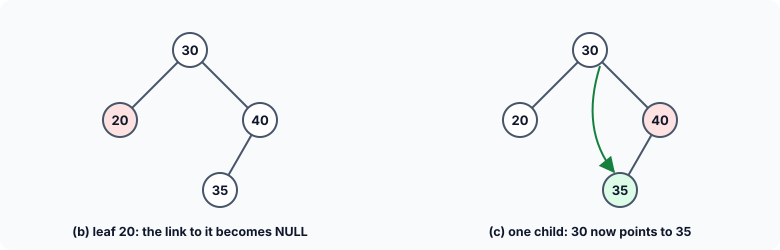
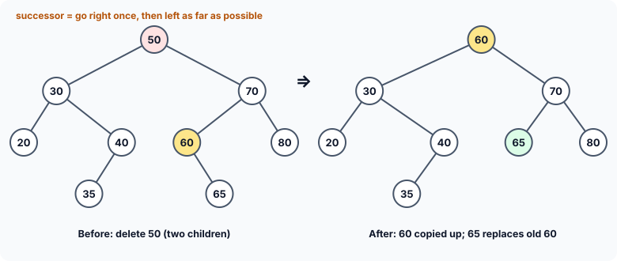
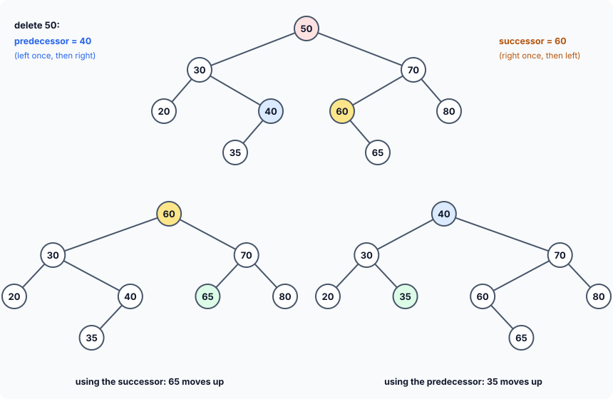

title : Deleting a Node from a Binary Search Tree

summary : Remove a value from a binary search tree without breaking its ordering: the four cases (not found, leaf, one child, two children), the inorder successor trick, and a version built on a pointer to the father's link that also deletes the root correctly, where the classic version crashes.

# Deleting a Node from a Binary Search Tree

The previous article built a binary search tree by inserting values and read them back with the three traversals. Real programs must also **remove** data from a tree — a deleted customer, a cancelled booking. Deletion is the trickiest of the basic tree operations, because after removing a node the tree must still be a binary search tree: everything left of each node smaller, everything right of it greater or equal.

## The Four Cases

Suppose we ask the delete function to remove a given value. There are four possible cases to consider:

**(a) No node in the tree contains the value.** Nothing is deleted; we just report that the value was not found.

**(b) The node has no children** (it is a leaf). Its memory is freed, and the link in its father that pointed to it — the left link or the right link, depending on which son it was — is set to `NULL`.

**(c) The node has exactly one child.** The link in the father that pointed to the node is changed to point to the node's **only child** instead. The child's whole subtree moves up one level, and the ordering is preserved: the child's subtree was on the same side of the father as the deleted node was.



**(d) The node has two children.** Now we cannot simply bypass the node, because its father has only one link to give, and there are two subtrees to keep. The solution is to replace the node's **data** by the next larger value in the tree, its **inorder successor**:

1. Find the inorder successor: go to the node's **right** son, then follow **left** links as far as possible. This is the smallest value in the right subtree — the value that comes right after the node in sorted order.
2. Copy the successor's data into the node being deleted.
3. Delete the successor's node instead. The successor can never have a left son (otherwise we would have kept going left), so it has **zero or one** child: case (b) or (c), which we already know how to handle.



Why is this still a binary search tree? The successor is larger than everything in the left subtree (it came from the right subtree) and no larger than anything else in the right subtree (it is the smallest value there). So it can sit exactly where the deleted value was.

So the whole logic of deleting a node with two children is: locate the inorder successor, copy its data, and reduce the problem to a simple deletion of a node with one or zero children.

### Successor or predecessor?

The inorder successor is not the only value that can take the deleted node's place. Its mirror image works just as well: the **inorder predecessor**, the next **smaller** value in the tree. To find it, go to the node's **left** son, then follow **right** links as far as possible — it is the rightmost node of the left subtree. It is larger than everything else in the left subtree and smaller than everything in the right subtree, so it too can sit where the deleted value was. And it can never have a right son, so removing it is again case (b) or (c).

So, to delete a node with two children, there are two equally valid choices:

| | Inorder successor | Inorder predecessor |
|---|---|---|
| Where | leftmost node of the **right** subtree | rightmost node of the **left** subtree |
| How to find it | right once, then left as far as possible | left once, then right as far as possible |
| Its value | the smallest value larger than (or equal to) the node's | the largest value smaller than the node's |
| Children it can have | never a left son | never a right son |

Both keep the tree a valid binary search tree, and both produce the same sorted (inorder) sequence. They differ only in the **shape** of the tree that results:



The following program deletes 50 from the same tree twice, once each way, and prints the result in **preorder**, which lists the root first and so shows the shape:

```c runnable
#include <stdio.h>
#include <stdlib.h>
#include <stdbool.h>

struct btreenode
{
    struct btreenode *leftchild;
    int data;
    struct btreenode *rightchild;
};

void insert(struct btreenode **sr, int num)
{
    if (*sr == NULL) {
        *sr = malloc(sizeof **sr);
        if (*sr == NULL)
            exit(EXIT_FAILURE);
        (*sr)->leftchild = (*sr)->rightchild = NULL;
        (*sr)->data = num;
    } else if (num < (*sr)->data) {
        insert(&(*sr)->leftchild, num);
    } else {
        insert(&(*sr)->rightchild, num);
    }
}

/* deletes num; a node with two children is replaced by its inorder
   successor (use_pred == false) or its inorder predecessor (use_pred == true) */
void delete_node(struct btreenode **link, int num, bool use_pred)
{
    while (*link != NULL && (*link)->data != num)  /* find the link to the node */
        link = num < (*link)->data ? &(*link)->leftchild : &(*link)->rightchild;
    if (*link == NULL)
        return;

    struct btreenode *x = *link;

    if (x->leftchild != NULL && x->rightchild != NULL) {
        struct btreenode **r;
        if (use_pred) {                            /* left once, then right to the end */
            r = &x->leftchild;
            while ((*r)->rightchild != NULL)
                r = &(*r)->rightchild;
        } else {                                   /* right once, then left to the end */
            r = &x->rightchild;
            while ((*r)->leftchild != NULL)
                r = &(*r)->leftchild;
        }
        x->data = (*r)->data;                      /* copy the replacement value up */
        link = r;                                  /* and delete the replacement node */
        x = *link;
    }

    *link = x->leftchild != NULL ? x->leftchild : x->rightchild;
    free(x);
}

/* preorder shows the SHAPE of the tree: the root comes first */
void preorder(const struct btreenode *sr)
{
    if (sr == NULL)
        return;
    printf("%d ", sr->data);
    preorder(sr->leftchild);
    preorder(sr->rightchild);
}

void free_tree(struct btreenode *sr)
{
    if (sr == NULL)
        return;
    free_tree(sr->leftchild);
    free_tree(sr->rightchild);
    free(sr);
}

int main(void)
{
    int a[] = {50, 30, 70, 20, 40, 60, 80, 35, 65};

    for (int pass = 0; pass < 2; pass++) {
        struct btreenode *bt = NULL;
        bool use_pred = (pass == 1);

        for (int i = 0; i < 9; i++)
            insert(&bt, a[i]);
        delete_node(&bt, 50, use_pred);

        printf("Using the inorder %-11s preorder: ", use_pred ? "predecessor," : "successor,");
        preorder(bt);
        printf("\n");
        free_tree(bt);
    }
    return 0;
}
```

```
Using the inorder successor,  preorder: 60 30 20 40 35 70 65 80 
Using the inorder predecessor, preorder: 40 30 20 35 70 60 65 80 
```

Which one should a program use? Three points help decide:

- **Equal values.** Our `insert()` sends a value **equal** to a node into its **right** subtree. The successor respects that rule: the value moved up is the smallest of the right subtree, so anything equal to it stays on its right. The predecessor can break it. Insert 50, 30, 70 and another 30, then delete 50: the second 30 is the predecessor, it moves up to the root, and the first 30 is now in the root's **left** subtree — equal to its father, on the wrong side. The tree still works for searching, but no longer follows its own convention. So, with "equal goes right", prefer the successor; a tree that sends equal values left should prefer the predecessor.
- **Balance.** Always taking the replacement from the same side slowly makes the tree lopsided over many deletions: the right subtrees keep losing nodes while the left subtrees do not. Some implementations therefore alternate between the successor and the predecessor, or take the replacement from whichever subtree is **taller**, to keep the tree balanced. (This effect was studied by Hibbard, after whom the successor method is often called *Hibbard deletion*.)
- **Cost.** Either way, finding the replacement means walking down one subtree, so the cost is at most the depth of the tree. Neither is faster in general.

The rest of this article uses the successor, as most textbooks do.

## The Program

```c runnable
#include <stdio.h>
#include <stdlib.h>

struct btreenode
{
    struct btreenode *leftchild;
    int data;
    struct btreenode *rightchild;
};

void insert(struct btreenode **sr, int num);
struct btreenode **search(struct btreenode **sr, int num);
void delete_node(struct btreenode **root, int num);
void inorder(const struct btreenode *sr);
void free_tree(struct btreenode *sr);

int main(void)
{
    struct btreenode *bt = NULL;               /* empty tree */
    int a[] = {50, 30, 70, 20, 40, 60, 80, 35, 65};

    for (int i = 0; i < 9; i++)
        insert(&bt, a[i]);

    printf("Binary tree before deletion: ");
    inorder(bt);

    int del[] = {20, 40, 70, 50, 99};          /* leaf, one child, two children, root, absent */
    for (int i = 0; i < 5; i++) {
        printf("\nDelete %d: ", del[i]);
        delete_node(&bt, del[i]);
        inorder(bt);
    }
    printf("\n");
    free_tree(bt);

    /* a root with only one child, then a root that is a leaf */
    bt = NULL;
    insert(&bt, 10);
    insert(&bt, 5);
    delete_node(&bt, 10);
    printf("Delete root 10 from {10, 5}: ");
    inorder(bt);
    delete_node(&bt, 5);
    printf("\nDelete root 5 from {5}: %s\n", bt == NULL ? "tree is now empty" : "?");
    return 0;
}

/* inserts a new node in a binary search tree */
void insert(struct btreenode **sr, int num)
{
    if (*sr == NULL) {
        *sr = malloc(sizeof **sr);
        if (*sr == NULL)
            exit(EXIT_FAILURE);
        (*sr)->leftchild = NULL;
        (*sr)->data = num;
        (*sr)->rightchild = NULL;
    } else if (num < (*sr)->data) {
        insert(&(*sr)->leftchild, num);
    } else {
        insert(&(*sr)->rightchild, num);
    }
}

/* returns the address of the LINK that points to the node holding num
   (the root pointer itself, or a child member of its father),
   or NULL if num is not in the tree */
struct btreenode **search(struct btreenode **sr, int num)
{
    while (*sr != NULL) {
        if ((*sr)->data == num)
            return sr;
        if (num < (*sr)->data)
            sr = &(*sr)->leftchild;
        else
            sr = &(*sr)->rightchild;
    }
    return NULL;
}

/* deletes the node holding num from a binary search tree */
void delete_node(struct btreenode **root, int num)
{
    struct btreenode **link = search(root, num);   /* the link that leads to x */
    struct btreenode *x;

    if (link == NULL) {                            /* case (a): not in the tree */
        printf("(%d not found) ", num);
        return;
    }
    x = *link;

    /* case (d): two children -> copy the inorder successor's data into x,
       then delete the successor instead */
    if (x->leftchild != NULL && x->rightchild != NULL) {
        struct btreenode **slink = &x->rightchild; /* go right once ... */
        while ((*slink)->leftchild != NULL)        /* ... then left as far as possible */
            slink = &(*slink)->leftchild;

        x->data = (*slink)->data;
        link = slink;                              /* now delete the successor */
        x = *link;
    }

    /* cases (b) and (c): x has at most one child, so it can be bypassed */
    if (x->leftchild != NULL)
        *link = x->leftchild;                      /* the father now points to x's child */
    else
        *link = x->rightchild;                     /* (NULL if x was a leaf) */
    free(x);
}

void inorder(const struct btreenode *sr)
{
    if (sr == NULL)
        return;
    inorder(sr->leftchild);
    printf("%d ", sr->data);
    inorder(sr->rightchild);
}

void free_tree(struct btreenode *sr)
{
    if (sr == NULL)
        return;
    free_tree(sr->leftchild);
    free_tree(sr->rightchild);
    free(sr);
}
```

```
Binary tree before deletion: 20 30 35 40 50 60 65 70 80 
Delete 20: 30 35 40 50 60 65 70 80 
Delete 40: 30 35 50 60 65 70 80 
Delete 70: 30 35 50 60 65 80 
Delete 50: 30 35 60 65 80 
Delete 99: (99 not found) 30 35 60 65 80 
Delete root 10 from {10, 5}: 5 
Delete root 5 from {5}: tree is now empty
```

Each line shows the tree (in inorder, so sorted) after one deletion: 20 is a leaf, 40 has one child (35), 70 has two children, 50 is the root and has two children, and 99 is not in the tree. The last two lines delete a root that has only one child, and then a root that is the only node.

## How It Works

### The key idea: find the link, not just the node

To delete a node, we must change the **link that points to it** — in its father, or `bt` itself if the node is the root. A classic version of this program finds the node `x` together with a pointer to its **father**, `parent`, and then writes code such as:

```c
if (parent->leftchild == x)
    parent->leftchild = x->rightchild;
else
    parent->rightchild = x->rightchild;
```

That needs separate code for "x is a left son" and "x is a right son". Worse, when `x` is the **root**, it has no father: `parent` is `NULL`, and `parent->leftchild` crashes the program. And even if it didn't, the caller's `bt` would never be updated.

The version here uses the same tool as the linked-list articles: a pointer to the **link**. `search()` returns a `struct btreenode **` — the address of whichever pointer variable leads to the node:

- `&bt`, if the node is the root;
- `&father->leftchild` or `&father->rightchild` otherwise.

Inside `delete_node()` that address is called `link`, so `*link` **is** the pointer that leads to the node. Assigning to `*link` changes whichever pointer that is. The root needs no special case, and neither does "left son or right son".

### search()

```c
while (*sr != NULL) {
    if ((*sr)->data == num)
        return sr;
    if (num < (*sr)->data)
        sr = &(*sr)->leftchild;
    else
        sr = &(*sr)->rightchild;
}
return NULL;
```

`sr` starts as `&bt`. At each node, the usual BST rule decides whether to go left or right — but instead of moving to the **child**, `sr` moves to the address of the **child pointer**: `&(*sr)->leftchild` is the address of the `leftchild` member of the node that `*sr` points to. When the value is found, `sr` is the link that leads to it. If the walk falls off the tree (`*sr` becomes `NULL`), the value is absent and `NULL` is returned — case (a).

Note the two levels: `sr` is the address of a link, `*sr` is the link (a pointer to a node), and `(*sr)->data` is the data in that node.

### Two children: delete the successor instead

```c
struct btreenode **slink = &x->rightchild;   /* go right once ... */
while ((*slink)->leftchild != NULL)          /* ... then left as far as possible */
    slink = &(*slink)->leftchild;

x->data = (*slink)->data;
link = slink;
x = *link;
```

`slink` walks to the inorder successor — again tracking the **link** that leads to it. The successor's data is copied into `x`. Then the two variables are pointed at the successor: from here on, the function deletes the successor's node rather than the original one. That is the "reduce the problem" step: the successor has no left son, so the code below handles it.

### Zero or one child: bypass the node

```c
if (x->leftchild != NULL)
    *link = x->leftchild;
else
    *link = x->rightchild;
free(x);
```

The link that led to `x` now leads to `x`'s only child — or to `NULL`, if `x` was a leaf (both children `NULL`). One statement covers cases (b) and (c). After that, nothing points to `x` any more, and it is freed.

:::callout
**Test the root.** Deleting the root is the easiest case to forget, because most test values are somewhere in the middle of the tree. A version that keeps a `parent` pointer must handle `parent == NULL` separately and update the caller's root pointer — which means the function must receive the root's **address** (`struct btreenode **`), not just its value. The last two lines of the output test exactly these cases.
:::

## Key Takeaways

- Deleting from a BST has four cases: not found, a leaf, one child, two children.
- A leaf or a node with one child is removed by making the link that pointed to it point to its child (or `NULL`).
- A node with two children takes the data of its **inorder successor** (right once, then left as far as possible) or of its **inorder predecessor** (left once, then right as far as possible); that node, which has at most one child, is then deleted instead.
- Both choices give a valid BST with the same sorted order but a different shape. With "equal values go right", the successor keeps the convention; alternating between the two helps keep the tree balanced.
- Working with the **address of the link** that leads to a node (`struct btreenode **`) removes the special cases for the root and for left versus right sons.
- Always free the removed node, and always test deleting the root.

## Practice Questions

:::details[In the tree built from 50 30 70 20 40 60 80 35 65, what is the inorder successor of 30, and of 70?]
For 30: go right to 40, then left to 35, which has no left son — the successor is **35**. For 70: go right to 80, which has no left son — the successor is **80**.
:::

:::details[Why can the inorder successor of a node with two children never have a left son?]
It is found by following left links until there are none. If it had a left son, the search would have continued to that son, which would be an even smaller value in the right subtree.
:::

:::details[Delete 30 from the tree built from 50 30 70 20 40 60 80 35 65, first using its successor and then (starting again) using its predecessor. Which value replaces 30 each time?]
30 has two children (20 and 40). Its **successor** is found by going right to 40 and then left to 35: **35** replaces 30, and 35's node (a leaf) is removed. Its **predecessor** is found by going left to 20, which has no right son: **20** replaces 30, and 20's node (a leaf) is removed.
:::

:::details[What would go wrong in delete_node() if search() returned the node itself (struct btreenode *) instead of the link to it?]
The function would know which node to remove, but not which pointer to change — the father's `leftchild`, its `rightchild`, or the caller's root pointer. It would need to search again for the father, and would still need special code for the root.
:::
