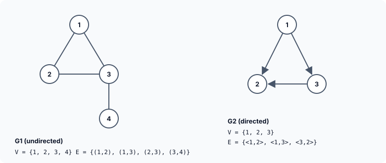
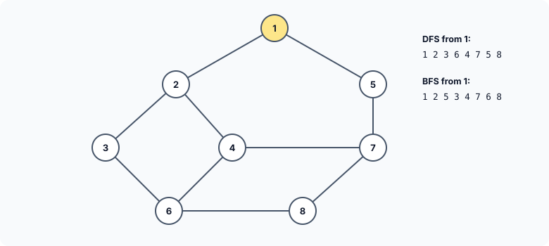

title : Graphs: Adjacency Lists, Depth First and Breadth First Search

summary : A graph is a set of vertices joined by edges — the structure behind road maps, networks and circuits. Learn the vocabulary, store a graph as an adjacency matrix or as adjacency lists built from linked lists, and visit every reachable vertex with depth first search and breadth first search.

# Graphs: Adjacency Lists, Depth First and Breadth First Search

The only non-linear data structure we have met so far is the tree. A tree is in fact a special kind of **graph**. Graphs are among the most widely applied data structures: road maps and shortest routes, computer networks, electrical circuits, links between web pages, friendships in a social network, dependencies between tasks in a project. To work with them, we first need their vocabulary.

## Definitions and Terminology

A **graph** consists of two sets, *V* and *E*. *V* is a finite, non-empty set of **vertices** (also called nodes), and *E* is a set of pairs of vertices, called **edges**. There are two kinds of graph:

- In an **undirected graph**, the pair of vertices representing an edge is **unordered**: (v1, v2) and (v2, v1) are the same edge. A road that can be driven both ways is an undirected edge.
- In a **directed graph** (or **digraph**), each edge is an **ordered** pair <v1, v2>, where v1 is the **tail** and v2 the **head** of the edge. <v1, v2> and <v2, v1> are two different edges. A one-way street is a directed edge.



The edges of a directed graph are drawn as arrows from the tail to the head.

### Adjacent vertices and incident edges

In an undirected graph, if (v1, v2) is an edge, the vertices v1 and v2 are **adjacent**, and the edge (v1, v2) is **incident on** v1 and v2. In G1, vertex 3 is adjacent to vertices 1, 2 and 4, and the edges incident on vertex 3 are (1, 3), (2, 3) and (3, 4).

In a directed graph, if <v1, v2> is an edge, v1 is **adjacent to** v2, and v2 is **adjacent from** v1. The edge <v1, v2> is incident to both. In G2, the edges incident to vertex 2 are <1, 2> and <3, 2> — both arrive at 2, and none leaves it.

## Representing a Graph

The two most common representations are the **adjacency matrix** and **adjacency lists**.

### The adjacency matrix

The adjacency matrix of a graph with *n* vertices is a 2-D array `a` of size *n* × *n*, with `a[i][j] = 1` if the edge (vi, vj) is in the graph, and `a[i][j] = 0` if it is not.

```c runnable
#include <stdio.h>

#define N1 4
#define N2 3

void show(int n, int a[][n])
{
    printf("    ");
    for (int j = 1; j <= n; j++)
        printf("%d ", j);
    printf("\n");
    for (int i = 0; i < n; i++) {
        printf("  %d ", i + 1);
        for (int j = 0; j < n; j++)
            printf("%d ", a[i][j]);
        printf("\n");
    }
}

int main(void)
{
    int g1[N1][N1] = {0};                      /* undirected: 1-2, 1-3, 2-3, 3-4 */
    int u1[][2] = {{1, 2}, {1, 3}, {2, 3}, {3, 4}};
    for (int i = 0; i < 4; i++) {
        g1[u1[i][0] - 1][u1[i][1] - 1] = 1;
        g1[u1[i][1] - 1][u1[i][0] - 1] = 1;    /* an undirected edge goes both ways */
    }

    int g2[N2][N2] = {0};                      /* directed: <1,2>, <1,3>, <3,2> */
    int d2[][2] = {{1, 2}, {1, 3}, {3, 2}};
    for (int i = 0; i < 3; i++)
        g2[d2[i][0] - 1][d2[i][1] - 1] = 1;    /* only from tail to head */

    printf("G1 (undirected):\n");
    show(N1, g1);
    printf("G2 (directed):\n");
    show(N2, g2);
    return 0;
}
```

```
G1 (undirected):
    1 2 3 4 
  1 0 1 1 0 
  2 1 0 1 0 
  3 1 1 0 1 
  4 0 0 1 0 
G2 (directed):
    1 2 3 
  1 0 1 1 
  2 0 0 0 
  3 0 1 0 
```

Row *i* of the matrix lists the vertices adjacent to vertex *i*. Notice:

- The matrix of an **undirected** graph is **symmetric** (`a[i][j] == a[j][i]`), because every edge goes both ways. That is why the program sets **two** elements for each undirected edge.
- The matrix of a **directed** graph need not be symmetric: G2 has an edge <1, 2> but no edge <2, 1>.
- Vertices are numbered from 1, but C arrays from 0, so vertex *v* is row and column `v - 1`.

The function `show()` receives a 2-D array whose size is not fixed: `void show(int n, int a[][n])`. This uses a C99 **variable-length array** parameter: because `n` comes first, it can be used as the column count of `a`, so one function prints both a 4 × 4 and a 3 × 3 matrix.

A matrix makes it instant to check whether two particular vertices are joined. But it always needs *n*² elements, however few edges there are. For an undirected graph, about half of that could be saved by storing only the upper or lower triangle, since the matrix is symmetric. Real graphs are usually **sparse** — a road map has many towns but only a few roads leave each — so most of the matrix would be zeros.

### Adjacency lists

In this representation, the *n* rows of the adjacency matrix are replaced by *n* **linked lists**: one list per vertex, whose nodes are the vertices adjacent to it. The heads of the lists are kept in an array, so the list for any vertex can be reached immediately. Here is the graph we will search:



and its adjacency lists:

![An array arr of eight pointers; arr[v-1] points to a linked list of the neighbours of vertex v, for example arr[0] leads to 2 then 5](images/graph-adjacency-lists.svg)

Every undirected edge appears **twice**, once in each endpoint's list. The lists take space proportional to the number of vertices plus edges, which for a sparse graph is far less than *n*².

## Visiting Every Vertex

Given the root of a binary tree, one of the most common operations is to visit every node. Similarly, given a vertex of a graph, we often want to visit **every vertex that can be reached from it**. There are two standard ways: **depth first search** and **breadth first search**.

Graphs bring one new difficulty that trees do not have: **cycles**. In G, you can go 2 → 4 → 6 → 3 → 2 and arrive back where you started. A search that simply followed edges could go round such a loop forever. So both searches keep an array `visited[]` and never visit a vertex twice.

```c runnable
#include <stdio.h>
#include <stdlib.h>
#include <stdbool.h>

#define MAX 8                                  /* number of vertices, numbered 1 to MAX */

struct node
{
    int data;                                  /* a neighbouring vertex */
    struct node *next;
};

void add_edge(struct node *arr[], int u, int v);
void dfs(int v, struct node *arr[], bool visited[]);
void bfs(int v, struct node *arr[], bool visited[]);
void free_graph(struct node *arr[]);

int main(void)
{
    struct node *arr[MAX] = {NULL};            /* arr[v - 1]: list of v's neighbours */
    bool visited[MAX];
    int edges[][2] = {
        {1, 2}, {1, 5}, {2, 3}, {2, 4}, {3, 6},
        {4, 6}, {4, 7}, {5, 7}, {6, 8}, {7, 8}
    };
    int nedges = sizeof edges / sizeof edges[0];

    for (int i = 0; i < nedges; i++) {         /* undirected: store each edge both ways */
        add_edge(arr, edges[i][0], edges[i][1]);
        add_edge(arr, edges[i][1], edges[i][0]);
    }

    printf("Adjacency lists:\n");
    for (int v = 1; v <= MAX; v++) {
        printf("  %d:", v);
        for (const struct node *q = arr[v - 1]; q != NULL; q = q->next)
            printf(" %d", q->data);
        printf("\n");
    }

    for (int i = 0; i < MAX; i++)
        visited[i] = false;
    printf("Depth first search:  ");
    dfs(1, arr, visited);
    printf("\n");

    for (int i = 0; i < MAX; i++)
        visited[i] = false;
    printf("Breadth first search:");
    bfs(1, arr, visited);
    printf("\n");

    free_graph(arr);
    return 0;
}

/* adds v to the END of u's list, so neighbours stay in the order given */
void add_edge(struct node *arr[], int u, int v)
{
    struct node *r = malloc(sizeof *r);
    if (r == NULL)
        exit(EXIT_FAILURE);
    r->data = v;
    r->next = NULL;

    struct node **q = &arr[u - 1];
    while (*q != NULL)
        q = &(*q)->next;
    *q = r;
}

/* depth first search: go as deep as possible before backing up */
void dfs(int v, struct node *arr[], bool visited[])
{
    visited[v - 1] = true;
    printf(" %d", v);

    for (const struct node *q = arr[v - 1]; q != NULL; q = q->next)
        if (!visited[q->data - 1])
            dfs(q->data, arr, visited);        /* recursion remembers where to come back */
}

/* breadth first search: visit all neighbours before going further */
void bfs(int v, struct node *arr[], bool visited[])
{
    int queue[MAX];                            /* each vertex enters the queue at most once */
    int front = 0, rear = 0;

    visited[v - 1] = true;
    printf(" %d", v);
    queue[rear++] = v;

    while (front < rear) {                     /* while the queue is not empty */
        int u = queue[front++];

        for (const struct node *q = arr[u - 1]; q != NULL; q = q->next)
            if (!visited[q->data - 1]) {
                visited[q->data - 1] = true;   /* mark when queued, so it is queued once */
                printf(" %d", q->data);
                queue[rear++] = q->data;
            }
    }
}

void free_graph(struct node *arr[])
{
    for (int i = 0; i < MAX; i++)
        while (arr[i] != NULL) {
            struct node *next = arr[i]->next;
            free(arr[i]);
            arr[i] = next;
        }
}
```

```
Adjacency lists:
  1: 2 5
  2: 1 3 4
  3: 2 6
  4: 2 6 7
  5: 1 7
  6: 3 4 8
  7: 4 5 8
  8: 6 7
Depth first search:   1 2 3 6 4 7 5 8
Breadth first search: 1 2 5 3 4 7 6 8
```

### Building the adjacency lists

`arr` is an array of `MAX` pointers, all `NULL` to begin with (the initialiser `{NULL}` sets the first element to `NULL` and, as always in C, the rest to zero too). For each edge, `add_edge()` is called **twice** — once in each direction — because the graph is undirected.

`add_edge()` appends to the end of a list, using the familiar pointer-to-a-link loop:

```c
struct node **q = &arr[u - 1];
while (*q != NULL)
    q = &(*q)->next;
*q = r;
```

`q` starts at the address of the list's head pointer in the array. Appending at the end keeps each list in the order the edges were given, which decides the order in which the searches below visit neighbours.

(Older versions of this program build the lists by hand, with long chains of statements like `v1->next = v2 = getnode_write(4);`. Generating them from a table of edges is shorter, and much harder to get wrong.)

### Depth first search

Depth first search (DFS) of an undirected graph proceeds as follows. The start vertex *v* is visited. Then an **unvisited** vertex *w* adjacent to *v* is selected, and a depth first search from *w* is started. When a vertex *u* is reached all of whose adjacent vertices have already been visited, we **back up** to the last vertex visited that still has an unvisited neighbour, and continue from there. The search ends when no unvisited vertex can be reached from any visited one.

That description is naturally recursive:

```c
void dfs(int v, struct node *arr[], bool visited[])
{
    visited[v - 1] = true;
    printf(" %d", v);

    for (const struct node *q = arr[v - 1]; q != NULL; q = q->next)
        if (!visited[q->data - 1])
            dfs(q->data, arr, visited);
}
```

The "backing up" happens automatically: when a recursive call returns, the loop in the caller continues with that vertex's **next** neighbour. Trace it on G: from 1 we go to 2 (1's first neighbour), from 2 to 3 (2's first unvisited neighbour), from 3 to 6, from 6 to 4, from 4 to 7, from 7 to 5. Now 5's neighbours (1, 7) are all visited, so we back up to 7, which still has 8: visit 8. Everything is visited, so all the calls return. Order: **1 2 3 6 4 7 5 8**.

`visited[v - 1]` uses `v - 1` because vertices are numbered from 1 while the array starts at 0. `visited` is passed as a parameter rather than being a global variable, so the function works for any graph, and `main` can reset it between searches.

### Breadth first search

Breadth first search (BFS) starts at vertex *v* and marks it as visited. It differs from DFS in that **all** unvisited vertices adjacent to *v* are visited next. Then the unvisited vertices adjacent to **those** vertices are visited, and so on — the search spreads out from *v* in waves. On G: 1 first; then 1's neighbours 2 and 5; then their unvisited neighbours 3, 4 (from 2) and 7 (from 5); finally 6 and 8. Order: **1 2 5 3 4 7 6 8**.

To process vertices in the order they were discovered, BFS uses a **queue**: first in, first out.

```c
queue[rear++] = v;                 /* start with v */

while (front < rear) {             /* while the queue is not empty */
    int u = queue[front++];        /* take the oldest vertex */
    for (each neighbour of u)
        if (not yet visited) {
            mark it visited, print it, and add it to the queue
        }
}
```

Two details deserve attention:

- A vertex is marked as visited **when it is added to the queue**, not when it is taken out. Otherwise a vertex that is a neighbour of two queued vertices (like 6, a neighbour of both 3 and 4) could be added twice.
- Because of that, each vertex enters the queue **at most once**, so an array of `MAX` elements can never overflow. The queue is an ordinary array with two indexes: `front` (the next element to take out) and `rear` (the next free position). `front < rear` means it is not empty.

(Older versions of this program use a global queue array with `front` and `rear` set to −1, and call `exit()` with no argument on overflow or underflow. `exit()` needs a status code — `exit(EXIT_FAILURE)` — and, with the visit-when-queued rule, those situations cannot happen anyway.)

### Which search to use?

Both searches visit every vertex reachable from the start exactly once, and look at every edge in the reachable part at most twice, so both take time proportional to vertices plus edges. They differ in the **order**:

- **BFS** visits vertices in order of their distance (number of edges) from the start. That makes it the tool for **shortest paths** in a graph where every edge counts the same — the fewest changes on a metro map, the fewest hops in a network.
- **DFS** goes deep first and backs up. It is the natural tool for exploring **all paths**, detecting cycles, solving mazes, and ordering tasks so that each comes after the ones it depends on (topological sorting).

Finally, as always, every node allocated with `malloc` is freed: `free_graph()` frees each adjacency list.

## Key Takeaways

- A graph is a set of vertices *V* and a set of edges *E*. Undirected edges (v1, v2) are unordered; directed edges <v1, v2> go from tail to head.
- Adjacent vertices are joined by an edge; an edge is incident on its endpoints.
- An adjacency matrix uses *n*² elements and is symmetric for an undirected graph. Adjacency lists use one linked list per vertex and are much smaller for sparse graphs.
- Graphs can contain cycles, so searches must remember which vertices are already visited.
- DFS goes as deep as possible, then backs up; it is easiest to write recursively. BFS visits neighbours in waves using a queue; mark a vertex visited when it is queued.

## Practice Questions

:::details[Write the adjacency matrix of the undirected graph with vertices 1, 2, 3 and edges (1, 2) and (2, 3).]
```
    1 2 3
  1 0 1 0
  2 1 0 1
  3 0 1 0
```
It is symmetric, as every undirected graph's matrix is.
:::

:::details[In G, what are the DFS and BFS orders starting from vertex 8?]
DFS from 8: **8 6 3 2 1 5 7 4**. (8 → 6 → 3 → 2 → 1 → 5 → 7 → 4; then everything is visited.)
BFS from 8: **8 6 7 3 4 5 2 1**. (8; its neighbours 6, 7; then 3, 4 from 6 and 5 from 7; then 2 from 3 and 1 from 5.)
:::

:::details[An undirected graph has 100 vertices and 150 edges. How many integers does its adjacency matrix hold, and how many nodes do its adjacency lists hold?]
The matrix holds 100 × 100 = **10 000** integers. The lists hold **300** nodes — each undirected edge appears in two lists — plus an array of 100 head pointers.
:::

:::details[What would happen in bfs() if a vertex were marked visited only when taken OUT of the queue?]
A vertex adjacent to several queued vertices would be added to the queue once for each of them, before any copy is taken out. It would be printed more than once, and the queue would need more room than `MAX` — this program's array could overflow.
:::
