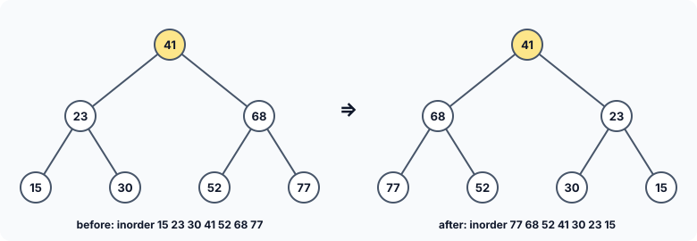

title : Linked Lists and Trees: Worked Problems

summary : Eight solved problems on linked lists and binary trees: concatenate two lists, erase a list, count, compare, copy and append with recursion, traverse a tree in inorder with your own stack instead of recursion, and mirror a tree. Each solution is complete, runnable and explained line by line.

# Linked Lists and Trees: Worked Problems

These problems practise the techniques of this chapter on short, complete programs. Several use **recursion** on linked lists. A linked list is recursive in the same way a tree is: a list is either empty, or a first node followed by **a smaller list**. Many list functions follow directly from that definition, as you will see.

Try each problem yourself before reading the solution.

## 1. Concatenate one linked list at the end of another

```c runnable
#include <stdio.h>
#include <stdlib.h>

struct node
{
    int data;
    struct node *link;
};

/* adds a node at the end of a linked list */
void append(struct node **q, int num)
{
    struct node *r = malloc(sizeof *r);
    if (r == NULL)
        exit(EXIT_FAILURE);
    r->data = num;
    r->link = NULL;

    while (*q != NULL)
        q = &(*q)->link;
    *q = r;
}

void display(const struct node *q)
{
    for (; q != NULL; q = q->link)
        printf("%d ", q->data);
    printf("\n");
}

int count(const struct node *q)
{
    int c = 0;

    for (; q != NULL; q = q->link)
        c++;
    return c;
}

/* attaches list *q at the end of list *p; afterwards *q is empty */
void concat(struct node **p, struct node **q)
{
    struct node **end = p;

    while (*end != NULL)                       /* find the last link of the first list */
        end = &(*end)->link;
    *end = *q;                                 /* hang the second list there */
    *q = NULL;                                 /* the nodes now belong to the first list */
}

void free_list(struct node **q)
{
    while (*q != NULL) {
        struct node *next = (*q)->link;
        free(*q);
        *q = next;
    }
}

int main(void)
{
    struct node *first = NULL, *second = NULL; /* empty linked lists */

    for (int v = 11; v <= 14; v++)
        append(&first, v);
    printf("First list: ");
    display(first);
    printf("No. of elements in Linked List = %d\n", count(first));

    for (int v = 15; v <= 18; v++)
        append(&second, v);
    printf("Second list: ");
    display(second);
    printf("No. of elements in Linked List = %d\n", count(second));

    concat(&first, &second);                   /* the result is in the first list */
    printf("Concatenated list: ");
    display(first);
    printf("No. of elements in Linked List = %d\n", count(first));

    free_list(&first);
    free_list(&second);                        /* already empty: frees nothing */
    return 0;
}
```

```
First list: 11 12 13 14 
No. of elements in Linked List = 4
Second list: 15 16 17 18 
No. of elements in Linked List = 4
Concatenated list: 11 12 13 14 15 16 17 18 
No. of elements in Linked List = 8
```

`concat()` finds the **last link** of the first list with the pointer-to-a-link loop, and stores the second list's first node there. If the first list is empty, `end` stays at `&first` itself, so `first` simply becomes the second list; if the second list is empty, `*end` is set to `NULL`, which it already was. No special cases are needed.

Notice the last line of `concat()`: `*q = NULL;`. After concatenation the second list's nodes **belong to** the first list. If `second` still pointed to them, the program would have two pointers to the same nodes, and freeing both lists would free those nodes twice. (Older versions of this program leave `second` pointing into the joined list — harmless only because they never free anything.) Setting it to `NULL` says plainly: these nodes have moved.

## 2. Erase all the nodes of a linked list

```c runnable
#include <stdio.h>
#include <stdlib.h>

struct node
{
    int data;
    struct node *link;
};

/* adds a node at the end of a linked list */
void append(struct node **q, int num)
{
    struct node *r = malloc(sizeof *r);
    if (r == NULL)
        exit(EXIT_FAILURE);
    r->data = num;
    r->link = NULL;

    while (*q != NULL)
        q = &(*q)->link;
    *q = r;
}

void display(const struct node *q)
{
    for (; q != NULL; q = q->link)
        printf("%d ", q->data);
    printf("\n");
}

int count(const struct node *q)
{
    int c = 0;

    for (; q != NULL; q = q->link)
        c++;
    return c;
}

/* frees every node and returns NULL, the empty list */
struct node *erase(struct node *q)
{
    struct node *temp;

    while (q != NULL) {
        temp = q;
        q = q->link;                           /* move on BEFORE freeing */
        free(temp);
    }
    return NULL;
}

int main(void)
{
    struct node *first = NULL;

    for (int v = 0; v <= 5; v++)
        append(&first, v * 7);
    display(first);
    printf("No. of elements in Linked List before erasing = %d\n", count(first));

    first = erase(first);
    printf("No. of elements in Linked List after erasing = %d\n", count(first));
    return 0;
}
```

```
0 7 14 21 28 35 
No. of elements in Linked List before erasing = 6
No. of elements in Linked List after erasing = 0
```

`erase()` frees the nodes one by one and returns `NULL`, which `main` stores back into `first`, so `first` correctly describes an empty list afterwards.

The order of the three statements in the loop matters. `temp` remembers the current node, `q` moves on to the next one, and only **then** is `temp` freed. Writing `free(q); q = q->link;` instead would read the `link` of a node that has just been freed — undefined behaviour.

## 3. Find the number of nodes in a linked list using recursion

```c runnable
#include <stdio.h>
#include <stdlib.h>

struct node
{
    int data;
    struct node *link;
};

/* adds a node at the end of a linked list */
void append(struct node **q, int num)
{
    struct node *r = malloc(sizeof *r);
    if (r == NULL)
        exit(EXIT_FAILURE);
    r->data = num;
    r->link = NULL;

    while (*q != NULL)
        q = &(*q)->link;
    *q = r;
}

void display(const struct node *q)
{
    for (; q != NULL; q = q->link)
        printf("%d ", q->data);
    printf("\n");
}

/* the length of a list is 0 if it is empty, else 1 + the length of the rest */
int length(const struct node *q)
{
    if (q == NULL)
        return 0;
    return 1 + length(q->link);
}

int main(void)
{
    struct node *p = NULL;                     /* empty linked list */

    for (int v = 1; v <= 5; v++)
        append(&p, v * v);
    display(p);
    printf("Length of linked list = %d\n", length(p));

    while (p != NULL) {
        struct node *next = p->link;
        free(p);
        p = next;
    }
    return 0;
}
```

```
1 4 9 16 25 
Length of linked list = 5
```

The function is a word-for-word translation of the definition: the length of an empty list is 0, and the length of any other list is 1 (for its first node) plus the length of the rest, `q->link`.

For the list 1 4 9 16 25, the calls nest five deep: `length(→1)` returns 1 + `length(→4)`, which returns 1 + `length(→9)`, and so on, until `length(NULL)` returns 0. Then the results add up on the way back: 1, 2, 3, 4, 5.

(Older versions store the result in a `static int` variable inside the function. That is unnecessary — each call can simply return its value — and a `static` variable would even give wrong answers if the function were used by two threads at once.)

## 4. Compare two linked lists using recursion

```c runnable
#include <stdio.h>
#include <stdlib.h>
#include <stdbool.h>

struct node
{
    int data;
    struct node *link;
};

/* adds a node at the end of a linked list */
void append(struct node **q, int num)
{
    struct node *r = malloc(sizeof *r);
    if (r == NULL)
        exit(EXIT_FAILURE);
    r->data = num;
    r->link = NULL;

    while (*q != NULL)
        q = &(*q)->link;
    *q = r;
}

void display(const struct node *q)
{
    for (; q != NULL; q = q->link)
        printf("%d ", q->data);
    printf("\n");
}

/* two lists are equal if both are empty, or if their first elements are
   equal and the rest of the lists are equal */
bool compare(const struct node *q, const struct node *r)
{
    if (q == NULL && r == NULL)                /* both ended together */
        return true;
    if (q == NULL || r == NULL)                /* one ended before the other */
        return false;
    if (q->data != r->data)
        return false;
    return compare(q->link, r->link);
}

void free_list(struct node **q)
{
    while (*q != NULL) {
        struct node *next = (*q)->link;
        free(*q);
        *q = next;
    }
}

int main(void)
{
    struct node *first = NULL, *second = NULL, *third = NULL;

    for (int v = 1; v <= 3; v++) {
        append(&first, v);
        append(&second, v);
    }
    append(&third, 1);
    append(&third, 2);                         /* one element shorter */

    printf("first and second: %s\n", compare(first, second) ? "EQUAL" : "DIFFERENT");
    printf("first and third:  %s\n", compare(first, third) ? "EQUAL" : "DIFFERENT");

    free_list(&first);
    free_list(&second);
    free_list(&third);
    return 0;
}
```

```
first and second: EQUAL
first and third:  DIFFERENT
```

Two lists are equal if both are empty, or if their first values are equal **and** the rest of the lists are equal. The function checks the cases in a careful order:

1. Both pointers `NULL`: the lists ended together — equal.
2. Exactly one pointer `NULL` (we know they are not both `NULL`, because case 1 already returned): one list is longer — different.
3. Both non-`NULL`, so `q->data` and `r->data` can be read safely. Different values — different.
4. Otherwise, the answer is whatever comparing the rest of the lists says.

Each `return` ends the function immediately, so a later test is only reached when the earlier ones failed.

:::callout
A well-known version of this function sets a flag when one of the pointers is `NULL`, but then goes on to evaluate `q->data != r->data` anyway, because the two tests are not linked by `else`. Comparing lists of different lengths therefore reads through a `NULL` pointer and crashes. (That version also keeps its result in a `static` variable and ignores the value returned by the recursive call.) Returning as soon as the answer is known avoids all of these problems.
:::

## 5. Copy one linked list into another using recursion

```c runnable
#include <stdio.h>
#include <stdlib.h>

struct node
{
    int data;
    struct node *link;
};

/* adds a node at the end of a linked list */
void append(struct node **q, int num)
{
    struct node *r = malloc(sizeof *r);
    if (r == NULL)
        exit(EXIT_FAILURE);
    r->data = num;
    r->link = NULL;

    while (*q != NULL)
        q = &(*q)->link;
    *q = r;
}

void display(const struct node *q)
{
    for (; q != NULL; q = q->link)
        printf("%d ", q->data);
    printf("\n");
}

/* copies list q into *s: copy the first node, then copy the rest after it */
void copy(const struct node *q, struct node **s)
{
    if (q == NULL) {
        *s = NULL;                             /* copying an empty list gives an empty list */
        return;
    }

    *s = malloc(sizeof **s);
    if (*s == NULL)
        exit(EXIT_FAILURE);
    (*s)->data = q->data;
    copy(q->link, &(*s)->link);                /* fill in the new node's link */
}

void free_list(struct node **q)
{
    while (*q != NULL) {
        struct node *next = (*q)->link;
        free(*q);
        *q = next;
    }
}

int main(void)
{
    struct node *first = NULL, *second = NULL;

    for (int v = 1; v <= 7; v++)
        append(&first, v * 3);

    copy(first, &second);
    second->data = 100;                        /* change the copy only */

    printf("first:  ");
    display(first);
    printf("second: ");
    display(second);

    free_list(&first);
    free_list(&second);
    return 0;
}
```

```
first:  3 6 9 12 15 18 21 
second: 100 6 9 12 15 18 21 
```

`copy()` makes a new node for the first element and then copies the **rest** of the list into the new node's `link`:

```c
copy(q->link, &(*s)->link);
```

The second argument is the address of the new node's `link` member — exactly the kind of "address of a pointer" that the next call needs in order to store **its** new node there. When the end of the original list is reached, the last call stores `NULL`, which terminates the copy.

`main` changes the first value of the copy to show that the two lists are completely separate: they share no nodes. That is why both can be freed independently.

## 6. Add a new node at the end of a linked list using recursion

```c runnable
#include <stdio.h>
#include <stdlib.h>

struct node
{
    int data;
    struct node *link;
};

/* adds a new node at the end: if this link is empty, the node goes here;
   otherwise add it at the end of the rest of the list */
void addatend(struct node **s, int num)
{
    if (*s == NULL) {
        *s = malloc(sizeof **s);
        if (*s == NULL)
            exit(EXIT_FAILURE);
        (*s)->data = num;
        (*s)->link = NULL;
    } else {
        addatend(&(*s)->link, num);
    }
}

void display(const struct node *q)
{
    for (; q != NULL; q = q->link)
        printf("%d ", q->data);
    printf("\n");
}

int main(void)
{
    struct node *p = NULL;
    int values[] = {4, 8, 15, 16, 23, 42};

    for (int i = 0; i < 6; i++)
        addatend(&p, values[i]);
    display(p);

    while (p != NULL) {
        struct node *next = p->link;
        free(p);
        p = next;
    }
    return 0;
}
```

```
4 8 15 16 23 42 
```

The recursive idea: if the link we have been given is empty (`*s == NULL`), the new node goes **here**. Otherwise, add the node at the end of the **rest** of the list, which starts at `(*s)->link`. Each call moves one node along the list, until it reaches the final `NULL` link.

`addatend()` takes a `struct node **` because the place where the new node is stored is a pointer variable — `p` in `main` the first time, and some node's `link` after that — and changing a pointer variable requires its address.

## 7. Traverse a binary tree in inorder without recursion

The recursive `inorder()` function relies on the system to remember, at each node, that its right subtree is still to be done. Without recursion, we must remember that ourselves — on a **stack** of node pointers.

```c runnable
#include <stdio.h>
#include <stdlib.h>

#define MAX 10                                 /* the deepest tree this stack can handle */

struct btreenode
{
    struct btreenode *leftchild;
    int data;
    struct btreenode *rightchild;
};

void insert(struct btreenode **sr, int num)
{
    if (*sr == NULL) {
        *sr = malloc(sizeof **sr);
        if (*sr == NULL)
            exit(EXIT_FAILURE);
        (*sr)->leftchild = (*sr)->rightchild = NULL;
        (*sr)->data = num;
    } else if (num < (*sr)->data) {
        insert(&(*sr)->leftchild, num);
    } else {
        insert(&(*sr)->rightchild, num);
    }
}

/* inorder traversal using our own stack instead of recursion */
void inorder(const struct btreenode *currentnode)
{
    const struct btreenode *nodestack[MAX];    /* nodes whose right side is still to do */
    int top = 0;                               /* number of nodes on the stack */

    while (1) {
        while (currentnode != NULL) {          /* go left as far as possible */
            if (top == MAX) {
                printf("\nStack is full\n");
                return;
            }
            nodestack[top++] = currentnode;    /* remember it, to come back later */
            currentnode = currentnode->leftchild;
        }

        if (top == 0)                          /* nothing left to come back to */
            break;

        currentnode = nodestack[--top];        /* back up to the latest node */
        printf("%d ", currentnode->data);
        currentnode = currentnode->rightchild; /* then do its right subtree */
    }
    printf("\n");
}

void free_tree(struct btreenode *sr)
{
    if (sr == NULL)
        return;
    free_tree(sr->leftchild);
    free_tree(sr->rightchild);
    free(sr);
}

int main(void)
{
    struct btreenode *bt = NULL;               /* empty tree */
    int items[] = {41, 23, 68, 15, 30, 52, 77, 27, 35, 60};

    for (int i = 0; i < 10; i++)
        insert(&bt, items[i]);

    inorder(bt);
    free_tree(bt);
    return 0;
}
```

```
15 23 27 30 35 41 52 60 68 77 
```

The algorithm repeats two phases:

1. **Go left** from `currentnode` as far as possible, pushing every node passed on the way. Each pushed node is one whose own data, and whose right subtree, are still to be visited.
2. **Back up**: pop the most recent node, print it, and continue with its **right** subtree (which may be empty, in which case phase 1 pushes nothing and we back up again).

When there is nothing to go left to and the stack is empty, every node has been printed.

The stack is an array with `top` counting the nodes on it. `nodestack[top++] = currentnode;` stores at index `top` and then increments it; `nodestack[--top]` decrements first and then reads. So the elements in use are always `nodestack[0]` to `nodestack[top - 1]`, and `top == MAX` means the stack is full. The stack never holds more nodes than the tree is deep, so `MAX` 10 is plenty for this tree.

:::callout
Older versions of this program increment `top` first and then test `if (top > MAX)`, storing nodes at `nodestack[1]` to `nodestack[MAX]`. The last of those is one element **past the end** of an array of `MAX` elements: a buffer overflow that the test lets through. They also call `exit()` without the required status argument. Keep the index range of a stack array in mind whenever you write `++` and `--` around it.
:::

## 8. Swap the contents of a binary tree (mirror it)

```c runnable
#include <stdio.h>
#include <stdlib.h>

struct btreenode
{
    struct btreenode *leftchild;
    int data;
    struct btreenode *rightchild;
};

void insert(struct btreenode **sr, int num)
{
    if (*sr == NULL) {
        *sr = malloc(sizeof **sr);
        if (*sr == NULL)
            exit(EXIT_FAILURE);
        (*sr)->leftchild = (*sr)->rightchild = NULL;
        (*sr)->data = num;
    } else if (num < (*sr)->data) {
        insert(&(*sr)->leftchild, num);
    } else {
        insert(&(*sr)->rightchild, num);
    }
}

void inorder(const struct btreenode *sr)
{
    if (sr == NULL)
        return;
    inorder(sr->leftchild);
    printf("%d ", sr->data);
    inorder(sr->rightchild);
}

/* swaps the left and right subtrees of every node: a mirror image */
void swap(struct btreenode *sr)
{
    if (sr == NULL)
        return;

    struct btreenode *tmp = sr->leftchild;     /* swap both children */
    sr->leftchild = sr->rightchild;
    sr->rightchild = tmp;

    swap(sr->leftchild);                       /* then do the same below */
    swap(sr->rightchild);
}

void free_tree(struct btreenode *sr)
{
    if (sr == NULL)
        return;
    free_tree(sr->leftchild);
    free_tree(sr->rightchild);
    free(sr);
}

int main(void)
{
    struct btreenode *bt = NULL;
    int items[] = {41, 23, 68, 15, 30, 52, 77};

    for (int i = 0; i < 7; i++)
        insert(&bt, items[i]);

    printf("Inorder traversal before swapping: ");
    inorder(bt);
    swap(bt);
    printf("\nInorder traversal after swapping:  ");
    inorder(bt);
    printf("\n");

    free_tree(bt);
    return 0;
}
```

```
Inorder traversal before swapping: 15 23 30 41 52 68 77 
Inorder traversal after swapping:  77 68 52 41 30 23 15 
```

`swap()` exchanges the left and right child pointers of a node, then does the same for both of its (new) children, recursively. The result is the **mirror image** of the tree:



Because every node's left and right subtrees are swapped, an inorder traversal of the mirrored binary search tree prints the values in **descending** order.

The function takes a plain `struct btreenode *`. It changes the **members** of the nodes, which it can reach through a copy of the pointer, but it never needs to change the pointer `bt` itself — the root stays the root. (Older versions pass `&bt` and work through `struct btreenode **` throughout; that works, but it is more complicated than needed.)

## Key Takeaways

- A linked list is recursive: empty, or a node followed by a smaller list. Length, comparison, copying and appending follow that definition directly.
- Pass `&(*s)->link` to let a recursive call store a new node in the current node's link.
- After moving nodes from one list to another, make sure no other pointer still claims them.
- Read a node's link **before** freeing the node.
- Recursion can always be replaced by an explicit stack; take care with the stack's index range.
- A function needs `struct ... **` only if it must change the caller's **pointer**; to change the nodes, a plain pointer is enough.

## Practice Questions

:::details[Write a recursive function int sum(const struct node *q) that returns the total of all values in a list.]
```c
int sum(const struct node *q)
{
    if (q == NULL)
        return 0;
    return q->data + sum(q->link);
}
```
:::

:::details[Write a recursive function that prints a linked list in reverse order without changing it.]
```c
void print_reverse(const struct node *q)
{
    if (q == NULL)
        return;
    print_reverse(q->link);      /* print the rest first ... */
    printf("%d ", q->data);      /* ... then this node */
}
```
:::

:::details[In problem 7, trace the stack for the tree 41 with left child 23 and right child 68. What is printed?]
Push 41, push 23 (going left); 23 has no left child. Pop 23, print 23; its right is empty. Pop 41, print 41; go right to 68: push 68. 68 has no left child. Pop 68, print 68. Stack empty and `currentnode` is `NULL`: done. Printed: **23 41 68**.
:::

:::details[Why must the copy in problem 5 be built from new nodes rather than by setting second = first?]
`second = first` copies only the **address** of the first node: both pointers would then refer to the same nodes. Changing `second->data` would change `first` too, and freeing both lists would free every node twice.
:::
