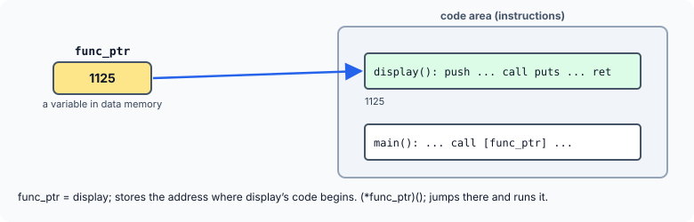

title : Pointers to Functions

summary : A function's code lives at an address too, and a pointer can hold it. Learn to declare and call function pointers, build arrays of them, pass them to functions as callbacks (as qsort does), return them, tame their syntax with typedef, and read even the most tangled C declarations.

# Pointers to Functions

Every variable in a program has an address in memory, and we have spent several chapters working with those addresses. The same is true of every **function**: its machine instructions are stored in memory, starting at some address. And just as we can store the address of a variable in a pointer, we can store the address of a function in a **pointer to a function**, and call the function through it.

That sounds like a curiosity, but it is one of the most powerful features of C. Function pointers let a program choose **at run time** which function to call. They are how `qsort()` lets you decide the sort order, how operating systems call the right driver for a device, how a GUI calls your code when a button is clicked, and how interpreters dispatch their instructions.

## Getting and Using a Function's Address

```c runnable
#include <stdio.h>

void display(void)
{
    puts("Long live viruses!!");
}

int main(void)
{
    void (*func_ptr)(void);                    /* a pointer to a function taking nothing, returning nothing */

    func_ptr = display;                        /* the function's name gives its address */
    printf("Address of function display is %s\n",
           func_ptr == &display ? "stored in func_ptr" : "?");

    (*func_ptr)();                             /* call through the pointer */
    func_ptr();                                /* the same call, shorter form */
    return 0;
}
```

```
Address of function display is stored in func_ptr
Long live viruses!!
Long live viruses!!
```

### The name of a function is its address

Just as mentioning the name of an array gives the array's base address, mentioning the name of a function (without parentheses after it) gives the function's address. So `func_ptr = display;` stores the address where `display()`'s code begins. Writing `&display` gives the same address — the program compares the two to show it.



Older books print that address with `printf("%u", display)`. That is not portable: a function pointer is not an `unsigned int`, and C does not even guarantee that it can be converted to `void *` for `%p` (although POSIX systems such as Linux allow it). The exact number is also different on every run. What matters is not the number but what you can do with it.

### Declaring a pointer to a function

```c
void (*func_ptr)(void);
```

Read it from the name outwards: `func_ptr` is a **pointer** (`*func_ptr`) **to a function** that takes no arguments (`(void)`) and returns **nothing** (`void`). A pointer to a function must state the function's whole signature — return type and parameter types — because the compiler needs both to call through it correctly.

The parentheses around `*func_ptr` are essential. Without them,

```c
void *func_ptr(void);
```

declares a **function** called `func_ptr` that returns a `void *` — because `()` binds more tightly than `*`. This is the most common mistake with function pointers.

### Calling through the pointer

`(*func_ptr)()` follows the pointer to the function and calls it. C also allows the shorter `func_ptr()`, which means exactly the same thing: a function name is converted to a pointer anyway, so calling "through" a pointer is the normal case. The long form makes it obvious to a reader that a pointer is involved; the short form is more common in modern code.

## Arrays of Function Pointers and Callbacks

Function pointers become useful when there is more than one function to choose from:

```c runnable
#include <stdio.h>

int add(int a, int b) { return a + b; }
int sub(int a, int b) { return a - b; }
int mul(int a, int b) { return a * b; }

/* applies any two-int function to x and y */
int apply(int (*op)(int, int), int x, int y)
{
    return op(x, y);
}

int main(void)
{
    int (*ops[3])(int, int) = {add, sub, mul};   /* an array of function pointers */
    const char *names[3] = {"add", "sub", "mul"};

    for (int i = 0; i < 3; i++)
        printf("%s(12, 5) = %d\n", names[i], ops[i](12, 5));

    printf("apply(mul, 6, 7) = %d\n", apply(mul, 6, 7));
    return 0;
}
```

```
add(12, 5) = 17
sub(12, 5) = 7
mul(12, 5) = 60
apply(mul, 6, 7) = 42
```

- `int (*ops[3])(int, int)` is an **array of 3 pointers to functions** that take two `int`s and return an `int`. Read it from the name: `ops` is an array of 3 (`ops[3]`), of pointers (`*`), to functions `(int, int)` returning `int`. The program calls whichever function the loop index selects: `ops[i](12, 5)`. This "table of functions" is how menus, command interpreters and state machines are often written — instead of a long `switch`.
- `apply()` receives a function as a **parameter**: `int (*op)(int, int)`. The caller decides what `apply()` does. A function passed in like this, for the receiver to call back, is called a **callback**.

The standard library's best-known callback user is `qsort()`. It can sort an array of anything, because the caller passes a comparison function:

```c runnable
#include <stdio.h>
#include <stdlib.h>

/* qsort calls back into these to decide the order */
int ascending(const void *a, const void *b)
{
    int x = *(const int *)a, y = *(const int *)b;
    return (x > y) - (x < y);                  /* -1, 0 or 1, without overflow */
}

int descending(const void *a, const void *b)
{
    return ascending(b, a);
}

void show(const int *v, int n)
{
    for (int i = 0; i < n; i++)
        printf("%d ", v[i]);
    printf("\n");
}

int main(void)
{
    int marks[] = {72, 15, 98, 40, 63, 27};
    int n = sizeof marks / sizeof marks[0];

    qsort(marks, n, sizeof marks[0], ascending);
    show(marks, n);
    qsort(marks, n, sizeof marks[0], descending);
    show(marks, n);
    return 0;
}
```

```
15 27 40 63 72 98 
98 72 63 40 27 15 
```

`qsort()` repeatedly calls the function it was given, with the addresses of two elements, and arranges the elements according to whether the result is negative, zero or positive. The same `qsort()` sorts ascending or descending, depending only on which function pointer it receives.

Why `(x > y) - (x < y)` instead of the tempting `x - y`? For large values of opposite sign, `x - y` can overflow an `int`, which is undefined behaviour and can give the wrong sign. The comparison form always returns −1, 0 or 1.

## Returning a Function Pointer, and typedef

A function can also **return** a pointer to a function. Written out in full, the declaration gets hard to read, so it is usual to name the pointer type with `typedef` first:

```c runnable
#include <stdio.h>

typedef int (*binop)(int, int);                /* binop: pointer to function (int, int) -> int */

int add(int a, int b) { return a + b; }
int mul(int a, int b) { return a * b; }

/* returns a pointer to a function, chosen by the operator symbol */
binop choose(char symbol)
{
    switch (symbol) {
    case '+': return add;
    case '*': return mul;
    default:  return NULL;
    }
}

/* the same function written without the typedef */
int (*choose_raw(char symbol))(int, int)
{
    return choose(symbol);
}

int main(void)
{
    const char *expr = "+*?";

    for (const char *s = expr; *s != '\0'; s++) {
        binop f = choose(*s);
        if (f != NULL)
            printf("8 %c 3 = %d\n", *s, f(8, 3));
        else
            printf("%c: unknown operator\n", *s);
    }
    printf("choose_raw('*')(4, 5) = %d\n", choose_raw('*')(4, 5));
    return 0;
}
```

```
8 + 3 = 11
8 * 3 = 24
?: unknown operator
choose_raw('*')(4, 5) = 20
```

`typedef int (*binop)(int, int);` makes `binop` a name for "pointer to a function taking two `int`s and returning `int`". After that, `binop choose(char symbol)` reads naturally: `choose` returns a `binop`.

Compare it with the same declaration written without the `typedef`:

```c
int (*choose_raw(char symbol))(int, int)
```

Reading from the name: `choose_raw` is a function taking a `char` (`choose_raw(char symbol)`), returning a pointer (`*`) to a function taking `(int, int)` and returning `int`. It is correct, but the `typedef` version is far easier to read and to get right.

Notice also that `choose()` returns `NULL` for an unknown operator, and the caller checks for it. Calling through a `NULL` function pointer crashes the program, just like dereferencing a `NULL` data pointer.

## Reading Complicated Declarations

Declarations involving function pointers can become intimidating. Here is a set of them, with what each declares. Every one of them has been compiled and used in a test program to confirm the reading.

| Declaration | Meaning |
|---|---|
| `typedef int (*funcptr)();` | `funcptr` is the type "pointer to a function returning `int`" (parameters unspecified) |
| `typedef int (*fret_int)(char *, char *);` | `fret_int` is a pointer to a function that takes two `char *` and returns `int` |
| `typedef void (*complex)();` | `complex` is a pointer to a function returning nothing |
| `char (*(*frpapfrc(void))[3])(void);` | `frpapfrc` is a function returning a pointer to an array of 3 pointers to functions returning `char` |
| `typedef int (*(*arr2d_ptr)(void))[3][4];` | `arr2d_ptr` is a pointer to a function returning a pointer to a 3 × 4 array of `int` |
| `typedef int (*(*(*ptr2d_fptr)(void))[10])(void);` | `ptr2d_fptr` is a pointer to a function returning a pointer to an array of 10 pointers to functions returning `int` |
| `typedef char (*(*arr_fptr[3])(void))[10];` | `arr_fptr` is an array of 3 pointers to functions, each returning a pointer to an array of 10 `char`s |
| `typedef float *(*(*(*ptr_fptr)(void))[10])(void);` | `ptr_fptr` is a pointer to a function returning a pointer to an array of 10 pointers to functions returning a `float *` |

(Older books write some of these with `[]` instead of `[3]`. A pointer to an array of unknown size is legal, but it cannot be indexed or used with `sizeof`, so a size is given here.)

### The right–left rule

There is a reliable method for reading any declaration:

1. Start at the **name** being declared.
2. Look **right**. `[n]` means "array of *n*"; `(...)` means "function taking ... returning". Keep going right until you reach a `)` or the end.
3. Then look **left**. `*` means "pointer to". Keep going left until you reach a `(`.
4. Step out of that pair of parentheses and repeat from step 2.
5. When nothing is left on either side, the type at the far left is the final type.

Applied to `float *(*(*(*ptr_fptr)(void))[10])(void)`:

| Step | Look at | Reads |
|---|---|---|
| name | `ptr_fptr` | `ptr_fptr` is |
| left | `*` | a pointer to |
| right | `(void)` | a function taking nothing, returning |
| left | `*` | a pointer to |
| right | `[10]` | an array of 10 |
| left | `*` | pointers to |
| right | `(void)` | functions taking nothing, returning |
| left | `float *` | a pointer to `float` |

In real code, break such types up with intermediate `typedef`s instead:

```c
typedef float *fptr_fn(void);          /* a function returning float *     */
typedef fptr_fn *fn_table[10];         /* an array of 10 pointers to such  */
typedef fn_table *(*ptr_fptr)(void);   /* the final pointer type           */
```

:::callout
An empty parameter list, as in `int (*funcptr)();`, has an old meaning in C: "the parameters are not specified", so the compiler cannot check calls through it. Since C23 it means the same as `(void)`. Always write the parameter types — `(void)` when there are none — so the compiler can catch a call with the wrong arguments.
:::

## Uses of Function Pointers

Older books list memory-resident (TSR) programs, viruses and anti-virus tools, COM components and Windows event handling as places where function pointers are indispensable. The principle behind all of them is the same, and it is everywhere in modern software too:

- **Callbacks**: `qsort()`, `bsearch()`, `atexit()`, `signal()`, thread start functions.
- **Event handlers**: a GUI library stores a pointer to the function to call when a button is clicked.
- **Tables of operations**: device drivers fill a structure of function pointers (`open`, `read`, `write`, …) that the operating system calls; this is how C achieves the effect of object-oriented "virtual functions".
- **Dispatch tables**: an interpreter or a menu indexes an array of function pointers instead of using a long `switch`.

## Key Takeaways

- A function's name gives the address of its code; that address can be stored in a pointer to a function and the function called through it.
- `ret (*name)(params)` declares a pointer to a function. The parentheses around `*name` are required; without them you declare a function returning a pointer.
- `(*fp)(args)` and `fp(args)` both call through the pointer.
- Arrays of function pointers make dispatch tables; function pointer parameters make callbacks, as in `qsort()`.
- Use `typedef` for function pointer types, and the right–left rule to read complicated declarations.
- Always give the full parameter list, and never call through a `NULL` function pointer.

## Practice Questions

:::details[Declare an array of three pointers to functions, each of which receives two ints and returns a float.]
```c
float (*fns[3])(int, int);
```
Or, with a `typedef`: `typedef float (*calc)(int, int); calc fns[3];`
:::

:::details[What is the difference between int *f(int); and int (*f)(int);?]
The first declares a **function** `f` that takes an `int` and returns an `int *`. The second declares a **pointer** `f` to a function that takes an `int` and returns an `int`.
:::

:::details[Write a comparison function for qsort that sorts an array of strings (char *) alphabetically.]
```c
int by_name(const void *a, const void *b)
{
    const char *const *x = a, *const *y = b;
    return strcmp(*x, *y);
}
```
Each argument is the address of an element, and the elements are `char *`, so each argument is really a pointer to a `char *`.
:::

:::details[Read this declaration: int (*(*p)(int))[5];]
`p` is a pointer to a function that takes an `int` and returns a pointer to an array of 5 `int`s.
:::
