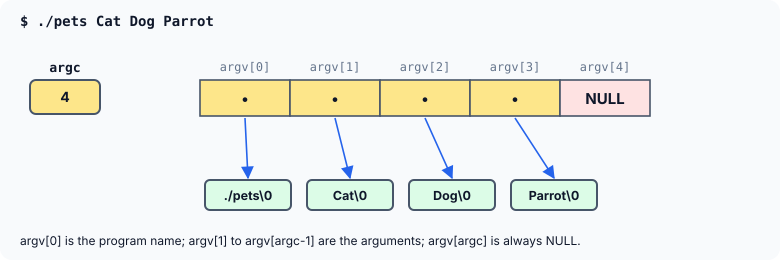

title : Command-Line Arguments and Variable Argument Lists

summary : main receives its command-line arguments as argc and argv, an array of pointers to strings. And a function such as printf can take any number of arguments using stdarg.h. Learn both, including default promotions, va_end, and why a variadic function must be told how many arguments it got.

# Command-Line Arguments and Variable Argument Lists

Two features of C are built entirely on pointers, though they are often used without thinking about it: the arguments a program receives from the **command line**, and functions such as `printf()` that accept a **variable number of arguments**.

## argc and argv

When a program is run from a command prompt, words can be typed after its name:

```
$ ./pets Cat Dog Parrot
```

These words are passed to `main()`, which can receive them through two parameters:

```c
int main(int argc, char *argv[])
```

- **`argc`** (argument count) is the number of words on the command line, **including the program's name**. Here it is 4.
- **`argv`** (argument vector) is an **array of pointers to strings**: `argv[0]` points to the program name, `argv[1]` to `"Cat"`, and so on. The standard also guarantees that `argv[argc]` is `NULL`, which marks the end of the array.



This is exactly the array of pointers to strings from the strings chapter. The operating system builds the strings and the array before `main()` starts, and passes `main()` their count and the array's base address. In a parameter list, `char *argv[]` is the same as `char **argv` — a pointer to the first `char *` — and both spellings are common.

A program that prints its arguments:

```c
#include <stdio.h>

int main(int argc, char *argv[])
{
    printf("argc = %d\n", argc);
    for (int i = 0; i < argc; i++)
        printf("argv[%d] = %s\n", i, argv[i]);
    printf("argv[argc] is %s\n", argv[argc] == NULL ? "NULL" : "not NULL");
    return 0;
}
```

Run as `./args Cat Dog Parrot`, it prints:

```
argc = 4
argv[0] = ./args
argv[1] = Cat
argv[2] = Dog
argv[3] = Parrot
argv[argc] is NULL
```

Since a program run from this page has no command line, here is the same idea with the array built by hand and passed to a function playing the part of `main()`:

```c runnable
#include <stdio.h>

/* stands in for main(argc, argv), so the demo needs no command line */
int fake_main(int argc, char *argv[])
{
    printf("argc = %d\n", argc);
    for (int i = 0; i < argc; i++)
        printf("argv[%d] = %s\n", i, argv[i]);
    return 0;
}

int main(void)
{
    char *argv[] = {"./pets", "Cat", "Dog", "Parrot", NULL};
    return fake_main(4, argv);
}
```

```
argc = 4
argv[0] = ./pets
argv[1] = Cat
argv[2] = Dog
argv[3] = Parrot
```

A few points:

- The names `argc` and `argv` are only a convention; any names work. The types are what matter.
- Every argument arrives as a **string**. A program that wants a number must convert it, for example with `strtol()`: `./add 12 30` gives `argv[1]` the string `"12"`, not the number 12.
- Words separated by spaces are separate arguments. Most shells let you group words with quotes: `./pets "Guinea pig"` gives one argument.
- `argv[0]` is usually the name used to run the program, but the standard only promises a name of *some* kind (and it may even be an empty string). Do not rely on its exact contents.

## Functions with a Variable Number of Arguments

`printf()` can be called with one argument, or two, or ten. How can a C function accept an unknown number of arguments?

The answer is the header `<stdarg.h>` and an **ellipsis** (`...`) in the function's parameter list. Here is a function that returns the largest of any number of `int`s:

```c runnable
#include <stdio.h>
#include <stdarg.h>

/* returns the largest of count ints that follow */
int findmax(int count, ...)
{
    va_list ptr;
    int max, num;

    va_start(ptr, count);                      /* ptr now points just past count */
    max = va_arg(ptr, int);                    /* fetch the first int, move ptr on */

    for (int i = 1; i < count; i++) {
        num = va_arg(ptr, int);                /* fetch the next int */
        if (num > max)
            max = num;
    }

    va_end(ptr);                               /* always pair va_start with va_end */
    return max;
}

int main(void)
{
    printf("maximum = %d\n", findmax(5, 23, 15, 1, 92, 50));
    printf("maximum = %d\n", findmax(3, 100, 300, 29));
    return 0;
}
```

```
maximum = 92
maximum = 300
```

### How it works

```c
int findmax(int count, ...)
```

The ellipsis says that any number of further arguments may follow `count`. There must be at least one named parameter before it. The function has no names for the extra arguments, so it reaches them through a **`va_list`**, which works like a pointer walking along the arguments:

- **`va_start(ptr, count)`** sets `ptr` to point just past the last named parameter, `count` — that is, at the first unnamed argument.
- **`va_arg(ptr, int)`** returns the argument `ptr` currently points to, treating it as an `int`, and moves `ptr` on to the next argument. The type tells `va_arg()` how big the argument is and how to read it.
- **`va_end(ptr)`** finishes the walk. Every `va_start()` must be matched by a `va_end()` before the function returns. (Older books leave it out. It often makes no difference on a PC, but on some systems `va_start()` allocates something that only `va_end()` releases, so it is required.)

The first `va_arg()` call fetches the first number into `max`; the loop then fetches the remaining `count - 1` numbers and keeps the largest.

### The function must be told what it received

Notice that `findmax()` receives the number of values in `count`. There is no other way: **a variadic function cannot find out how many arguments it was given, or what their types are.** `va_arg()` simply reads whatever is in the next position. Asking for more arguments than were passed, or for the wrong type, is undefined behaviour — typically garbage values or a crash.

So every variadic function needs some agreed way of knowing what to expect:

- a **count**, as in `findmax()`;
- a **format string**, as in `printf()`: `"%d %s"` says "an `int`, then a `char *`";
- a **sentinel**, a special last value such as `NULL`, as in the POSIX function `execl()`.

### Default argument promotions

The next function prints values of one of three types. It shows an important rule:

```c runnable
#include <stdio.h>
#include <stdarg.h>

enum kind { INTS = 1, CHARS = 2, DOUBLES = 3 };

/* prints count values of the given kind */
void display(enum kind type, int count, ...)
{
    va_list ptr;

    va_start(ptr, count);
    for (int j = 0; j < count; j++) {
        switch (type) {
        case INTS:
            printf("%d ", va_arg(ptr, int));
            break;
        case CHARS:
            printf("%c ", (char)va_arg(ptr, int));     /* a char arrives as an int */
            break;
        case DOUBLES:
            printf("%.1f ", va_arg(ptr, double));      /* a float arrives as a double */
            break;
        }
    }
    printf("\n");
    va_end(ptr);
}

int main(void)
{
    display(INTS, 2, 5, 6);
    display(CHARS, 4, 'A', 'a', 'b', 'c');
    display(DOUBLES, 3, 2.5, 299.3, -1.0);
    return 0;
}
```

```
5 6 
A a b c 
2.5 299.3 -1.0 
```

When arguments are passed through `...`, they undergo the **default argument promotions**: every `char` and `short` is converted to `int`, and every `float` to `double`, before it is passed. So the characters `'A'`, `'a'`, … arrive as `int`s, and must be fetched with `va_arg(ptr, int)` (then converted back to `char` if needed); a `float` would have to be fetched with `va_arg(ptr, double)`.

:::callout
Older books fetch the characters with `va_arg(ptr, char)`. That reads a `char` where an `int` was passed — undefined behaviour. GCC warns: *'char' is promoted to 'int' when passed through '...'* and adds *if this code is reached, the program will abort* — it actually compiles the line into an instruction that stops the program. Always fetch `char` and `short` arguments as `int`, and `float` arguments as `double`.
:::

The program also uses an `enum` for the kind of value instead of the bare numbers 1, 2 and 3: `display(CHARS, 4, ...)` says what it means.

### A variadic sort

As a last example, a function that sorts the numbers it is given, in ascending or descending order. The fixed arguments say which order, and how many numbers follow:

```c runnable
#include <stdio.h>
#include <stdarg.h>
#include <stdlib.h>

enum order { ASCENDING, DESCENDING };

/* sorts count ints given after the fixed arguments, and prints them */
void sort_print(enum order how, int count, ...)
{
    int *v = malloc((size_t)count * sizeof *v);
    if (v == NULL)
        return;

    va_list ap;
    va_start(ap, count);
    for (int i = 0; i < count; i++)
        v[i] = va_arg(ap, int);                /* copy the arguments into an array */
    va_end(ap);

    for (int i = 1; i < count; i++) {          /* insertion sort */
        int key = v[i], j = i - 1;
        while (j >= 0 && (how == ASCENDING ? v[j] > key : v[j] < key)) {
            v[j + 1] = v[j];
            j--;
        }
        v[j + 1] = key;
    }

    for (int i = 0; i < count; i++)
        printf("%d ", v[i]);
    printf("\n");
    free(v);
}

int main(void)
{
    sort_print(ASCENDING, 6, 42, 7, 19, 88, 3, 55);
    sort_print(DESCENDING, 4, 10, 40, 20, 30);
    return 0;
}
```

```
3 7 19 42 55 88 
40 30 20 10 
```

The unnamed arguments cannot be indexed like an array, so the function first copies them into one — allocated with `malloc()`, because `count` is known only at run time — and then sorts the array with an ordinary insertion sort. The condition `how == ASCENDING ? v[j] > key : v[j] < key` picks the comparison that matches the requested order.

:::callout
Variadic functions give up all type checking: the compiler cannot tell whether the arguments match what the function will fetch. (For `printf()` and `scanf()`, compilers check the format string specially, which is why `-Wall` catches mistakes there.) When the arguments all have the same type, passing an array and its length is safer and just as convenient.
:::

## Key Takeaways

- `main(int argc, char *argv[])` receives the command-line words: `argc` counts them (including the program name), and `argv` is an array of pointers to them, ending with `argv[argc] == NULL`.
- Every command-line argument is a string; convert numbers explicitly.
- A function declared with `...` reads its extra arguments with `va_start()`, `va_arg()` and `va_end()` from `<stdarg.h>`.
- A variadic function must be told how many arguments it received and their types — by a count, a format string or a sentinel.
- `char`/`short` arguments arrive as `int`, `float` arguments as `double`; fetch them with those types.
- Always call `va_end()` for every `va_start()`.

## Practice Questions

:::details[For the command ./copy a.txt b.txt, what are argc, argv[0], argv[2] and argv[3]?]
`argc` is **3**; `argv[0]` is `"./copy"`; `argv[2]` is `"b.txt"`; `argv[3]` is `NULL`.
:::

:::details[Write a program that adds up the numbers given on its command line.]
```c
#include <stdio.h>
#include <stdlib.h>

int main(int argc, char *argv[])
{
    long sum = 0;

    for (int i = 1; i < argc; i++)      /* skip argv[0], the program name */
        sum += strtol(argv[i], NULL, 10);
    printf("%ld\n", sum);
    return 0;
}
```
`./add 12 30 8` prints 50.
:::

:::details[What goes wrong if findmax(5, 23, 15, 1) is called?]
`findmax()` is told there are 5 numbers but receives only 3. The loop's `va_arg()` calls read two arguments that were never passed — undefined behaviour, giving garbage values or a crash. The count must match.
:::

:::details[A variadic function is passed a float. How must it fetch the value, and why?]
With `va_arg(ap, double)`. Arguments passed through `...` undergo the default argument promotions, which convert `float` to `double`.
:::
