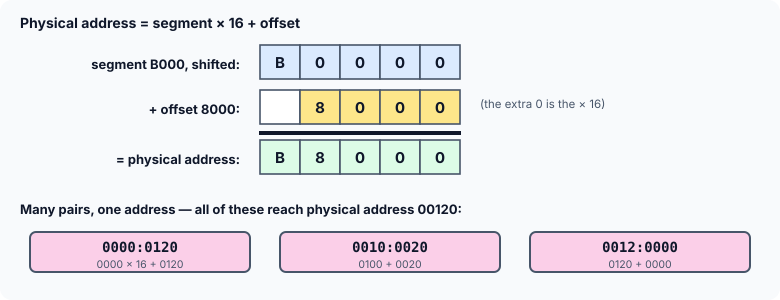

title : Near, Far and Huge Pointers: Segmented Memory

summary : Old 16-bit PCs reached 1 MB of memory by combining a segment and an offset, which gave C three kinds of pointer: near, far and huge. Learn how segment:offset addressing worked, why two far pointers to the same byte could compare unequal, and how normalization fixed it.

# Near, Far and Huge Pointers: Segmented Memory

Older books on C, and old code written for MS-DOS, are full of declarations such as `char far *scr` and `int huge *a`. These keywords do not exist in standard C, and no modern compiler for a PC accepts them. But they are worth understanding: they explain a lot of old code, they show clearly what a pointer **is** at the machine level, and they are a good lesson in why the C standard is careful about comparing pointers.

All the programs in this article are written in standard C. Instead of using real `far` pointers, they **compute** what the old hardware did, so you can run them and see the results.

## Data Bus and Address Bus

A microprocessor is connected to memory by two sets of wires. The **data bus** carries the data; its width says how many bits can be moved in one go. The **address bus** carries the address of the memory location being read or written; its width says how many different locations the processor can address. With a 20-bit address bus, a processor can reach 2²⁰ locations — 1 MB.

| Microprocessor | Data bus | Address bus | Maximum memory | Modes of operation |
|---|---|---|---|---|
| 8088 (PC, XT) | 8 | 20 | 1 MB | Real |
| 8086 | 16 | 20 | 1 MB | Real |
| 80286 (AT) | 16 | 24 | 16 MB | Real / Protected |
| 80386 | 32 | 32 | 4 GB | Real / Protected |
| 80486 | 32 | 32 | 4 GB | Real / Protected |
| Pentium | 64 | 32 | 4 GB | Real / Protected |

(Some older books give the Pentium a 64-bit address bus; in fact the original Pentium had a 32-bit address bus — its 64-bit bus was the data bus. Later processors added a few more address lines.)

The 8088 and 8086 work only in **real mode**, and can address only 1 MB. The later processors can also work in **protected mode**, which lets them reach all their memory and protects running programs from each other's memory. MS-DOS was written for real mode — so even on a 286 with 16 MB installed, DOS programs could use only the first 1 MB. (Special drivers such as `EMM386`, for "expanded" and "extended" memory, worked around this.) Unix, and later Windows, ran in protected mode.

## Segments and Offsets

In real mode, a 16-bit processor faces a puzzle. Its registers are 16 bits wide, so one register can hold numbers only up to 65,535 — enough to address 64 KB. But the address bus has 20 bits, enough for 1 MB. How does it form a 20-bit address?

It uses **two** 16-bit registers together: a **segment** and an **offset**. The memory is viewed as a set of **segments**, each up to 64 KB long, and a segment may begin at any address that is a multiple of 16. The segment register says where the segment begins (divided by 16), and the offset register says how far into the segment the byte lies. The physical address is:

```
physical address = segment × 16 + offset
```

Multiplying by 16 is the same as shifting left by one hexadecimal digit. So segment `B000` and offset `8000` give:



Addresses written in this form, `segment:offset`, were everywhere in the DOS world. This program computes a few:

```c runnable
#include <stdio.h>
#include <stdint.h>

/* the 8086 rule: physical address = segment * 16 + offset (20 bits) */
uint32_t physical(uint16_t segment, uint16_t offset)
{
    return ((uint32_t)segment << 4) + offset;
}

int main(void)
{
    printf("0002:0005 -> %05X (decimal %u)\n", (unsigned)physical(0x0002, 0x0005),
           (unsigned)physical(0x0002, 0x0005));
    printf("B000:8000 -> %05X\n", (unsigned)physical(0xB000, 0x8000));
    printf("B800:0000 -> %05X\n", (unsigned)physical(0xB800, 0x0000));
    printf("0040:0017 -> %05X\n", (unsigned)physical(0x0040, 0x0017));
    printf("0000:0417 -> %05X\n", (unsigned)physical(0x0000, 0x0417));
    return 0;
}
```

```
0002:0005 -> 00025 (decimal 37)
B000:8000 -> B8000
B800:0000 -> B8000
0040:0017 -> 00417
0000:0417 -> 00417
```

The first line is the example from the old books: segment 2, offset 5 gives 2 × 16 + 5 = 37. Notice the last four lines: **different** segment:offset pairs can name the **same** physical byte. B000:8000 and B800:0000 are both B8000 — the start of colour video memory. And 0040:0017 and 0000:0417 are both 00417, a byte we will meet again in the next article.

## Near, Far and Huge Pointers

A C pointer has to hold an address. On these machines, there were two choices:

- A **near** pointer holds only a 16-bit **offset**. It is used together with a segment register that the program already has set up: the code segment (CS) for pointers to functions, the data segment (DS) for pointers to data. Near pointers are 2 bytes, small and fast — but they can only reach the 64 KB of the current segment.
- A **far** pointer holds a 32-bit value: a 16-bit **segment** and a 16-bit **offset**, side by side. It can reach anywhere in the 1 MB. The far pointer for B000:8000 was written as the number `0xB0008000`.
- A **huge** pointer is also 32 bits, segment and offset, but the compiler keeps it **normalized** (explained below), and does extra work so that pointer arithmetic can cross 64 KB boundaries.

So one machine could have pointers of two different sizes. Which was the default depended on the **memory model** chosen when compiling:

| Model | Code pointers | Data pointers | Limits |
|---|---|---|---|
| Tiny | near | near | code + data + stack together in 64 KB |
| Small | near | near | 64 KB code, 64 KB data |
| Medium | far | near | 1 MB code, 64 KB data |
| Compact | near | far | 64 KB code, 1 MB data |
| Large | far | far | 1 MB code, 1 MB data; no single item over 64 KB |
| Huge | far | huge | like large, but a single array may exceed 64 KB |

The keywords `near`, `far` and `huge` let a program override the model's default for one pointer — for example, a small-model program could still declare a `far` pointer to reach video memory, which lies outside its data segment.

The old compilers also provided macros (in `dos.h`) to build and take apart far pointers: `MK_FP(segment, offset)` makes a far pointer, `FP_SEG(fp)` returns its segment, and `FP_OFF(fp)` its offset. The next program defines its own versions of them with shifts and masks on a 32-bit integer.

## The Trouble with Far Pointers

Because several segment:offset pairs name the same byte, two far pointers can point to the **same** location and still hold **different** values. Consider three far pointers:

```c
char far *a = 0x00000120;     /* 0000:0120 */
char far *b = 0x00100020;     /* 0010:0020 */
char far *c = 0x00120000;     /* 0012:0000 */
```

All three refer to physical address 00120. Yet the old compilers compared far pointers in a way that did not notice:

- `==` and `!=` compared the **whole 32-bit value**. Since the three values differ, `a == b`, `a == c` and `b == c` are all **false**.
- `<`, `>`, `<=` and `>=` compared **only the offset**, for speed. The offsets are 0120, 0020 and 0000, so `a > b && a > c && b > c` is **true**.

A program testing these four conditions printed only the result of the last one — exactly the opposite of what a reader would expect.

**Huge** pointers fixed this by being **normalized**: a normalized pointer keeps as much of the address as possible in the segment, so the offset is always between 0 and F. To normalize a pointer, convert it to its 20-bit physical address, then use the top 16 bits as the segment and the bottom 4 bits as the offset. 500D:9407, for example, is physical address 594D7, which normalizes to 594D:0007. Since every physical address has exactly **one** normalized form, equal huge pointers always have equal values. The price was speed: huge pointer arithmetic needed calls to library routines to re-normalize after every step.

This program simulates both behaviours:

```c runnable
#include <stdio.h>
#include <stdint.h>

/* a far pointer packs segment (high 16 bits) and offset (low 16 bits) into 32 bits */
typedef uint32_t farptr;

#define MK_FP(seg, off)  (((farptr)(seg) << 16) | (uint16_t)(off))
#define FP_SEG(fp)       ((uint16_t)((fp) >> 16))
#define FP_OFF(fp)       ((uint16_t)(fp))

uint32_t physical(farptr p)
{
    return ((uint32_t)FP_SEG(p) << 4) + FP_OFF(p);
}

/* a normalized (huge) pointer: as much as possible in the segment, offset 0..F */
farptr normalize(farptr p)
{
    uint32_t addr = physical(p);
    return MK_FP(addr >> 4, addr & 0xF);
}

void show(const char *name, farptr p)
{
    printf("%s = %04X:%04X  physical %05X\n", name, FP_SEG(p), FP_OFF(p), (unsigned)physical(p));
}

int main(void)
{
    farptr a = 0x00000120, b = 0x00100020, c = 0x00120000;

    show("a", a);
    show("b", b);
    show("c", c);

    /* how old compilers compared FAR pointers: == uses all 32 bits, > only the offset */
    printf("\nfar:  a == b? %s   a == c? %s   b == c? %s\n",
           a == b ? "yes" : "no", a == c ? "yes" : "no", b == c ? "yes" : "no");
    printf("far:  a > b && a > c && b > c (offsets only)? %s\n",
           FP_OFF(a) > FP_OFF(b) && FP_OFF(a) > FP_OFF(c) && FP_OFF(b) > FP_OFF(c) ? "yes" : "no");

    /* HUGE pointers are always normalized, so equal addresses have equal values */
    farptr ha = normalize(a), hb = normalize(b), hc = normalize(c);
    printf("\nhuge: a = %04X:%04X  b = %04X:%04X  c = %04X:%04X\n",
           FP_SEG(ha), FP_OFF(ha), FP_SEG(hb), FP_OFF(hb), FP_SEG(hc), FP_OFF(hc));
    printf("huge: a == b? %s   a == c? %s   b == c? %s\n",
           ha == hb ? "yes" : "no", ha == hc ? "yes" : "no", hb == hc ? "yes" : "no");

    farptr p = MK_FP(0x500D, 0x9407);
    farptr n = normalize(p);
    printf("\n500D:9407 normalizes to %04X:%04X\n", FP_SEG(n), FP_OFF(n));
    return 0;
}
```

```
a = 0000:0120  physical 00120
b = 0010:0020  physical 00120
c = 0012:0000  physical 00120

far:  a == b? no   a == c? no   b == c? no
far:  a > b && a > c && b > c (offsets only)? yes

huge: a = 0012:0000  b = 0012:0000  c = 0012:0000
huge: a == b? yes   a == c? yes   b == c? yes

500D:9407 normalizes to 594D:0007
```

With far-pointer rules, the three equality tests fail and the offset-only test succeeds. After normalizing, all three pointers become 0012:0000, and the equality tests succeed.

:::callout
This is exactly why the C standard says that comparing pointers with `<` or `>` is defined only when both point into the **same array** (or one past its end). On a segmented machine, pointers into one array share a segment, so comparing offsets is enough — and that is all the language promises.
:::

### Practice: reading declarations with near, far and huge

Old code mixes these keywords into declarations. They qualify the pointer they appear next to:

| Declaration | Meaning |
|---|---|
| `int f1();` | a function returning `int` |
| `int *p1;` | a pointer to `int` (near or far, depending on the memory model) |
| `int *f2();` | a function returning a pointer to `int` |
| `int (*fp1)(int);` | a pointer to a function that takes an `int` and returns an `int` |
| `int (*fp2)(int *ip);` | a pointer to a function that takes a pointer to `int` and returns an `int` |
| `int (far *list[5])(int far *ip);` | an array of 5 far pointers to functions that take a far pointer to `int` and return an `int` |
| `int (huge *a[10])(char far *j);` | an array of 10 huge pointers to functions that take a far pointer to `char` and return an `int` |

## Why This Has Disappeared

Since the 80386, PC processors can use a **flat** address space in protected mode: an address is a single 32-bit (or today 64-bit) number, and all of memory is one huge segment. Every pointer has the same size, there is no near or far, and two pointers to the same byte always hold the same value. Modern operating systems also give every program its own **virtual** address space, mapped to physical memory by the processor, so programs never deal with physical addresses at all.

The ideas have not vanished completely, though. Some microcontrollers still have separate memory spaces and compiler-specific keywords for them, and 16-bit DOS compilers are still used to maintain old code. Whenever you meet `far`, `near`, `huge`, `MK_FP` or a segment:offset address, you now know what it means.

## Key Takeaways

- Real-mode 8086 addresses are formed as segment × 16 + offset, giving 20 bits (1 MB) from 16-bit registers. Many segment:offset pairs name the same byte.
- A near pointer holds a 16-bit offset into the current segment; far and huge pointers hold a segment and an offset (32 bits).
- Far pointers compared with `==` used all 32 bits, but with `<`/`>` only the offset — so equal addresses could compare unequal, and comparisons could mislead.
- Huge pointers are always normalized (offset 0–F), so each address has one representation; they are slower.
- Memory models (tiny, small, medium, compact, large, huge) set the default pointer sizes.
- Modern flat memory makes all pointers the same size; `near`, `far` and `huge` are not part of standard C.

## Practice Questions

:::details[What physical address does 1234:0010 refer to?]
1234 × 16 + 0010 = 12340 + 0010 = **12350** (hexadecimal).
:::

:::details[Normalize the address 2A00:01F8.]
Physical address: 2A000 + 01F8 = 2A1F8. Normalized: segment **2A1F**, offset **0008**, i.e. 2A1F:0008.
:::

:::details[Can two different near pointers contain two different addresses but refer to the same location in memory?]
**No.** All near pointers use the same segment register, so different offsets always mean different locations.
:::

:::details[Can two different far pointers? Two different huge pointers?]
Far pointers: **yes** — different segment:offset pairs can name the same byte. Huge pointers: **no** — they are always normalized, so each physical address has only one representation.
:::

:::details[How many bytes did near, far and huge pointers occupy?]
A near pointer **2** bytes (offset only); far and huge pointers **4** bytes each (segment and offset).
:::
