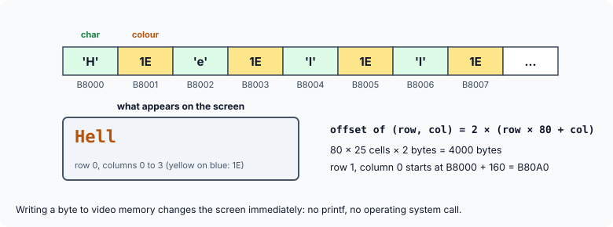

title : Talking to Hardware Through Pointers

summary : On a DOS PC, a pointer to the right address could change the screen, switch on Caps Lock or read the memory size. Explore video memory, the keyboard status byte and the BIOS data area in a simulation, learn safe bit manipulation, and meet volatile pointers in embedded C.

# Talking to Hardware Through Pointers

So far, every pointer in this course has pointed to memory that the program itself owned: its variables, its arrays, blocks from `malloc()`. But on many computers, some addresses do not belong to ordinary memory at all. Reading or writing them talks directly to **hardware**: the screen, the keyboard, a timer, a network card. This is called **memory-mapped I/O**, and a pointer is the natural tool for it.

On an MS-DOS PC, any program could do this. Older books on C show it with three small programs: one makes the text on the screen "dance", one switches Caps Lock on, and one reports how much memory the machine has. They use `far` pointers (see the previous article) to reach addresses outside the program's own segment.

A modern operating system does not let an ordinary program touch hardware addresses: every program runs in its own protected virtual address space, and an attempt to write to physical address B8000 would simply crash it. So the programs in this article run against a **simulated** 1 MB memory — an ordinary array — and a function `at()` that plays the part of a far pointer, returning the address of the byte at a given physical address. The pointer logic is exactly the same as on the real machine; only the memory is pretend.

## Video Memory and the "Dancing Dolls"

In text mode, the PC screen shows 25 rows of 80 characters. The contents of the screen are not stored inside the display; they are kept in **video memory**, which the display hardware reads many times a second. For a colour display it starts at physical address B8000 (segment B800); for an old monochrome display, at B0000.

Every character on the screen takes **two bytes** in video memory: first the character's code, then its **attribute** — a byte that sets its colour. The cell at row *r*, column *c* is therefore at offset 2 × (*r* × 80 + *c*), and the whole screen takes 80 × 25 × 2 = 4000 bytes.



So writing a byte to video memory changes the screen **instantly** — no `printf()`, no operating system. Here is the idea in our simulation:

```c runnable
#include <stdio.h>
#include <stdint.h>
#include <string.h>

#define ROWS 25
#define COLS 80

/* a simulated 1 MB of real-mode memory; on a DOS PC this was the real thing */
static unsigned char memory[1 << 20];

/* plays the part of a far pointer: the byte at a 20-bit physical address */
unsigned char *at(uint32_t physical)
{
    return &memory[physical];
}

/* writes text at (row, col) as a DOS program would: char byte, then colour byte */
void put_text(int row, int col, const char *s, unsigned char colour)
{
    unsigned char *scr = at(0xB8000) + 2 * (row * COLS + col);

    for (; *s != '\0'; s++) {
        *scr++ = (unsigned char)*s;            /* the character */
        *scr++ = colour;                       /* its attribute (colour) */
    }
}

void show_rows(int nrows)
{
    const unsigned char *scr = at(0xB8000);

    for (int r = 0; r < nrows; r++) {
        for (int c = 0; c < 32; c++)
            putchar(scr[2 * (r * COLS + c)] ? scr[2 * (r * COLS + c)] : ' ');
        putchar('\n');
    }
}

/* the "dancing dolls": swap the case of every letter on the screen */
void dance(void)
{
    unsigned char *scr = at(0xB8000);

    for (int i = 0; i < ROWS * COLS * 2; i += 2) {   /* every second byte is a character */
        if (scr[i] >= 'A' && scr[i] <= 'Z')
            scr[i] = scr[i] + 32;
        else if (scr[i] >= 'a' && scr[i] <= 'z')
            scr[i] = scr[i] - 32;
    }
}

int main(void)
{
    put_text(0, 0, "C:\\> dir /w", 0x07);
    put_text(1, 0, "Volume in drive C is Work", 0x07);
    put_text(2, 0, "Hello, Pointers!", 0x1E);      /* yellow on blue */

    show_rows(3);
    for (int round = 1; round <= 2; round++) {     /* the real program looped forever */
        dance();
        printf("-- after round %d --\n", round);
        show_rows(3);
    }
    printf("colour byte of 'H' at B8000 + 2*(2*80) + 1: %02X\n", *at(0xB8000 + 2 * (2 * COLS) + 1));
    return 0;
}
```

```
C:\> dir /w                     
Volume in drive C is Work       
Hello, Pointers!                
-- after round 1 --
c:\> DIR /W                     
vOLUME IN DRIVE c IS wORK       
hELLO, pOINTERS!                
-- after round 2 --
C:\> dir /w                     
Volume in drive C is Work       
Hello, Pointers!                
colour byte of 'H' at B8000 + 2*(2*80) + 1: 1E
```

`put_text()` writes text into video memory exactly as a DOS program did: a character byte, then a colour byte, for every character. `0x1E` means yellow (E) on blue (1): the high four bits of the attribute set the background colour and the low four the foreground colour.

`dance()` is the heart of the old "dancing dolls" program. It walks through all 4000 bytes in steps of 2 — so it looks only at the **character** bytes and skips the colour bytes — and swaps each letter's case: `'A'` to `'Z'` become lower case by adding 32, and `'a'` to `'z'` become upper case by subtracting 32 (the codes of the upper- and lower-case letters are exactly 32 apart). The original program ran this in an endless loop, so every letter on the screen flickered between capital and small faster than the eye could follow — the "dancing dolls". Here it runs twice: after two rounds the screen is back to normal.

On the real machine, the pointer was declared like this:

```c
char far *scr = 0xB8000000;     /* segment B800, offset 0000 */
```

A `far` pointer was needed because video memory lies outside the program's data segment, so a 16-bit near pointer could not reach it. The constant holds the segment in its top 16 bits and the offset in its bottom 16 bits. (Older books write `0xB0008000` — segment B000, offset 8000 — which names the same physical address, B8000.)

## Caps Lock: the Keyboard Status Byte

The BIOS — the built-in software of the PC — keeps some information in a small area of memory, the **BIOS data area**, starting at physical address 400. The byte at **417** records the state of several keys, one bit each:

| Bit | Mask | Meaning when the bit is 1 |
|---|---|---|
| 7 | `0x80` | Insert mode on |
| 6 | `0x40` | Caps Lock on |
| 5 | `0x20` | Num Lock on |
| 4 | `0x10` | Scroll Lock on |
| 3 | `0x08` | Alt pressed |
| 2 | `0x04` | Ctrl pressed |
| 1 | `0x02` | Left Shift pressed |
| 0 | `0x01` | Right Shift pressed |

To turn Caps Lock on, a program sets bit 6 of that byte. Older books do it by writing the number 64 (binary 01000000):

```c
char far *kb = 0x417;
*kb = 64;
```

That sets bit 6 — but it also **clears every other bit**, switching off Num Lock, Scroll Lock and Insert mode if they were on. To change just one bit, use the bitwise operators:

```c runnable
#include <stdio.h>
#include <stdint.h>

static unsigned char memory[1 << 20];         /* simulated real-mode memory */

unsigned char *at(uint32_t physical) { return &memory[physical]; }

/* bit masks for the keyboard status byte at 417h */
#define RIGHT_SHIFT 0x01
#define LEFT_SHIFT  0x02
#define CTRL        0x04
#define ALT         0x08
#define SCROLL_LOCK 0x10
#define NUM_LOCK    0x20
#define CAPS_LOCK   0x40
#define INSERT      0x80

void show(unsigned char status)
{
    const char *names[8] = {"RShift", "LShift", "Ctrl", "Alt", "Scroll", "Num", "Caps", "Ins"};

    printf("%02X =", status);
    for (int bit = 7; bit >= 0; bit--)
        printf(" %d", (status >> bit) & 1);
    printf("  on:");
    for (int bit = 7; bit >= 0; bit--)
        if (status & (1u << bit))
            printf(" %s", names[bit]);
    printf("\n");
}

int main(void)
{
    unsigned char *kb = at(0x417);

    *kb = NUM_LOCK;                            /* suppose Num Lock is already on */
    printf("before:          ");
    show(*kb);

    *kb = 64;                                  /* the classic way: overwrites every bit */
    printf("*kb = 64:        ");
    show(*kb);

    *kb = NUM_LOCK;                            /* start again */
    *kb |= CAPS_LOCK;                          /* turn ONLY the Caps Lock bit on */
    printf("*kb |= CAPS:     ");
    show(*kb);

    *kb &= (unsigned char)~CAPS_LOCK;          /* turn it off again */
    printf("*kb &= ~CAPS:    ");
    show(*kb);

    *kb ^= CAPS_LOCK;                          /* toggle it */
    printf("*kb ^= CAPS:     ");
    show(*kb);
    return 0;
}
```

```
before:          20 = 0 0 1 0 0 0 0 0  on: Num
*kb = 64:        40 = 0 1 0 0 0 0 0 0  on: Caps
*kb |= CAPS:     60 = 0 1 1 0 0 0 0 0  on: Caps Num
*kb &= ~CAPS:    20 = 0 0 1 0 0 0 0 0  on: Num
*kb ^= CAPS:     60 = 0 1 1 0 0 0 0 0  on: Caps Num
```

- `*kb |= CAPS_LOCK;` turns bit 6 **on** and leaves the others as they were. OR-ing with a 1 bit sets it; OR-ing with a 0 bit changes nothing.
- `*kb &= ~CAPS_LOCK;` turns it **off**: `~CAPS_LOCK` has every bit set except bit 6, so AND-ing clears only that bit.
- `*kb ^= CAPS_LOCK;` **toggles** it: XOR with 1 flips a bit.

These three idioms are the standard way to work with flag bits anywhere: hardware registers, file permissions, option sets. Naming each mask with a `#define` makes the code readable.

The cast in `(unsigned char)~CAPS_LOCK` is there because `~` works on `int`s: `~0x40` is a negative `int` with every high bit set, and the cast says plainly that only the low 8 bits are wanted.

### Why a far pointer?

A map of DOS memory explains why `kb` had to be `far`: the program's code and data segments lay somewhere in the 640 KB of ordinary memory, while address 417 lies in the first few hundred bytes, below DOS itself. A near pointer can only reach the program's own data segment, so a far pointer was required. The same physical byte can be named 0000:0417 or 0040:0017 — the BIOS documentation usually uses the second form.

## How Much Memory Do You Have?

At start-up, the BIOS also stores the amount of **base memory** — the conventional memory below 1 MB, typically 640 KB — as a 16-bit number of kilobytes at addresses 413 and 414:

```c runnable
#include <stdio.h>
#include <stdint.h>

static unsigned char memory[1 << 20];         /* simulated real-mode memory */

unsigned char *at(uint32_t physical) { return &memory[physical]; }

int main(void)
{
    /* the BIOS stores the base memory size, in KB, as a 16-bit number at 413h */
    memory[0x413] = 0x80;                      /* low byte first (little-endian) ... */
    memory[0x414] = 0x02;                      /* ... then the high byte: 0x0280 = 640 */

    const unsigned char *mem = at(0x413);
    unsigned size = mem[0] | (unsigned)mem[1] << 8;

    printf("Base memory size = %u kb\n", size);
    return 0;
}
```

```
Base memory size = 640 kb
```

The value is stored **little-endian**, as everything is on the PC: the low byte (0x80) at 413 and the high byte (0x02) at 414, giving 0x0280 = 640. The old program read it in one step with `unsigned int far *mem = 0x413;` and `*mem`, because `int` was 16 bits and the processor itself was little-endian. Building the number from its two bytes, as here, does the same thing on any machine.

## The Same Idea Today: volatile Pointers

On a desktop operating system, programs no longer do this. But memory-mapped hardware is everywhere in **embedded** C — the code inside microcontrollers in washing machines, cars and phones. There, a register that controls a device is still reached through a pointer to a fixed address, usually like this:

```c
#define LED_PORT (*(volatile unsigned int *)0x40020014)

LED_PORT |= 1u << 5;        /* switch on the LED on pin 5 */
```

The new ingredient is **`volatile`**. It tells the compiler that the value at that address can change, or that writing to it has effects, outside the program's knowledge — so every read and write in the source must really happen, in order. Without it, an optimising compiler could notice that a program writes the same address twice and drop the first write, or keep a value in a register instead of re-reading a status register that the hardware is changing. The old DOS programs worked without `volatile` only because the compilers of the time did little optimisation.

## Key Takeaways

- In memory-mapped I/O, some addresses belong to hardware; reading and writing them through a pointer controls the device directly.
- On a DOS PC, colour text-mode video memory started at B8000: two bytes per cell (character, then colour), 80 × 25 cells, 4000 bytes.
- The BIOS data area held the keyboard status bits at 417 and the base memory size at 413–414.
- Change a single flag bit with `|=` (set), `&= ~` (clear) and `^=` (toggle); plain assignment overwrites all the other bits.
- Modern operating systems prevent ordinary programs from touching hardware addresses. Embedded C still does it, through `volatile` pointers.

## Practice Questions

:::details[At what address is the character at row 10, column 40 of the colour text screen, and where is its colour byte?]
Offset 2 × (10 × 80 + 40) = 2 × 840 = 1680 = 0x690. The character is at B8000 + 690 = **B8690**, and its colour byte at **B8691**.
:::

:::details[Write the statement that switches Num Lock off without changing any other bit of *kb.]
`*kb &= (unsigned char)~0x20;` — `0x20` is bit 5, the Num Lock bit.
:::

:::details[Why does dance() step through video memory 2 bytes at a time?]
Every second byte is a colour attribute, not a character. Stepping by 2 from offset 0 visits only the character bytes. Changing the case of a colour byte "letter" would change colours instead.
:::

:::details[What would an optimising compiler be allowed to do with: unsigned int *status = (unsigned int *)0x40000000; while (*status == 0) ;?]
Since nothing in the loop changes `*status`, it may read the value once and loop forever (or not at all) without reading the address again. Declaring the pointer as `volatile unsigned int *` forces a fresh read on every pass.
:::
